Proposta de design · aguarda aprovação

# O WhatsAI frente ao Twenty, ao Frappe, ao Cursor e ao GitHub

Olhei as telas e os vídeos de produto do twenty.com e do frappe.io/crm e comparei com **todas as 27 telas do nosso painel** (no computador, no celular e no tema escuro) e com o **site**, que também comparei com o Cursor e o GitHub. Abaixo: o que cada um faz melhor, a consistência medida, cada página e cada componente com o seu nível e quinze propostas (A a O), incluindo o site desenhadas no visual do WhatsAI, com dados fictícios. Nada foi implementado: marque o que aprova no fim da página.

[Resumo](#resumo)[Telas lado a lado](#telas)[Padrão por padrão](#padroes)[Consistência](#consistencia)[Página por página](#paginas)[Propostas A a F](#prop-a)[Propostas G a L](#prop-g)[Componentes](#componentes)[Formatos e textos](#ux)[Propostas M e N](#prop-m)[Site](#site)[Segurança](#seguranca)[Proposta P](#prop-p)[Auditoria](#qualidade)[Propostas Q a S](#prop-q)[Cal.com, Neon, Lovable, Kolejain](#refs2)[Seção por seção](#secoes)[Proposta Z](#prop-z)[Nível empresarial](#empresa)[Propostas T a Y](#prop-t)[Acabamento](#acabamento)[Proposta AA](#prop-aa)[O que não copiar](#nao)[Aprovar](#aprovar)

## Resumo

### Twenty CRM tabela + atalhos

- Tabela densa com ícone em cada coluna e chips para links, pessoas e status.
- Visões salvas, filtros em chips e quadro (kanban) por etapa.
- Ctrl K com **ações** (enviar e-mail, exportar, criar), não só navegação.
- Tudo atualiza ao vivo; vários usuários veem as mudanças na hora.

### Frappe CRM registro + funil

- Cada lead abre numa **página** com abas (Atividade, E-mails, Ligações, Tarefas, Notas, **WhatsApp**) e detalhes à direita.
- Status no topo, com um botão "Converter" que abre um diálogo curto.
- Dashboard com números do período, variação e gráfico de tendência.
- "Visões fixadas" e "Notificações" com contador na lateral.

### WhatsAI hoje WhatsApp + IA

- Forte no que os dois não têm: IA no WhatsApp, triagem de leads, agenda e processos (OAB), portal do cliente.
- O lead abre numa gaveta com caixas de texto grandes; a conversa e o lead ficam em telas separadas.
- A Visão Geral mostra token e botões técnicos antes do resultado do escritório.
- Sem quadro por status; o Ctrl K só navega.

**Recomendação:** manter o visual atual, que já está na mesma família (Geist, neutros, tabelas densas). O que mais separa o nosso painel dos dois é a **consistência**: as telas novas (Leads, Processos, Agenda, Contatos da IA) já estão no nível deles, enquanto as herdadas do Evolution (Atendente IA, Eventos, Integrações) e as páginas do espaço de trabalho seguem outro padrão. Proposta: unificar a base (L, G), redesenhar as telas herdadas (H, I, J) e depois copiar a **estrutura** do Frappe para o lead e a conversa (A, B) e os **atalhos** do Twenty (C, E). Tudo é mudança só no painel, sem mexer no WhatsApp, exceto o gráfico da Visão Geral (D).

**Novo na versão 6:** mais quatro referências (Cal.com, Neon, Lovable e Kolejain), todas as 32 seções das páginas públicas com veredito e imagem, o que falta para nível empresarial (T a Y, com antes e depois desenhado), o acabamento quadro a quadro (AA) e correções rápidas visíveis hoje (Z). Nada foi implementado.

**Versão 5:** a página de Segurança comparada com Cursor, Twenty, GitHub e Frappe ([P](#prop-p)) e uma auditoria de acessibilidade, erros, peso e textos legais. O site passou limpo. O painel tem problemas herdados e um erro visível para todos: link errado mostra "Unexpected Application Error" em inglês ([Q](#prop-q)). A política de privacidade precisa do país dos dados e do contato do encarregado ([R](#prop-r)).

## Telas lado a lado

### Lista de leads

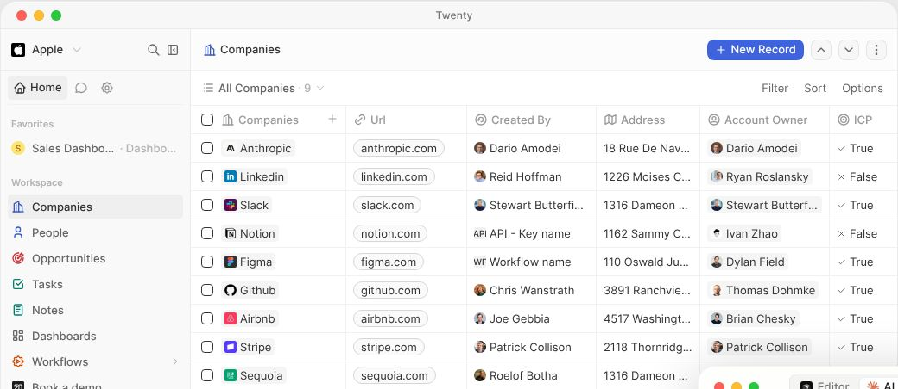

**Twenty.** Ícone em cada coluna, chips para links e pessoas, "Filter · Sort · Options" na mesma linha.

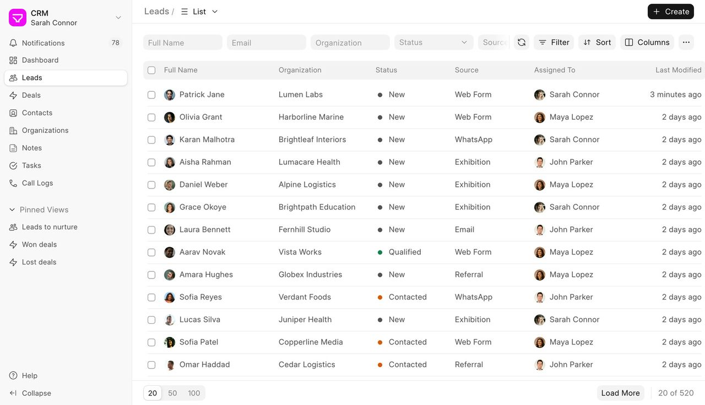

**Frappe.** Filtros rápidos no topo, status com ponto colorido, "Visões fixadas" na lateral, paginação 20/50/100.

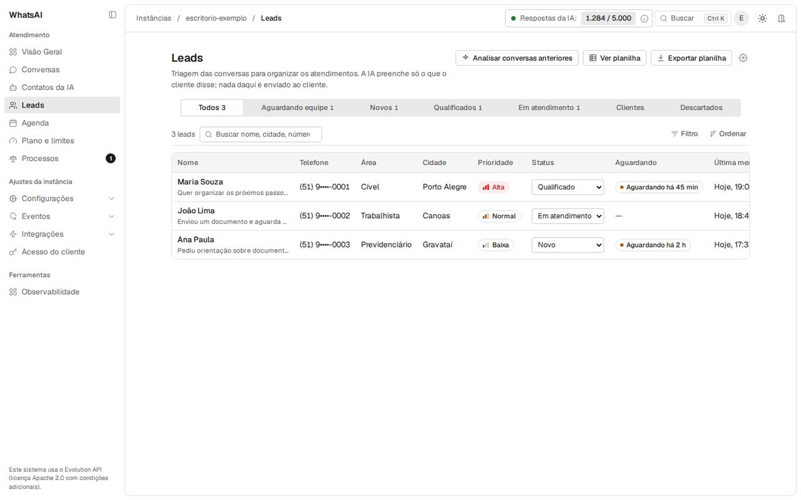

**WhatsAI hoje.** Abas por status e tabela densa, já próximo. Falta o quadro por status e fixar visões.

### Conversa no WhatsApp

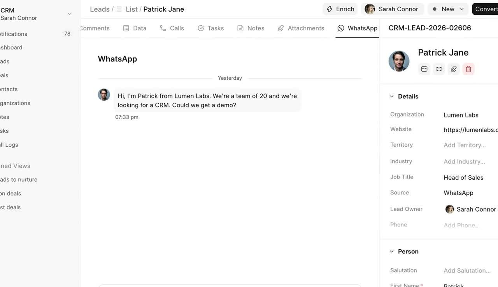

**Frappe.** O WhatsApp é uma aba dentro do lead; status, dono e dados ficam sempre visíveis à direita.

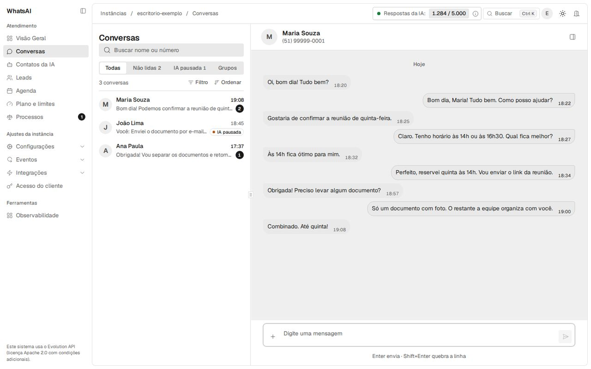

**WhatsAI hoje.** Conversa ótima, mas para ver área, status, próximo agendamento ou processo é preciso ir a outra tela.

### Tela inicial

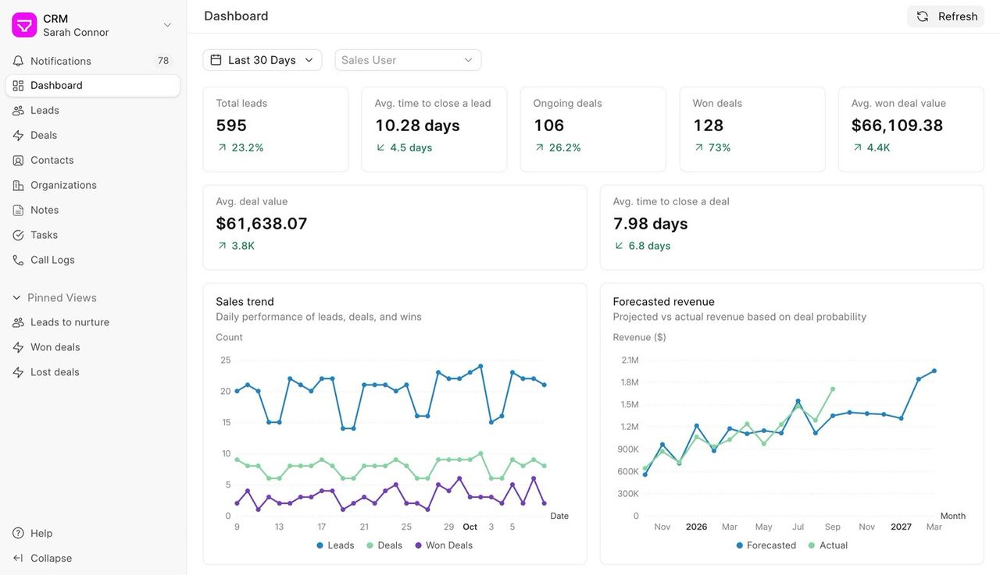

**Frappe.** Período no topo, números com variação, tendência diária. Responde "como estamos indo?".

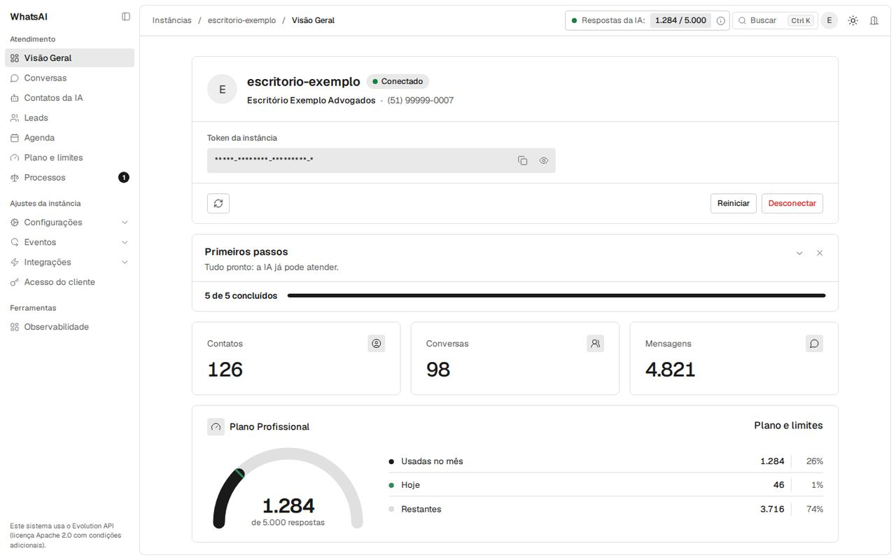

**WhatsAI hoje.** Token, Reiniciar e Desconectar no topo; contadores de contatos e mensagens sem período nem variação.

### Detalhes que dão o acabamento

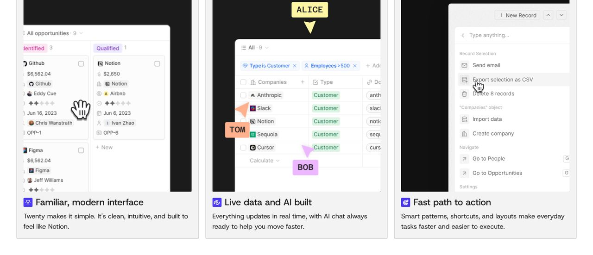

**Twenty.** Quadro por etapa, filtros em chips e Ctrl K com ações sobre os registros selecionados.

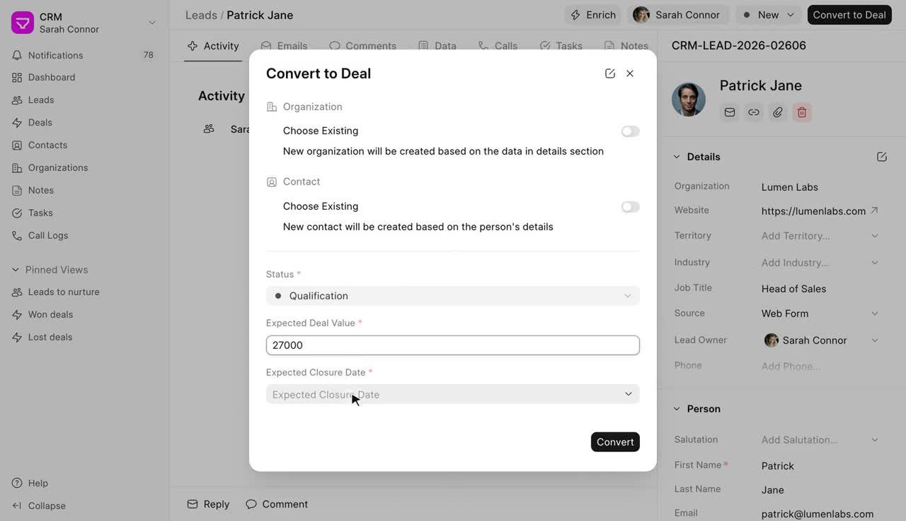

**Frappe.** "Converter" abre um diálogo de 3 campos sobre o próprio lead, sem trocar de tela.

Imagens do twenty.com e do frappe.io/crm (material de divulgação, dados fictícios deles) usadas só para comparação interna. Telas do WhatsAI com dados fictícios.

## Padrão por padrão

| Padrão | Twenty | Frappe | WhatsAI hoje | Proposta |
| --- | --- | --- | --- | --- |
| Abrir um lead | Painel lateral ou página | Página com abas e detalhes à direita | Gaveta com caixas de texto | A |
| Conversa e lead juntos | Não tem WhatsApp | Aba WhatsApp dentro do lead | Telas separadas | B |
| Quadro por status | Sim (kanban) | Sim (kanban de negócios) | Não | C |
| Visões fixadas | Favoritos | "Pinned views" na lateral | 1 visão salva no navegador | C |
| Tela inicial | Dashboards configuráveis | Números do período + tendência | Token, botões e contadores | D |
| Ctrl K | Busca + ações | Sem equivalente | Busca e navegação | E |
| Ícone por coluna, datas relativas | Sim | Sim ("3 minutos atrás") | Parcial | F |
| Notificações com contador | Sim | Sim, na lateral | Só badge em Processos | F |
| IA respondendo no WhatsApp | Não | Não | Sim (o diferencial) | Manter |

A

## Ficha do lead em página, com abas

Só painelEsforço médioInspirado no Frappe

whatsaibr.vercel.app/manager/instance/…/leads/maria-souza

WhatsAI

Visão GeralConversasLeads22AgendaProcessos1

Leads / **Maria Souza** Marcar consulta Aguardando equipe ▾ Virar cliente

AtividadeConversaAgenda 1ProcessosNotas 2

**Maria** mandou mensagem: "Preciso levar algum documento?"

há 8 min

IA marcou **Consulta** para qui, 14/11 às 14:00 confirmada

há 40 min

Triagem: área **Previdenciário**, prioridade Alta

há 1 h

Status mudou de **Novo** para **Aguardando equipe**

há 1 h

Primeira mensagem pelo WhatsApp

ontem 19:02

M

**Maria Souza**(51) 9••••-0001

Detalhes

Área

Previdenciário

Cidade

Campinas

Origem

WhatsApp

IA

ativa

Falta saber

Data de nascimento

Próximo passo

Conferir CNIS antes da consulta.

**Hoje**A gaveta mostra resumo, "falta saber" e próximo passo em caixas de texto grandes; o histórico não aparece.

**Como fica**Uma página por lead: linha do tempo com o que aconteceu (mensagens, triagem, agendamentos), status no topo e "Virar cliente" num diálogo curto. A gaveta continua para olhar rápido na lista.

B

## Conversa com a ficha do lead ao lado

Só painelEsforço médioInspirado no Frappe

Conversas

WhatsAI

Visão GeralConversas3LeadsAgendaProcessos

M

**Maria Souza**

Preciso levar algum documento?

19:08

J

**João Lima**

Você: Enviei o documento por e-mail

18:45

A

**Ana Paula**

Obrigada! Vou separar os documentos

17:37

Gostaria de confirmar a reunião de quinta-feira.18:25

IAClaro. Tenho horário às 14h ou às 16h30. Qual fica melhor?18:27

Às 14h fica ótimo para mim.18:32

IAPerfeito, reservei quinta às 14h.18:34

Preciso levar algum documento?19:08

Digite uma mensagemAssumir conversa

M

**Maria Souza**Lead · Previdenciário

IA

ativa

Status

Aguardando equipe

Prioridade

Alta

Agenda

**Consulta** · qui 14/11, 14:00\
online · lembrete enviado

Processos

Nenhum vinculado

Abrir ficha completa

**Hoje**Para saber se a IA está ativa, o status do lead ou o próximo horário, é preciso sair da conversa.

**Como fica**Painel recolhível à direita (como o Frappe), com o que a equipe precisa para responder: IA ativa ou pausada, status, próximo agendamento e processos. "Assumir conversa" pausa a IA com um clique.

C

## Leads em quadro por status e visões fixadas

Só painelEsforço médioInspirado no Twenty

Leads · Quadro

WhatsAI

ConversasLeadsAgenda

Visões fixadas

Aguardando equipe22Prioridade alta5Novos hoje4

ListaQuadro Área é Previdenciário ×Cidade é Campinas × FiltroOrdenarFixar visão

#### Novos *4*

**Carlos Mendes**

Previdenciário · Campinas

há 12 min

**Beatriz Rocha**

Previdenciário · Campinas

há 1 h

#### Aguardando equipe *2*

**Maria Souza**

Consulta qui 14:00

Altahá 45 min

**Ana Paula**

Falta: CNIS

há 2 h

#### Em atendimento *1*

**Rita Alves**

Equipe assumiu · IA pausada

#### Clientes *1*

**Paulo Nunes**

Processo 0001234-…

**Hoje**Abas por status numa tabela; a única visão salva fica no navegador de quem salvou.

**Como fica**Alternar Lista/Quadro; arrastar o cartão muda o status (o mesmo que o seletor de status faz hoje). "Fixar visão" põe filtros prontos na lateral, com contador. Visões ficam no navegador na primeira versão; no servidor depois, se fizer falta.

D

## Visão Geral com o resultado do escritório

Painel + 1 rota na APIEsforço médioInspirado no Frappe

Visão Geral

WhatsAI

Visão GeralConversasLeadsAgendaProcessos

**Visão Geral**Últimos 7 dias ▾WhatsApp conectado

Leads novos**36***↗ 12% vs semana passada*

Aguardando equipe**22***↗ 4 a mais*

1ª resposta**38 s***↘ 6 s mais rápido*

Agendamentos**14***↗ 3 a mais*

Respostas da IA**1.284***26% do plano*

**Últimos 30 dias**

Leads novosAgendamentos

**Hoje**

14:00 · Maria Souzaconfirmada

16:30 · João Limapendente

Processo com novidade1

Leads aguardando há mais de 2 h3

**Hoje**Token da instância, Reiniciar e Desconectar ocupam o topo; os contadores não têm período nem comparação.

**Como fica**A pergunta "como foi a semana?" respondida primeiro, com variação e a agenda do dia. Token, Reiniciar e Desconectar vão para Configurações > Conexão. Precisa de uma rota nova na API com as contagens por dia (reinicia a API uma vez).

E

## Ctrl K com ações

Só painelEsforço baixoInspirado no Twenty

Ctrl K

⌕ *Digite uma ação ou um nome…*

Nesta conversa (Maria Souza)

Pausar a IA neste contatoP

Marcar agendamento

Mudar status do lead

Criar

Novo agendamento

Adicionar processo pelo número CNJ

Ir para

Leads aguardando equipeG L

Exportar planilha de leads

**Hoje**O Ctrl K busca conversas e abre páginas.

**Como fica**As ações mais comuns a um atalho de distância, mudando conforme a tela aberta. Usa as mesmas rotas que os botões já usam.

F

## Acabamento: ícones nas colunas, datas relativas e notificações

Só painelEsforço baixoTwenty e Frappe

Leads · Lista

WhatsAI

Notificações5 Visão GeralConversasLeadsAgenda

| ◷ Nome | ☏ Telefone | ⚖ Área | ● Status | ⟳ Atualizado |
| --- | --- | --- | --- | --- |
| MMaria Souza | (51) 9••••-0001 | Previdenciário | Aguardando equipe | há 8 min |
| JJoão Lima | (51) 9••••-0002 | Trabalhista | Em atendimento | há 1 h |
| AAna Paula | (51) 9••••-0003 | Previdenciário | Novo | ontem |

**Hoje**Cabeçalhos só com texto, status num seletor em cada linha e hora absoluta; o aviso de novidade só existe em Processos.

**Como fica**Ícone discreto por coluna, status como chip com ponto (o seletor abre ao clicar), "há 8 min" com a hora exata ao passar o mouse e "Notificações" na lateral reunindo leads aguardando, agendamentos pendentes e processos com novidade. Junto entram os P0 da análise de UX do #80 (contraste no tema escuro, coluna cortada em 1440 px).

## Consistência, medida em 27 telas

Abri todas as páginas do painel (sem a landing) com dados fictícios e medi cada uma: título, botões, campos, cantos e largura do conteúdo. O Twenty e o Frappe repetem os mesmos poucos valores em todas as telas; o nosso painel ainda mistura os do Evolution original com os das páginas novas.

| Item | Hoje (medido) | Twenty / Frappe | Proposta (L) |
| --- | --- | --- | --- |
| Título da página | 20 px nas páginas da instância; 24 px em Chaves, Retenção e Observabilidade; Instâncias sem título | Um tamanho em todas as telas | 20 px semibold, sempre com uma linha de descrição |
| Altura dos botões | 8 alturas: 24, 25, 26, 28, 30, 32, 34 e 36 px | Twenty 32/24 · Frappe 32/28 | 32 px padrão, 28 px em barras e tabelas |
| Cantos dos botões | 4 px (152), 6 px (15) e 0 px (10, nos seletores da Agenda e de Processos) | Um raio para controles | 6 px em botões, campos e seletores |
| Altura dos campos | 32, 30, 28 e 26 px | Um padrão | 32 px em formulários, 28 px em filtros |
| Cantos dos cartões | 8 px (35), 4 px (17) e 6 px (15) | Um raio para cartões | 8 px |
| Largura do conteúdo | Começa em x=308 na maioria; Visão Geral em 397, Retenção em 465, Chaves em 325 | Mesma coluna em todas as telas | Uma largura (1040 px); tela cheia só em Conversas, Agenda, Planilha e Instâncias |
| Maiúsculas nos rótulos | "Configurações Padrão", "Marcar Todos", "Carregar Modelos", "Assinar Mensagens" nas telas herdadas | Só a 1ª letra maiúscula | "Configurações padrão", "Marcar todos"… |
| Estado vazio | Leads e Contatos da IA com ícone, explicação e ação; Typebot só "Nada para mostrar" | Sempre explica e oferece a próxima ação | Um componente único em todas as listas |
| Celular | Leads com botões em 3 linhas; Processos e Instâncias com a tabela cortada | Lista vira linhas empilhadas | Linhas-cartão e ações extras no menu "…" (K) |

[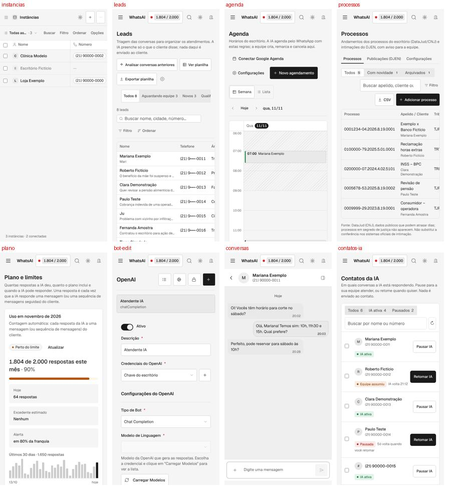](img/p/sheet-light-390.jpg)

**Celular hoje (390 px).** Conversas, Agenda e Contatos da IA já se adaptam; Instâncias, Leads e Processos ainda mostram a tabela cortada.

[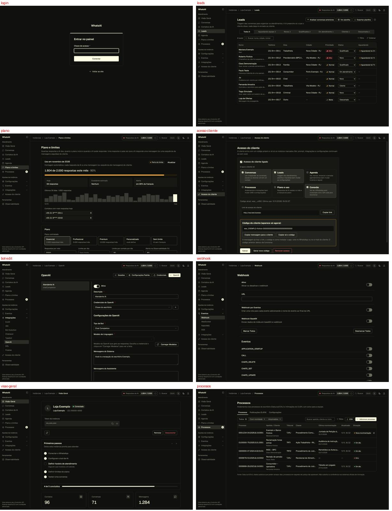](img/p/sheet-dark-1440.jpg)

**Tema escuro hoje.** Consistente na maior parte. Ficam os pontos do #80: o contraste do botão do login e alguns ícones fixos em cinza claro.

## O painel inteiro, página por página

Cada cartão mostra a tela de hoje (clique para ampliar), o nível de acabamento frente ao Twenty e ao Frappe e as propostas que a melhoram. Bom já está no nível deles, Médio precisa de ajustes, Fraco pede redesenho.

Entrada e espaço de trabalho

[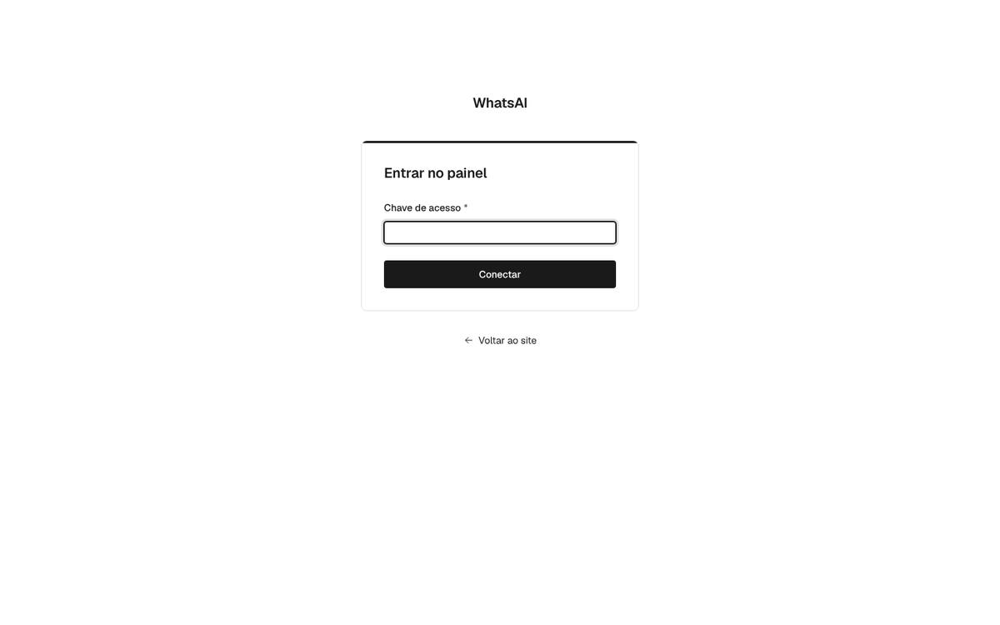](img/p/login.jpg)

#### Login do administrador

Médio

Cartão simples e funcional. No escuro, o botão perde contraste. Não tem o atalho "Sou cliente" para quem caiu aqui por engano.

Proposta: [L](#prop-l) + link para /acesso

[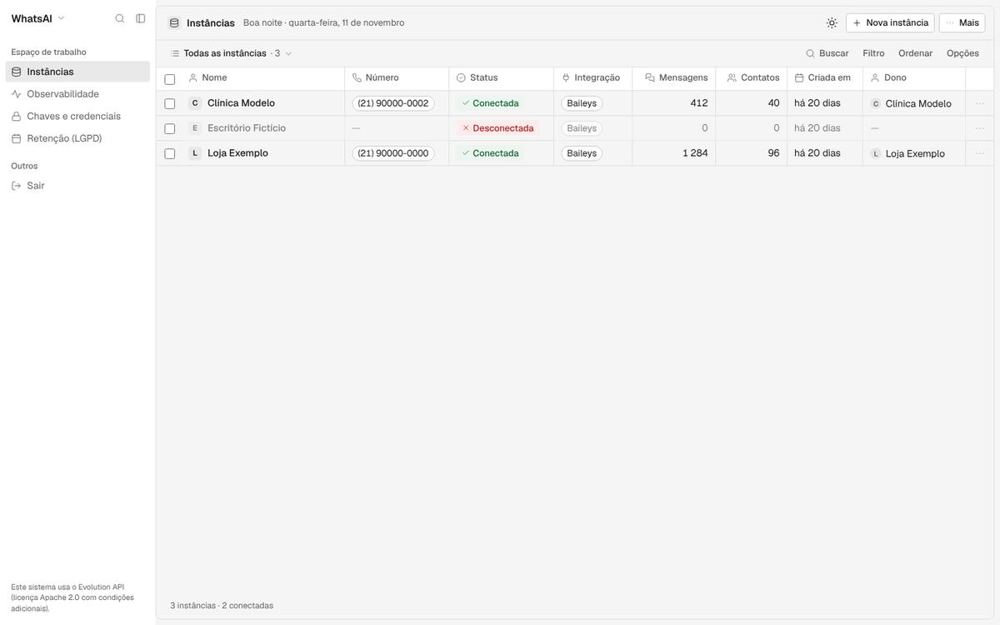](img/p/instancias.jpg)

#### Instâncias

Bom

Já no estilo do Twenty: ícone por coluna, chips de status, Buscar, Filtro e Ordenar. No celular só cabem 2 colunas.

Proposta: [K](#prop-k)

[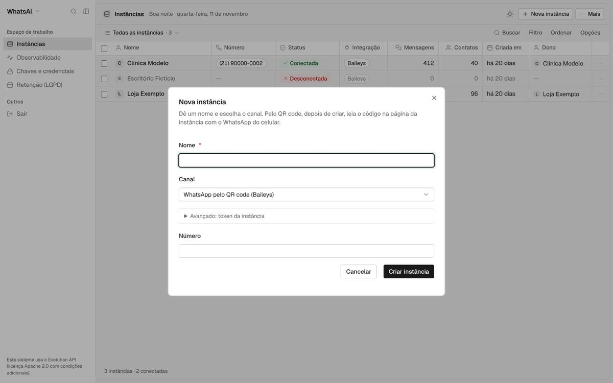](img/p/nova-instancia.jpg)

#### Nova instância

Bom

Diálogo curto, com o "avançado" recolhido. Igual ao padrão do Frappe.

Sem mudança

[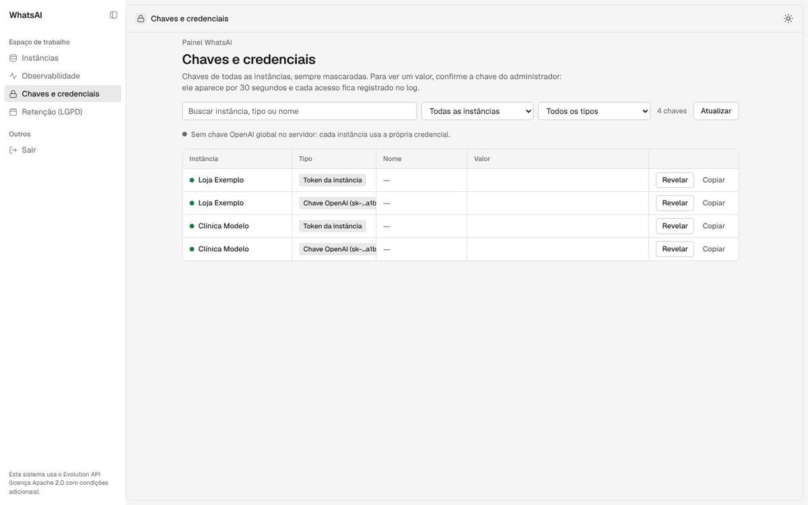](img/p/chaves.jpg)

#### Chaves e credenciais

Médio

Título de 24 px com um rótulo "Painel WhatsAI" acima, que nenhuma outra página tem. Filtros em seletor nativo e largura própria.

Proposta: [G](#prop-g) [L](#prop-l)

[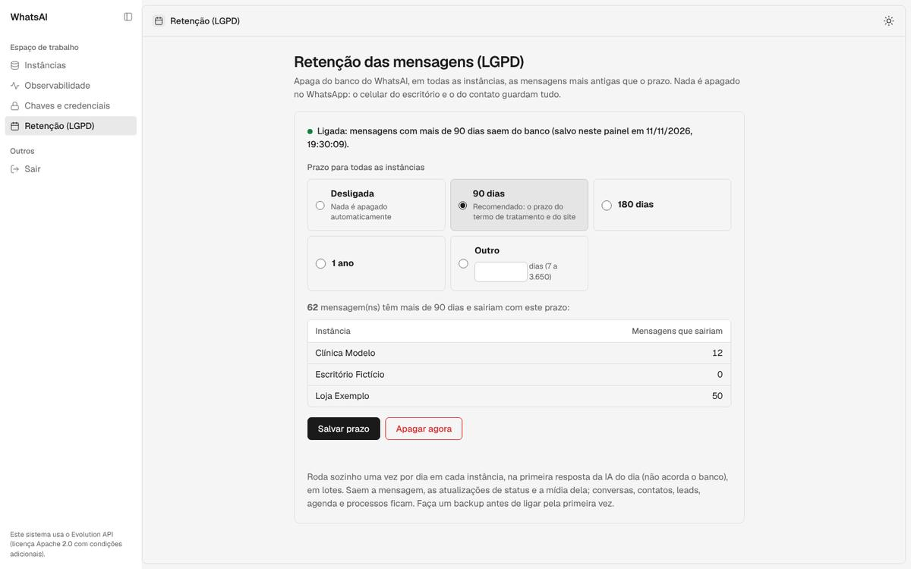](img/p/retencao.jpg)

#### Retenção (LGPD)

Médio

O conteúdo é ótimo (prévia por instância, confirmação). Mas o cartão é estreito e centralizado, o título tem 24 px e as opções ficam em blocos cinza de outro estilo.

Proposta: [G](#prop-g) [L](#prop-l)

[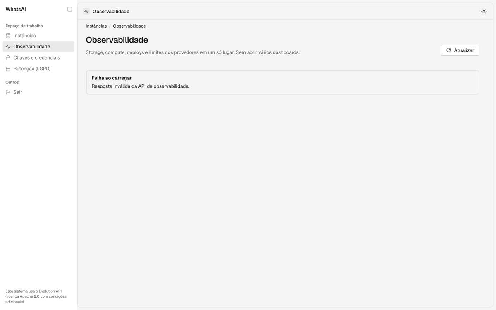](img/p/obs-global.jpg)

#### Observabilidade

Médio

A trilha "Instâncias / Observabilidade" aparece duas vezes (no cabeçalho e dentro da página), e o título tem 24 px. Aqui aparece em erro porque a captura usa dados simulados.

Proposta: [G](#prop-g)

Atendimento

#### Visão Geral

Fraco

Começa pelo token, Reiniciar e Desconectar. Os números não têm período nem comparação, e a coluna é mais estreita que as outras páginas.

Proposta: [D](#prop-d) [G](#prop-g)

[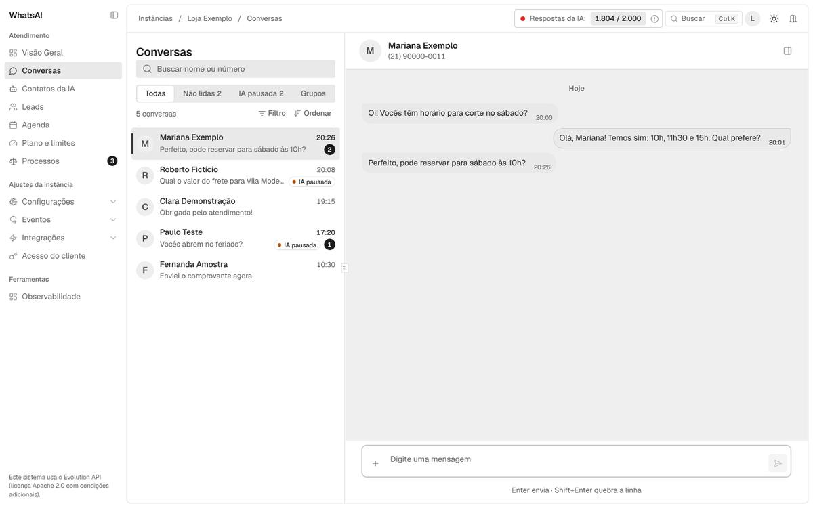](img/p/conversas.jpg)

#### Conversas

Bom

Lista e conversa bem resolvidas, com filtros de IA pausada. Falta o que o Frappe mostra ao lado: status do lead, agenda e processos.

Proposta: [B](#prop-b) [E](#prop-e)

[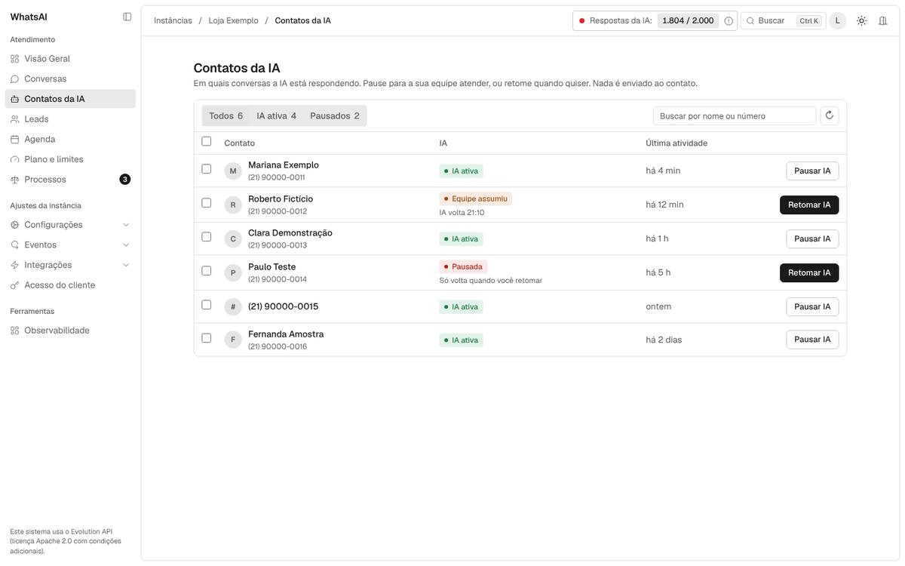](img/p/contatos-ia.jpg)

#### Contatos da IA

Bom

Lista no estilo Twenty, com seleção em massa. Os botões têm 30 px e cantos de 6 px, diferentes do resto do painel.

Proposta: [L](#prop-l)

[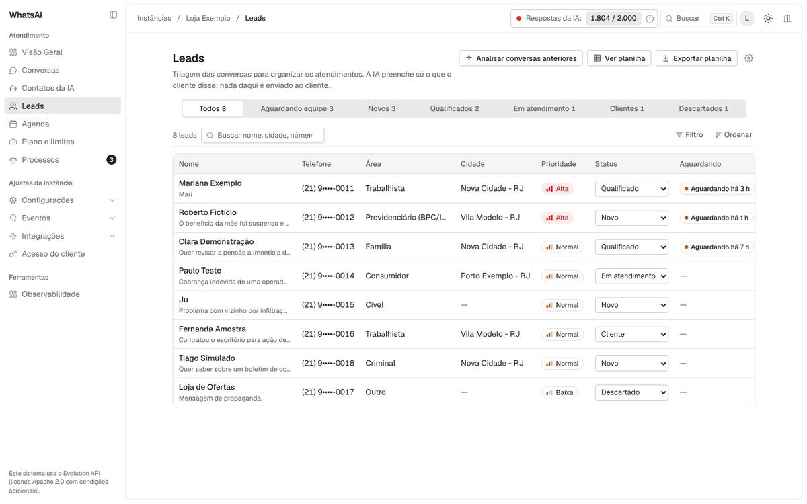](img/p/leads.jpg)

#### Leads

Bom

A tela mais próxima do Twenty. Faltam a ficha em página, o quadro por status e visões fixadas. No celular os botões quebram em 3 linhas.

Proposta: [A](#prop-a) [C](#prop-c) [F](#prop-f) [K](#prop-k)

[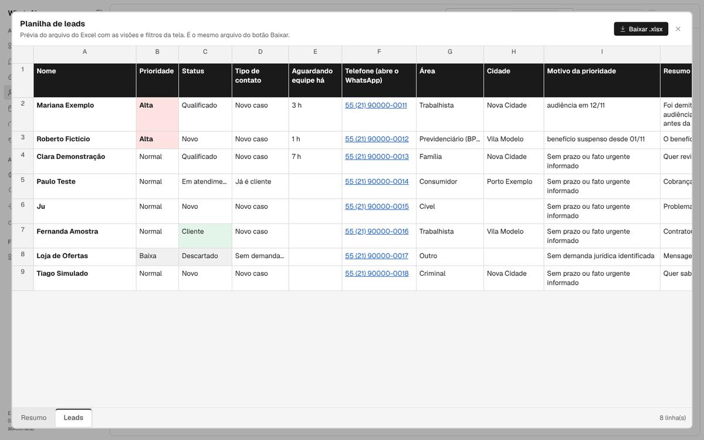](img/p/planilha-leads.jpg)

#### Planilha de leads

Bom

Prévia fiel do Excel antes de baixar; nenhum dos dois CRMs tem algo assim.

Sem mudança

[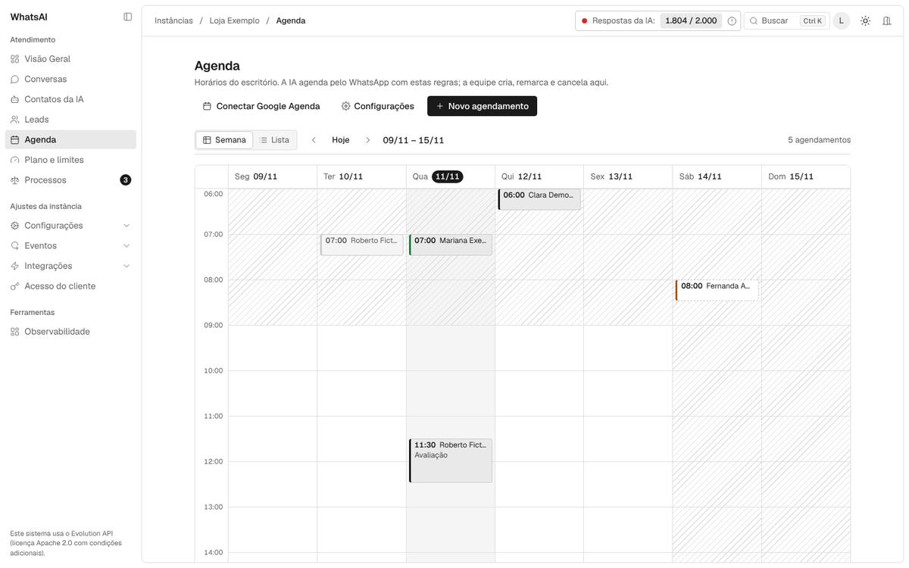](img/p/agenda.jpg)

#### Agenda (semana)

Bom

Semana com horários fora do expediente hachurados e o dia de hoje marcado. Os botões variam de 26 a 34 px e o seletor Semana/Lista tem cantos retos.

Proposta: [L](#prop-l)

[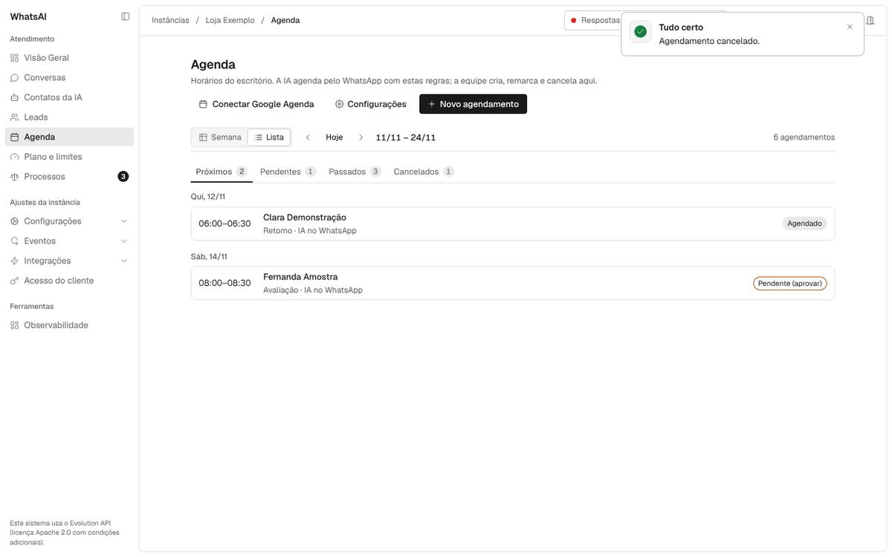](img/p/ag-lista.jpg)

#### Agenda (lista)

Bom

Abas Próximos, Pendentes, Passados e Cancelados com contagem, no padrão do Cal.diy.

Proposta: [L](#prop-l)

[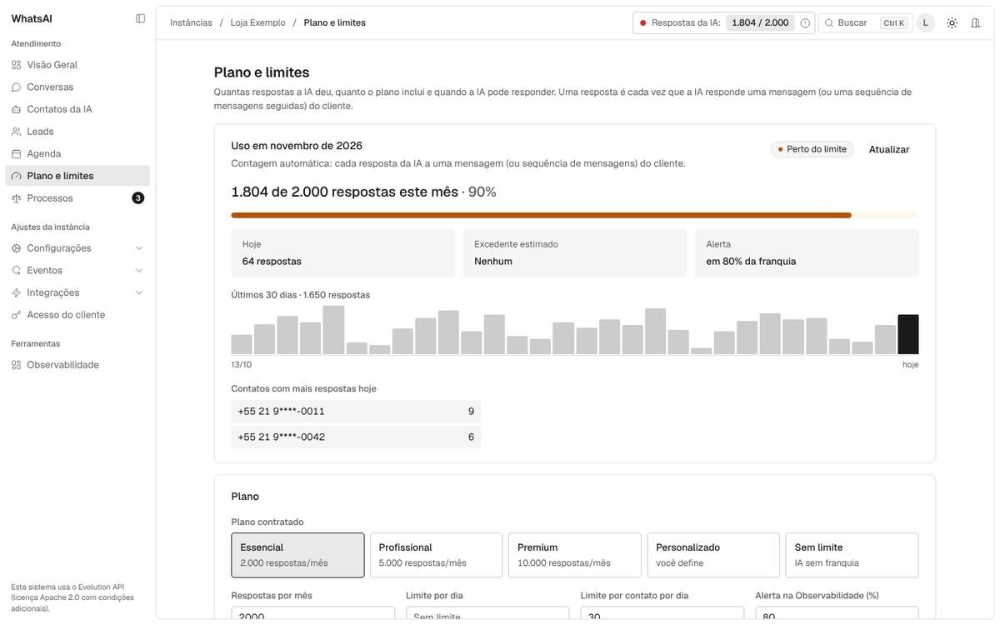](img/p/plano.jpg)

#### Plano e limites

Médio

Uso do mês claro, com barra e gráfico de 30 dias. O formulário do plano vem logo abaixo, num cartão com cantos e espaçamentos diferentes.

Proposta: [L](#prop-l) [H](#prop-h)

[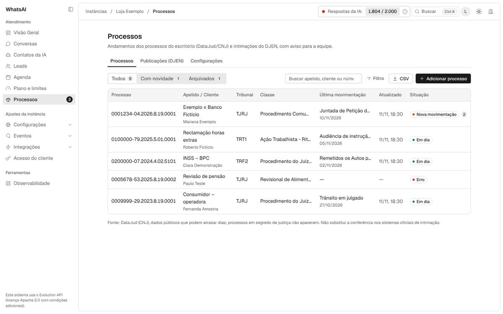](img/p/processos.jpg)

#### Processos

Bom

Abas sublinhadas, busca e filtro na mesma linha, situação com ponto colorido. No celular, a tabela fica cortada.

Proposta: [K](#prop-k) [L](#prop-l)

Ajustes da instância

[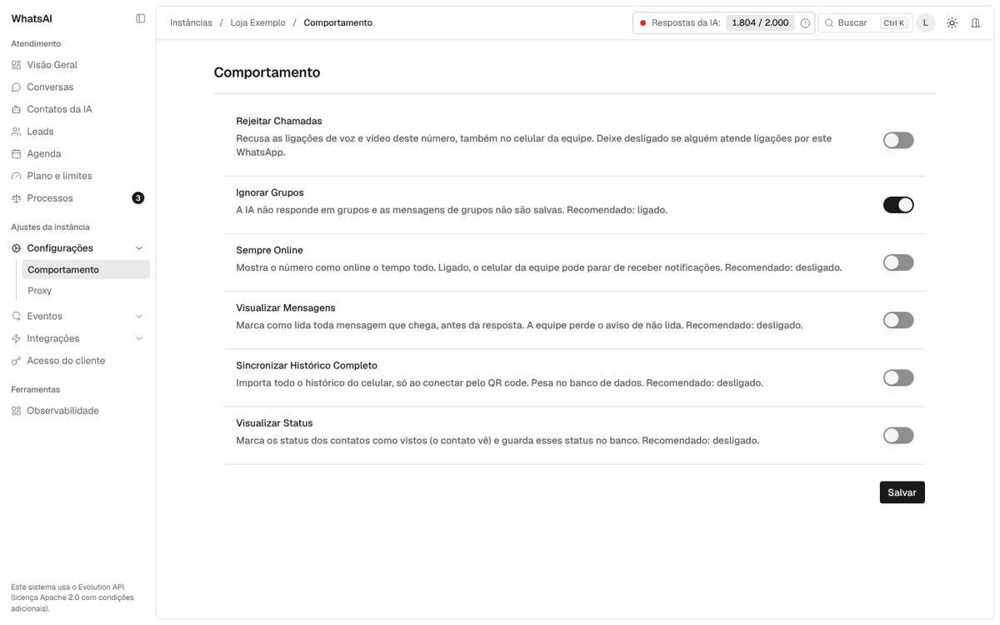](img/p/configuracoes.jpg)

#### Comportamento

Médio

Interruptores com boas explicações e recomendação. Falta a descrição sob o título, e o "Salvar" fica sozinho no fim, longe de quem mudou o primeiro item.

Proposta: [H](#prop-h) [L](#prop-l)

[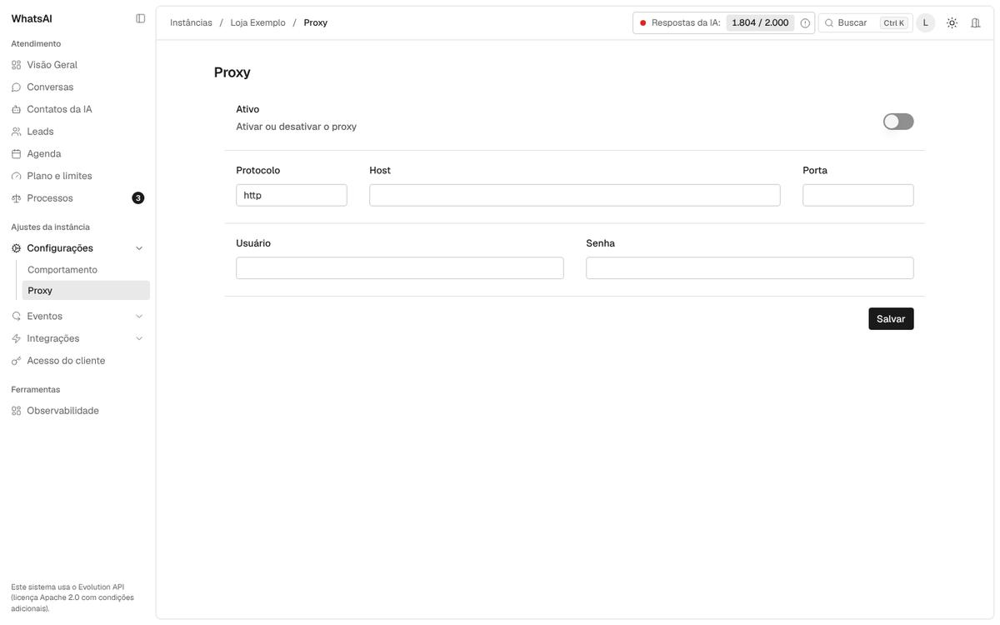](img/p/proxy.jpg)

#### Proxy

Médio

Formulário técnico sem explicação de quando usar. O botão Salvar fica no canto e os campos de largura não seguem uma grade.

Proposta: [H](#prop-h) [L](#prop-l)

[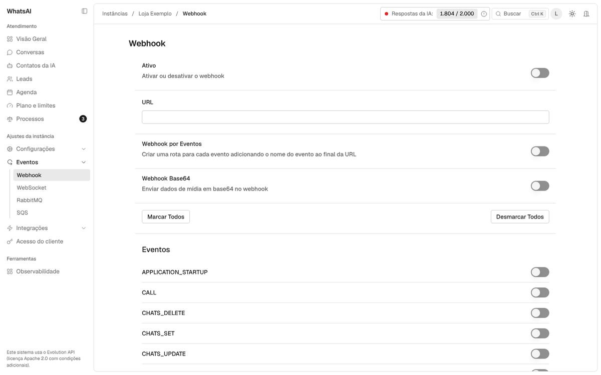](img/p/webhook.jpg)

#### Webhook

Fraco

27 eventos em CAIXA ALTA técnica (APPLICATION_STARTUP, CHATS_SET…), um embaixo do outro, com "Marcar Todos". Não há como testar a URL.

Proposta: [I](#prop-i)

[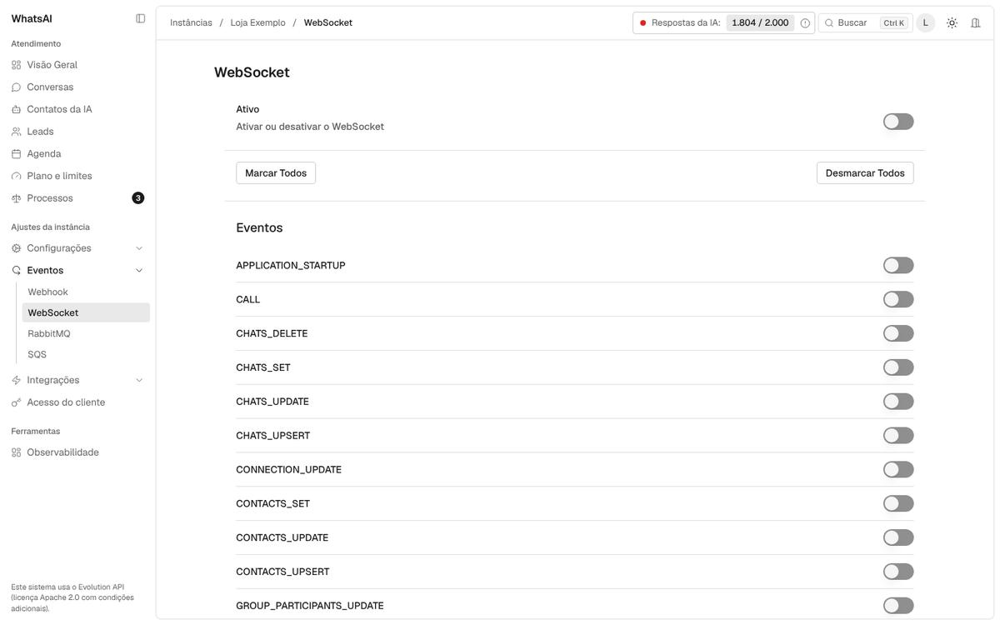](img/p/p-ws.jpg)

#### WebSocket, RabbitMQ e SQS

Fraco

As mesmas listas de eventos, repetidas em quatro telas. Para quem atende pelo WhatsAI, o menu "Eventos" com quatro subitens é ruído.

Proposta: [I](#prop-i) [J](#prop-j)

[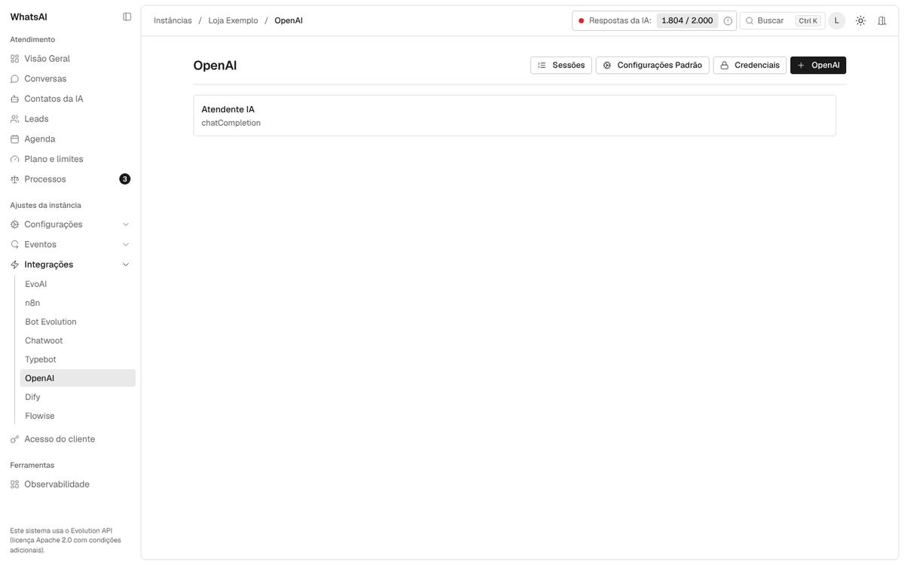](img/p/bot-lista.jpg)

#### OpenAI (lista de bots)

Fraco

Um cartão "Atendente IA · chatCompletion" e quatro botões com Maiúsculas ("Configurações Padrão"). É a tela mais importante do produto, e está escondida em Integrações.

Proposta: [H](#prop-h) [J](#prop-j)

[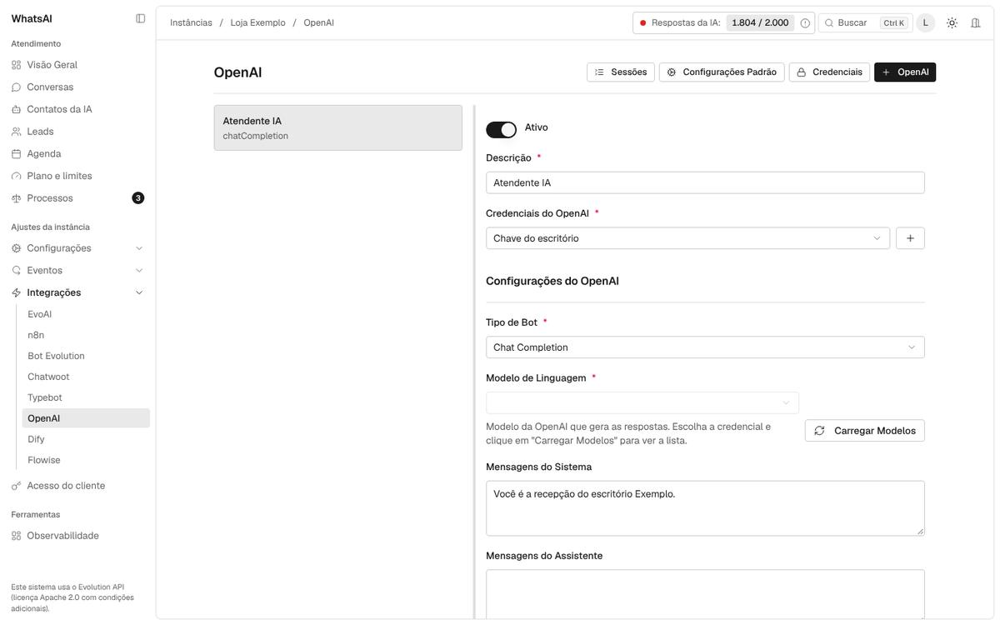](img/p/bot-edit.jpg)

#### OpenAI (ficha do atendente)

Fraco

Um formulário longo com termos técnicos ("Tipo de Bot", "Chat Completion", "Modelo de Linguagem", "Mensagens do Assistente") e sem seções nem navegação.

Proposta: [H](#prop-h)

[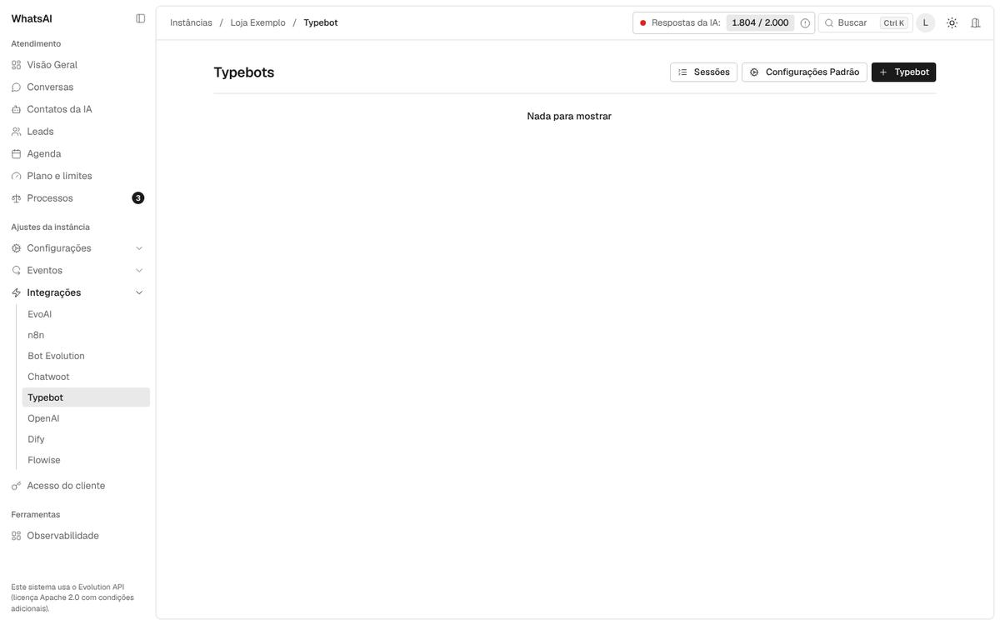](img/p/p-typebot.jpg)

#### Typebot, n8n, Dify e outras

Fraco

Oito subitens no menu, cada um com "Nada para mostrar" quando vazio e sem dizer para que serve.

Proposta: [J](#prop-j) [L](#prop-l)

[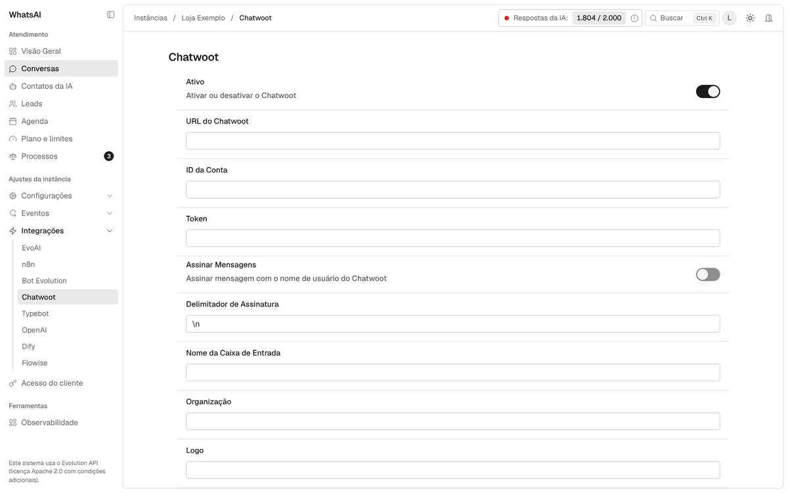](img/p/p-chatwoot.jpg)

#### Chatwoot

Fraco

Dez campos soltos em largura total, sem grupos, sem "testar conexão" e com rótulos em Maiúsculas. Além disso, o item Conversas aparece marcado no menu nesta tela.

Proposta: [H](#prop-h) [J](#prop-j)

[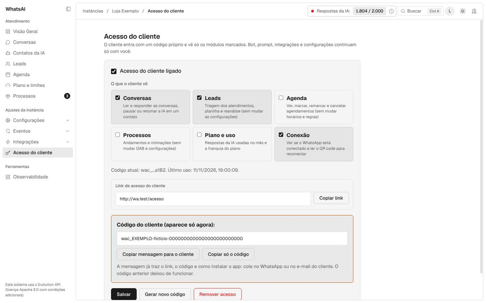](img/p/acesso-cliente.jpg)

#### Acesso do cliente

Bom

Fluxo completo: módulos, link, mensagem pronta e código. O cartão é cinza com cantos de 6 px, fora do padrão.

Proposta: [L](#prop-l)

[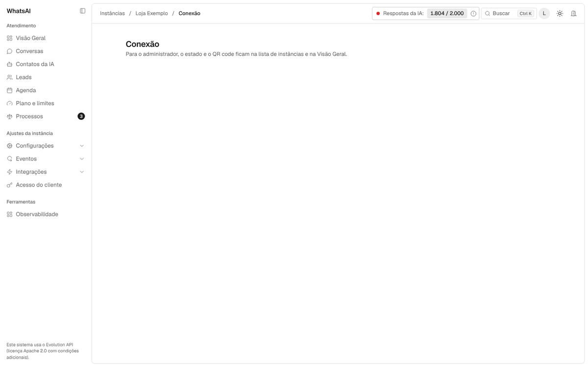](img/p/conexao.jpg)

#### Conexão (administrador)

Fraco

Página quase vazia, só com um aviso. Não aparece no menu do administrador, mas abre por endereço.

Proposta: [G](#prop-g): levar à Visão Geral

G

## Um cabeçalho e uma largura para todas as páginas

Só painelEsforço baixoTwenty e Frappe

Chaves e credenciais

WhatsAI

Espaço de trabalho

InstânciasObservabilidadeChaves e credenciaisRetenção (LGPD)

Espaço de trabalho / **Chaves e credenciais**◐

### Chaves e credenciais

Chaves de todas as instâncias, sempre mascaradas. Para ver uma, confirme a chave de administrador; cada acesso fica registrado.

Atualizar

Buscar instância ou nomeTipo: todos ▾Instância: todas ▾4 chaves

| Instância | Tipo | Valor |  |
| --- | --- | --- | --- |
| Escritório Exemplo | Token da instância | •••••••• | Revelar |
| Escritório Exemplo | Chave OpenAI | sk-…a1b2 | Revelar |

**Hoje**As páginas do espaço de trabalho (Chaves, Retenção, Observabilidade) têm título de 24 px, rótulo extra, larguras próprias e, em Observabilidade, a trilha repetida dentro da página. A Visão Geral usa uma coluna mais estreita. A Conexão do administrador é uma página vazia.

**Como fica**Todas as páginas com o mesmo cabeçalho (trilha, título de 20 px, uma linha de descrição, ações à direita) e a mesma largura de conteúdo. A trilha aparece só no topo, e a Conexão do administrador leva direto à Visão Geral.

H

## Atendente IA com seções e linguagem simples

Só painelEsforço médioConfigurações do Twenty e do Frappe

Atendente IA · Instruções

WhatsAI

Visão GeralConversasLeads

Ajustes da instância

Atendente IAComportamentoIntegraçõesAcesso do cliente

Atendente IA / **Instruções**LigadoTestar uma conversa

IdentidadeInstruçõesQuando responderHorário de atendimentoMensagens longasAvançadoModelo e chavePausa humana

Instruções para a IA

Você é a recepção do Escritório Exemplo. Faça a triagem com educação: pergunte a área do problema, a cidade e se já existe processo. Nunca prometa resultado…

É o "prompt". A IA segue estas instruções em todas as conversas.

Modelo

Rápido e econômico ▾

Chave da OpenAI

Chave do escritório ▾

Quando a IA responde

A todas as mensagensSó quando a mensagem tiver uma palavra-chaveNunca (só a equipe)

DescartarSalvar alterações

**Hoje**A tela que define como a IA atende fica em Integrações > OpenAI. É um formulário único e longo, com termos da API ("Tipo de Bot: Chat Completion", "Mensagens do Assistente", "Carregar Modelos") e 4 botões no topo.

**Como fica**"Atendente IA" vira item próprio no menu, com seções à esquerda como as configurações do Twenty e do Frappe. Os rótulos ficam em linguagem simples, há um botão "Testar uma conversa" e "Salvar" aparece no fim de cada seção. Os campos e a API continuam os mesmos; só a organização muda. O mesmo padrão de seções serve a Comportamento, Proxy e Plano.

I

## Eventos em grupos, com teste de envio

Só painelEsforço médio

Integrações · Webhook

### Webhook

Envia os acontecimentos desta instância para outro sistema (n8n, Make, seu servidor).

Ligado

Endereço (URL)

https://exemplo.n8n.cloud/webhook/whatsai

Enviar testeÚltimo teste: 200 OK

**Mensagens**4 de 5▾

Mensagem recebida ou enviada`MESSAGES_UPSERT`

Mensagem lida ou entregue`MESSAGES_UPDATE`

Mensagem apagada`MESSAGES_DELETE`

**Conexão do WhatsApp**1 de 2▸

**Conversas e contatos**0 de 9▸

**Hoje**27 interruptores com nomes técnicos em CAIXA ALTA, repetidos em Webhook, WebSocket, RabbitMQ e SQS, sem forma de testar.

**Como fica**Eventos em 4 grupos com nome em português e o código técnico pequeno ao lado, para quem integra. Um botão "Enviar teste" mostra a resposta do servidor. O mesmo componente atende as quatro telas.

J

## Integrações em catálogo, no lugar de 12 subitens

Só painelEsforço baixoTwenty e Frappe

Integrações

### Integrações

Conecte esta instância a outros sistemas. O atendimento por IA fica em "Atendente IA".

AI**OpenAI**

A chave e o modelo usados pelo Atendente IA.

LigadaConfigurar

WH**Webhook**

Envia mensagens e eventos para outro sistema.

DesligadoConfigurar

CW**Chatwoot**

Atenda o WhatsApp dentro do Chatwoot.

DesligadoConfigurar

n8**n8n**

Automações com fluxos visuais.

DesligadoConfigurar

TB**Typebot**

Fluxos de perguntas e respostas montados no Typebot.

DesligadoConfigurar

+4**Outras**

Dify, Flowise, EvoAI, Bot Evolution, WebSocket, RabbitMQ e SQS.

Para quem integraVer todas

**Hoje**O menu lateral abre "Eventos" (4 subitens) e "Integrações" (8 subitens), sem dizer para que serve cada um nem quais estão ligados.

**Como fica**Uma página de catálogo, como as de integrações do Twenty e do Frappe: um cartão por integração, com uma frase e o estado (ligada ou desligada). As raras ficam em "Outras". O menu da instância perde 12 subitens e ganha "Atendente IA" (H).

K

## Celular: listas em linhas empilhadas

Só painelEsforço médioPadrão móvel do Frappe

**Leads**Filtro…

Todos 8Aguardando 3Novos 3

**Maria Souza**há 45 min

Previdenciário · Campinas

AltaAguardando equipe

**João Lima**há 1 h

Trabalhista · Canoas

Em atendimento

**Ana Paula**ontem

Previdenciário · Gravataí

Novo

**Processos**+…

Todos 5Com novidade 1Arquivados

**Aposentadoria Maria**nova

0001234-04.2026.8.19.0001 · TJRJ

Juntada de petição · 10/11

**Horas extras João**em dia

0100000-79.2025.5.01.0001 · TRT1

Audiência de instrução · 05/11

**INSS – BPC**em dia

0200000-07.2024.4.02.5101 · TRF2

**Hoje**No celular, Leads empilha 4 botões em 3 linhas e as abas saem da tela. Processos e Instâncias mostram a tabela cortada, com rolagem lateral.

**Como fica**Abaixo de 640 px, cada linha da tabela vira um bloco com nome, a informação principal e os chips. As ações secundárias vão para o menu "…" e as abas rolam de lado. No computador, nada muda.

L

## Um sistema visual só, aplicado em todas as telas

Só painelEsforço médio (passa por todos os patches)Base para as outras propostas

Regras para todas as páginas

##### Botões · 2 tamanhos, cantos de 6 px

Salvar alteraçõesCancelar32 px · padrão

FiltroOrdenar28 px · barras e tabelas

##### Cabeçalho de página

**Plano e limites**

Uma linha que diz para que serve a página.

Ações à direita, na mesma linha do título

##### Rótulos: só a 1ª letra maiúscula

Configurações Padrão→Configurações padrão

Marcar Todos→Marcar todos

Modelo de Linguagem→Modelo

##### Estado vazio

**Nenhum fluxo do Typebot ainda**Ligue um fluxo para a IA passar a conversa para ele quando o contato escolher uma opção.Adicionar fluxo

**Hoje**Botões com 8 alturas e 3 raios diferentes, cartões com 3 raios, títulos de 20 ou 24 px, maiúsculas variando conforme a página venha do Evolution ou seja nova, e estados vazios de três jeitos.

**Como fica**Uma folha única de regras (tamanhos, raios, cabeçalho, maiúsculas, estado vazio) aplicada a todos os patches, com capturas antes e depois de cada tela nos dois temas. É o que deixa o painel com cara de produto único, como o Twenty.

## Componente por componente

Recortei cada componente direto das nossas telas, no estado real (com filtro aberto, diálogo aberto, aviso na tela), e pus ao lado o padrão do Twenty e do Frappe e a proposta. O que o Twenty faz de diferente não é ter componentes mais bonitos: é ter **um de cada**, usado igual em todas as telas. A proposta [M](#prop-m) junta tudo isso.

### Abas e seletores de visão 5 estilos hoje

Hoje

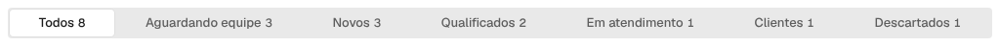 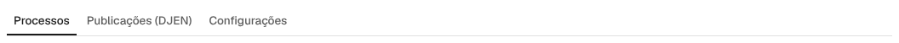 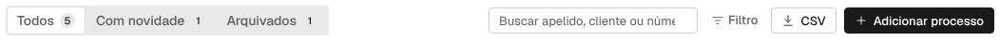 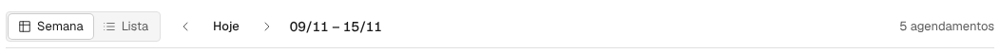 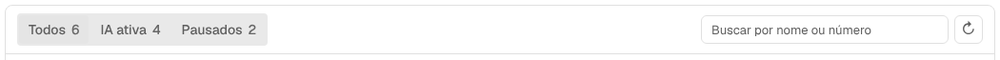

- Sublinhado em Processos, cinza em Leads, contagem em caixinha em Processos, contagem solta em Contatos, cantos retos na Agenda.

Twenty / Frappe

**Twenty:** visões num seletor só ("All companies · 9 ▾"). **Frappe:** abas sublinhadas para as seções do registro e o mesmo seletor para as visões da lista.

Proposta

Seções de uma página: abas sublinhadas

ProcessosPublicaçõesConfigurações

Filtros de uma lista: seletor, com contagem sempre igual

Todos*8*Aguardando*3*Novos*3*

- Dois tipos e regra clara: abas sublinhadas para trocar de seção, seletor para filtrar a mesma lista.
- Contagem sempre em fonte mono e cinza, nunca em caixinha.

### Botões do cabeçalho da página 3 estilos hoje

Hoje

  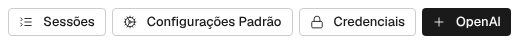

- Leads com contorno, Agenda sem contorno e com o primário mais alto, OpenAI com Maiúsculas Em Cada Palavra.
- O ícone de engrenagem sozinho em Leads não diz o que faz.

Twenty / Frappe

Um primário escuro por tela ("New Record", "Create") e os outros como texto com ícone; ações raras no menu "…".

Proposta

Ver planilhaExportar…Analisar conversas

- No máximo um botão escuro por tela, à direita.
- Secundários sem contorno; o resto no "…" (que no celular junta tudo).
- Ícone sozinho só com nome ao passar o mouse.

### Seletores e filtros nativos do navegador misturados aos do painel

Hoje

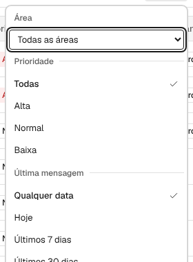 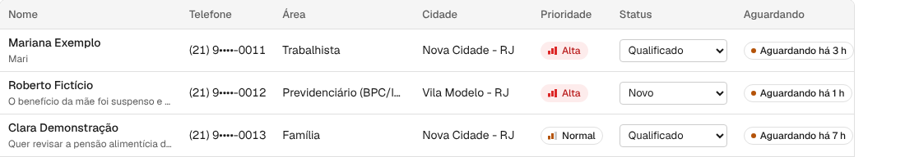

- Dentro do menu Filtro, "Área" é um seletor nativo; "Prioridade" é uma lista com marca. São dois componentes no mesmo menu.
- Cada linha de Leads tem um seletor nativo de status, que pesa a tabela e muda de cara a cada navegador.

Twenty / Frappe

**Twenty:** filtros viram chips na barra ("Type is Customer ×") e todos os menus são do mesmo componente. **Frappe:** filtros rápidos no topo da lista.

Proposta

Área é Previdenciário ×Prioridade é Alta ×+ Filtro

Aguardando equipe ▾

StatusNovoAguardando equipe ✓Em atendimentoCliente

- Um só seletor do painel (busca, teclado, mesmo visual nos dois temas) no lugar dos nativos.
- Filtros aplicados ficam visíveis como chips na barra.
- Status na tabela como chip que abre o menu ao clicar.

### Chips de status 6 variações hoje

Hoje

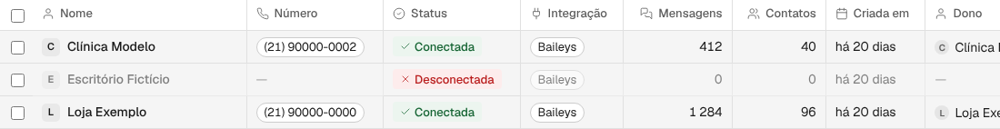 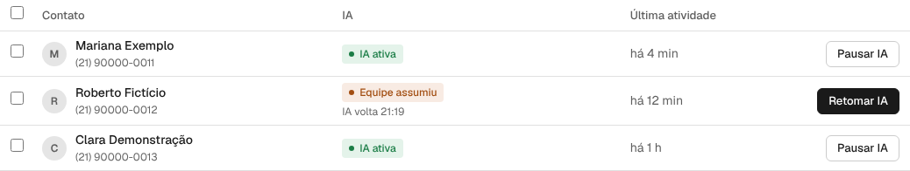 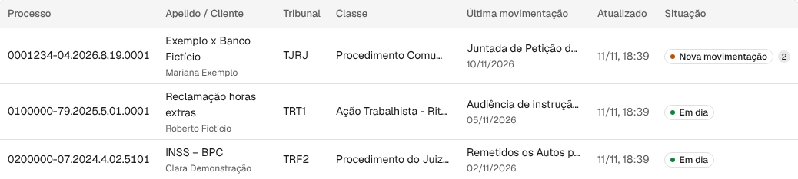

- Instâncias: texto verde com "✓" e sem fundo. Contatos: fundo e ponto. Processos: chip menor.
- Leads: barra de sinal na prioridade e contorno no "Aguardando". Agenda: chip cinza, contorno laranja ou verde cheio.

Twenty / Frappe

**Twenty:** uma etiqueta (fundo suave, canto de 4 px) em todas as tabelas. **Frappe:** ponto colorido e texto, sempre igual.

Proposta

NovoConectadaAguardando 3 hAltaEm atendimento

- Um chip com 5 tons (neutro, ok, atenção, erro, informação), sempre com ponto e fundo suave.
- A cor sempre significa a mesma coisa em todas as telas.

### Tabelas alturas de linha e cabeçalhos diferentes

Hoje

 

- Instâncias com ícone no cabeçalho e linha de 22 px; Leads sem ícone e linha de 31 px; Contatos com 34 px.
- A seleção em massa só existe em Contatos da IA e Instâncias.

Twenty / Frappe

Linhas de altura fixa (Twenty 32 px, Frappe \~44 px), cabeçalho com ícone do tipo de campo, linha destacada ao passar o mouse e seleção em massa em todas as listas.

Proposta

| ◷ Nome | ⚖ Área | ● Status | ⟳ Atualizado |
| --- | --- | --- | --- |
| Maria Souza | Previdenciário | Aguardando | há 8 min |
| João Lima | Trabalhista | Em atendimento | há 1 h |

- Linha de 36 px em todas as tabelas, cabeçalho com ícone e destaque ao passar o mouse.
- Caixa de seleção e ações em massa onde houver ação em lote (Leads, Processos, Instâncias).

### Diálogos, gavetas e confirmações 3 formatos, sem regra

Hoje

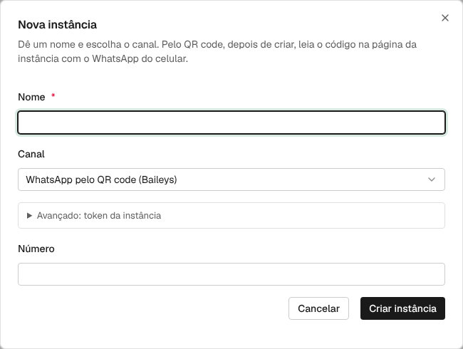 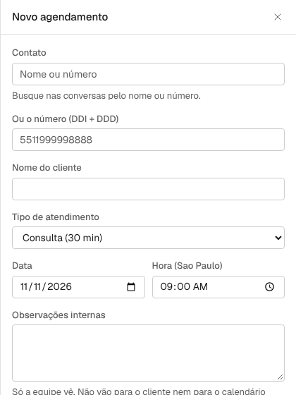 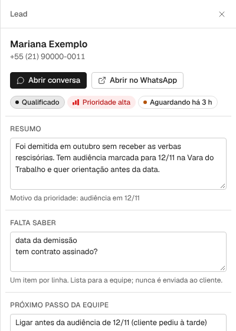 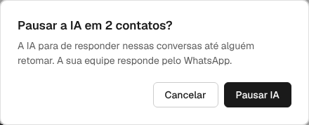

- Criar instância abre no centro, criar agendamento abre de lado; ver um lead abre de lado.
- Data e hora usam os campos do navegador (em inglês mostram "AM").
- A confirmação (WaPortal.ask) está boa e já é a mesma em todo o painel.

Twenty / Frappe

**Twenty:** registro no painel lateral; criar algo pequeno no próprio lugar (linha nova). **Frappe:** criar e converter em diálogo central curto ("Convert to Deal"); o registro abre em página.

Proposta

- **Diálogo central** para criar algo com até 6 campos (instância, agendamento, processo).
- **Gaveta lateral** só para ver ou editar um registro sem sair da lista.
- **Página** para o registro completo (A).
- Data e hora num seletor do painel em português (dd/mm e 24 h).
- A confirmação atual vira o padrão de qualquer ação que apaga, pausa vários ou desconecta.

### Avisos de sucesso e erro o aviso cobre o cabeçalho

Hoje

- Fica no canto de cima, sobre o contador de respostas e a busca.
- Título genérico "Tudo certo" e a ação embaixo.
- Não há "Desfazer" depois de arquivar, pausar ou cancelar.

Twenty / Frappe

**Twenty:** aviso curto embaixo, com "Undo" quando a ação é reversível. **Frappe:** aviso no canto com a frase da ação.

Proposta

IA pausada em 2 contatos Desfazer

Não foi possível salvar: a hora termina antes de começar.

- Embaixo à direita, longe do cabeçalho, com uma linha que diz o que aconteceu.
- "Desfazer" por 6 segundos em ações reversíveis.
- Erro diz o que corrigir.

### Estado vazio e carregamento 3 jeitos de vazio

Hoje

- Leads e Contatos da IA têm ícone, explicação e botão; Typebot e as integrações só "Nada para mostrar".
- Carregando: esqueleto em Plano e limites, "Carregando…" em texto em Contatos e Acesso do cliente.

Twenty / Frappe

Vazio sempre com título, uma frase e a ação principal; carregamento com esqueleto no formato do conteúdo.

Proposta

**Nenhum processo ainda**Adicione pelo número CNJ; o DataJud é consultado sozinho.Adicionar processo

- Um componente de vazio e um de esqueleto em todas as listas e cartões.

### Formulários rótulos, larguras e "Salvar"

Hoje

- Maiúsculas Em Cada Palavra ("Rejeitar Chamadas", "Tipo de Bot").
- Campos em largura total da tela, "Salvar" sozinho no fim e sem aviso de alteração não salva.
- Erros: Agenda e Plano mostram ao lado do campo; as telas herdadas, só num aviso.

Twenty / Frappe

Rótulo curto, explicação em cinza embaixo, coluna de \~600 px, "Salvar" e "Descartar" fixos no rodapé quando algo mudou.

Proposta

Ignorar gruposA IA não responde em grupos e as mensagens de grupos não são salvas. Recomendado: ligado.

1 alteração não salvaDescartarSalvar

- Coluna de leitura (620 px) e seções com título (H).
- Rodapé que aparece quando há mudança, e aviso ao sair sem salvar.
- Erro sempre ao lado do campo, como em Agenda e Plano.

### Cabeçalho, lateral e Ctrl K já no nível do Twenty

Hoje

- Bons. A coluna "Página" do Ctrl K repete a mesma palavra em todas as linhas.
- O botão Sair (ícone de porta) fica ao lado do tema, fácil de clicar sem querer.
- O avatar "L" não abre menu.

Twenty / Frappe

Avatar abre um menu (conta, tema, sair); Ctrl K com ações e atalhos (E); notificações na lateral (F).

Proposta

escritório-exemploTema: Sistema ▸Atalhos do teclado ?Sair

- Tema e Sair dentro do menu do avatar, o que limpa o cabeçalho.
- Ctrl K sem a coluna repetida e com ações (E).

## UX além dos componentes: formatos, textos e comportamento

Coisas pequenas que o Twenty e o Frappe fazem igual em todas as telas e que, no nosso painel, mudam de página para página. Tudo daqui entra na proposta [N](#prop-n).

| Assunto | Hoje (visto nas telas) | Proposta |
| --- | --- | --- |
| **Telefone** | 4 formatos: "(21) 9••••-0011" em Leads, "(21) 90000-0011" em Contatos e Instâncias, "+55 (21) 90000-0011" na gaveta do lead, "5511999998888" no novo agendamento | Sempre "(21) 99999-0011"; "+55" só para número de fora do Brasil. Mascarar só onde existe motivo, e da mesma forma em todas as telas |
| **Data e hora** | "há 4 min", "20:26", "11/11, 18:39", "há 20 dias" e "10/11/2026" em listas parecidas; campos do navegador com "AM" | Até 24 h: "há 8 min" / "há 3 h"; depois, "ontem"; depois, "12/11" (e o ano só se não for o atual). Hora exata ao passar o mouse; sempre 24 h |
| **Maiúsculas** | "Configurações Padrão", "Marcar Todos", "Rejeitar Chamadas" nas telas herdadas | Só a primeira letra, como em todo o resto do painel e nos dois CRMs |
| **Termos técnicos** | "chatCompletion", "Tipo de Bot", "APPLICATION_STARTUP", "Credenciais do OpenAI" | Palavra do escritório ("Atendente IA", "Chave da OpenAI", "Mensagem recebida"); o termo técnico pequeno ao lado só onde integra |
| **Mensagens de aviso** | "Tudo certo" + frase; erros às vezes com o texto cru da API | Uma linha com o que aconteceu ("Agenda salva"); o erro diz o que corrigir; "Desfazer" quando der |
| **Carregando** | Esqueleto em uma tela, "Carregando…" em outras, nada em algumas | Esqueleto no formato do conteúdo em todas; botão mostra "Salvando…" e fica desativado |
| **Teclado** | Ctrl K e Esc; foco visível bom | / foca a busca da lista, ↑↓ andam na lista, Enter abre, ? mostra os atalhos (Twenty) |
| **Alterações não salvas** | Sair da página perde o que foi digitado sem avisar (formulários herdados) | Rodapé "1 alteração não salva" e confirmação ao sair |
| **Título da aba do navegador** | Igual em todas as páginas | "Leads · Escritório Exemplo · WhatsAI", para achar a aba certa (item P0 do #80) |
| **Ícones** | Mesma família de traço fino; alguns botões só com ícone e sem nome | Todo ícone sozinho com nome ao passar o mouse e para leitores de tela |
| **Movimento** | Gavetas e menu lateral animados; respeita "reduzir movimento" | Manter. Usar a mesma curva em diálogos e avisos |

M

## Componentes únicos (um de cada, em todas as telas)

Só painelEsforço alto, em etapasJunto com L

**Hoje**5 estilos de abas, 6 de chip de status, seletores nativos misturados aos do painel, 3 formatos de diálogo sem regra, 3 jeitos de estado vazio e aviso por cima do cabeçalho. Cada página nova trouxe a sua versão.

**Como fica**Uma pequena biblioteca no painel: abas, seletor, chip, tabela, filtro em chips, diálogo, gaveta, aviso com "Desfazer", estado vazio, esqueleto e campo de data e hora. Cada tela troca as suas versões por essas, uma tela por PR, com capturas antes e depois. A análise do #80 já recomendava isso (primitivas compartilhadas).

N

## Formatos e textos iguais em todo o painel

Só painelEsforço baixo a médio

**Hoje**Telefone em 4 formatos, datas em 5, Maiúsculas Em Cada Palavra nas telas herdadas, termos da API na tela, avisos genéricos e nenhum aviso de alteração não salva.

**Como fica**Uma função de telefone e uma de data usadas em todas as telas, a revisão de todos os textos herdados (primeira letra maiúscula, palavra do escritório), avisos de uma linha com "Desfazer", atalhos de teclado e título da aba por página.

Site (landing page)

## O site frente ao Twenty, ao Frappe, ao Cursor e ao GitHub

Abri os quatro sites e o nosso no computador e no celular, medi a altura e contei as seções. Os quatro fazem a mesma coisa: uma frase curta, um ou dois botões, o produto em tela grande e poucas seções. O nosso diz tudo o que é verdade sobre o produto, mas em 17 seções. Quem chega pelo anúncio ou pelo WhatsApp precisa rolar umas 36 telas no celular para ver tudo.

| Site | Altura (computador) | Seções | Como abre |
| --- | --- | --- | --- |
| GitHub | 7.634 px | 8 | 1 frase + e-mail + botão |
| Cursor | 8.199 px | 7 | 1 frase + 2 botões + produto em tela grande |
| Frappe CRM | não medido (o site trava o navegador) | 9 | 1 frase + produto + vídeos curtos por etapa |
| Twenty | 12.691 px | 6 | 1 frase + 2 botões + produto em tela grande |
| **WhatsAI hoje** | **18.162 px** (30.079 px no celular) | **17** | selo + título de 3 linhas em 2 cores + parágrafo + 2 botões + preço + 2 marcações + cartões flutuantes |
| **Proposta** | **\~8.000 px** (\~12.000 no celular) | **6** | 1 frase em 2 linhas + 2 botões + preço numa linha + o painel em tela grande |

**As quatro páginas na mesma escala.** O nosso site tem mais que o dobro do Cursor e do GitHub.

### Como cada um abre

**WhatsAI hoje.** Oito elementos competem no topo: selo "Novo", título de 3 linhas em duas cores, parágrafo, dois botões, pílula de preço, duas marcações e cartões borrados atrás do painel.

**Cursor.** Uma frase de 2 linhas, dois botões e o produto real ocupando a largura toda.

**Twenty.** Título, uma frase de apoio, dois botões e o produto; os detalhes ficam para depois.

**GitHub.** A frase mais curta das quatro e uma ação só (o cadastro).

**Frappe CRM** (o navegador de teste trava no site deles, por causa dos vídeos): título "Open-source CRM with unlimited users", a tela de Leads logo abaixo e uma seção por etapa da venda, cada uma com um vídeo de 10 segundos do produto (as imagens estão no início desta página). São 9 seções e terminam em "Before you switch", as perguntas antes de trocar.

O

## Site com 6 seções

Só site estáticoEsforço médioCursor, Twenty, Frappe e GitHub

### O topo, antes e depois

whatsaibr.vercel.app

**WhatsAI**Como funcionaProdutoPlanosDúvidasEntrarAgendar demonstração

### O WhatsApp do seu negócio responde em segundos. Sua equipe assume quando quiser.

IA treinada com as informações do seu negócio, que entende áudio, foto e PDF.

Agendar demonstraçãoVer como funciona

A partir de R$ 437/mês · WhatsApp pelo QR code ou API oficial da Meta

**Hoje**Oito elementos antes do produto. O título em duas cores faz ler duas frases. Os cartões borrados atrás do painel parecem imagem de banco, e o painel só aparece na metade de baixo da tela.

**Como fica**Uma frase em 2 linhas e uma linha de apoio. Os dois botões continuam, o preço vai para uma linha de texto e o painel real aparece em tela grande logo abaixo, como no Cursor e no Twenty. O selo "Novo" vira um item da seção de produto.

### 17 seções viram 6

| Nova seção | Junta (hoje) | Como fica | Referência |
| --- | --- | --- | --- |
| 1. Topo | Topo · Funciona com | Frase, 2 botões, preço numa linha, painel em tela grande; "funciona com" vira texto na linha do preço | Cursor, Twenty |
| 2. Como funciona | Antes e depois · Conecte, configure, atenda · Do primeiro "oi" ao cliente | 3 passos lado a lado e, embaixo, o antes e depois numa faixa só | GitHub |
| 3. O produto | Painel por dentro · Detalhes · Atendente que não dorme · WhatsApp Web ou API · Pergunte do seu jeito | Uma área com abas (Conversas, Pausa humana, Leads, Agenda, Processos): cada aba com uma frase e a tela real ou um vídeo curto | Cursor, Frappe |
| 4. Para quem é | Seja qual for o seu negócio · Segmentos · O produto em números · Regras claras | Seletor de segmento (advocacia, clínica, loja…) com uma conversa de exemplo e 3 números; segurança vira uma linha com link para /seguranca | Twenty |
| 5. Planos | Planos (2.910 px) | 3 cartões e a tabela completa recolhida em "Comparar tudo" | GitHub, Cursor |
| 6. Dúvidas e contato | Perguntas frequentes · Veja o WhatsAI atendendo | 6 perguntas que decidem a compra ("antes de contratar", como o Frappe) e o convite final na mesma faixa | Frappe, Twenty |

### Antes e depois, em escala

altura das seções (1 px = 30 px da página)

**Hoje · 17 seções · 18.162 px**

Topo

Antes e depois

Conecte, configure, atenda

O painel por dentro

Detalhes

Seja qual for o negócio

WhatsApp Web ou API

Atendente que não dorme

Do primeiro "oi"

Pergunte do seu jeito

Números

Segmentos

Regras claras

Planos

Perguntas frequentes

Contato

**Proposta · 6 seções · \~8.000 px**

1\. Topo com o painel

2\. Como funciona

3\. O produto (abas)

4\. Para quem é

5\. Planos

6\. Dúvidas e contato

### Acabamento

**Uma ação por bloco**Hoje há botões de demonstração no topo, no meio e no fim, além de links de WhatsApp. Proposta: "Agendar demonstração" no topo, no menu fixo e no fim; as outras seções só mostram.

**Produto real, nunca ilustração**Manter as telas do painel com dados fictícios e o selo "Ilustrativo", como hoje, e tirar os cartões borrados. No Cursor e no Twenty, a imagem é sempre o produto.

**Vídeos curtos no lugar de blocos de texto**Como o Frappe: 8 a 10 segundos sem som, em laço, na seção de produto (pausar uma conversa, a IA marcando consulta). Leves e só carregados quando aparecem na tela.

**Celular primeiro**Hoje são 30.079 px no celular. Com 6 seções, abas e a tabela de planos recolhida, ficam \~12.000 px (umas 14 telas).

**Títulos de uma cor**O padrão "frase. complemento em cinza" funciona como subtítulo. Usado em todas as 17 seções, cansa; vale manter só no topo e em Planos.

**O que fica igual**Sem logotipos de terceiros, sem certificações que não temos, tema Sistema, fonte Geist, linguagem de "triagem" para advocacia, e /seguranca, /privacidade e /termos no rodapé.

Página de Segurança

## /seguranca frente ao Cursor, ao Twenty, ao GitHub e ao Frappe

Abri a página de segurança de cada um (no Twenty é a central de confiança, trust.twenty.com) e comparei com a nossa, item por item. A nossa é a mais clara de ler e a única que diz com todas as letras que não tem selo próprio. O que falta é o que um escritório ou uma clínica pergunta antes de assinar: onde ficam os dados, quem mais recebe, como apagar, o que acontece se vazar e se dá para recuperar.

| Item | Cursor | Twenty | GitHub | Frappe | WhatsAI hoje |
| --- | --- | --- | --- | --- | --- |
| Data da última atualização | Sim | "Atualizado há 37 min" | Não | Não | Não |
| Índice com âncoras | Sim, 7 itens | 5 abas | Submenu | Não | Sim, 4 itens |
| Certificações | Próprias (SOC 2, ISO) | Próprias (SOC 2, GDPR) | Próprias | Não fala | Diz que são dos provedores, não nossas |
| Lista de quem mais recebe os dados (suboperadores) | No portal | Aba própria | Não | Não | Nomes soltos no texto |
| Controles por área (acesso, dados, recuperação, incidentes…) | Em texto | 10 áreas, com lista | Não | Não | 8 camadas; faltam recuperação e incidentes |
| Como apagar a conta e os dados | Sim, com guia | Nas perguntas | Não | Não | Só a limpeza automática por prazo |
| A IA não treina com os dados | Privacy Mode | Não se aplica | Não se aplica | Não se aplica | Sim |
| Reportar falha | E-mail, resposta em 5 dias úteis | E-mail | Programa próprio | Escopo e o que enviar | WhatsApp e security.txt, 2 dias úteis; sem escopo nem o que enviar |
| Status do serviço | No rodapé | Link no topo | Sim | Não | Não |
| Termo de tratamento para baixar | A pedido | A pedido, no portal | Sim | Não | Citado, sem link |
| Perguntas frequentes | Não | Sim | Sim | Não | Não |

### Como cada uma abre

**WhatsAI hoje.** Título curto, frase honesta ("só entra o que está implementado"), dois botões e um índice de 4 itens. Os ícones 3D ocupam metade da primeira tela.

**Cursor.** Uma coluna de leitura, "Last updated" logo abaixo do título e o índice. Só texto, nenhum enfeite.

**Twenty.** Central de confiança com abas (Conformidade, Documentos, Controles, Perguntas, Suboperadores) e a lista dos controles por área.

**GitHub.** É uma página de vendas do produto de segurança, com logotipos de clientes. Não é o modelo para nós.

**Frappe.** Só o reporte de falhas: o que está no escopo, o que não está e o que mandar no e-mail.

**WhatsAI no escuro.** Passou na verificação de contraste nos dois temas. Nada a corrigir aqui.

**Veredito:** a nossa página já está à frente do GitHub e do Frappe no que importa para o cliente, e no mesmo nível de linguagem do Cursor. Para chegar ao nível do Twenty não precisa de selo: precisa de cinco blocos de informação que já temos (data, onde ficam os dados, direitos, incidentes, recuperação) e de perguntas frequentes.

P

## Segurança: o que o cliente pergunta antes de assinar

Só site estáticoEsforço baixoCursor, Twenty e Frappe

### Como fica

whatsaibr.vercel.app/seguranca

**NESTA PÁGINA** ResumoOito camadasOnde ficam os dadosSeus direitosSe algo der erradoCópias e recuperaçãoReportar uma falhaPerguntas

SEGURANÇA E PRIVACIDADE

As conversas dos seus clientes, bem guardadas.

Atualizado em 12 de novembro de 2026 · o que mudou

**Criptografado**em todo o caminho

**Prazo de guarda**escolhido por você

**IA não treina**com as conversas

**Sem selo próprio**e dizemos isso

Onde ficam os dados

| Serviço | Para quê | O que recebe | Onde |
| --- | --- | --- | --- |
| Render | Servidor da API | Mensagens em trânsito | EUA (Ohio) |
| Neon | Banco de dados | Conversas, contatos, fichas | EUA (Ohio) |
| OpenAI | Respostas da IA | Trecho da conversa, áudio transcrito | EUA |
| Vercel | Site e painel | Nenhuma conversa | Rede global |
| Meta | API oficial, se usada | Mensagens | Meta |
| Google | Agenda, se conectada | Horários marcados | Google |

**Hoje**Quatro seções boas, sem data, sem dizer em que país os dados ficam (a transferência internacional precisa estar clara pela LGPD) e sem dizer como pedir para apagar. Os ícones 3D ocupam metade da primeira tela.

**Como fica**Uma coluna de leitura como a do Cursor, com o índice fixo ao lado, a data no topo e quatro fatos curtos. Os oito blocos atuais continuam iguais; entram cinco blocos novos e as perguntas. Os ícones ficam menores ou saem.

### Os blocos novos

**Data e "o que mudou"**"Atualizado em…" abaixo do título e uma linha por mudança no fim da página, como o Cursor. Mostra que a página é cuidada.

**Onde ficam os dados**A tabela acima, com os 6 serviços, para que serve cada um e o país. Hoje Render e Neon estão em Ohio (EUA), o que é transferência internacional e precisa estar escrito.

**Seus direitos**Como pedir cópia ou exclusão dos dados (sua empresa e o contato dela), por qual canal e em quanto tempo. A LGPD dá até 15 dias para a resposta completa.

**Se algo der errado**O que fazemos num incidente: avisar a sua empresa sem demora, com o que já se sabe, para ela decidir sobre a comunicação à ANPD (que tem prazo curto, em dias úteis). Texto final a conferir com o jurídico.

**Cópias e recuperação**Hoje o banco só pode voltar até **6 horas** atrás (plano gratuito do Neon). Escrever isso com honestidade, ou, melhor, criar uma cópia diária antes (veja as recomendações técnicas abaixo).

**Reportar uma falha, com escopo**Como o Frappe: o que está no escopo (site, painel, API), o que não está (derrubar o serviço por excesso de acessos, golpes por telefone, o próprio WhatsApp), o que enviar e o compromisso de não processar quem reporta de boa-fé.

**Perguntas**Seis, curtas: Quem da equipe WhatsAI vê as conversas? A IA pode inventar uma resposta? E se o WhatsApp bloquear o número? Dá para apagar tudo de uma vez? Onde fica a cópia de segurança? O termo de tratamento está onde?

**O que continua de fora**Selos e certificações que não são nossas, "100% seguro", logotipos dos provedores e qualquer número que não dê para conferir.

### Recomendações técnicas (não são texto da página)

Estas são lacunas reais do sistema que apareceram na comparação. Não entram na página como prontas; ficam para decidir.

| Lacuna | Risco | O que fazer | Custo |
| --- | --- | --- | --- |
| Recuperação de só 6 horas | Um apagamento por engano notado no dia seguinte não volta | Cópia diária do banco, cifrada, guardada fora do Neon (uma tarefa agendada por dia) | Baixo; acorda o banco 1 vez por dia |
| Administrador entra só com a chave | Quem copiar a chave entra no painel inteiro | Login com Google (já em preparação) e, depois, segundo fator | Médio |
| Sem registro de quem fez o quê | Num incidente, não dá para saber que chave pausou, apagou ou exportou | Registro de ações do painel (quem, quando, o quê), visível em Observabilidade | Médio |
| Sem página de status | O cliente não sabe se o problema é dele ou nosso | Página de status pública a partir do monitor que já testa a API a cada 5 minutos | Baixo |

Auditoria

## O que faltava: acessibilidade, erros, peso e textos legais

Passei um verificador automático de acessibilidade (axe, regras WCAG 2.1 AA) em 18 telas do painel, nas 5 páginas do site e na área do cliente, nos dois temas. Também medi o peso de cada página em produção, abri um endereço que não existe e conferi títulos, descrições e as prévias de compartilhamento. O site está limpo. Os problemas estão no painel, quase todos herdados do Evolution, e num erro que qualquer pessoa pode ver.

**Endereço que não existe, hoje.** Qualquer link errado (whatsaibr.vercel.app/qualquer-coisa) mostra isto, em inglês, sem botão de volta, depois de baixar os 2 MB do painel. E responde como se a página existisse (código 200), então o Google pode guardar esses endereços.

**O que já está bom**

- Site (início, /seguranca, /privacidade, /termos) e /acesso: **nenhum problema** no verificador, no claro e no escuro.
- Login do painel: nenhum problema.
- Site leve: 263 KB e 6 pedidos na página inicial; /seguranca com 141 KB.
- As 4 páginas do site têm título, descrição e imagem de compartilhamento.
- O painel está fora do Google (robots.txt), há sitemap e security.txt com validade até 2027.
- Área do cliente no celular: só avisos leves de estrutura.

| O que | Onde | O que acontece | Gravidade | Correção | Proposta |
| --- | --- | --- | --- | --- | --- |
| Endereço inexistente | Site e painel | "Unexpected Application Error!" em inglês, tela vazia, 2 MB, código 200 | Alta | Página 404 própria no site (código 404) e "Página não encontrada" no painel, com volta para Instâncias | [Q](#prop-q) |
| Interruptores sem nome | Webhook, WebSocket, RabbitMQ, SQS | 26 por tela; o leitor de tela diz só "botão" | Alta | Cada interruptor com o nome do evento | [Q](#prop-q) [I](#prop-i) |
| Grade da Agenda | Agenda (semana) | Dias e horários com papéis de grade errados; o nome lido não bate com o texto | Alta | Linhas e células da grade corretas | [Q](#prop-q) |
| Referência quebrada | Conversas, ficha do atendente | Um controle aponta para um elemento que não existe | Média | Corrigir a referência | [Q](#prop-q) |
| Link dentro de link | Todas as telas do painel (trilha do cabeçalho) | 9 por tela; no teclado, o foco para duas vezes no mesmo lugar | Média | Um elemento clicável por item | [Q](#prop-q) [G](#prop-g) |
| Sem área principal | Instâncias, Comportamento, Conversas, Contatos da IA, Webhook, área do cliente | Quem usa leitor de tela não consegue pular direto para o conteúdo | Média | Uma área principal em toda tela | [Q](#prop-q) [G](#prop-g) |
| Título da aba sempre "WhatsAI" | Painel inteiro | Com várias abas abertas não dá para saber qual é qual; o histórico do navegador fica inútil | Média | "Leads · Loja Exemplo · WhatsAI", como o Twenty | [Q](#prop-q) |
| Peso do painel | Painel e área do cliente | 2 MB e cerca de 30 pedidos na primeira visita, inclusive no celular do cliente | Média | Carregar cada página só quando abrir | [S](#prop-s) |
| Privacidade incompleta | /privacidade | Sem contato do encarregado, sem país dos dados, sem lista de suboperadores, sem incidentes | Alta | Completar os quatro pontos | [R](#prop-r) |
| Razão social e CNPJ | Rodapé, /termos, /privacidade | Não aparecem; esperando os seus dados | Alta | Incluir assim que você mandar | [R](#prop-r) |
| Contraste baixo | Instâncias desconectadas | Texto cinza a 3,8:1 (o mínimo é 4,5:1) | Baixa | Cinza um tom mais escuro | [L](#prop-l) |
| Nome do Ctrl K | Cabeçalho do painel | O texto visível e o nome lido pelo leitor de tela são diferentes | Baixa | Igualar os dois | [Q](#prop-q) |
| /favicon.ico | Site | Devolve a página do painel em vez de um ícone | Baixa | Arquivo de ícone de verdade | [Q](#prop-q) |
| Menu marca "Conversas" no Chatwoot | Integrações › Chatwoot | O item errado fica destacado | Baixa | Já previsto | [G](#prop-g) |

Q

## Qualidade: página 404, acessibilidade e títulos de aba

Site + painelEsforço baixo a médioTwenty

**Hoje**Link errado vira tela de erro em inglês. O verificador acha problemas críticos em 3 telas e avisos em todas as do painel. A aba do navegador diz "WhatsAI" em qualquer página.

**Como fica**Uma 404 no visual do site ("Esta página não existe", com volta para o início e para o painel) e outra dentro do painel. Zero problemas críticos ou sérios no verificador em todas as telas, conferido a cada PR. Título da aba com a página e a instância.

R

## Privacidade e termos completos

Só site estáticoEsforço baixoPrecisa da razão social e do CNPJ

**Hoje**A política explica bem o que coletamos e por quê, mas não diz com quem falar sobre privacidade, em que país os dados ficam, quem mais os recebe e o que acontece num incidente. Falta quem é a empresa.

**Como fica**Os mesmos textos da proposta P (onde ficam os dados, direitos, incidentes), resumidos na política e nos termos, com o contato do encarregado e a razão social e o CNPJ no rodapé das três páginas. Texto final a conferir com o seu jurídico.

S

## Painel mais leve no primeiro acesso

Só painelEsforço altoDepois de L e M

**Hoje**O painel baixa tudo de uma vez: 2 MB e cerca de 30 pedidos, mesmo quando o cliente abre só Conversas no celular. Nas visitas seguintes o navegador já tem os arquivos.

**Como fica**Cada página carregada só quando abrir, e a área do cliente sem as telas de administrador. Fica para depois de L e M, porque mexe na mesma base e o ganho maior é na primeira visita.

Mais referências

## Cal.com, Neon, Lovable e Kolejain: o que cada um ensina

Além de Twenty, Frappe, Cursor e GitHub, abri o Cal.com, o Neon, o Lovable e a página de recursos do Kolejain, no computador e no celular, e olhei também as telas de dentro do produto (página de agendamento do Cal.com, console do Neon, painel do Lovable). A página inicial do Lovable recusa navegador automatizado; usei as páginas de preços, segurança e soluções, que mostram o mesmo sistema visual.

| Site | Altura (computador / celular) | Seções | O que define | O que levar para o WhatsAI |
| --- | --- | --- | --- | --- |
| Cal.com | 16.936 / 21.838 px | 13 | Título enorme com pedaços do produto entre as palavras, cadastro em 2 botões com "sem cartão de crédito", o agendamento real logo abaixo | Mostrar uma conversa real (fictícia) logo abaixo do título; o antes e depois numa frase só |
| Neon | 11.039 / 11.124 px | 9 | Seções numeradas 01, 02, 03, cada recurso num cartão com uma mini-tela; Segurança, Status e Novidades no menu | Recursos em cartões com recortes do painel; Status e Novidades no menu e no rodapé |
| Lovable | Preços 3.888 / 7.317 px | Preços: 3 | Mensal/anual no topo dos preços, 4 planos com a ação no mesmo lugar; segurança com "Central de confiança" e "Reportar falha" como os dois botões do topo | Alternância mensal/anual e cartões de plano alinhados; os dois botões do topo de /seguranca |
| Kolejain | Página de recursos | Lista de 25 kits | Lateral quieta com contador, conteúdo numa folha com rolagem própria, duas fontes com papéis fixos, um botão escuro por linha, telas reais em carrossel | Base do painel e da área do cliente; um botão principal por linha; telas reais no lugar de descrição |

### Como cada um abre

**Cal.com.** Selo "Novo" ligado às novidades, título de 3 linhas com pequenos pedaços do produto, cadastro em um clique e "Sem cartão de crédito".

**Cal.com, logo abaixo.** O produto de verdade, funcionando, dentro de uma janela. Para nós: uma conversa do WhatsApp com a IA respondendo.

**Neon.** Faixa de anúncio, menu com Segurança e Novidades, fundo escuro e rótulos em fonte mono.

**Neon, seção 01.** Cada recurso num cartão com uma mini-tela real. Compacto: no celular a página quase não cresce.

**Lovable, preços.** Mensal/anual com "2 meses grátis", quatro cartões do mesmo tamanho e o botão sempre na mesma altura.

**Lovable, segurança.** Uma frase e dois botões: "Central de confiança" e "Reportar um problema". Confirma a proposta [P](#prop-p).

**Kolejain, recursos.** Lateral de 192 px com contador, conteúdo numa folha recuada, título 32 px, texto 14 px e um botão escuro por linha.

**Kolejain, dentro dos kits.** Ficha como lista de propriedades com chips, "Salvo há 1 min" com histórico de versões, exclusão que diz a consequência e "Excluídos recentemente".

### Dentro do produto

**Cal.com.** Agendamento com mês, horários, 12/24 h e fuso. Referência para a página de agendamento que o cliente do escritório vê.

**Neon.** Selo de status no topo, plano visível, cota dentro do botão ("3/20") e uma linha de explicação sob cada título.

**Lovable.** Busca com dica de ⌘K na lateral, cartão de plano no pé da lateral e selo "Novo" ligado às novidades.

### Princípios que valem para o projeto todo

**1. Mostrar, não descrever**Telas reais (com dados fictícios) no site, em /seguranca e na ajuda, como Cal.com, Neon e Kolejain. Entra em [O](#prop-o).

**2. Um botão principal por bloco**Escuro, um só; o resto como texto ou contorno. Kolejain e Lovable. Entra em [L](#prop-l) e [M](#prop-m).

**3. Duas fontes, seis tamanhos**Geist para títulos e texto, Geist Mono só para rótulos e números; seis tamanhos no painel e no site. Entra em [L](#prop-l).

**4. Salvar sem botão**"Salvo há 1 min" e histórico de versões no Atendente IA e no Comportamento, como nos kits do Kolejain. Entra em [H](#prop-h).

**5. Exclusão que diz a consequência**"Isto apaga 1.284 mensagens e não dá para desfazer" e, onde der, "Excluídos recentemente (30 dias)". Entra em [M](#prop-m) e [X](#prop-x).

**6. Estado do sistema sempre à vista**Selo "Tudo funcionando" e plano no topo da lateral, como o Neon. Entra em [W](#prop-w) e [Y](#prop-y).

**7. Novidades ligadas ao produto**Selo "Novo" no site e no painel apontando para uma página de novidades com data, como Cal.com, Neon e Lovable. Entra em [W](#prop-w).

**8. Celular com barra flutuante**Barra superior arredondada e anúncio que se fecha, como o Kolejain no celular. Para a área do cliente e o menu do site. Entra em [K](#prop-k).

**O que não copiar:** logotipos de clientes, notas e contadores de usuários (não temos e não inventamos), o fundo animado pesado do Neon, o aviso de cookies do Lovable (o nosso site não grava cookies, então não precisa) e a caixa de consentimento já marcada do Kolejain, que não vale como consentimento pela LGPD.

Seção por seção

## Cada seção de cada página pública, com veredito

O painel já está avaliado tela por tela acima. Aqui estão todas as seções do site, de /seguranca, /privacidade, /termos, /acesso e da área do cliente: 32 itens, medidos no computador e no celular, nos dois temas. Resultado: **manter 5, ajustar 17, juntar 8, remover 2**. O tema escuro do site está correto em todas as seções.

### Início: 17 seções, 18.162 px (29.995 no celular)

#### 1. Topo (celular)

Ajustar

Título de 3 linhas em duas cores e oito elementos antes do produto. **No celular, a barra fixa "Demonstração · Agendar" já aparece ao abrir e cobre o preço**, repetindo o botão logo acima.

Cursor, Twenty; barra só depois do topo, como Lovable e Cal.com · Proposta: [O](#prop-o) [Z](#prop-z)

#### 2. Funciona com

Juntar

Lista de nomes sem valor para quem compra. "Evolution API" é o motor interno, não um canal, e confunde.

Vira texto na linha do preço · Proposta: [O](#prop-o) [Z](#prop-z)

#### 3. Antes e depois

Juntar

O melhor argumento visual do site, mas sozinho, longe dos 3 passos.

GitHub: problema e passos na mesma faixa · Proposta: [O](#prop-o)

#### 4. Conecte, configure, atenda (celular)

Juntar

Três cartões com telas grandes empilhados: 1.846 px no celular.

Cal.com e Lovable: passos em linha que viram abas no celular · Proposta: [O](#prop-o)

#### 5. O painel por dentro

Manter

Abas com a tela real: a melhor seção do site. Vira a seção de produto.

Cursor, Frappe · Proposta: [O](#prop-o)

#### 6. Detalhes que poupam cliques

Juntar

Mais uma vitrine do painel; passa de 2.000 px no celular.

Um recurso por aba · Proposta: [O](#prop-o)

#### 7. Seja qual for o seu negócio

Remover

Caixa com 10 chips e um botão que só rola até a seção 13. Duplicada.

Vira o seletor de segmento · Proposta: [O](#prop-o)

#### 8. WhatsApp Web ou API oficial

Juntar

Explica o risco do QR code com honestidade, mas longe dos planos, e é uma escolha que muda preço e risco.

Neon e Cal.com: a escolha que muda o preço fica em Planos · Proposta: [O](#prop-o)

#### 9. Um atendente que não dorme (celular)

Juntar

A seção mais longa do site: 4.377 px no celular. O primeiro cartão tem um bloco vazio grande acima do texto.

Cursor: um recurso por aba · Proposta: [O](#prop-o)

#### 10. Do primeiro "oi" (módulos)

Remover

Repete os recursos e o rodapé; parece um menu.

Os itens viram as abas · Proposta: [O](#prop-o)

#### 11. Pergunte do seu jeito

Juntar

Bom exemplo do assistente, mas um recurso de nicho com seção própria.

Lovable: a caixa de pedido como demonstração, numa aba · Proposta: [O](#prop-o)

#### 12. O produto em números

Juntar

Números verdadeiros, mas são limites do produto, não resultados; o título sugere outra coisa.

Rótulo "limites do produto", em Para quem é · Proposta: [O](#prop-o)

#### 13. Perguntas de cada segmento

Ajustar

As perguntas reais convencem e advocacia usa "triagem". São seis cartões: 2.455 px no celular.

Twenty e Cal.com: seletor com uma conversa por vez · Proposta: [O](#prop-o)

#### 14. Regras claras

Ajustar

Seis regras honestas, numa faixa escura longa com os ícones 3D da /seguranca.

Neon e Cal.com: faixa curta de confiança perto de Planos · Proposta: [O](#prop-o)

#### 15. Planos (celular)

Ajustar

Preços claros e "sem fidelidade". A faixa das 3 descrições repete os cartões, a tabela completa fica sempre aberta e, no celular, ela é cortada à direita sem aviso de que rola: 5.252 px.

Cursor e GitHub: 3 cartões e "Comparar tudo"; Lovable: mensal/anual · Proposta: [O](#prop-o) [Z](#prop-z)

#### 16. Perguntas frequentes

Ajustar

Duas colunas que abrem e fecham, mas 14 perguntas.

Frappe e Cursor: 6 a 8 perguntas e "ver todas" · Proposta: [O](#prop-o)

#### 17. Veja o WhatsAI atendendo

Manter

Convite final limpo, com 2 ações.

Junto com Dúvidas · Proposta: [O](#prop-o)

#### Rodapé (celular)

Ajustar

Colunas completas e aviso da marca Meta. Faltam e-mail, razão social e CNPJ, status e Novidades.

GitHub, Neon e Cal.com: empresa, status e idioma na última linha · Proposta: [R](#prop-r) [W](#prop-w)

**Ajuste à proposta O:** "WhatsApp Web ou API oficial" vai para Planos (muda preço e risco, como no Neon e no Cal.com), e "Regras claras" fica como uma faixa curta de confiança perto de Planos (3 itens e um link). A página fica com 6 seções e uma faixa fina, perto de 8.500 px.

### /seguranca: 5 seções, 4.239 px (7.428 no celular)

#### Topo (celular)

Ajustar

Frase honesta e índice, mas os ícones 3D ocupam uns 300 px antes do conteúdo. Sem data.

Cursor: coluna de leitura e data · Proposta: [P](#prop-p)

#### Oito camadas (celular)

Ajustar

Texto concreto e verificável, em 8 cartões altos: 2.552 px no celular.

Twenty e Kolejain: lista compacta com título e uma linha · Proposta: [P](#prop-p)

#### Como os dados circulam

Manter

Diagrama claro, legível no escuro.

—

#### LGPD na prática

Ajustar

Controlador e operador, prazo de guarda e IA que não treina. Faltam direitos, incidentes, país dos dados e suboperadores.

Twenty, Cursor · Proposta: [P](#prop-p) [R](#prop-r)

#### Encontrou uma falha?

Ajustar

Prazo de 2 dias úteis e security.txt, sem escopo nem o que enviar; ícone 3D grande para um bloco pequeno.

Frappe: escopo e o que enviar · Proposta: [P](#prop-p)

### Textos legais, /acesso e área do cliente

#### /privacidade

Ajustar

Coluna de leitura, data, índice numerado e linguagem simples. Faltam encarregado, país dos dados, suboperadores, incidentes, razão social e CNPJ.

Cursor, Twenty · Proposta: [R](#prop-r)

#### /termos

Ajustar

Mesma estrutura boa da privacidade, mas texto longo sem resumo no início e sem razão social e CNPJ.

GitHub: resumo simples antes do texto completo · Proposta: [R](#prop-r)

#### /acesso (celular)

Ajustar

Rápido e sem erros de acessibilidade. Título genérico "Entrar", espaço vazio fixo entre o campo e o botão, sem "Não tem o código?" e sem links de privacidade e termos.

Cal.com e Lovable: título com contexto, ajuda abaixo, links no rodapé · Proposta: [Z](#prop-z)

#### Área do cliente: cabeçalho (celular)

Ajustar

O contador "1.804 / 2.000" com ponto vermelho e sem rótulo é o elemento mais forte da tela e parece erro. O cliente não controla a franquia.

Neon e Cal.com: uso numa página própria, com rótulo · Proposta: [Z](#prop-z)

#### Área do cliente: Conversas

Manter

Lista, filtros e chips iguais ao painel. Só a nota da licença do Evolution no pé da lateral não é para o cliente.

GitHub: créditos em "Sobre" · Proposta: [Z](#prop-z)

#### Área do cliente: Conexão (celular)

Ajustar

O botão "Mostrar QR code" é cinza e parece desativado; o código de pareamento fica no meio de um parágrafo; os passos vêm em texto corrido.

GitHub: código grande com "Copiar"; WhatsApp Web: passos 1, 2, 3 · Proposta: [Z](#prop-z)

Z

## Correções rápidas: celular, /acesso e área do cliente

Site + área do clienteEsforço baixoGitHub, Cal.com, Lovable

Coisas pequenas, visíveis hoje para clientes, que não precisam esperar o site novo (O) nem a base do painel (L e M).

**Barra fixa do celular**Aparece só depois que o botão do topo sai da tela, e não cobre mais o preço.

**Tabela de planos no celular**Vira lista por plano (como o Cal.com) em vez de tabela cortada.

**"Evolution API" fora do "Funciona com"**É o motor interno; o cliente só precisa ver WhatsApp e API oficial da Meta.

**Conexão do cliente**Botão principal visível, código de pareamento grande em fonte mono com "Copiar" e passos numerados 1, 2, 3.

**Contador do cabeçalho**Com rótulo ("Respostas da IA este mês") e sem ponto vermelho enquanto não estiver perto do limite.

**Licença na lateral do cliente**A nota do Evolution sai da área do cliente e fica em "Sobre" no painel do administrador e nos termos.

**/acesso**Título "Área do cliente", ajuda "Não tem o código? Peça a quem configurou o seu atendimento", sem espaço vazio e com links de privacidade e termos.

**Página não liberada**Aviso curto "Esta área não está liberada para o seu acesso" em vez de abrir outra tela sem explicar.

Nível empresarial

## O que um produto empresarial tem e o nosso ainda não

Simulei no painel o que acontece fora do caminho feliz: primeiro acesso sem nenhuma instância, listas vazias, API fora do ar e internet lenta. Também procurei o que Twenty, Neon, Cal.com, Lovable e GitHub oferecem a uma empresa (equipe, registro de ações, ajuda, novidades, cobrança, exportação). Nada disso mexe na conexão do WhatsApp.

**O mais grave.** Com a API fora do ar, Conversas diz "Nenhuma conversa ainda". Quem usa acha que perdeu tudo. Leads, Processos e Agenda ficam em branco.

**Primeiro acesso.** Um administrador novo vê uma tabela vazia e uma frase, sem botão nem passos.

| Falta | Quem tem | Por que pesa para empresa | Esforço | Proposta |
| --- | --- | --- | --- | --- |
| Erro que parece vazio; telas em branco; carregando sem fim | Todos | O cliente acha que perdeu os dados e liga para o suporte | Baixo | [T](#prop-t) |
| Primeiro uso guiado | Lovable, Neon, Cal.com | Quem instala sozinho desiste na primeira tela vazia | Baixo | [U](#prop-u) |
| Usuários, papéis e convites; revogar um acesso; registro de quem fez o quê | Twenty, GitHub, Neon, Cal.com | Uma chave só para todos: não dá para tirar uma pessoa nem saber quem apagou | Alto, em etapas | [V](#prop-v) |
| Menu de ajuda, Novidades, atalhos no "?" | Cursor, Neon, Lovable, Cal.com | O cliente não sabe a quem recorrer nem percebe as melhorias | Baixo | [W](#prop-w) |
| Histórico de cobrança e comprovantes; exportar a instância inteira | Neon, Lovable, Cal.com | O financeiro pede comprovantes; a LGPD pede portabilidade | Médio | [X](#prop-x) |
| Central de notificações | Twenty, Frappe, GitHub | Desconexão, limite, processos e agenda ficam em telas diferentes | Médio | [Y](#prop-y) |
| Idioma | Cal.com, Lovable | Ok enquanto o produto for só para o Brasil; vira lacuna só se vender fora | — | Manter só pt-BR |

### O que já está no nível deles (não mexer)

**Exclusão segura.** Excluir instância pede para digitar o nome, como no GitHub e no Neon.

**Teclado.** O foco aparece, com contorno de 2 px, no menu e nos botões.

**Primeiros passos.** A Visão Geral já guia a configuração, com barra de progresso. A proposta U leva isso para o primeiro acesso.

**Vazios que explicam.** Leads, Processos e Conversas, quando vazios de verdade, dizem o porquê e o que fazer.

**Menu no celular.** Completo e correto no tema escuro.

**Esqueleto em Instâncias.** O modelo para as outras listas (proposta T).

O site não grava cookies nem chama serviços de terceiros, então **não precisa de aviso de cookies** (o Lovable precisa; nós não).

T

## Erros e carregamento honestos

Só painelEsforço baixoNeon, Twenty, Cal.com

### Antes e depois: a API não respondeu

**Hoje.** Com a API fora do ar, Leads, Processos e Agenda ficam em branco. Conversas diz "Nenhuma conversa ainda", como se os dados tivessem sumido.

Leads · Loja Exemplo

**WhatsAI***Atendimento*Visão GeralConversasContatos da IALeadsAgendaProcessos

Instâncias / Loja Exemplo / **Leads**?

!

Não deu para carregar os leads

O servidor não respondeu a tempo. Seus dados continuam guardados; nada foi apagado.

Tentar de novoVer status do serviço

Código do erro: 503 · 12/11 21:04 · copiar para o suporte

**Como fica.** Um bloco de erro igual em todas as telas: o que houve, o aviso de que os dados estão salvos, "Tentar de novo" e o código para o suporte.

### Antes e depois: carregando com a internet lenta

**Hoje.** Enquanto o banco acorda (alguns segundos), Leads e Processos ficam brancos. A Visão Geral gira sem fim quando a resposta não chega.

Leads · Loja Exemplo

**WhatsAI***Atendimento*Visão GeralConversasContatos da IALeadsAgendaProcessos

Instâncias / Loja Exemplo / **Leads**?

Leads

TodosNovosEm triagemAgendados

| Nome | Status | Última mensagem |
| --- | --- | --- |
|  |  |  |
|  |  |  |
|  |  |  |
|  |  |  |

Acordando o banco de dados… isso leva alguns segundos na primeira consulta.

**Como fica.** O formato da tabela aparece na hora, em cinza, como já acontece em Instâncias. Se passar de 15 segundos, vira o bloco de erro acima, nunca uma tela branca.

**Hoje**Cada tela trata falha e espera de um jeito: branco, "nenhuma conversa", girando para sempre. O cliente acha que perdeu os dados ou que o sistema travou.

**Como fica**Três estados iguais em todas as telas, como no Neon e no Twenty: carregando (esqueleto), vazio (explica e oferece ação, que já existe) e erro (diz o que houve, garante que os dados estão salvos e dá "Tentar de novo"). Conversas nunca mais confunde erro com vazio.

U

## Primeiro uso guiado

Só painelEsforço baixoCal.com, Lovable, Neon

### Antes e depois: o administrador entra pela primeira vez

**Hoje.** Uma tabela vazia de 8 colunas e, lá embaixo, "Nenhuma instância ainda". Nenhum passo, e o botão fica no canto.

Instâncias

**WhatsAI***Espaço de trabalho*InstânciasObservabilidadeChavesRetenção (LGPD)

**Instâncias**?

Boas-vindas ao WhatsAI

Três passos e o seu WhatsApp passa a responder sozinho. Leva uns 10 minutos.

1

**Conectar o WhatsApp**

Pelo QR code (WhatsApp Web) ou pela API oficial da Meta.

Nova instância

2

**Configurar a IA**

O que ela responde, o horário e quando chamar alguém da equipe.

3

**Mandar uma mensagem de teste**

De outro celular, para ver a resposta chegar.

Prefere ajuda? Falar com o suporte no WhatsApp · Guia rápido

**Como fica.** A tela vazia vira o roteiro. O passo 1 abre "Nova instância"; os passos 2 e 3 acendem quando o anterior termina, reaproveitando os "Primeiros passos" da Visão Geral.

### Antes e depois: o cliente abre a área dele pela primeira vez

**Hoje (celular).** O mesmo vazio, ainda mais longe do polegar. Na área do cliente, ele cai direto em Conversas, sem saber o que pode fazer ali.

Área do cliente

**Loja Exemplo**≡

**Este é o painel da Loja Exemplo**

Aqui você pode:

· ler e responder as conversas· pausar a IA num contato e retomar depois· ver os leads da triagem· conferir se o WhatsApp está conectado

EntendiDúvidas? Falar no WhatsApp

ConversasLeadsConexão

ME

**Mariana Exemplo**

Perfeito, pode reservar para sábado?

RF

**Roberto Fictício**

Qual o valor do frete?

**Como fica.** Um aviso que aparece uma vez, com o que os módulos liberados permitem fazer e o contato do suporte. Some no "Entendi".

**Hoje**Quem chega pela primeira vez vê tabelas vazias e precisa descobrir sozinho por onde começar. O caminho certo existe ("Primeiros passos"), mas só aparece depois de criar a instância.

**Como fica**Como no Cal.com e no Lovable: a primeira tela é o roteiro, com um botão por passo e o progresso salvo. O cliente final ganha um aviso de boas-vindas que explica o que ele pode fazer.

V

## Equipe, acessos e registro de ações

API + painelEsforço alto, em etapasTwenty, Neon, GitHubNão toca no WhatsApp

### Antes e depois: quem pode entrar

**Hoje.** Todo mundo entra com a mesma chave. Para tirar o acesso de uma pessoa, é preciso trocar a chave de todos. Não há nomes, papéis nem convites.

Equipe

**WhatsAI***Espaço de trabalho*InstânciasEquipeObservabilidadeRetenção (LGPD)

**Equipe**Convidar pessoa

Cada pessoa entra com a própria conta do Google. Tirar alguém não afeta os outros.

| Pessoa | Papel | Acesso |  |
| --- | --- | --- | --- |
| AEAna Exemplo | Dono | agora |  |
| BTBruno Teste | Equipe | há 2 h | Revogar |
| CACarla Amostra | Só leitura | Convite | Reenviar |

Códigos de acesso de clientes

| Instância | Módulos | Último uso |  |
| --- | --- | --- | --- |
| Loja Exemplo | Conversas, Leads, Conexão | ontem 18:20 | Revogar |

**Como fica.** Uma página "Equipe" com nomes, papel, último acesso e "Revogar" por pessoa e por código de cliente (a API já guarda o último uso).

| O que pode fazer | Dono | Equipe | Só leitura |
| --- | --- | --- | --- |
| Ler conversas, leads, agenda e processos | Sim | Sim | Sim |
| Responder, pausar e retomar a IA, agendar | Sim | Sim | Não |
| Mudar o comportamento da IA e os horários | Sim | Se o dono liberar | Não |
| Exportar dados e apagar contatos | Sim | Não | Não |
| Conectar ou desconectar o WhatsApp, criar instâncias | Sim | Não | Não |
| Convidar pessoas, revogar acessos, ver cobrança | Sim | Não | Não |

### Registro de ações

Observabilidade › Registro de ações

Registro de açõesPessoa: todasTipo: todosExportar

| Quando | Quem | O que | Onde |
| --- | --- | --- | --- |
| há 12 min | Bruno Teste | Pausou a IA para Mariana Exemplo | Loja Exemplo |
| ontem 18:40 | Ana Exemplo | Exportou os leads (planilha) | Loja Exemplo |
| ontem 09:15 | Ana Exemplo | Mudou o horário de atendimento da IA | Clínica Modelo |
| 10/11 17:02 | Ana Exemplo | Revogou um código de acesso de cliente | Loja Exemplo |
| 10/11 08:31 | Carla Amostra | Entrou pela primeira vez (Google) | Painel |

**Hoje**Uma chave para todos, sem nomes. Num incidente ou numa discussão com o cliente, não há como saber quem pausou, apagou ou exportou.

**Como fica**Em três etapas: 1) login com Google por pessoa e "Revogar" (já em preparação); 2) papéis Dono, Equipe e Só leitura; 3) registro de ações com filtro e exportação. É o que o Twenty, o Neon e o GitHub chamam de equipe e auditoria.

W

## Ajuda, novidades e atalhos

Painel + siteEsforço baixoCursor, Neon, Cal.com, Lovable

### Antes e depois

**Hoje.** No cabeçalho há Buscar, o tema e um botão de interrogação, mas nenhum menu de ajuda: sem contato do suporte, status nem "Novidades". A tecla ? do teclado não faz nada.

Visão Geral · Loja Exemplo

**WhatsAI***Atendimento*Visão GeralConversasLeadsAgenda

Instâncias / **Loja Exemplo**Buscar Ctrl K?

Falar com o suporte WhatsApp Guia rápido Atalhos do teclado ?

---

Status: tudo funcionando Novidades 2 novas

---

**NOVIDADES**

**12 nov** · Planilha de leads formatada

**05 nov** · Limpeza automática de mensagens antigas (LGPD)

Ver todas

**Como fica.** Um menu "Ajuda" no cabeçalho com o suporte no WhatsApp, o guia, os atalhos, o status do serviço e as últimas novidades. A mesma lista vira a página /novidades no site.

**Atalhos na tecla ?**Um diálogo curto: Ctrl K para buscar, G + C para Conversas, G + L para Leads, P para pausar a IA na conversa aberta, Esc para fechar. Como no Linear e no Twenty.

**Novidades com data**Uma entrada por mudança que o cliente percebe, com uma frase e uma imagem quando ajudar. Selo "Novo" no item do menu por 14 dias. Como o changelog do Cal.com e do Neon.

**Status do serviço**O ponto verde no menu vem do monitor que já testa a API a cada 5 minutos. Quando cai, vira amarelo ou vermelho, com o horário.

**No site**Rodapé com e-mail de contato, status, /novidades e CNPJ (proposta R). Não precisa de aviso de cookies: o site não grava cookies nem chama serviços de terceiros.

**Hoje**O manual saiu do painel e não ficou nada no lugar. Quem tem dúvida não sabe a quem recorrer, e as melhorias passam despercebidas.

**Como fica**Ajuda a um clique, novidades visíveis e atalhos para quem usa todo dia. Esforço baixo: é um menu, uma lista e um diálogo.

X

## Conta, cobrança e exportação

API + painelEsforço médioNeon, Lovable, Cal.comNão toca no WhatsApp

### Antes e depois: cobrança

**Hoje.** Mostra bem o uso do mês, mas não há vencimento, histórico de pagamentos nem comprovantes para o financeiro do cliente.

Plano e limites · Loja Exemplo

**WhatsAI***Atendimento*Visão GeralConversasLeadsPlano e limites

Instâncias / Loja Exemplo / **Plano e limites**

UsoCobrançaExportar dados

**Plano Essencial**

Próximo vencimento em 05/12/2026 · boleto ou Pix

Mudar plano

| Mês | Valor | Situação |  |
| --- | --- | --- | --- |
| Novembro 2026 | R$ 437,00 | Pago | Comprovante |
| Outubro 2026 | R$ 437,00 | Pago | Comprovante |
| Setembro 2026 | R$ 437,00 | Pago | Comprovante |

Dados para a nota: razão social e CNPJ da empresa · editar

**Como fica.** Uma aba "Cobrança" ao lado do uso: plano, vencimento, histórico e comprovantes. No começo pode ser preenchida à mão; o formato já fica pronto.

### Exportar os dados da instância

Plano e limites › Exportar dados

**Exportar dados da instância**

Um arquivo ZIP com planilhas (CSV) de tudo o que está guardado da Loja Exemplo.

Conversas e mensagens

Contatos

Leads e fichas de triagem

Agenda

O arquivo fica pronto em alguns minutos e o link vale 24 horas. A exportação entra no registro de ações.

CancelarExportar

**Hoje**Só os leads saem em planilha. Se o cliente pedir uma cópia dos dados (direito previsto na LGPD) ou quiser sair, é trabalho manual no banco.

**Como fica**Cobrança e exportação no mesmo lugar, como no Neon e no Lovable. A exportação completa atende a portabilidade da LGPD e dá segurança a quem contrata: os dados são dele.

Y

## Central de notificações

Só painelEsforço médioTwenty, Frappe, Cal.comSó lê o estado

### Antes e depois

**Hoje.** Cada aviso mora numa tela: o contador de Processos no menu, o limite do plano em Plano e limites, a desconexão em Instâncias. O aviso de "Tudo certo" cobre o cabeçalho.

Agenda · Loja Exemplo

**WhatsAI***Atendimento*Visão GeralConversasLeadsAgendaProcessos *3*

Instâncias / Loja Exemplo / **Agenda**4?

**Notificações**Marcar tudo como visto

Não vistas · 4Todas

**WhatsApp desconectado**Clínica Modelo · há 5 minAbrir conexão **Novo andamento no processo**0001234-56.2026 · Mariana Exemplo · há 1 h **85% das respostas da IA usadas**Plano e limites · hoje **3 agendamentos hoje**Primeiro às 09:00 · Roberto Fictício

**Como fica.** Um sino no cabeçalho junta o que pede atenção, em ordem de urgência, com o atalho para resolver ("Abrir conexão" leva à tela de conexão). Os avisos de "salvo" descem para baixo do cabeçalho.

**Hoje**Para saber se algo precisa de atenção, é preciso visitar Instâncias, Processos, Agenda e Plano. Uma desconexão do WhatsApp pode passar horas sem ser vista no painel.

**Como fica**Uma lista só, como no Twenty e no Frappe, com "marcar como visto". Só lê o estado que o sistema já tem, sem mexer na conexão. Junta-se à parte de notificações da proposta [F](#prop-f).

Design criativo e polimento

## Acabamento: movimento, ícones, cantos, sombras e tipografia

Gravei quadro a quadro como cada site abre o menu, reage ao passar o mouse e desenha ícones e títulos, e fiz o mesmo no nosso site e no nosso painel. O que separa Cal.com, Cursor, Twenty e Neon do nosso não é cor nem fonte (já estamos na mesma família): é **movimento curto e consistente** e **poucas medidas, repetidas sempre iguais**.

### Abrir o menu, quadro a quadro (0 → 0,05 → 0,14 → 0,26 s → aberto)

**WhatsAI hoje.** O menu aparece inteiro de uma vez, no primeiro quadro.

**Cal.com.** O fundo esmaece e desfoca, o menu entra em cerca de 0,2 s e os itens chegam em sequência.

**Painel hoje.** A gaveta do lead também aparece de uma vez. A lateral já tem uma animação de 0,22 s que nenhuma outra peça usa.

**Twenty.** O painel lateral entra com uma transição curta em vez de surgir de uma vez.

### Passar o mouse

**Painel hoje.** "Nova instância" muda na hora; Instâncias tem 22 controles sem transição, Leads usa 0,15 s.

**Cal.com.** Fundo e sombra mudam juntos em cerca de 0,15 s, e o botão escuro tem um brilho interno de 1 px que dá volume.

**Linhas de tabela.** Proposta: transição de 120 ms e um "Abrir" discreto no fim da linha.

**Vazio.** Texto bom, mas sem imagem. Proposta: miniatura em traço do conteúdo que vai aparecer ali.

### Ícones e títulos, ampliados

**Painel hoje.** Um conjunto só (Lucide, bom), mas com 5 espessuras de traço e tamanhos de 12 a 18 px.

**Twenty.** Dois tamanhos e um traço só, em todas as telas.

**Painel hoje.** O título da página tem 14 px em Instâncias e 20 px em Leads.

**Cal.com.** Escala curta, títulos grandes com letras mais juntas e números alinhados.

| Detalhe | WhatsAI hoje | Quem faz melhor | Recomendação | Onde |
| --- | --- | --- | --- | --- |
| Gavetas, menus e diálogos | Aparecem de uma vez | Cal.com, Cursor, Twenty | 240 ms com esmaecimento do fundo, a mesma curva da lateral | Ambos |
| Passar o mouse e clicar | Varia de 0 a 150 ms; sem estado de pressionado | Cal.com | 120 ms em tudo e leve afundamento ao clicar | Ambos |
| Revelar ao rolar | Nenhum | Cal.com, Neon, Twenty | Só títulos e telas do produto, 320 ms, uma vez cada | Site |
| Ícones | 5 traços, 12 a 18 px | Twenty, Neon | 16 px no menu e nos botões, 14 px nas tabelas, traço 1,75 | Painel |
| Cantos | 4, 5, 6, 8 e 12 px em 3 conjuntos de medidas | Twenty, Kolejain | 4, 6, 10, 14 e redondo, um conjunto só | Ambos |
| Sombras | Instâncias sem nenhuma; outras telas com sombras diferentes | Twenty | 3 níveis (borda, menu, diálogo); no escuro, borda mais clara | Ambos |
| Imagens do produto | Cartões borrados atrás do painel; ícones 3D | Cal.com | Pedaços reais do WhatsAI (balão, chip "IA pausada", cartão de agendamento) com dados fictícios | Site |
| Salvou | Aviso que cobre o cabeçalho | Kolejain | ✓ "Salvo" no próprio botão; aviso só para o que não se vê na tela | Painel |
| Movimento reduzido | O site respeita | Todos | Manter, e aplicar a cada animação nova | Ambos |

AA

## Movimento e acabamento com um padrão só

Site + painelEsforço baixo a médioCal.com, Twenty, Neon, KolejainJunto com L

padrões visuais do WhatsAI (site e painel)

**Tempo**120 ms passar o mouse\
200 ms menus\
240 ms gavetas e diálogos\
320 ms revelar ao rolar\
Desligado com movimento reduzido

**Cantos**

4 · 6 · 10 · 14 · redondo

**Sombras**

borda · menu · diálogo

**Ícones**Lucide\
16 px menu e botões\
14 px tabelas\
traço 1,75

**Texto (Geist)**12 · 13 · 14 · 16 · 20 · 24\
mais 32 e 48 no site; título de página sempre 20 px, peso 600

**Hoje**Cada tela foi feita numa época, e cada uma tem suas medidas: 3 conjuntos de cantos, 5 traços de ícone, animação só na lateral. Nada está feio; o conjunto é que não parece de uma mesma mão.

**Como fica**Um arquivo de padrões usado pelo site e pelo painel, com as medidas acima. Gavetas, menus e diálogos com a mesma entrada curta; ✓ "Salvo" no botão; miniaturas em traço nos vazios; pedaços reais do produto no site. Vai junto com [L](#prop-l), que já unifica botões e campos.

## O que não vale copiar

**Valor do negócio e previsão de receita**Frappe calcula receita prevista por probabilidade. Em advocacia, isso esbarra nas regras da OAB e não ajuda a triagem.

**Pontuação de pessoas**Nenhum "score" de lead ou de cliente; a prioridade continua como hoje (Alta, Normal, Baixa), explicada pela triagem.

**"Enrich" de contatos**Buscar dados de terceiros sobre a pessoa (Frappe) vai contra o que prometemos em /privacidade.

**Objetos e campos personalizáveis**O motor do Twenty transforma o produto num CRM genérico e multiplica a manutenção dos patches.

**Cursores ao vivo de outros usuários**Escritórios com 1 a 3 pessoas não precisam, e manteria o banco acordado.

**Logotipos e marcas deles**As telas acima servem de referência de estrutura; o visual continua o do WhatsAI.

## Aprovar

Marque o que quer que eu faça e copie a resposta. **Comece pelo que o cliente já vê hoje:** Z, Q, T e U (correções e estados de erro, esforço baixo). Depois, ordem sugerida: primeiro a base (L, M, N e G), que corrige a consistência de todas as telas de uma vez; depois as telas herdadas do Evolution (H, J, I); em seguida o centro do produto (F, A, B); por fim D, K, C e E. O site (O, P e R) pode ir em paralelo, porque não depende do painel, e Q entra junto com a base, porque corrige erros que qualquer pessoa vê. Cada item vira um PR separado, testado com capturas antes e depois, nos dois temas e no celular.

[x] **Z · Correções rápidas: barra do celular, tabela de planos, Conexão do cliente, /acesso**Site + área do cliente · esforço baixoagora

[x] **T · Erros e carregamento honestos (nunca mais "vazio" quando a API caiu)**Só painel · esforço baixoagora

[x] **U · Primeiro uso guiado (boas-vindas com 3 passos)**Só painel · esforço baixoagora

[x] **W · Ajuda, novidades e atalhos**Painel + site · esforço baixobase

[x] **AA · Movimento e acabamento com um padrão só**Site + painel · esforço baixo a médio · junto com Lbase

[ ] **Y · Central de notificações**Só painel · esforço médiodepois

[ ] **X · Cobrança e exportação completa da instância**Painel + API · esforço médiodepois

[ ] **V · Equipe, papéis, convites, revogar acessos e registro de ações**API + painel · esforço alto, em etapasdepois

[x] **P · Segurança: data, onde ficam os dados, direitos, incidentes, recuperação e perguntas**Só site estático · esforço baixosite

[x] **Q · Página 404, acessibilidade sem erros graves e título da aba por página**Site + painel · esforço baixo a médio1º

[x] **R · Privacidade e termos completos (encarregado, país dos dados, suboperadores, incidentes, CNPJ)**Só site estático · esforço baixo · precisa da razão social e do CNPJsite

[x] **O · Site com 6 seções (topo novo, produto em abas, planos recolhidos)**Só site estático · esforço médio · independe do painelsite

[x] **L · Um sistema visual só, em todas as telas**Só painel · esforço médio · base das outrasbase

[x] **M · Componentes únicos (abas, chips, seletores, diálogos, avisos, vazio)**Só painel · esforço alto, em etapas · junto com Lbase

[x] **N · Formatos e textos iguais (telefone, datas, maiúsculas, avisos)**Só painel · esforço baixo a médiobase

[x] **G · Um cabeçalho e uma largura para todas as páginas**Só painel · esforço baixo1º

[x] **H · Atendente IA com seções e linguagem simples**Só painel · esforço médio2º

[x] **J · Integrações em catálogo**Só painel · esforço baixo3º

[ ] **I · Eventos em grupos, com teste de envio**Só painel · esforço médio4º

[x] **F · Acabamento: ícones, datas relativas, notificações**Só painel · esforço baixo5º

[x] **A · Ficha do lead em página, com abas**Só painel · esforço médio6º

[x] **B · Conversa com a ficha do lead ao lado**Só painel · esforço médio7º

[ ] **D · Visão Geral com o resultado do escritório**Painel + 1 rota na API · esforço médio8º

[ ] **K · Celular: listas em linhas empilhadas**Só painel · esforço médio9º

[ ] **C · Quadro por status e visões fixadas**Só painel · esforço médio10º

[ ] **E · Ctrl K com ações**Só painel · esforço baixo11º

[ ] **S · Painel mais leve no primeiro acesso**Só painel · esforço alto · depois de L e M12º

`Aprovo: Z, Q, T, U, P, R, O, L, AA, M, N, G, H, J, W, F, A, B`