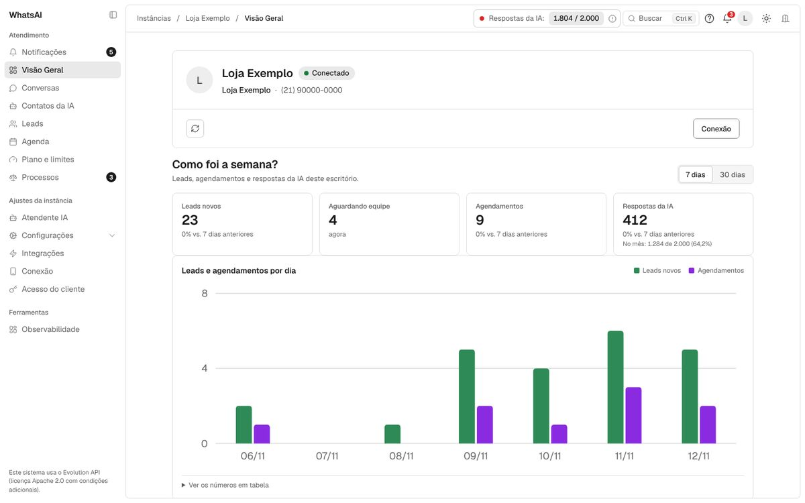
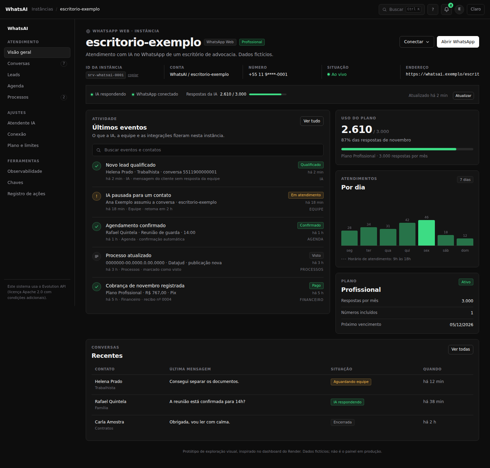
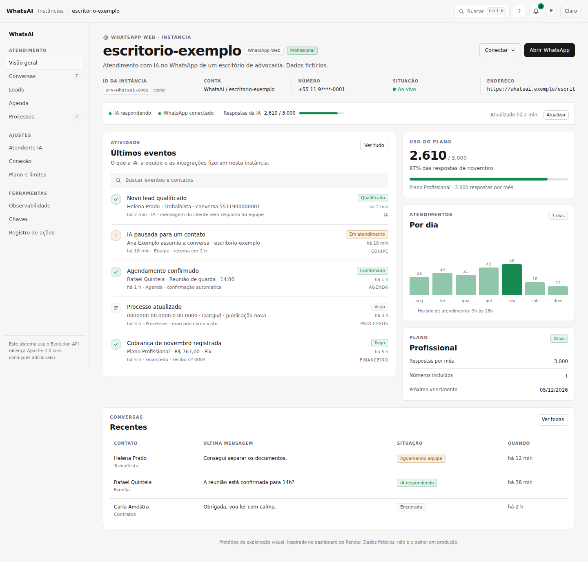
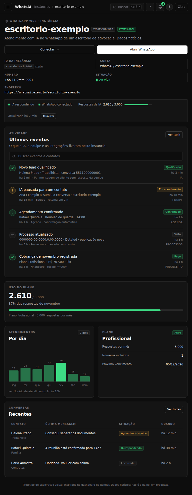
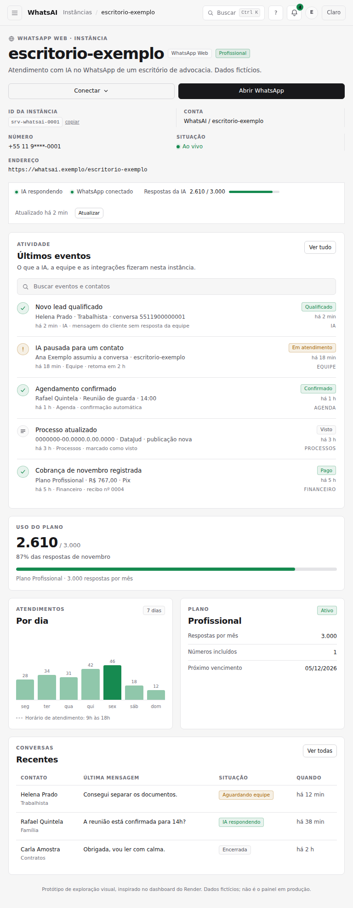
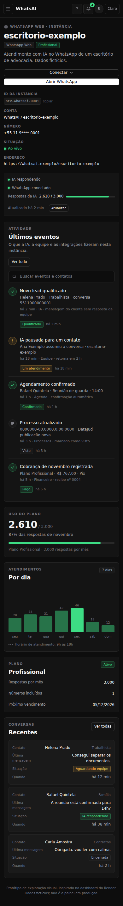
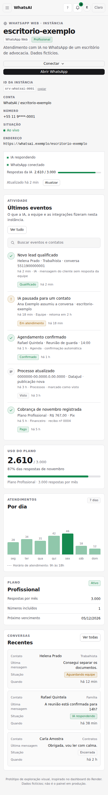

# Comparação com o dashboard atual do Render

Exploração visual feita em 12/11/2026 para responder a uma pergunta simples: o que o dashboard do Render faz bem e o
que disso faria sentido no painel do WhatsAI, sem perder a identidade do produto e sem copiar a marca de terceiros.

Não é o painel em produção. O protótipo é estático, usa dados fictícios e não chama a API. As imagens de referência
do Render são públicas (site e changelog) e pertencem à Render; aqui elas servem só como referência de design, não
fazem parte do produto e não foram incluídas nos arquivos do repositório.

## O que eu olhei

Quatro telas públicas do dashboard atual, escolhidas por mostrarem os padrões que interessam:

| Tela | O que mostra | Fonte |
|---|---|---|
| Página de serviço / Deploys | Cabeçalho do serviço, metadados, faixa de estado, histórico de deploys com status, versão ao vivo, tempo e ação | [imagem](https://cdn.sanity.io/images/hvk0tap5/production/3199f6d4c0803a2d325fff21a2261e290e227866-1898x1314.png) |
| Preview e pilha de PRs | Cartões de ambiente, "View deployment", pilha de PRs com estados "Ready" e ação principal | [imagem](https://cdn.sanity.io/images/hvk0tap5/production/3fdb4a1aad53dc7ef717fa85263ecb112b3476d9-1480x1186.png) |
| Métrica de build | Gráfico de barras simples, com uma anotação e um ponto destacado | [imagem](https://cdn.sanity.io/images/hvk0tap5/production/e00f545dee243072cb659ff1d693d2dae2601c35-1666x890.png) |
| Navegação de cron job | Sidebar escura, item ativo com fundo roxo, agrupamento e ícones | [imagem](https://cdn.sanity.io/images/hvk0tap5/production/9d773371336cbced2ba3cd984cb04c83fcc297a6-706x376.png) |

As capturas públicas vêm do [changelog do Render](https://render.com/changelog) (entradas de setembro e novembro de
2026). O dashboard logado exige conta; não usei credenciais nem a conta de produção.

## Nosso painel hoje

O ponto de partida é a Visão Geral do painel real, com dados fictícios:

O que já está bom: a lateral com grupos, o tema Sistema, a largura única, os cartões de números, o gráfico e a
linguagem em PT-BR. O que o Render faz melhor: a hierarquia da página de serviço, a faixa de estado e a lista de
atividade com contexto, origem e tempo.

## Como ficaria

Protótipo com os padrões do Render, mas com a marca, os dados e o vocabulário do WhatsAI. Nada de logo, roxo ou
"deploy" na interface do cliente.

### Computador

| Escuro | Claro |
|---|---|
|  |  |

### Tablet

| Escuro | Claro |
|---|---|
|  |  |

### Celular

| Escuro | Claro |
|---|---|
|  |  |

## O que vale adotar

1. **Cabeçalho de serviço na instância.** Nome grande, selos do canal e do plano, linha de metadados (ID, conta,
   número, situação, endereço) e as duas ações principais à direita. Hoje a instância tem título e cartões, mas não
   tem essa leitura de "serviço" em uma olhada. Esforço baixo, só painel.
2. **Faixa de estado.** "IA respondendo", "WhatsApp conectado", "Respostas da IA 2.610 / 3.000" e "Atualizado há 2
   min" na mesma linha. É a informação que o cliente procura primeiro, e ela já existe no painel; falta juntar.
3. **Atividade como lista principal.** Cada evento com ícone de estado, título, contato/instância, origem (IA,
   Equipe, Agenda, Processos, Financeiro), hora e um selo. É a evolução natural da central única de notificações
   (F+Y) e responde "o que aconteceu desde que eu saí?".
4. **Gráfico compacto com anotação.** Barras por dia, uma barra destacada e uma nota curta ("Horário de atendimento:
   9h às 18h"). O gráfico já existe na Visão Geral; o ganho é o estilo e a leitura.
5. **Tabelas densas com cartões no celular.** Cabeçalho em caixa alta, linhas separadas por borda fina e a mesma
   informação virando cartão no celular. O painel já faz isso em várias telas; vale padronizar.
6. **Tema escuro de verdade.** O Render trata o escuro como tema de primeira classe. O WhatsAI já tem Claro, Escuro
   e Sistema; a recomendação é revisar os tokens escuros com o mesmo cuidado, sem virar dark-only.

## O que não vale copiar

- **Marca e cores do Render.** Roxo e amarelo são a identidade deles. O WhatsAI usa verde para "ok", âmbar para
  atenção e vermelho para erro; cor precisa continuar com significado.
- **Vocabulário de desenvolvedor.** "Deploy", "service", "rollback" e "instance" não ajudam o escritório. O painel
  fala de atendimento, conversa, lead, agenda e processo.
- **Navegação centrada em deploy.** O Render é uma plataforma de infraestrutura; o nosso cliente precisa de
  Conversas, Leads, Agenda e Processos na frente.
- **Texto de 10 px em caixa alta.** O Render usa microtexto em alguns rótulos. No nosso painel, o piso de rótulo
  continua 12 px, com contraste AA.
- **Dark-only.** O padrão do WhatsAI é Sistema, e o cliente escolhe. O protótipo mostra os dois temas.
- **Cópia do layout inteiro.** O dashboard do Render é para engenheiros; o nosso é para advogados e equipe de
  atendimento. A estrutura deve ser adaptada, não transplantada.

## Comparação direta

| Elemento | Render | Nosso painel hoje | Recomendação |
|---|---|---|---|
| Cabeçalho | Nome, selos, metadados e ações na primeira dobra | Título e cartões | Adotar a hierarquia, com os nossos dados |
| Estado | Faixa de deploy com versão, tempo e ação | Cartões de números e conexão espalhados | Juntar em uma faixa única |
| Histórico | Lista de deploys com status, commit e duração | Notificações e eventos em páginas separadas | Uma lista de atividade com origem e tempo |
| Métrica | Gráfico de barras com anotação | Gráfico da Visão Geral | Mesmo estilo compacto e anotado |
| Tabela | Densidade alta, colunas claras | Tabelas e cartões por tela | Padronizar o cabeçalho e o cartão no celular |
| Tema | Escuro e claro | Claro, escuro e Sistema | Manter Sistema e revisar o escuro |
| Marca | Roxo e amarelo | Verde, âmbar e vermelho | Manter a nossa semântica |

## Recomendações por prioridade

| Prioridade | O que fazer | Onde | Esforço | Risco |
|---|---|---|---|---|
| 1 | Cabeçalho de serviço com metadados e ações | `instance-shell` e Visão Geral | Baixo | Baixo |
| 2 | Faixa de estado única | Visão Geral | Baixo | Baixo |
| 3 | Lista de atividade com origem, tempo e selo | Central de notificações / Visão Geral | Médio | Médio: depende da fonte única |
| 4 | Gráfico compacto com anotação | Visão Geral | Baixo | Baixo |
| 5 | Padronizar tabelas e cartões no celular | Listas existentes | Médio | Baixo |
| 6 | Revisão de contraste do tema escuro | Tokens `--m-*` | Médio | Baixo |

## Acessibilidade

O protótipo usa foco visível, rótulos de tabela, `aria-label` nas busca e nos ícones, e contraste alto. O texto
muted do Render em alguns pontos fica abaixo do que usamos; não copiei esse ponto. Antes de levar qualquer padrão
para o painel, a conferência continua sendo axe sem violações critical e serious, em 390/768/1024/1440, claro e
escuro.

## Arquivos desta exploração

- `index.html` e `styles.css`: protótipo estático, sem API, com dados fictícios.
- `capturas/`: as seis imagens do protótipo (desktop, tablet e celular; claro e escuro).
- As imagens do Render não foram copiadas para o repositório; os links acima apontam para o CDN público deles e são
  usados apenas como referência.

## Licença e marcas

O dashboard, as imagens e as marcas do Render pertencem à Render. Esta pasta é uma análise de design, não um
produto derivado nem uma afiliação. O protótipo não usa o logo, a fonte de marca ou as cores do Render.
