# Artefato do Projeto: comparação antes x depois

Este documento compara, em **12/11/2026**, o que o [Artefato do Projeto](../Artefato%20do%20Projeto/WhatsAI%20frente%20a%20Twenty%20e%20Frappe.md) propunha com o que o projeto atual entrega. As 27 propostas (A a AA) foram aprovadas e mescladas entre os PRs #83 e #108; a documentação final entrou no #109. A tabela de status oficial fica no fim do artefato, em "Status da execução".

**Método.** Li cada proposta no artefato, conferi o corpo dos PRs #83 a #108 (resumo, limitações e recomendações) e usei as capturas antes/depois versionadas em `readmes/pr/<letra>/`. As imagens do artefato são as telas de referência que motivaram cada proposta; nem toda proposta tinha mockup próprio, e nem toda entrega gerou captura. Quando não há captura, o documento diz isso com todas as letras em vez de simular uma.

**O que entrou.** 27 letras: 24 com PR próprio (A, B, C, D, E, F, G, H, I, J, K, L, O, P, Q, R, S, T, U, V, W, X, Y, Z), 3 marcadas no artefato como entregues em PRs anteriores (M, N, AA) e 2 PRs de infraestrutura no meio do pacote (#96 e #107, CI). Há capturas antes/depois versionadas para 15 letras: A, B, C, D, E, F, G, H, I, J, K, S, W, X e Y.

**Como ler os vereditos.**

- **Entregue:** a proposta principal está no projeto e as capturas confirmam.
- **Entregue com ressalva:** a proposta principal está no projeto, mas o próprio PR registrou uma limitação ou deixou uma etapa para depois.
- **Entregue em PRs anteriores:** o artefato marca assim; não houve PR nem captura dedicados no pacote.
- **Sem captura:** a entrega existe, mas não há antes/depois versionado em `readmes/pr`.

As seções seguem a ordem em que as propostas aparecem no artefato.

## Resumo

| Letra | Proposta | PR | Captura | Veredito |
| --- | --- | --- | --- | --- |
| A | Ficha do lead em página, com abas | #95 | Sim | Entregue |
| B | Conversa com a ficha do lead ao lado | #91 | Sim | Entregue com ressalva |
| C | Leads em quadro por status e visões fixadas | #105 | Sim | Entregue com ressalva |
| D | Visão Geral com o resultado do escritório | #102 | Sim | Entregue |
| E | Ctrl K com ações | #99 | Sim | Entregue com ressalva |
| F | Acabamento: ícones, datas relativas e notificações | #94 | Sim | Entregue |
| G | Um cabeçalho e uma largura para todas as páginas | #90 | Sim | Entregue |
| H | Atendente IA com seções e linguagem simples | #93 | Sim | Entregue com ressalva |
| I | Eventos em grupos, com teste de envio | #104 | Sim | Entregue com ressalva |
| J | Integrações em catálogo | #98 | Sim | Entregue |
| K | Celular: listas em linhas empilhadas | #106 | Sim | Entregue com ressalva |
| L | Um sistema visual só, em todas as telas | #97 | Não | Entregue |
| M | Componentes únicos | PRs anteriores | Não | Entregue em PRs anteriores |
| N | Formatos e textos iguais | PRs anteriores | Não | Entregue em PRs anteriores |
| O | Site com 6 seções | #89 | Não | Entregue com ressalva |
| P | Segurança: dados, direitos, incidentes e perguntas | #86 | Não | Entregue |
| Q | Página 404, acessibilidade e título da aba | #84 | Não | Entregue |
| R | Privacidade e termos completos | #88 | Não | Entregue |
| S | Painel mais leve no primeiro acesso | #100 | Sim | Entregue com ressalva |
| Z | Correções rápidas: celular, /acesso e área do cliente | #83 | Não | Entregue |
| T | Erros e carregamento honestos | #85 | Não | Entregue |
| U | Primeiro uso guiado | #87 | Não | Entregue |
| V | Equipe, acessos e registro de ações | #103 | Não | Entregue com ressalva (etapa 1) |
| W | Ajuda, novidades e atalhos | #92 | Sim | Entregue com ressalva |
| X | Conta, cobrança e exportação | #101 | Sim | Entregue com ressalva |
| Y | Central de notificações | #108 | Sim | Entregue com ressalva |
| AA | Movimento e acabamento com um padrão só | PRs anteriores | Não | Entregue em PRs anteriores |

## A · Ficha do lead em página, com abas

**Proposta.** Uma página por lead com linha do tempo do que aconteceu (mensagens, triagem, agendamentos e processos), status no topo, coluna lateral com contato, resumo, estado da IA, "falta saber" e próximo passo, e "Virar cliente" num diálogo curto. A gaveta continua para olhar rápido na lista.

**Entrega.** PR [#95](https://github.com/devconnecting1/evolution-api-render/pull/95), mesclado. A rota `/manager/instance/:instanceId/leads/:leadId` fica dentro do mesmo guard e do mesmo layout da instância, com abas Atividade, Conversa, Agenda e Processos. Reaproveita `GET /leads/:instance/:id`, `POST /chat/findMessages`, `GET /agenda`, `GET /processos` e `PATCH /leads`; nenhuma rota nova e nenhum timer. Sem aba de notas porque a API ainda não tem notas de lead.

**Imagem de referência no artefato:** [tela de Leads de hoje](../Artefato%20do%20Projeto/img/p/leads.jpg).

| Antes (1440, claro) | Depois (1440, claro) |
| --- | --- |
| [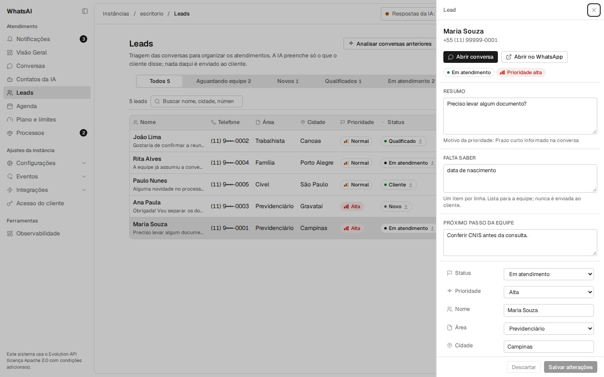](pr/A/antes-1440-light.jpg) | [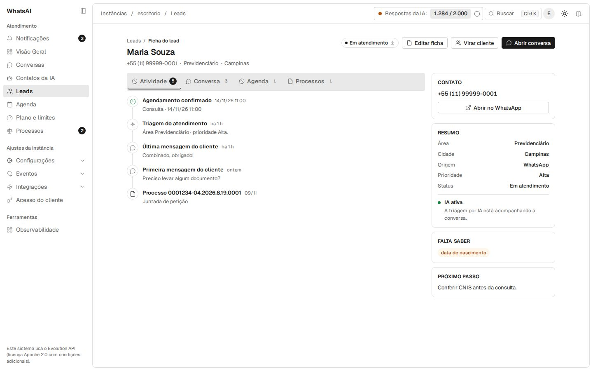](pr/A/depois-1440-light.jpg) |

Outras capturas: [escuro 1440](pr/A/antes-1440-dark.jpg) / [depois](pr/A/depois-1440-dark.jpg), [claro 390](pr/A/antes-390-light.jpg) / [depois](pr/A/depois-390-light.jpg), [escuro 390](pr/A/antes-390-dark.jpg) / [depois](pr/A/depois-390-dark.jpg), [aba Conversa](pr/A/aba-conversa-1440-light.jpg), [aba Agenda](pr/A/aba-agenda-1440-light.jpg), [aba Processos](pr/A/aba-processos-1440-light.jpg) e [diálogo Virar cliente](pr/A/dialogo-virar-cliente-1440-light.jpg).

**Veredito: entregue.** A página, as abas e o diálogo estão nas capturas. A única ausência é a aba de notas, que depende de uma API que ainda não existe.

## B · Conversa com a ficha do lead ao lado

**Proposta.** Painel recolhível à direita da conversa com o que a equipe precisa para responder: IA ativa ou pausada, status, próximo agendamento e processos. "Assumir conversa" pausa a IA com um clique.

**Entrega.** PR [#91](https://github.com/devconnecting1/evolution-api-render/pull/91), mesclado. O cartão "Ficha do lead" mostra estado da IA, status, prioridade, área, espera, próximo passo e até 3 processos; "Abrir ficha completa" leva à gaveta de Leads e "Assumir conversa" usa a mesma ação de Pausar IA. Sem rota nova, com cache em memória de 60 s e sem timer. No computador o painel abre por padrão a partir de 1024 px; no celular continua atrás do botão de informações.

**Imagem de referência no artefato:** [tela de Conversas de hoje](../Artefato%20do%20Projeto/img/p/conversas.jpg).

| Antes (1440, claro) | Depois (1440, claro) |
| --- | --- |
| [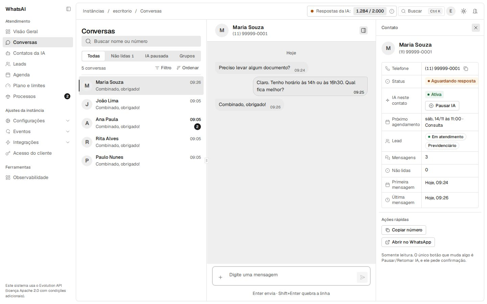](pr/B/antes-1440-light.jpg) | [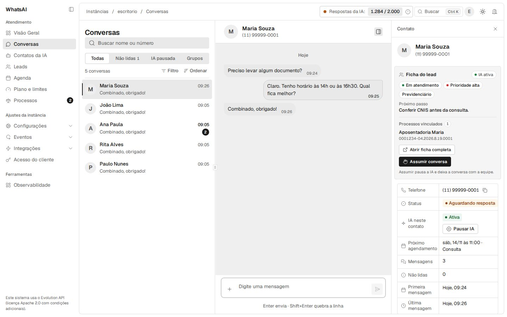](pr/B/depois-1440-light.jpg) |

Outras capturas: [escuro 1440](pr/B/antes-1440-dark.jpg) / [depois](pr/B/depois-1440-dark.jpg), [claro 390](pr/B/antes-390-light.jpg) / [depois](pr/B/depois-390-light.jpg) e [escuro 390](pr/B/antes-390-dark.jpg) / [depois](pr/B/depois-390-dark.jpg).

**Veredito: entregue com ressalva.** O cartão é somente leitura fora pausar/retomar; editar status e prioridade no cartão exige uma rota de escrita que ficou para depois. Processos são casados pelo JID exato ou pelos dígitos do telefone, então conversas `@lid` podem não casar, e `GET /processos/:instance` devolve até 1000 linhas. "Assumir conversa" só aparece quando existe sessão de IA para o contato.

## C · Leads em quadro por status e visões fixadas

**Proposta.** Alternar Lista/Quadro; arrastar o cartão muda o status (o mesmo que o seletor já faz); "Fixar visão" põe filtros prontos na lateral, com contador. Na primeira versão as visões ficam no navegador.

**Entrega.** PR [#105](https://github.com/devconnecting1/evolution-api-render/pull/105), mesclado. Quadro com as cinco etapas já usadas pela página (Novo, Qualificado, Em atendimento, Cliente e Descartado), arrastar com a mesma chamada `PATCH /leads`, menu de status no rodapé do cartão como alternativa para toque e teclado, e visões em `localStorage` (máximo de 8). A lista continua igual.

**Imagem de referência no artefato:** [tela de Leads de hoje](../Artefato%20do%20Projeto/img/p/leads.jpg).

| Lista (antes) | Quadro (depois) |
| --- | --- |
| [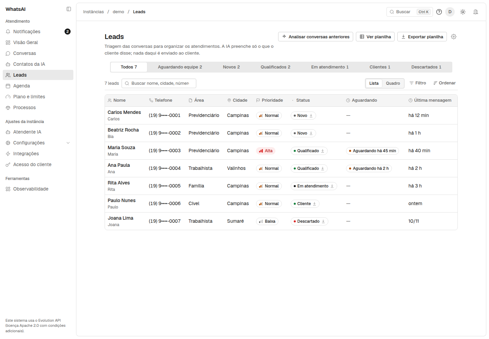](pr/C/1440-light-lista.png) | [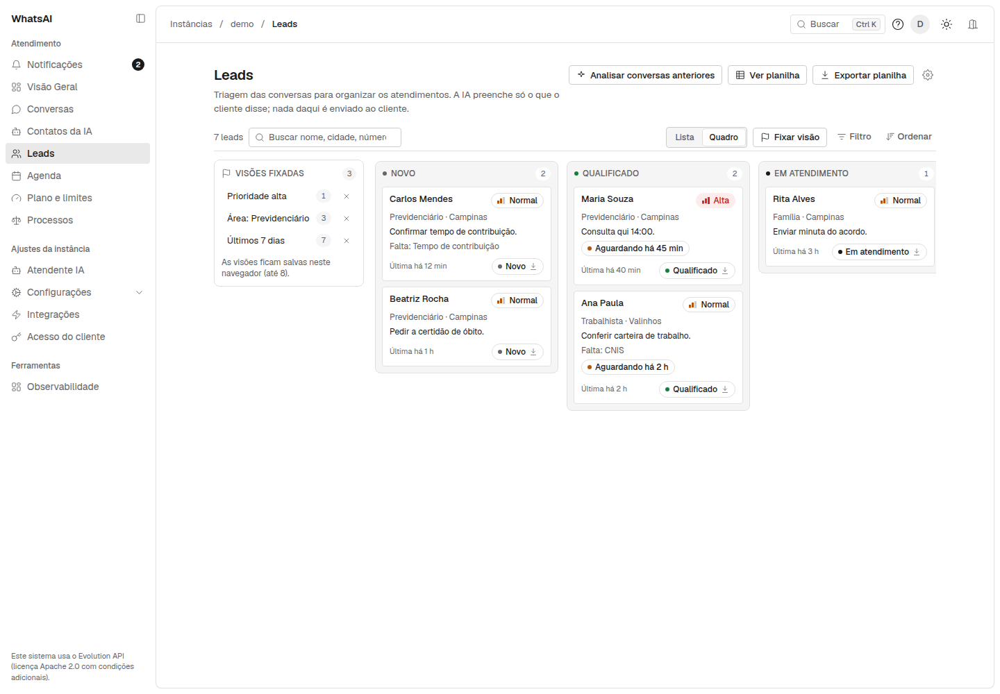](pr/C/1440-light-quadro.png) |

Outras capturas: [quadro 1440 escuro](pr/C/1440-dark-quadro.png), [quadro 390 claro](pr/C/390-light-quadro.png), [quadro 390 escuro](pr/C/390-dark-quadro.png) e [lista 390 claro](pr/C/390-light-lista.png).

**Veredito: entregue com ressalva.** As visões ficam só no navegador de quem criou (não são compartilhadas entre pessoas), o quadro usa `pageSize=100` e acima disso cada coluna mostra "Ver todos" para o modo Lista filtrado, e arrastar é do computador; no celular e no teclado vale o menu de status.

## D · Visão Geral com o resultado do escritório

**Proposta.** A primeira tela da instância responde "como foi a semana?", com números do escritório, variação, gráfico por dia, agenda de hoje e alertas. Token, Reiniciar e Desconectar vão para Conexão. Precisa de uma rota nova na API.

**Entrega.** PR [#102](https://github.com/devconnecting1/evolution-api-render/pull/102), mesclado. Nova rota `GET /overview/:instanceName?days=7|30`, somente leitura, com totais, comparação com o período anterior, série diária, agenda do dia e alertas. O fuso vem de `InstanceLimits.businessHours.timezone`, nunca de UTC. Token e ações destrutivas passam para a página Conexão, com token mascarado. Testes unitários e de integração cobrem período, fuso e isolamento entre tenants.

**Imagem de referência no artefato:** [tela de Visão Geral de hoje](../Artefato%20do%20Projeto/img/p/visao-geral.jpg).

| Antes (1440, claro) | Depois (1440, claro) |
| --- | --- |
| [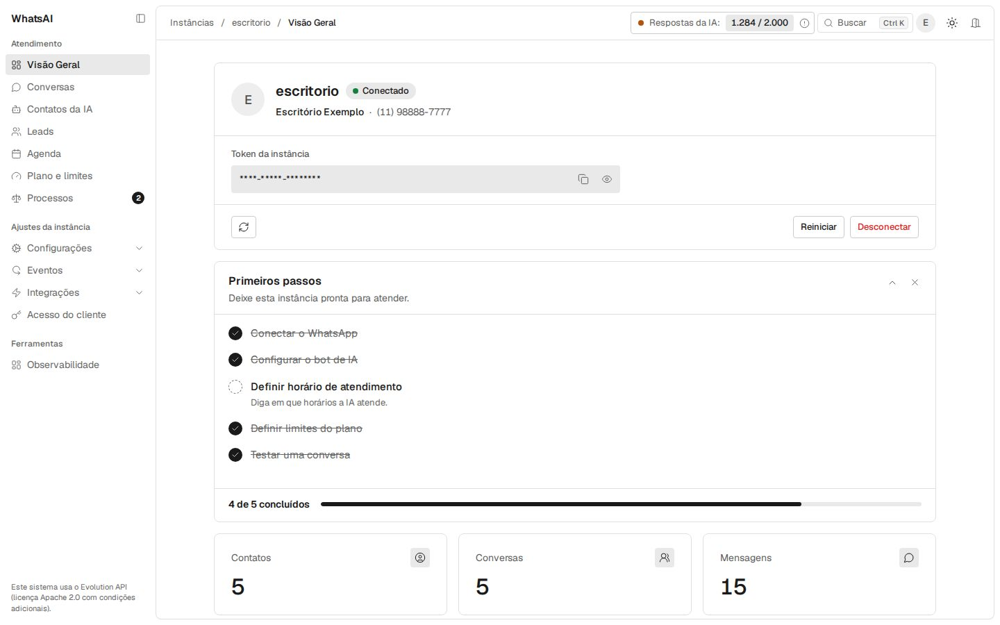](pr/D/antes-1440-light.jpg) | [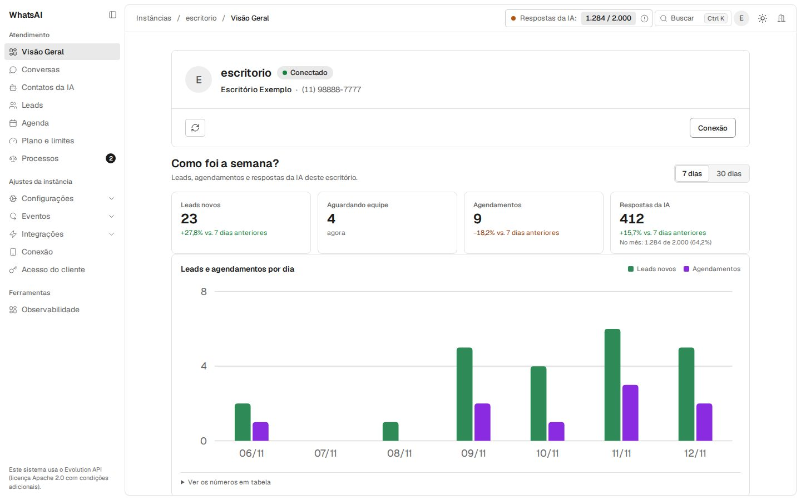](pr/D/depois-1440-light.jpg) |

Outras capturas: [escuro 1440](pr/D/antes-1440-dark.jpg) / [depois](pr/D/depois-1440-dark.jpg), [claro 390](pr/D/antes-390-light.jpg) / [depois](pr/D/depois-390-light.jpg) e [escuro 390](pr/D/antes-390-dark.jpg) / [depois](pr/D/depois-390-dark.jpg).

**Veredito: entregue.** "1ª resposta" ficou de fora porque o modelo guarda apenas a última resposta humana; "aguardando equipe" é um retrato do agora e não tem comparação. A tela não usa timer nem polling e o gráfico lê até 10.000 linhas por período.

## E · Ctrl K com ações

**Proposta.** O Ctrl K deixa de só buscar e passa a executar as ações mais comuns conforme a tela aberta, usando as mesmas rotas dos botões.

**Entrega.** PR [#99](https://github.com/devconnecting1/evolution-api-render/pull/99), mesclado. Com uma conversa aberta, o menu oferece pausar/retomar a IA, marcar agendamento e mudar o status do lead; em "Criar", novo agendamento e adicionar processo pelo número CNJ; em "Ir para", leads aguardando equipe e exportar planilha. As ações navegam e acionam os botões e filtros reais depois que eles aparecem (MutationObserver com limite de 8 s), sem rota nova e sem escrita própria.

**Imagem de referência no artefato:** [Ctrl K de hoje](../Artefato%20do%20Projeto/img/c/ctrl-k.png).

| Antes (1440, claro) | Depois (1440, claro) |
| --- | --- |
| [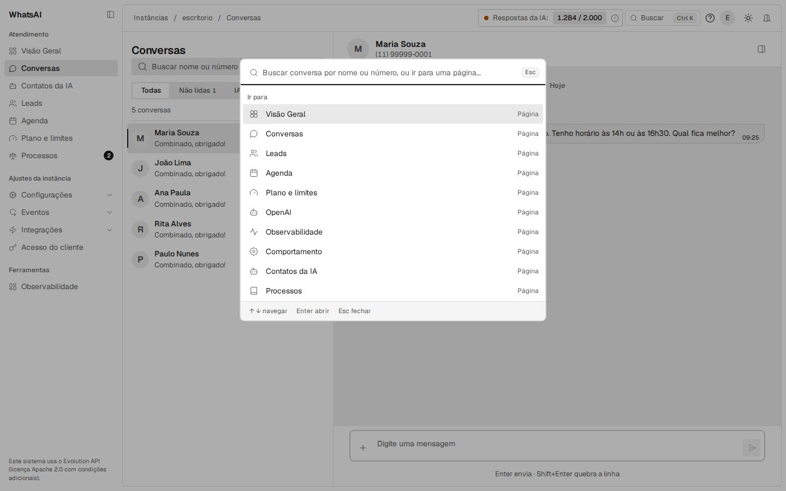](pr/E/antes-conversa-1440-light.jpg) | [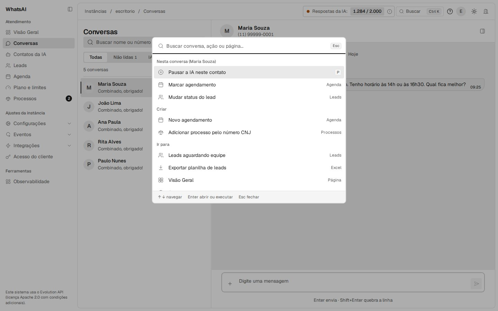](pr/E/depois-conversa-1440-light.jpg) |

Outras capturas: [Leads antes](pr/E/antes-leads-1440-light.jpg) / [depois](pr/E/depois-leads-1440-light.jpg), [escuro 1440](pr/E/antes-conversa-1440-dark.jpg) / [depois](pr/E/depois-conversa-1440-dark.jpg) e [390 claro](pr/E/antes-conversa-390-light.jpg) / [depois](pr/E/depois-conversa-390-light.jpg).

**Veredito: entregue com ressalva.** O menu em si está provado pelas capturas; o efeito final depende dos botões das páginas, então o PR recomenda teste manual em homologação (pausar/retomar, agendar, mudar status, adicionar processo e exportar). Pausar/Retomar só aparece quando existe sessão de IA, e o atalho P é o mesmo da proposta W.

## F · Acabamento: ícones nas colunas, datas relativas e notificações

**Proposta.** Ícone discreto por coluna, status como chip com ponto (o seletor abre ao clicar), "há 8 min" com a hora exata ao passar o mouse e "Notificações" na lateral reunindo leads aguardando, agendamentos pendentes e processos com novidade. Junto entram os P0 da análise de UX do #80.

**Entrega.** PR [#94](https://github.com/devconnecting1/evolution-api-render/pull/94), mesclado, pelo patch `acabamento-listas.py`. Ícones nas tabelas de Leads e Processos, chip de status acessível por teclado, datas relativas com `title` exato, página de Notificações com contador e cache de memória de 120 s, sem timer e sem polling. Também corrige o contraste do botão primário do login no tema escuro e a última coluna cortada em 1440 px.

**Imagem de referência no artefato:** [painel no celular](../Artefato%20do%20Projeto/img/p/sheet-light-390.jpg).

| Antes (1440, claro) | Depois (1440, claro) |
| --- | --- |
| [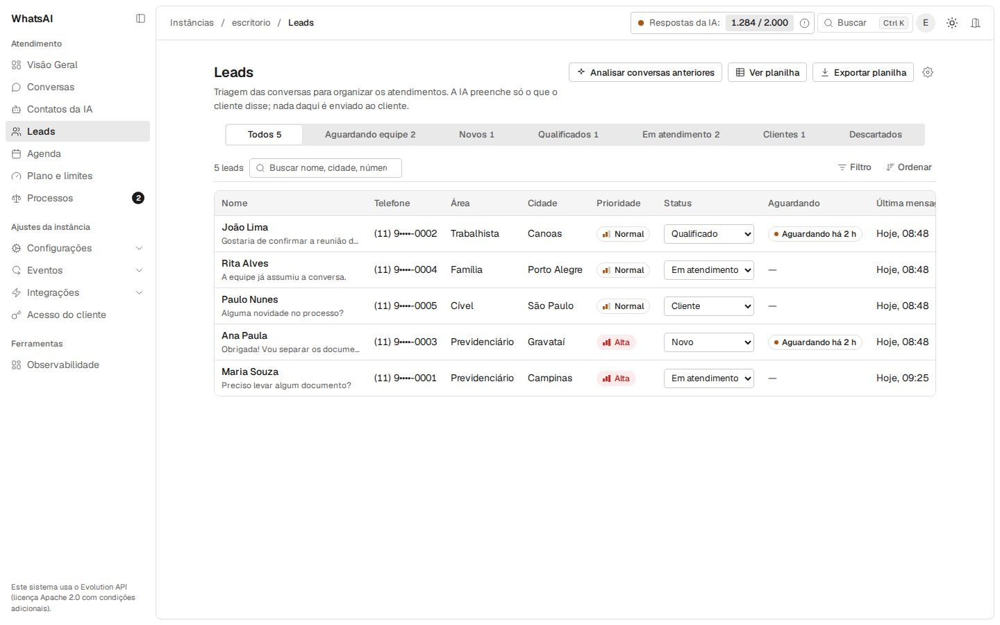](pr/F/antes-1440-light.jpg) | [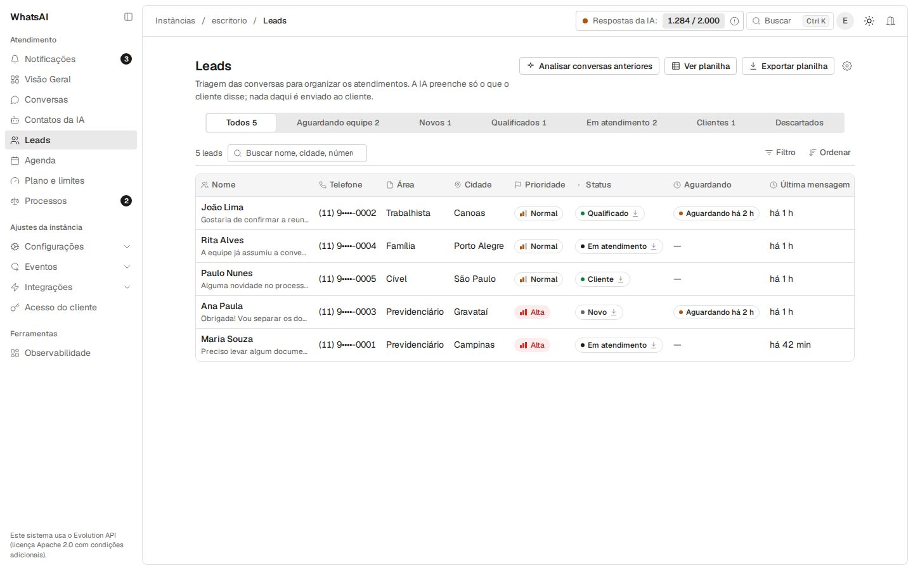](pr/F/depois-1440-light.jpg) |

Outras capturas: [escuro 1440](pr/F/antes-1440-dark.jpg) / [depois](pr/F/depois-1440-dark.jpg), [claro 390](pr/F/antes-390-light.jpg) / [depois](pr/F/depois-390-light.jpg) e [escuro 390](pr/F/antes-390-dark.jpg) / [depois](pr/F/depois-390-dark.jpg).

**Veredito: entregue.** Os dois P0 do #80 entraram no mesmo PR. A leitura da página de Notificações é feita uma vez por instância e fica em cache de memória, coerente com a regra de não acordar o Neon.

## G · Um cabeçalho e uma largura para todas as páginas

**Proposta.** Todas as páginas com o mesmo cabeçalho (trilha, título de 20 px, uma linha de descrição, ações à direita) e a mesma largura de conteúdo. A trilha aparece só no topo, e a Conexão do administrador leva direto à Visão Geral.

**Entrega.** PR [#90](https://github.com/devconnecting1/evolution-api-render/pull/90), mesclado, pelo patch `page-frame.py`. Títulos de 20 px nas páginas gerais (Chaves, Retenção e Observabilidade), coluna de 1040 px, Retenção alinhada à esquerda, sem "Painel WhatsAI" e sem trilha repetida. O menu do Chatwoot deixa de marcar "Conversas" por engano: o item ativo só vale quando o caminho é um segmento inteiro.

**Imagem de referência no artefato:** [cabeçalho de hoje](../Artefato%20do%20Projeto/img/c/cabecalho.png).

| Antes (Chaves, 1440, claro) | Depois (Chaves, 1440, claro) |
| --- | --- |
| [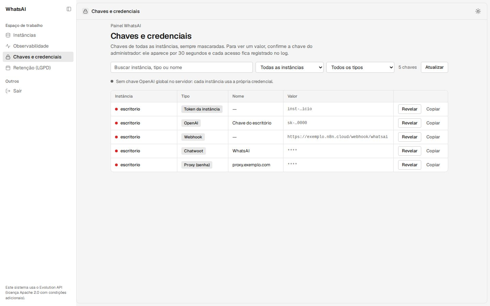](pr/G/antes-chaves-1440-light.jpg) | [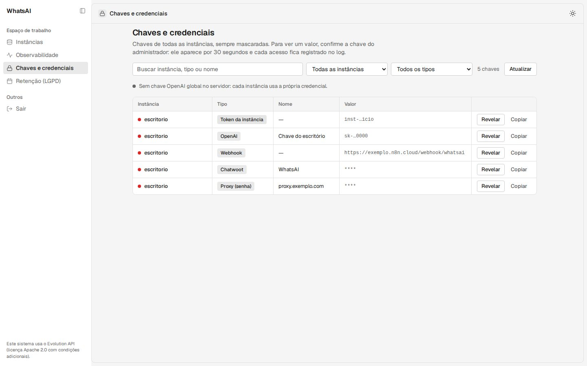](pr/G/depois-chaves-1440-light.jpg) |

Outras capturas: [Retenção antes](pr/G/antes-retencao-1440-light.jpg) / [depois](pr/G/depois-retencao-1440-light.jpg), [Chatwoot antes](pr/G/antes-chatwoot-1440-light.jpg) / [depois](pr/G/depois-chatwoot-1440-light.jpg), [escuro 1440](pr/G/antes-chaves-1440-dark.jpg) / [depois](pr/G/depois-chaves-1440-dark.jpg) e [390 claro](pr/G/antes-chaves-390-light.jpg) / [depois](pr/G/depois-chaves-390-light.jpg).

**Veredito: entregue.** A Observabilidade também foi ajustada, mas não entrou nas capturas por ser tela de diagnóstico. Telas de tela cheia (Conversas, Agenda, Planilha e Instâncias) continuam fora da coluna de 1040 px, como antes.

## H · Atendente IA com seções e linguagem simples

**Proposta.** A tela que define como a IA atende deixa de ficar escondida em Integrações > OpenAI e vira "Atendente IA", item próprio do menu, com seções à esquerda, rótulos em linguagem de escritório, "Testar uma conversa" e "Salvar" no fim de cada seção.

**Entrega.** PR [#93](https://github.com/devconnecting1/evolution-api-render/pull/93), mesclado, pelo patch `atendente-ia.py`. Seções Identidade, Modelo e chave, Instruções, Quando responder, Avançado, Pausa humana, Mensagens longas e Mídia. A lista troca nomes técnicos por "Conversa com o modelo" e "Assistente da OpenAI"; o topo ganha descrição curta e o atalho "Testar uma conversa". Campos, chaves e chamadas de gravação continuam os mesmos.

**Imagem de referência no artefato:** [ficha do atendente de hoje](../Artefato%20do%20Projeto/img/p/bot-edit.jpg).

| Antes (lista, 1440, claro) | Depois (lista, 1440, claro) |
| --- | --- |
| [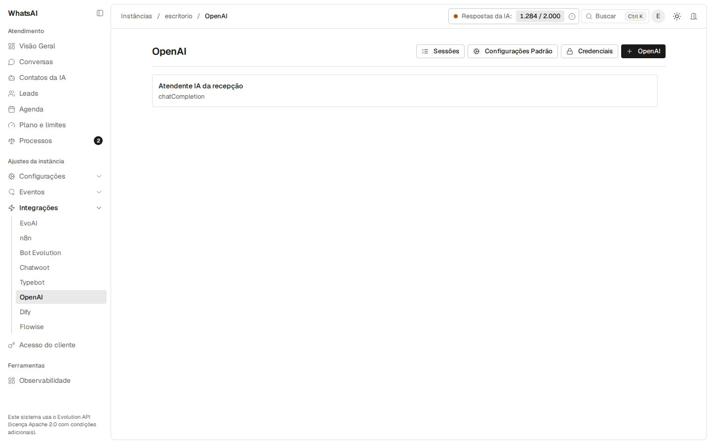](pr/H/antes-1440-light.jpg) | [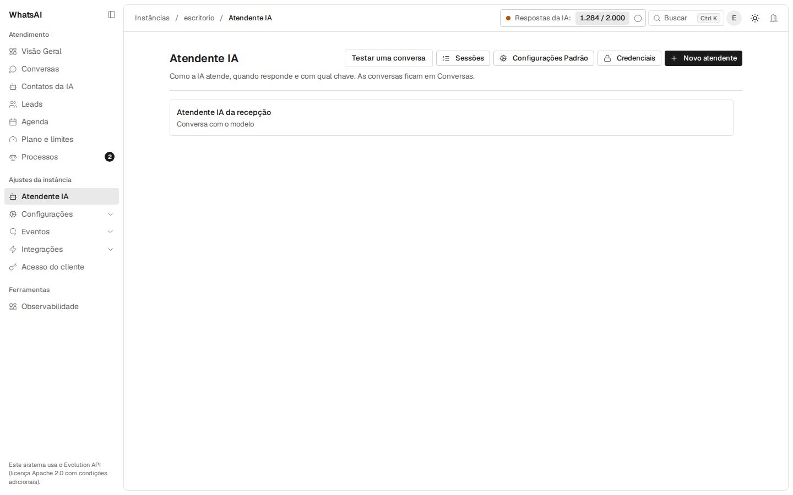](pr/H/depois-1440-light.jpg) |

Outras capturas: [formulário antes](pr/H/antes-form-1440-light.jpg) / [depois](pr/H/depois-form-1440-light.jpg), [escuro 1440](pr/H/antes-1440-dark.jpg) / [depois](pr/H/depois-1440-dark.jpg) e [390 claro](pr/H/antes-390-light.jpg) / [depois](pr/H/depois-390-light.jpg).

**Veredito: entregue com ressalva.** Cada seção tem o seu botão, mas todos enviam o mesmo formulário inteiro; não há gravação parcial. "Testar uma conversa" abre Conversas, não um simulador embutido. O diálogo "Novo atendente" continua como era, as seções não foram levadas a Comportamento, Proxy e Plano, não há seção de horário de atendimento e ficaram de fora salvamento automático e histórico de versões.

## I · Eventos em grupos, com teste de envio

**Proposta.** Os 27 interruptores com nomes técnicos em caixa alta, repetidos em Webhook, WebSocket, RabbitMQ e SQS, viram 4 grupos com nome em português e o código técnico pequeno ao lado. Um botão "Enviar teste" mostra a resposta do servidor, no mesmo componente das quatro telas.

**Entrega.** PR [#104](https://github.com/devconnecting1/evolution-api-render/pull/104), mesclado, pelo patch `eventos-grupos.py`. Grupos Mensagens (5), Conexão do WhatsApp (5), Conversas e contatos (10) e Grupos e automações (6), recolhíveis, com contagem "selecionados de total" e "Outros" para evento novo. "Enviar teste" usa o mesmo `POST /webhook/set`, `/websocket/set`, `/rabbitmq/set` ou `/sqs/set` do botão Salvar e exibe o status ou erro.

**Imagem de referência no artefato:** [tela de Webhook de hoje](../Artefato%20do%20Projeto/img/p/webhook.jpg).

| Antes (Webhook, 1440, claro) | Depois (Webhook, 1440, claro) |
| --- | --- |
| [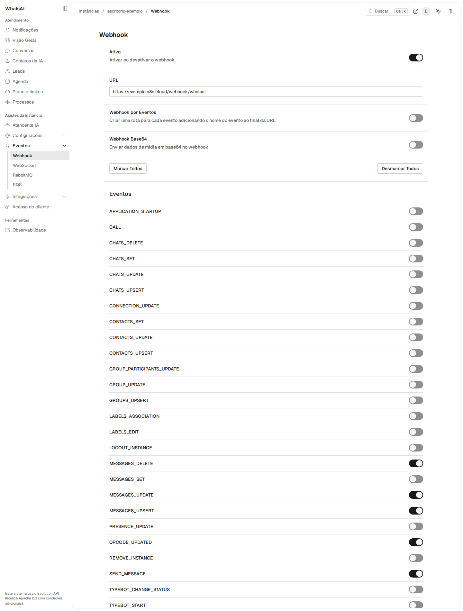](pr/I/antes-webhook-1440-light.png) | [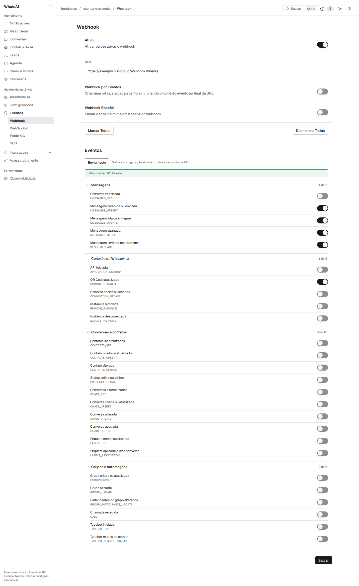](pr/I/depois-webhook-1440-light.png) |

Outras capturas: [escuro 1440](pr/I/antes-webhook-1440-dark.png) / [depois](pr/I/depois-webhook-1440-dark.png), [claro 390](pr/I/antes-webhook-390-light.png) / [depois](pr/I/depois-webhook-390-light.png), [escuro 390](pr/I/antes-webhook-390-dark.png) / [depois](pr/I/depois-webhook-390-dark.png) e [SQS depois](pr/I/depois-sqs-1440-light.png).

**Veredito: entregue com ressalva.** A API não tem endpoint de entrega de um evento de teste ao destino. "Enviar teste" valida a configuração contra o servidor usando a ação que a tela já tem; quando existir um endpoint real, basta trocar a chamada no componente.

## J · Integrações em catálogo

**Proposta.** Uma página de catálogo com um cartão por integração, uma frase explicando para que serve e o estado (ligada ou desligada). As menos usadas ficam em "Outras". O menu da instância perde 12 subitens.

**Entrega.** PR [#98](https://github.com/devconnecting1/evolution-api-render/pull/98), mesclado, pelo patch `integracoes-catalogo.py`. A página `/manager/instance/:instanceId/integracoes` mostra os cartões e o link "Configurar"; o estado vem das mesmas consultas `find` que as páginas já fazem, sem endpoint novo. As páginas antigas continuam acessíveis por URL; saem do menu apenas os 12 subitens.

**Imagem de referência no artefato:** [página de integração de hoje](../Artefato%20do%20Projeto/img/p/p-typebot.jpg).

| Menu antes (1440, claro) | Menu depois (1440, claro) |
| --- | --- |
| [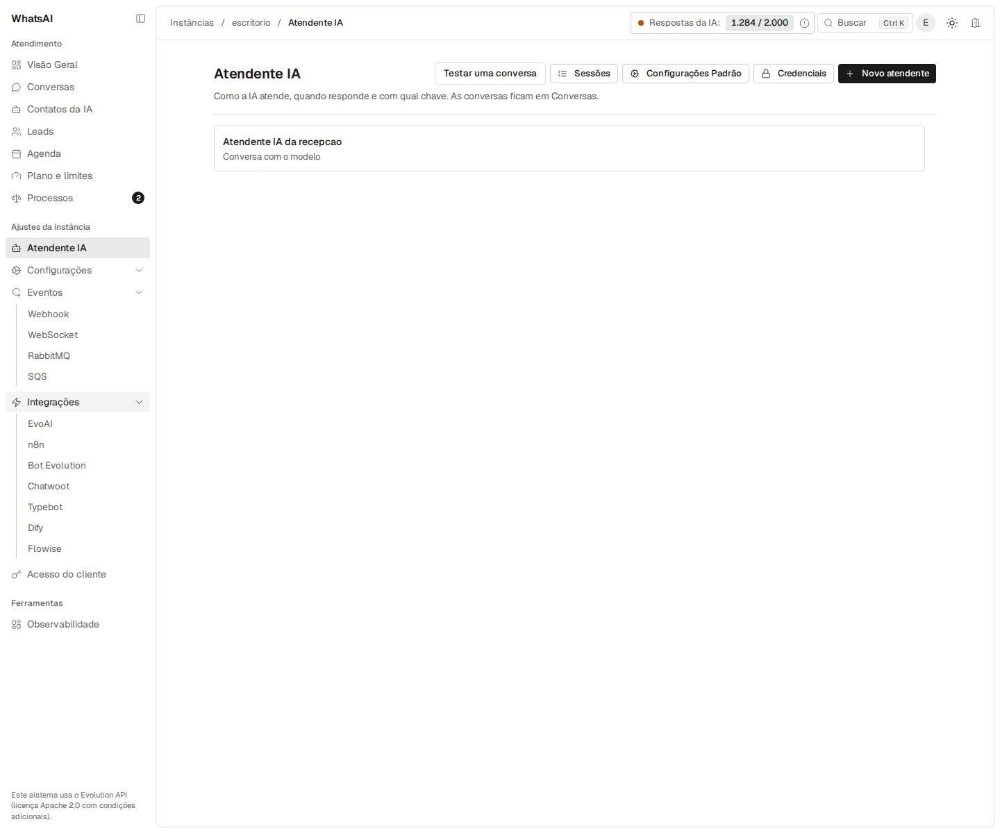](pr/J/menu-antes-1440-light.jpg) | [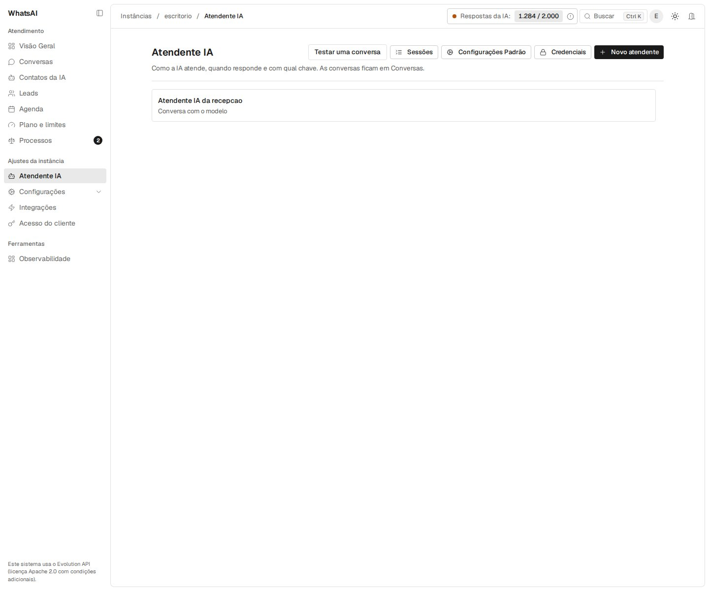](pr/J/menu-depois-1440-light.jpg) |

Outras capturas: [catálogo depois](pr/J/catalogo-depois-1440-light.jpg), [catálogo "Outras"](pr/J/catalogo-outras-1440-light.jpg), [menu escuro 1440](pr/J/menu-antes-1440-dark.jpg) / [depois](pr/J/menu-depois-1440-dark.jpg) e [390 claro](pr/J/menu-antes-390-light.jpg) / [depois](pr/J/menu-depois-390-light.jpg).

**Veredito: entregue.** O PR recomenda uma conferida visual rápida depois do merge, porque a main já tinha recebido outras letras (H e ajuda/novidades) antes. A mudança é só de menu e página; nenhuma integração foi removida.

## K · Celular: listas em linhas empilhadas

**Proposta.** Abaixo de 640 px, cada linha de tabela vira um bloco com nome, a informação principal e os chips; as ações secundárias vão para o menu "..." e as abas rolam de lado. No computador, nada muda.

**Entrega.** PR [#106](https://github.com/devconnecting1/evolution-api-render/pull/106), mesclado, pelo patch `celular-listas.py`. Leads, Processos e Instâncias viram cartões; os botões secundários vão para menus de três pontos com os mesmos handlers e estados; as abas e visões rolam de lado. As tabelas de sessões das integrações de chatbot ganharam empilhamento genérico.

**Imagem de referência no artefato:** [painel no celular](../Artefato%20do%20Projeto/img/p/sheet-light-390.jpg).

| Antes (Leads, 390, claro) | Depois (Leads, 390, claro) |
| --- | --- |
| [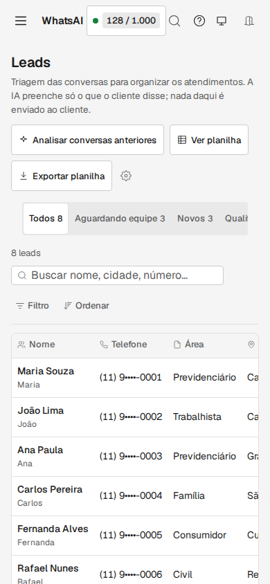](pr/K/antes-leads-390-light.png) | [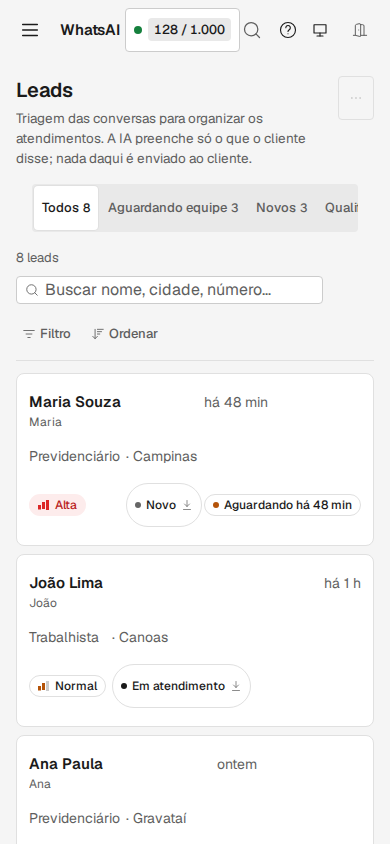](pr/K/depois-leads-390-light.png) |

Outras capturas: [Instâncias antes](pr/K/antes-instancias-390-light.png) / [depois](pr/K/depois-instancias-390-light.png), [Processos antes](pr/K/antes-processos-390-light.png) / [depois](pr/K/depois-processos-390-light.png), [Leads 1440 claro](pr/K/antes-leads-1440-light.png) / [depois](pr/K/depois-leads-1440-light.png), [menu de Leads no celular](pr/K/depois-leads-menu-390-light.png) e [processos no celular](pr/K/depois-processos-390-light.png).

**Veredito: entregue com ressalva.** No celular, as caixas de seleção em massa de Instâncias ficam escondidas (a seleção continua no computador); o telefone do lead e a classe/atualizado do processo saem do cartão, mas continuam no painel lateral; as tabelas de sessões de chatbot não foram capturadas porque dependem de integrações externas configuradas.

## L · Um sistema visual só, em todas as telas

**Proposta.** Uma folha única de regras visuais (tamanhos, raios, cabeçalho, maiúsculas e estado vazio) aplicada a todos os patches, com capturas antes e depois de cada tela nos dois temas.

**Entrega.** PR [#97](https://github.com/devconnecting1/evolution-api-render/pull/97), mesclado. `manager/dist/assets/design-system.css` define tokens de raio, controle e conteúdo, títulos de 20/28 px, coluna de 1040 px, cartões de 8 px, chips de 22 px com canto de 4 px e controles de 32/28 px. O CSS entra depois de todos os estilos existentes, imediatamente antes do bundle, para valer como último stylesheet. Usa só tokens `var(--m-*)`, então claro e escuro continuam valendo.

**Imagem de referência no artefato:** [estilos de abas de hoje](../Artefato%20do%20Projeto/img/c/abas-leads.png).

**Capturas.** Não há pasta `readmes/pr/L`. A entrega é transversal e o PR não versionou antes/depois; a validação foi feita pelos `--check` dos patches e pelo `esbuild` do bundle.

**Veredito: entregue, sem captura.** Como é a base das outras propostas, qualquer tela nova ou patch futuro precisa carregar o `design-system.css` por último para não regredir.

## M · Componentes únicos

**Proposta.** Uma pequena biblioteca no painel com abas, seletor, chip, tabela, filtro em chips, diálogo, gaveta, aviso com "Desfazer", estado vazio, esqueleto e campo de data e hora. Cada tela troca as suas versões por essas, uma tela por PR, com capturas antes e depois.

**Entrega.** O [status oficial do artefato](../Artefato%20do%20Projeto/WhatsAI%20frente%20a%20Twenty%20e%20Frappe.md) marca "entregue em PRs anteriores", sem PR próprio no pacote #83 a #108. A padronização visual foi incorporada ao longo das entregas anteriores, e a folha única da proposta L (#97) consolidou a base.

**Imagem de referência no artefato:** [tabela de Instâncias de hoje](../Artefato%20do%20Projeto/img/c/tabela-instancias.png).

**Capturas.** Não há pasta `readmes/pr/M` nem antes/depois dedicado.

**Veredito: entregue em PRs anteriores, sem captura.** Não existe um PR único rastreável para a biblioteca. O risco é novas telas voltarem a criar a própria versão de aba, chip ou diálogo; vale usar o `design-system.css` e os componentes já existentes como referência.

## N · Formatos e textos iguais

**Proposta.** Uma função de telefone e uma de data usadas em todas as telas, revisão dos textos herdados (primeira letra maiúscula, palavra do escritório), avisos de uma linha com "Desfazer", atalhos de teclado e título da aba por página.

**Entrega.** O status oficial marca "entregue em PRs anteriores", sem PR próprio no pacote. Parte dos itens aparece em PRs do pacote: o título da aba por página entrou no Q (#84) e os atalhos de teclado no W (#92); a padronização de textos e formatos veio das entregas anteriores.

**Imagem de referência no artefato:** [aviso de hoje](../Artefato%20do%20Projeto/img/c/aviso-toast.png).

**Capturas.** Não há pasta `readmes/pr/N` nem antes/depois dedicado.

**Veredito: entregue em PRs anteriores, sem captura.** Como não há um PR único, a revisão completa dos textos herdados não tem rastro de captura. Formatos de telefone e data devem continuar sendo conferidos nas telas novas.

## O · Site com 6 seções

**Proposta.** Uma frase em 2 linhas e uma linha de apoio, os dois botões, o preço numa linha e o painel real em tela grande logo abaixo. O selo "Novo" vira item da seção de produto; 17 seções viram 6.

**Entrega.** PR [#89](https://github.com/devconnecting1/evolution-api-render/pull/89), mesclado, primeira etapa. O topo muda, 5 seções repetidas saem, "Como funciona" vem antes do antes e depois, "WhatsApp Web ou API oficial" fica junto de Planos, a tabela completa de planos fica recolhida e as dúvidas mostram 8 perguntas com "Ver mais 6".

**Resultado medido pelo PR:** computador de 18.162 px e 17 seções para 13.477 px e 12 seções; celular de 30.079 px para 20.150 px.

**Imagem de referência no artefato:** [comparação de altura das páginas](../Artefato%20do%20Projeto/img/l/altura-comparada.png).

**Capturas.** Não há pasta `readmes/pr/O`. O PR registrou capturas no claro e no escuro, mas não as versionou em `readmes/pr`.

**Veredito: entregue com ressalva.** A meta de 6 seções e cerca de 8.500 px não foi atingida. Ficou para outra etapa levar "Um atendente que não dorme" para dentro do tour em abas e transformar os segmentos num seletor com uma conversa por vez.

## P · Segurança: dados, direitos, incidentes e perguntas

**Proposta.** Uma coluna de leitura como a do Cursor, com índice fixo, data no topo e quatro fatos curtos. Entram cinco blocos novos e as perguntas; os ícones ficam menores ou saem.

**Entrega.** PR [#86](https://github.com/devconnecting1/evolution-api-render/pull/86), mesclado. A página `/seguranca` ganha data e "O que mudou", tabela de onde ficam os dados (Render e Neon nos EUA/Ohio, OpenAI nos EUA, Vercel, Meta e Google), direitos LGPD com resposta em até 15 dias, passos de incidente, cópias e recuperação, como reportar uma falha e seis perguntas. Selos e certificações que não são nossos continuam de fora.

**Imagem de referência no artefato:** [página /seguranca de hoje](../Artefato%20do%20Projeto/img/s/seg-ours.jpg).

**Capturas.** Não há pasta `readmes/pr/P`. O PR registrou capturas a 1440 e 390, claro e escuro, e axe sem problemas, mas não as versionou em `readmes/pr`.

**Veredito: entregue, sem captura versionada.** As regiões foram conferidas no Render (`ohio`) e no Neon (`aws-us-east-2`). A validação de acessibilidade está registrada no PR.

## Q · Página 404, acessibilidade e título da aba

**Proposta.** Uma 404 no visual do site ("Esta página não existe", com volta para o início e para o painel) e outra dentro do painel. Zero problemas críticos ou sérios no verificador em todas as telas, conferido a cada PR. Título da aba com a página e a instância.

**Entrega.** PR [#84](https://github.com/devconnecting1/evolution-api-render/pull/84), mesclado, pelo patch `a11y-404.py` e pelo script `panel-a11y.js`. O site responde 404 de verdade em endereço inexistente, com `404.html`; o painel ganha tela em português para página inexistente e erro; `/favicon.ico` passa a existir. Em 14 telas a 1440 e 390, claro e escuro, o axe não acusa nenhum problema crítico ou sério; ficam 3 avisos moderados (ordem de títulos na ficha do atendente, `main` dentro de região em Chaves e h1 na conversa no celular).

**Imagem de referência no artefato:** [página 404](../Artefato%20do%20Projeto/img/s/q-404.png).

**Capturas.** Não há pasta `readmes/pr/Q`. A validação por axe está registrada no PR, mas não há antes/depois versionado.

**Veredito: entregue, sem captura versionada.** O título da aba por página também entrou aqui e complementa a proposta N.

## R · Privacidade e termos completos

**Proposta.** Os mesmos textos da proposta P (onde ficam os dados, direitos, incidentes) resumidos na política e nos termos, com o contato do encarregado e a identificação do operador.

**Entrega.** PR [#88](https://github.com/devconnecting1/evolution-api-render/pull/88), mesclado. A política e os termos foram atualizados em 12/11/2026 para operador pessoa física, sem CNPJ e sem publicar CPF ou nome. Entram a transferência internacional (art. 33 da LGPD), direitos com resposta em até 15 dias, canal de privacidade, incidentes e "Em resumo" no início dos termos.

**Imagem de referência no artefato:** [topo de /privacidade](../Artefato%20do%20Projeto/img/s2/priv-topo.jpg).

**Capturas.** Não há pasta `readmes/pr/R`; a verificação foi axe sem problemas a 1440 e 390.

**Veredito: entregue, sem captura versionada.** Quando abrir CNPJ, basta trocar as duas frases de identificação. Se o site passar a vender e contratar online, o Decreto 7.962/2013 exige nome e CPF ou CNPJ visíveis no site.

## S · Painel mais leve no primeiro acesso

**Proposta.** Cada página carregada só quando abrir, e a área do cliente sem as telas de administrador. Fica depois de L e M, porque mexe na mesma base e o ganho maior é na primeira visita.

**Entrega.** PR [#100](https://github.com/devconnecting1/evolution-api-render/pull/100), mesclado, na parte que dá para fazer sem o código-fonte do painel. Entram a tela de boot em HTML/CSS, cache `immutable` para `/assets/*`, `?v=` na fonte Geist, `defer` no `panel-a11y.js` e o patch `perf-boot.py`.

**Imagem de referência no artefato:** [painel no tema escuro](../Artefato%20do%20Projeto/img/p/sheet-dark-1440.jpg).

| Boot antes (1440, claro) | Boot depois (1440, claro) |
| --- | --- |
|  | [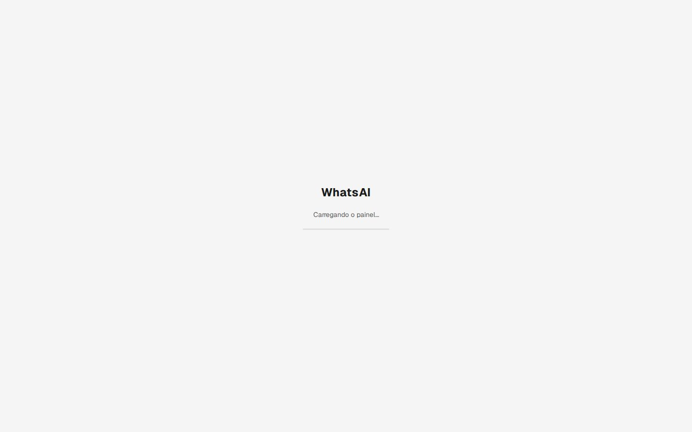](pr/S/boot-depois-1440-light.jpg) |

Outras capturas: [Leads antes](pr/S/leads-antes-1440-light.jpg) / [depois](pr/S/leads-depois-1440-light.jpg), [boot 390 escuro antes](pr/S/boot-antes-390-dark.jpg) / [depois](pr/S/boot-depois-390-dark.jpg) e [Leads 390 escuro antes](pr/S/leads-antes-390-dark.jpg) / [depois](pr/S/leads-depois-390-dark.jpg).

**Veredito: entregue com ressalva.** O bundle de cerca de 1,5 MB continua sendo baixado inteiro; o corte por rota, objetivo cheio da proposta, depende de mexer no build do fonte e ficou para outra etapa. O HTML não ganhou cache próprio e as demais páginas (404, acesso, observabilidade e landing) ainda preloadam a fonte sem `?v=`.

## Z · Correções rápidas: celular, /acesso e área do cliente

**Proposta.** Coisas pequenas, visíveis hoje para clientes, que não precisam esperar o site novo (O) nem a base do painel (L e M): barra fixa do celular, tabela de planos em lista, "Evolution API" fora de "Funciona com", Conexão do cliente, contador do cabeçalho, licença na lateral, `/acesso` e aviso de página não liberada.

**Entrega.** PR [#83](https://github.com/devconnecting1/evolution-api-render/pull/83), mesclado. A barra fixa só entra depois que o botão do topo sai da tela e sai na seção de contato; as tabelas de planos viram blocos abaixo de 560 px; "Evolution API" sai de "Funciona com"; a Conexão ganha passos numerados, código em fonte mono e "Copiar"; a página não liberada ganha aviso; `/acesso` muda título, ajuda e rodapé.

**Imagem de referência no artefato:** [Conversas com a API fora do ar](../Artefato%20do%20Projeto/img/g/g-error-conversas.jpg).

**Capturas.** Não há pasta `readmes/pr/Z`. O PR cita capturas no celular e no harness da área do cliente, mas não as versionou em `readmes/pr`.

**Veredito: entregue, sem captura versionada.** A mudança é estática; o script inline de `/acesso` não mudou e o hash da CSP ficou igual.

## T · Erros e carregamento honestos

**Proposta.** Três estados iguais em todas as telas: carregando (esqueleto), vazio (explica e oferece ação) e erro (diz o que houve, garante que os dados estão salvos e dá "Tentar de novo"). Conversas nunca mais confunde erro com vazio.

**Entrega.** PR [#85](https://github.com/devconnecting1/evolution-api-render/pull/85), mesclado, pelo patch `states.py` e `states.css`. A instância mostra esqueleto e, se falhar, o bloco "Não deu para carregar esta instância" com "Tentar de novo"; os 5 `errText()` traduzem 5xx sem mensagem real; Processos e Instâncias ganham "Tentar de novo"; Leads ganha esqueleto de tabela.

**Imagem de referência no artefato:** [Leads com a API fora do ar](../Artefato%20do%20Projeto/img/g/g-error-leads.jpg).

**Capturas.** Não há pasta `readmes/pr/T`. O PR registrou capturas com `FAIL=fetchInstances`, `FAIL=/processos`, `FAIL=/leads` e `SLOW=4000`, mas não as versionou em `readmes/pr`.

**Veredito: entregue, sem captura versionada.** A validação comportamental está descrita no PR; a regra de nunca confundir erro com vazio está implementada.

## U · Primeiro uso guiado

**Proposta.** A primeira tela é o roteiro, com um botão por passo e o progresso salvo. O cliente final ganha um aviso de boas-vindas que explica o que ele pode fazer.

**Entrega.** PR [#87](https://github.com/devconnecting1/evolution-api-render/pull/87), mesclado, pelo patch `first-run.py` e `first-run.css`. Sem nenhuma instância, o painel mostra "Boas-vindas ao WhatsAI" com os três passos (conectar o WhatsApp, configurar o atendente e mandar uma mensagem de teste) e "Nova instância" como ação principal. Na área do cliente, um cartão lista o que o código permite fazer e some com "Entendi", guardado por instância no `localStorage`.

**Imagem de referência no artefato:** [primeiro acesso de hoje](../Artefato%20do%20Projeto/img/g/g-firstrun.jpg).

**Capturas.** Não há pasta `readmes/pr/U`. O PR registrou capturas a 1440 e 390, claro e escuro, mas não as versionou em `readmes/pr`.

**Veredito: entregue, sem captura versionada.** Os vazios de uma visão filtrada e de falha de carregamento continuam como estavam; a proposta cobria o primeiro uso, não todos os vazios.

## V · Equipe, acessos e registro de ações

**Proposta.** Em três etapas: 1) login com Google por pessoa e "Revogar"; 2) papéis Dono, Equipe e Só leitura; 3) registro de ações com filtro e exportação.

**Entrega.** PR [#103](https://github.com/devconnecting1/evolution-api-render/pull/103), mesclado, etapa 1. Entram login com Google restrito a uma lista de e-mails verificados, sessão própria por pessoa (token `was_` guardado apenas como SHA-256, validade de 30 dias e revogação), `/team/me`, `/team/sessions` e `/team/revoke`, logout que revoga a sessão, quadro de acessos e migrations aditivas para `User` e `UserSession` nos três schemas. Sem as variáveis de ambiente, o recurso fica desligado; a chave global continua como break-glass.

**Imagem de referência no artefato:** [tela de Chaves de hoje](../Artefato%20do%20Projeto/img/p/chaves.jpg).

**Capturas.** Não há pasta `readmes/pr/V`. A entrega é de API, sem mudança visual no painel nesta etapa.

**Veredito: entregue com ressalva (etapa 1 de 3).** O painel ainda entra pela chave global: faltam a tela de login "Entrar com Google", a página Equipe com "Revogar", os papéis Dono/Equipe/Só leitura, o registro de ações de negócio com filtro e exportação, convites e rate limit em `/auth/google/exchange`. O código de uso único vive na memória de um processo só.

## W · Ajuda, novidades e atalhos

**Proposta.** Ajuda a um clique, novidades visíveis e atalhos para quem usa todo dia. Esforço baixo: é um menu, uma lista e um diálogo.

**Entrega.** PR [#92](https://github.com/devconnecting1/evolution-api-render/pull/92), mesclado, pelo patch `help-menu.py` e `help-shortcuts.js`. O menu Ajuda aparece nos três cabeçalhos, com suporte, guia rápido, atalhos e as três últimas novidades; a página pública `/novidades` tem 11 entradas datadas; os atalhos são `?`, `G` + `C`, `G` + `L` e `P`. O menu abre por mouse e teclado, fecha com Esc, clique fora ou escolha de item.

**Imagem de referência no artefato:** [cabeçalho de hoje](../Artefato%20do%20Projeto/img/g/g-error-visao.jpg).

| Antes (1440, claro) | Depois (1440, claro) |
| --- | --- |
|  | [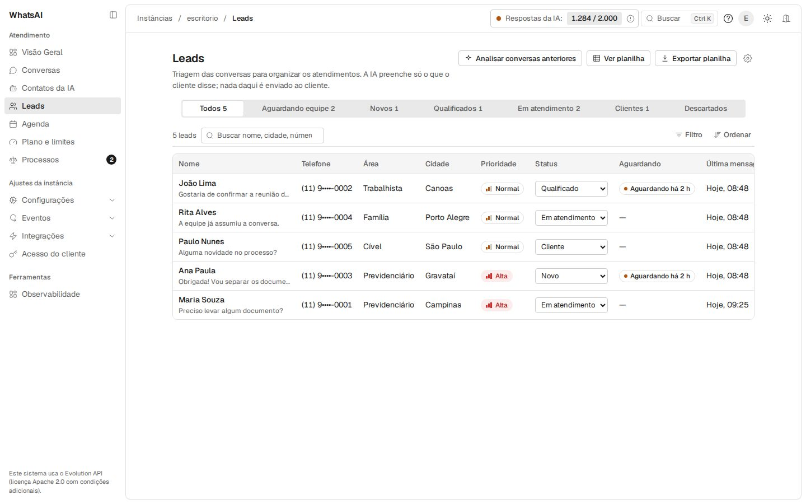](pr/W/depois-1440-light.jpg) |

Outras capturas: [menu depois](pr/W/depois-menu-1440-light.jpg), [atalhos](pr/W/depois-atalhos-1440-light.jpg), [novidades antes](pr/W/antes-novidades-1440-light.jpg) / [depois](pr/W/depois-novidades-1440-light.jpg), [escuro 1440](pr/W/antes-1440-dark.jpg) / [depois](pr/W/depois-1440-dark.jpg) e [390 claro](pr/W/antes-390-light.jpg) / [depois](pr/W/depois-390-light.jpg).

**Veredito: entregue com ressalva.** O link "Guia rápido" aponta para `README-WHATSAI.md` num repositório privado; se o cliente do painel não tiver acesso, o link não abre para ele. O conteúdo de `/novidades` é manual e precisa de uma linha nova a cada mudança percebida. Não há status do serviço, por decisão de não criar polling. O atalho `P` depende do botão "Pausar IA"/"Retomar IA" existir na conversa aberta e merece teste manual.

## X · Conta, cobrança e exportação

**Proposta.** Cobrança e exportação no mesmo lugar, como no Neon e no Lovable. A exportação completa atende à portabilidade da LGPD e dá segurança a quem contrata: os dados são dele.

**Entrega.** PR [#101](https://github.com/devconnecting1/evolution-api-render/pull/101), mesclado, com API e painel. A página "Plano e limites" ganha as abas Uso, Cobrança e Exportar dados. Entram `GET /usage/billing/:instanceName` (plano, `source` igual a "none", histórico vazio e formato final) e `GET /usage/export/:instanceName?datasets=...`, um ZIP somente leitura em streaming com `conversas.csv`, `mensagens.csv`, `contatos.csv`, `leads.csv`, `agenda.csv` e `leia-me.txt`, com CSV em UTF-8, BOM, ponto e vírgula, CRLF e proteção contra injeção de fórmula. Códigos de acesso do cliente com módulo "plano" veem a cobrança, mas não a exportação; a rota responde 403 e a aba fica oculta.

**Imagem de referência no artefato:** [Plano e limites de hoje](../Artefato%20do%20Projeto/img/p/plano.jpg).

| Antes (1440, claro) | Depois (1440, claro) |
| --- | --- |
| [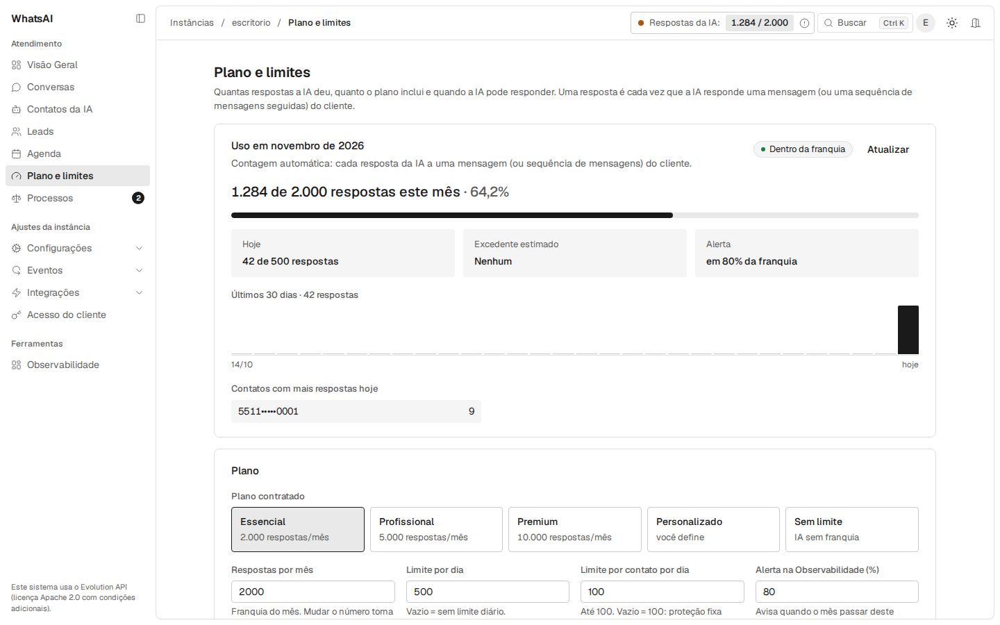](pr/X/antes-1440-light.jpg) | [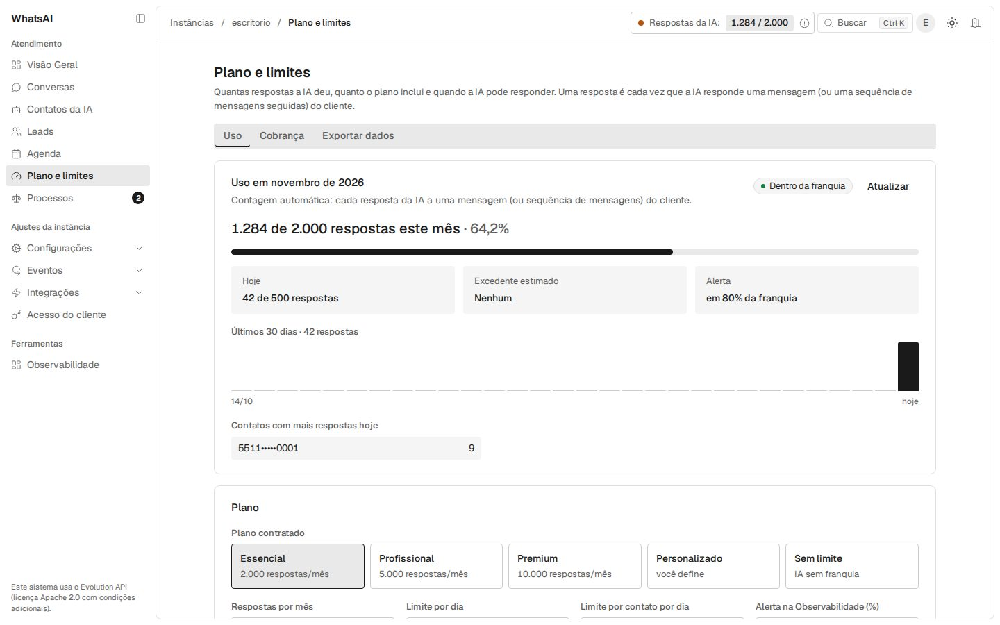](pr/X/depois-1440-light.jpg) |

Outras capturas: [escuro 1440](pr/X/antes-1440-dark.jpg) / [depois](pr/X/depois-1440-dark.jpg), [claro 390](pr/X/antes-390-light.jpg) / [depois](pr/X/depois-390-light.jpg) e [escuro 390](pr/X/antes-390-dark.jpg) / [depois](pr/X/depois-390-dark.jpg).

**Veredito: entregue com ressalva.** A cobrança ainda depende de uma fonte que não existe: não há tabela, boleto, Pix, comprovante, nota fiscal nem registro de pagamento; a API responde honestamente com `source` "none" e histórico vazio. A exportação não tem mídia (só texto e marcadores), para em 4 GiB por causa do ZIP32, não tem limite de frequência próprio e o registro de ações depende da letra V. O PR mexe em `src/` e o deploy reinicia a API.

## Y · Central de notificações

**Proposta.** Uma lista só, como no Twenty e no Frappe, com "marcar como visto". Só lê o estado que o sistema já tem, sem mexer na conexão, e junta-se à parte de notificações da proposta F.

**Entrega.** PR [#108](https://github.com/devconnecting1/evolution-api-render/pull/108), mesclado, pelo patch `central-notificacoes.py`. O sino aparece nos três cabeçalhos e reúne, em ordem de urgência, WhatsApp desconectado ou aguardando conexão, novo andamento em processo monitorado e novas publicações do DJEN, uso do plano de respostas da IA a partir de 85% e agenda de hoje ou agendamentos pendentes. Tem abas Não vistas e Todas, "Marcar tudo como visto" e visto por item, com o estado em `localStorage` na chave `wa-notif-seen-v1`.

**Imagem de referência no artefato:** [aviso de hoje](../Artefato%20do%20Projeto/img/g/g-toast.jpg).

| Antes (1440, claro) | Depois (1440, claro) |
| --- | --- |
| [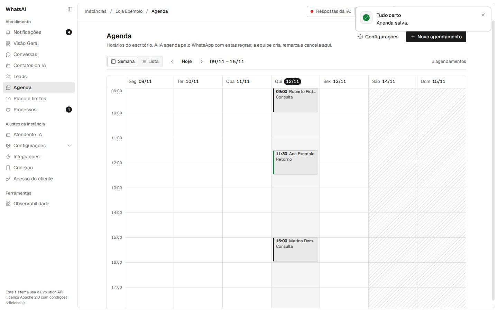](pr/Y/antes-1440-light.jpg) | [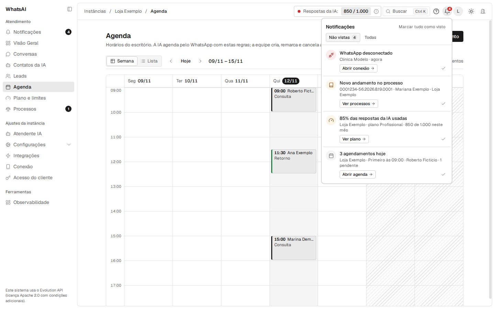](pr/Y/depois-1440-light.jpg) |

Outras capturas: [instâncias depois](pr/Y/depois-instancias-1440-light.jpg), [aviso depois](pr/Y/depois-toast-1440-light.jpg), [escuro 1440](pr/Y/antes-1440-dark.jpg) / [depois](pr/Y/depois-1440-dark.jpg) e [390 claro](pr/Y/antes-390-light.jpg) / [depois](pr/Y/depois-390-light.jpg).

**Veredito: entregue com ressalva.** O estado é em memória: um recarregamento duro começa vazio e é preenchido pela primeira tela. O sino não lê o instante exato da desconexão, a agenda de hoje antes de visitar a Agenda nem dados de outras instâncias num recarregamento direto em página global. Sem timer e sem polling, coerente com a regra do Neon.

## AA · Movimento e acabamento com um padrão só

**Proposta.** Um arquivo de padrões usado pelo site e pelo painel, com tempos (120 ms hover, 200 ms menus, 240 ms gavetas e diálogos, 320 ms revelar ao rolar, desligado com movimento reduzido), cantos, sombras, ícones Lucide e tipografia Geist. Gavetas, menus e diálogos com a mesma entrada curta; "Salvo" no botão; miniaturas em traço nos vazios; pedaços reais do produto no site. Vai junto com L.

**Entrega.** O status oficial do artefato marca "entregue em PRs anteriores", sem PR próprio no pacote #83 a #108. O trabalho de movimento já vinha de antes, como a animação de abrir e fechar o menu lateral no #64, e a folha única da proposta L (#97) consolidou a base visual.

**Imagem de referência no artefato:** [gaveta do painel de hoje, sem transição](../Artefato%20do%20Projeto/img/d/d-ours-drawer.jpg).

**Capturas.** Não há pasta `readmes/pr/AA` nem antes/depois dedicado.

**Veredito: entregue em PRs anteriores, sem captura.** Como não há PR único, os tempos e tokens devem ser conferidos nas telas novas; a regra de respeitar "reduzir movimento" continua valendo.

## Recomendações e lacunas

O que os PRs registraram como pendência ou limitação, consolidado por tema:

1. **V em etapas.** A etapa 1 (#103) entregou login por pessoa, sessões e revogação, mas o painel ainda entra pela chave global. Faltam a tela "Entrar com Google", a página Equipe, os papéis Dono, Equipe e Só leitura, o registro de ações de negócio com filtro e exportação, convites e rate limit em `/auth/google/exchange`. O código de uso único fica na memória de um processo só; com mais de uma instância seria preciso armazenamento compartilhado.
2. **X sem fonte de cobrança.** A API responde `source` "none" e histórico vazio porque não existe tabela, boleto, Pix, comprovante, nota fiscal ou registro de pagamento. Quando a fonte existir, basta trocar a origem em `UsageController.getBilling`. A exportação não tem mídia, para em 4 GiB (ZIP32), não tem limite de frequência próprio e o registro de ações depende de V.
3. **C com visões só no navegador.** As visões fixadas ficam em `localStorage`, no máximo 8, e não são compartilhadas entre pessoas. O quadro usa `pageSize=100` e "Ver todos" para o restante; arrastar é do computador e o menu de status cobre toque e teclado. A versão com servidor fica para depois, se fizer falta.
4. **Y com estado em memória.** O sino é preenchido pelo que as telas já consultaram; um recarregamento duro começa vazio. O visto fica em `localStorage`. Não há timer, polling nem o instante exato da desconexão; a agenda de hoje só entra depois de visitar a Agenda, e dados de outras instâncias não aparecem num recarregamento direto em página global.
5. **S com bundle único.** O painel ainda baixa cerca de 1,5 MB inteiro no primeiro acesso; o corte por rota depende de mexer no build do fonte. O HTML não tem cache próprio e as páginas 404, acesso, observabilidade e landing ainda preloadam a fonte sem `?v=`.
6. **L sem capturas.** A folha única de estilo é transversal e não gerou antes/depois versionado. É a base das outras propostas; telas e patches novos precisam carregar o `design-system.css` por último para não regredir.
7. **M, N e AA sem PR nem captura.** O artefato marca as três como entregues em PRs anteriores, mas não há um PR único rastreável nem antes/depois dedicado. O risco é cada tela nova voltar a criar a própria versão de componente, formato ou movimento. Vale manter o `design-system.css` e os componentes existentes como referência e conferir formatos de telefone, data e textos nas telas novas.
8. **O em primeira etapa.** A landing caiu de 17 para 12 seções e de 18.162 para 13.477 px no computador (30.079 para 20.150 px no celular), mas a meta de 6 seções e cerca de 8.500 px não foi atingida. A segunda etapa (tour em abas e seletor de segmentos) não entrou.
9. **H com ressalvas de formulário.** Cada seção tem o seu "Salvar", mas todos enviam o formulário inteiro; não há gravação parcial. "Testar uma conversa" abre Conversas, não um simulador. O diálogo "Novo atendente" continua como era, as seções não foram levadas a Comportamento, Proxy e Plano, não há seção de horário de atendimento e ficaram de fora salvamento automático e histórico de versões.
10. **I com teste de configuração.** Não há endpoint de entrega de um evento de teste ao destino; "Enviar teste" valida a configuração usando o mesmo endpoint de Salvar. Quando existir um endpoint real, basta trocar a chamada no componente.
11. **B com cartão somente leitura.** Fora pausar/retomar a IA, o cartão não edita status nem prioridade; isso exige uma rota de escrita. Processos são casados por JID exato ou dígitos do telefone, então `@lid` pode não casar, e a consulta devolve até 1000 linhas.
12. **E com ações dependentes dos botões.** O menu aciona os botões e filtros reais via MutationObserver (8 s); se a página não abrir o formulário no prazo, aparece uma mensagem amigável. O PR recomenda teste manual em homologação das ações de pausar/retomar, agendar, mudar status, adicionar processo e exportar.
13. **W com link e conteúdo manuais.** "Guia rápido" aponta para o manual em repositório privado; se o cliente não tiver acesso, o link não abre. `/novidades` é mantido à mão. Não há status do serviço, por decisão de não criar polling. O atalho `P` merece teste manual com conversa real.
14. **K com cortes no celular.** A seleção em massa de Instâncias fica só no computador; telefone do lead e classe/atualizado do processo saem do cartão, mas continuam no painel lateral. As tabelas de sessões de chatbot receberam empilhamento genérico, mas não foram capturadas.
15. **Capturas ausentes em Z, T, U, P, Q, R, O, V, L, M, N e AA.** Em Z, T, U, P, Q, R e O o PR registrou capturas ou validação por axe, mas elas não foram versionadas em `readmes/pr`; em V a entrega é de API; em L, M, N e AA a entrega é transversal ou veio de PRs anteriores. Para uma próxima rodada, vale gerar as capturas faltantes ou aceitar que o registro fica no corpo do PR.
16. **Pendências operacionais do pacote.** O #109 registrou que a conferência final do deploy `live` no Render, da instância do WhatsApp `open` e das tabelas `User`/`UserSession` no Neon fica com o Claude Code do dono. O PR #82 (Baileys rc14) segue aberto e fora deste pacote.
