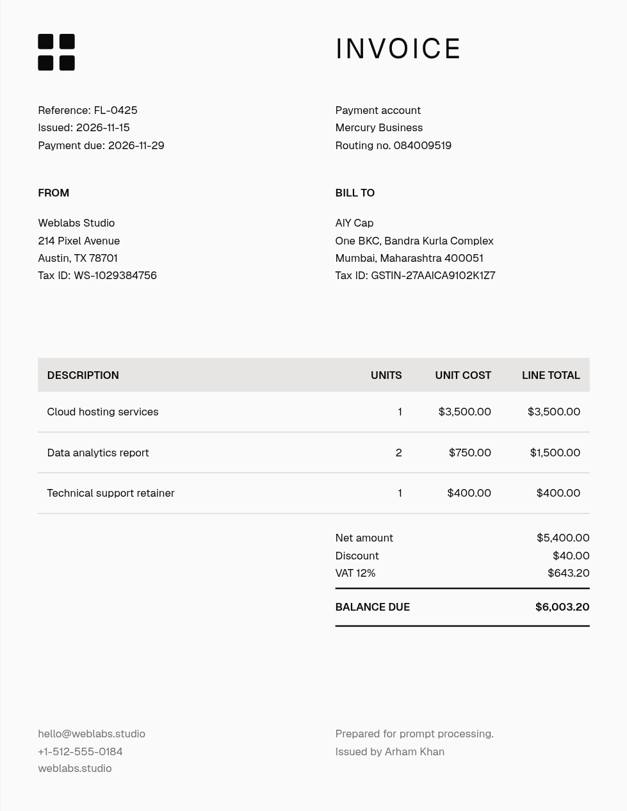
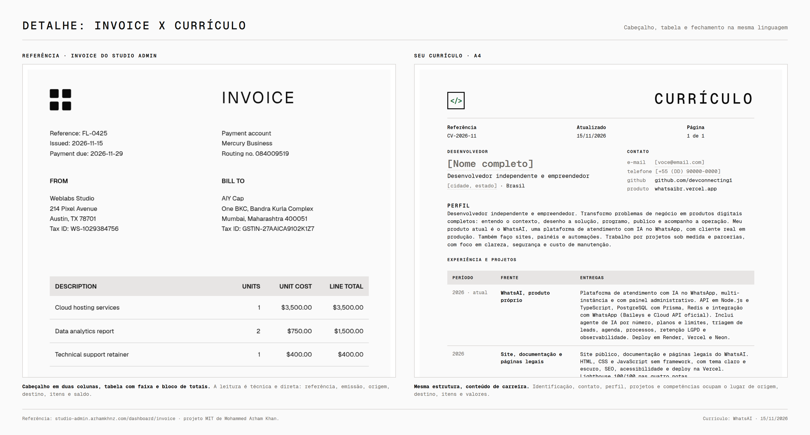

# Currículo x invoice do Studio Admin

Comparação do currículo do WhatsAI com a página de invoice do Studio Admin (projeto MIT de Mohammed
Arham Khan), com as decisões de adaptação e as recomendações para o envio.

O currículo final, com nome, e-mail e telefone, fica fora do Git. Este diretório versiona apenas o
template com placeholders, as capturas e a comparação.

## Arquivos

| Arquivo | O que é |
| --- | --- |
| `curriculo.html` | Template do currículo em A4, uma página, com campos marcados. |
| `curriculo-template.pdf` | O mesmo template em PDF, para conferir o formato. |
| `comparacao.html` | Comparação visual em duas páginas A4 paisagem. |
| `comparacao.pdf` | A comparação em PDF. |
| `referencia-invoice.png` | Captura da página de invoice do Studio Admin. |
| `curriculo-preview.png` | Captura do currículo em A4. |
| `comparacao-pagina-1.png` | Captura da página 1 da comparação. |
| `comparacao-pagina-2.png` | Captura da página 2, com decisões e recomendações. |
| `comparacao-detalhe.png` | Detalhe do cabeçalho e da tabela, lado a lado. |

## O que foi comparado

## O que veio da referência

- Cabeçalho em duas colunas: marca à esquerda, título à direita.
- Linha de referência e data logo abaixo do cabeçalho.
- Tabela com faixa cinza no cabeçalho e fios entre as linhas.
- Bloco de fechamento com a última linha em destaque.
- Rodapé de contato.
- Tipografia mono e paleta neutra, com verde só na marca.

## O que mudou para o seu caso

| No invoice | No currículo | Por quê |
| --- | --- | --- |
| Letter, 8,5 x 11 in | A4, 210 x 297 mm | Padrão de impressão no Brasil e em escritórios. |
| Itens, unidades e valores | Período, frente e entregas | A tabela de cobrança vira histórico de trabalho. |
| From / Bill to | Desenvolvedor / Contato | A mesma leitura em dois blocos, aplicada a quem se apresenta. |
| Subtotal, imposto e saldo | Em resumo e modelo de trabalho | O bloco de totais vira a síntese da proposta. |
| Dados de exemplo (Weblabs, AIY Cap) | Links reais do produto e GitHub; campos pessoais como placeholders | Nada de inventar empresa, cliente ou formação. |
| Sem formação | Autodidata, sem diploma universitário | Honestidade e prova real: o que vale é o que está em produção. |
| Contato e emissor no rodapé | Contato, produto e data | Fecha o documento com os links que o leitor vai usar. |

## Recomendações

1. **Posicione-se como independente.** O documento é para projetos e parcerias, sem vínculo formal,
   não para uma vaga. Diga isso na primeira linha.
2. **Fale de resultado antes de tecnologia.** Para um empresário, "o que foi entregue" e "qual
   problema resolveu" valem mais que a lista de frameworks.
3. **Use prova em produção.** WhatsAI, site e GitHub são mais fortes que qualquer adjetivo. Deixe os
   links visíveis e testados.
4. **Trate o diploma com naturalidade.** "Formação autodidata" e projetos reais bastam no papel. Na
   conversa, seja direto: não tem diploma, aprendeu construindo. Não invente formação.
5. **Mantenha uma página.** Se entrar mais experiência, corte a menos relevante. Não reduza a fonte
   abaixo de 8 pt.
6. **Preencha os campos marcados.** Nome, cidade, e-mail, telefone e nível de inglês. Teste e-mail,
   telefone e links antes de enviar.
7. **Envie com uma mensagem curta.** Três linhas: quem você é, o que já entregou e o que gostaria de
   conversar. Se a conversa andar, leve uma proposta de uma página para um problema concreto do
   negócio dele.
8. **Não copie a marca nem os dados de exemplo.** O invoice é referência de desenho, não de conteúdo.
   Nada de Weblabs, AIY Cap ou valores.

## Antes de enviar

- [ ] Nome completo e cidade/estado
- [ ] E-mail e telefone testados
- [ ] GitHub e produto abrindo
- [ ] Nível de inglês preenchido
- [ ] Modelo de trabalho claro
- [ ] PDF final em uma página A4

## Privacidade

O template e as capturas usam placeholders. Nenhum nome, e-mail, telefone ou dado de cliente real foi
versionado. O PDF final, com os dados preenchidos, fica em `.claude/curriculo/`, fora do Git; o
`.git/info/exclude` já ignora essa pasta.

## Pendências para o currículo final

- Nome completo
- Cidade e estado
- E-mail
- Telefone
- Nível de inglês
- Outros projetos ou experiências (opcional)
- CNPJ ou nome da empresa (opcional)
- Site ou portfólio pessoal (opcional; o produto já está no currículo)

## Como gerar o PDF

Abra `curriculo.html` e use "Imprimir ou salvar em PDF" (A4, margens zero, uma página). Para a
comparação, abra `comparacao.html` e imprima em A4 paisagem. As capturas foram geradas com o Chromium
headless em 15/11/2026.

## Referência

- Página: https://studio-admin.arhamkhnz.com/dashboard/invoice
- Projeto MIT: https://github.com/arhamkhnz/next-shadcn-admin-dashboard
