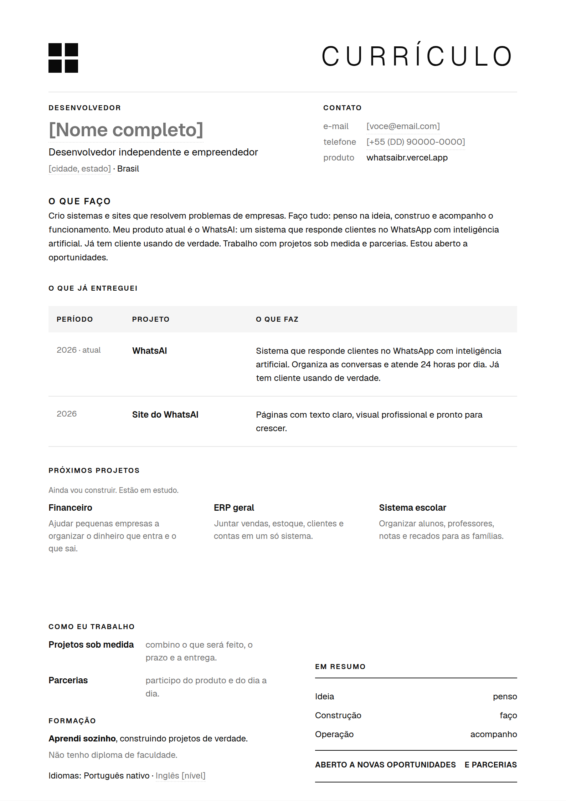
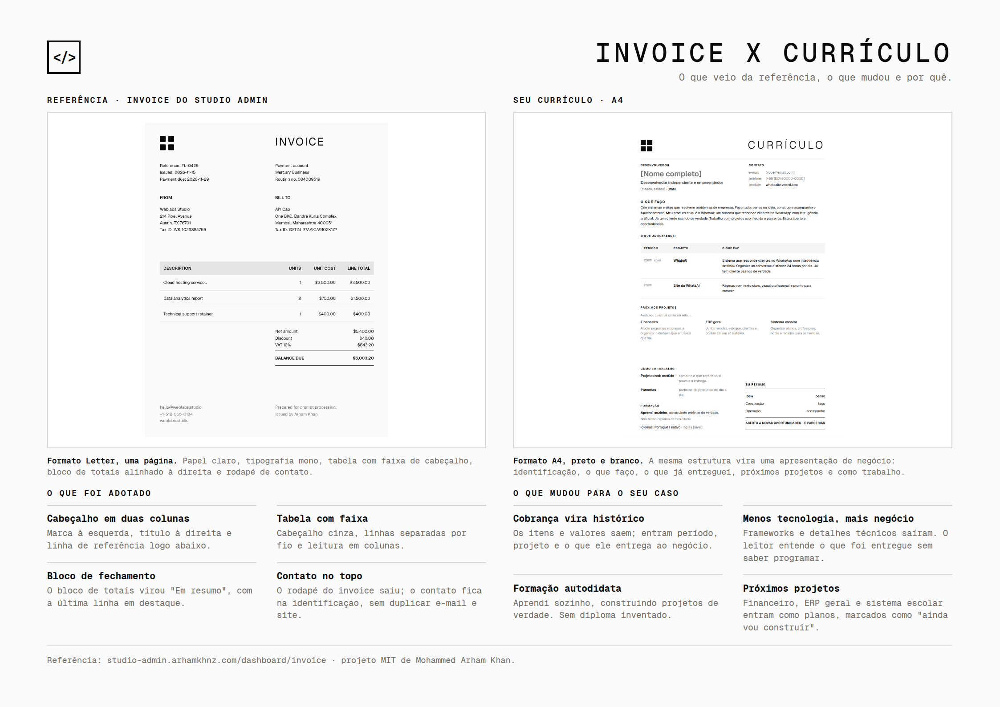

# Currículo A4 x invoice do Studio Admin

Comparação do currículo do WhatsAI com a página de invoice do Studio Admin (projeto MIT de Mohammed
Arham Khan). A versão final usa a fonte Geist, as cores e o símbolo de quatro quadrados da referência,
tem uma página A4 e linguagem direta para um leitor de negócio que não conhece programação.

O currículo final, com os dados pessoais, fica fora do Git. Este diretório versiona apenas o template
com placeholders, as capturas e a comparação.

## Arquivos

| Arquivo | O que é |
| --- | --- |
| `curriculo.html` | Template do currículo em A4, uma página, com campos marcados. |
| `curriculo-template.pdf` | O mesmo template em PDF, para conferir o formato. |
| `comparacao.html` | Comparação visual em duas páginas A4 paisagem. |
| `comparacao.pdf` | A comparação em PDF. |
| `referencia-invoice.png` | Captura da página de invoice do Studio Admin. |
| `curriculo-preview.png` | Captura do template do currículo em A4. |
| `comparacao-pagina-1.png` | Captura da página 1 da comparação. |
| `comparacao-pagina-2.png` | Captura da página 2, com decisões e recomendações. |
| `comparacao-detalhe.png` | Detalhe do cabeçalho e da tabela, lado a lado. |

## O que foi comparado

## O que veio da referência

- Cabeçalho em duas colunas: símbolo de quatro quadrados à esquerda, título à direita.
- Tabela com faixa cinza no cabeçalho e fios entre as linhas.
- Bloco de fechamento com a última linha em destaque.
- Tipografia Geist, a mesma da referência.
- Paleta preto e branco: fundo `#fff`, texto `#0a0a0a`, secundário `#737373`, linhas `#e5e5e5` e faixa
  `#f5f5f5`.
- A4 real: 210 x 297 mm, 595 x 842 pt.

## O que mudou para o seu caso

| No invoice | No currículo | Por quê |
| --- | --- | --- |
| Letter, 8,5 x 11 in | A4, 210 x 297 mm | Padrão de impressão no Brasil e em escritórios. |
| Itens, unidades e valores | Período, projeto e o que faz | A tabela de cobrança vira histórico de trabalho. |
| From / Bill to | Desenvolvedor / Contato | A mesma leitura em dois blocos, aplicada a quem se apresenta. |
| Subtotais e saldo | Em resumo e como eu trabalho | O bloco de totais vira o convite final. |
| Dados de exemplo (Weblabs, AIY Cap) | Links reais do produto; campos pessoais como placeholders | Nada de inventar empresa, cliente ou formação. |
| Sem formação | Aprendi sozinho, sem diploma de faculdade | Honestidade e prova real: o que vale é o que está em produção. |
| Sem próximos projetos | Financeiro, ERP geral e sistema escolar, como "ainda vou construir" | Mostra visão e ambição sem prometer o que ainda não foi entregue. |
| Rodapé com contato | Contato no topo | O rodapé repetia e-mail e site; o contato já aparece na identificação. |
| Neutros | Preto e branco | A referência é preto e branco; cor só se acrescentar informação. |
| Mono | Geist | A referência usa Geist; a sans deixa o documento mais limpo que a mono. |

## Recomendações

1. **Posicione-se como independente.** O documento é para projetos e parcerias, e você está aberto a
   oportunidades. Deixe isso claro no começo.
2. **Resultado antes de tecnologia.** O currículo atual já faz isso: saíram os frameworks e ficou o que
   o negócio entende.
3. **Use prova em produção.** WhatsAI e site valem mais que adjetivos. Deixe os links visíveis e
   testados.
4. **Trate o diploma com naturalidade.** "Aprendi sozinho" e projetos reais bastam. Na conversa, seja
   direto: aprendeu construindo. Não invente formação.
5. **Mostre visão sem prometer o que não existe.** Financeiro, ERP e sistema escolar entram como "ainda
   vou construir", não como entregas.
6. **Geist, preto e branco, menos é mais.** A mesma fonte e as mesmas cores da referência, uma página,
   poucos blocos e linguagem que qualquer pessoa entende. O empresário não precisa de detalhes técnicos.
7. **Envie com uma mensagem curta.** Três linhas: quem você é, o que já entregou e o que gostaria de
   conversar. Se a conversa andar, leve uma proposta de uma página.
8. **Não copie a marca nem os dados de exemplo.** O invoice é referência de desenho, não de conteúdo.
   Nada de Weblabs, AIY Cap ou valores.

## Antes de enviar

- [ ] Nome, cidade, e-mail e telefone corretos
- [ ] Produto abrindo
- [ ] Nível de inglês preenchido
- [ ] Modelo de trabalho claro
- [ ] Projetos futuros como "ainda vou construir"
- [ ] Fundo e textos nas cores da referência
- [ ] Fonte Geist e símbolo de quatro quadrados
- [ ] PDF final em uma página A4

## Privacidade

O template e as capturas usam placeholders. O PDF final com os dados preenchidos fica em
`.claude/curriculo/curriculo-final.pdf`, fora do Git; o `.git/info/exclude` já ignora essa pasta.
Nenhum nome, e-mail, telefone ou dado de cliente real foi versionado.

## Como gerar o PDF

Abra `curriculo.html` e use "Imprimir ou salvar em PDF" (A4, margens zero, uma página). Para a
comparação, abra `comparacao.html` e imprima em A4 paisagem. As capturas foram geradas com o Chromium
headless em 15/11/2026.

## Referência

- Página: https://studio-admin.arhamkhnz.com/dashboard/invoice
- Projeto MIT: https://github.com/arhamkhnz/next-shadcn-admin-dashboard
