# Cabeçalho global com tema e rodapé único

Esta proposta leva o cabeçalho da landing para `/seguranca`, `/termos` e `/privacidade`, e também para
`/novidades`. O rodapé compacto da landing passa a ser o rodapé dessas páginas. O menu de tema Sistema, Claro e
Escuro, que só existia no `/docs`, entra no cabeçalho global e fica visível no computador e no celular.

## O que mudou

- **Cabeçalho compartilhado:** o CSS do topo, do menu de tema e do rodapé saiu de `landing-cursor.css` e virou
  `assets/site-shell.css`, incluído no bundle da landing e carregado diretamente nas páginas legais e em
  `/novidades`.
- **Tema no topo:** a landing e as páginas com o cabeçalho global ganharam o menu `Sistema` / `Claro` / `Escuro`, com
  os mesmos ícones e o mesmo comportamento do `/docs`. A preferência fica em `localStorage` (`wa-theme`), a mesma
  chave da documentação, então a escolha vale ao navegar entre as páginas.
- **Sem flash:** o tema salvo é aplicado antes da primeira pintura. A landing e `/novidades` usam
  `assets/theme.js`; as páginas legais continuam usando o `docs.js`, que já tinha a mesma lógica de tema.
- **Menu de tema visível no celular:** o botão fica no topo, ao lado do botão do menu, fora da gaveta. A gaveta
  continua com os links e o botão “Falar no WhatsApp”.
- **Páginas legais:** o antigo `site-head` e o rodapé `doc-footer` saíram. Entram o cabeçalho e o rodapé da landing,
  com os links da landing ajustados para `/#...`. O corpo ganhou `padding-top` de 52 px porque o topo é fixo, e o
  `--d-topbar` do índice lateral passou de 64 px para 52 px.
- **Contato:** os botões do topo e do rodapé usam `data-wa-cta`; o `landing.js` monta o link do WhatsApp com a origem
  da página (`seguranca`, `termos`, `privacidade`, `site`) e os `utm_*`.
- **Novidades:** a página deixou de usar o cabeçalho e o rodapé antigos e entrou no shell global. O conteúdo dela
  continua com a tipografia anterior; igualar o texto ao `/docs` fica para um PR separado.
- **Ícones:** entraram `i-sun`, `i-moon` e `i-monitor` no sprite da landing e de `/novidades`; as páginas legais
  ganharam `i-menu`, `i-close` e `i-chat` onde faltavam.
- **Índice e copiar link:** as páginas legais mantêm o `docs.js` para o “Copiar link” e o índice ativo. O menu de tema
  delas é o mesmo markup do novo cabeçalho, controlado pelo próprio `docs.js`.

## Comportamento do tema

| Recurso | Como funciona |
| --- | --- |
| Padrão | Sistema (`prefers-color-scheme`) |
| Opções | Sistema, Claro e Escuro |
| Persistência | `localStorage` na chave `wa-theme`, compartilhada com o `/docs` |
| Antes da pintura | `theme.js` na landing e `/novidades`; `docs.js` nas legais e no `/docs` |
| `theme-color` | Atualizado para `#ffffff` ou `#0d0d0d` conforme o tema efetivo |
| Teclado | Setas, Home, End, Escape, Tab e foco visível |
| Leitor de tela | `aria-expanded`, `role="menu"`, `role="menuitemradio"` e `aria-checked` |
| Movimento | Sem animação nova; o menu abre e fecha na hora |

## O que não mudou

- O cabeçalho do `/docs`, com busca, navegação lateral e índice, continua próprio da documentação.
- Cores, tipografia, geometria dos componentes, textos, preços e mockups da landing.
- O painel administrativo e o `/acesso`, que têm shells próprios.
- A CSP: não há script inline novo; `theme.js` é um arquivo externo servido pelo próprio site.

## Comparação

### Cabeçalho e tema em 1440 px

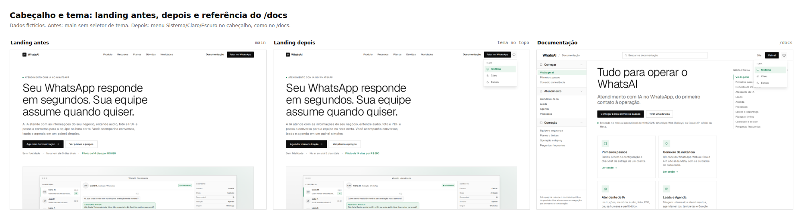

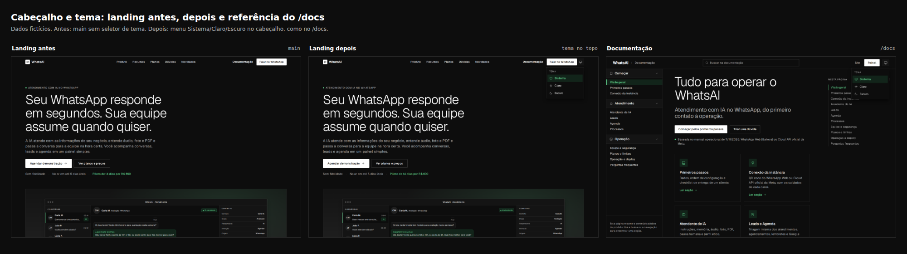

### Páginas legais com o cabeçalho global

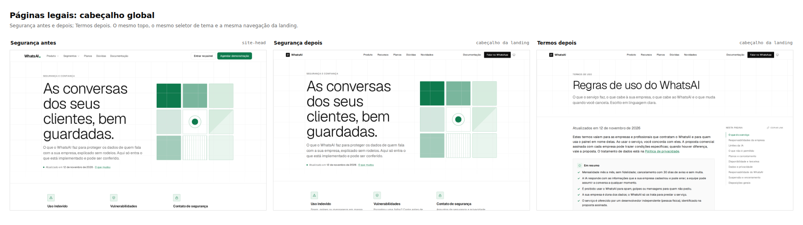

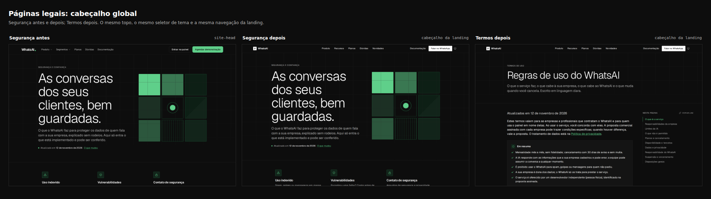

### Rodapé global nas páginas legais

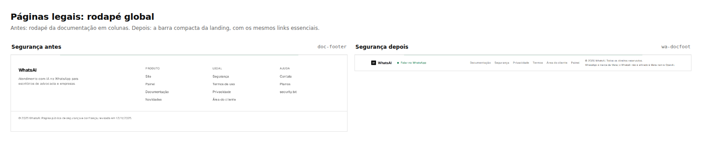

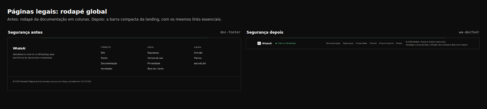

### Celular

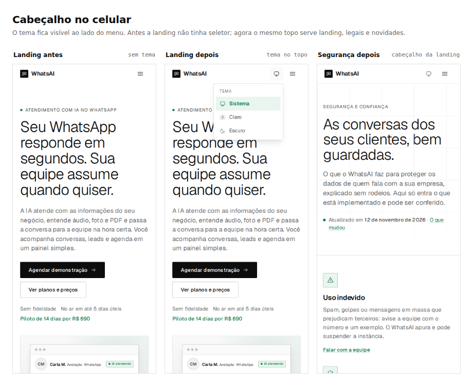

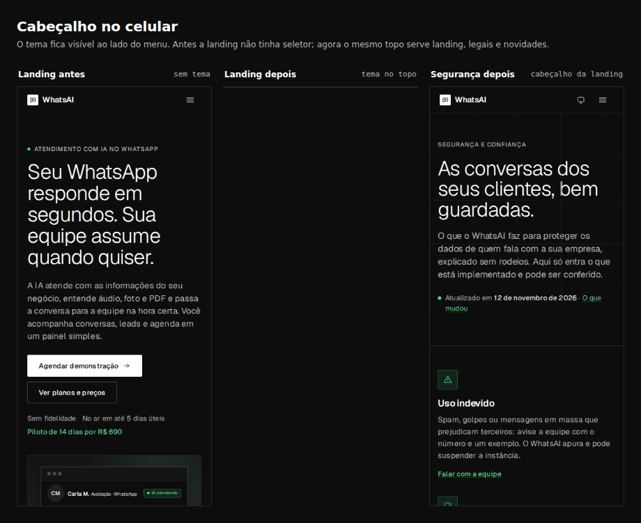

### Antes e depois em tamanho real

| Antes: landing sem tema | Depois: landing com o menu de tema |
| --- | --- |
| 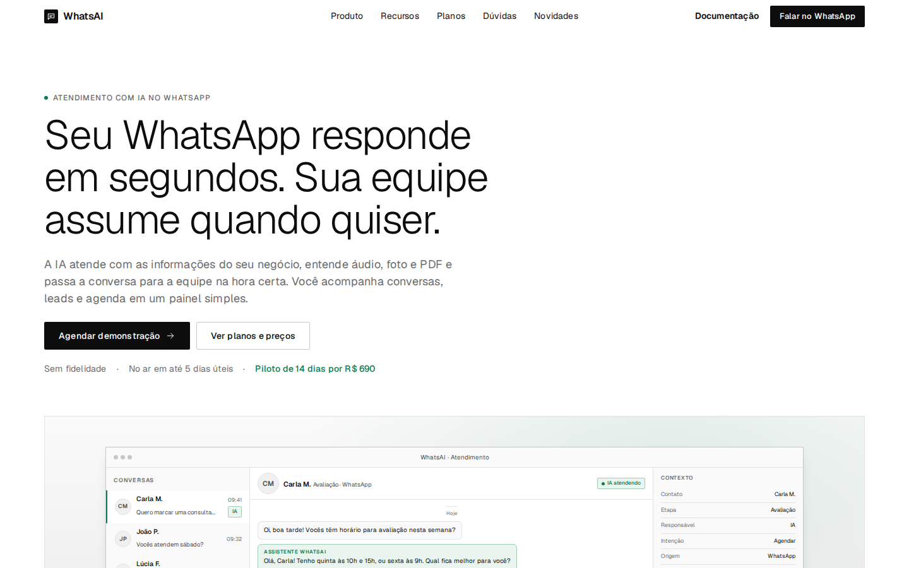 | 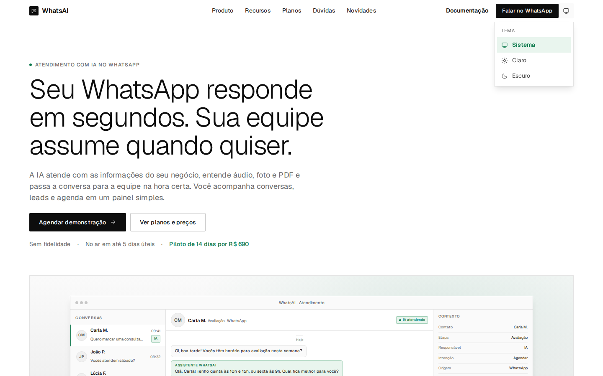 |
| 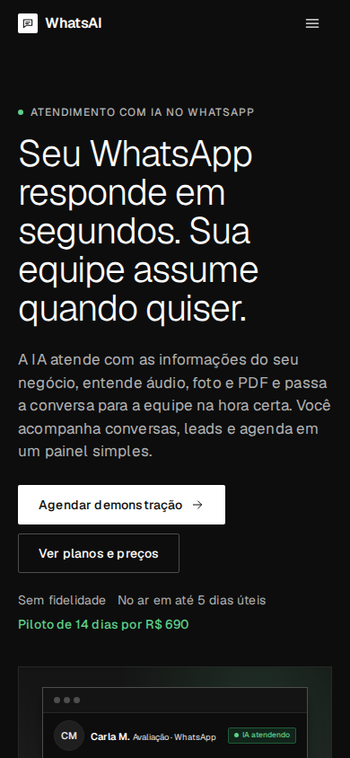 |  |

| Antes: Segurança com o topo antigo | Depois: Segurança com o topo da landing |
| --- | --- |
| 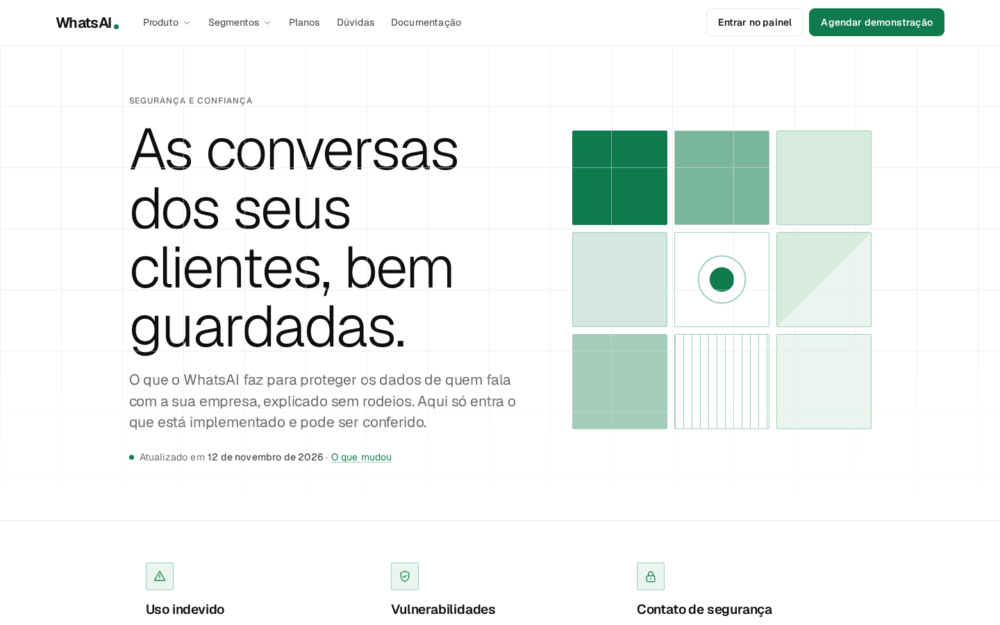 | 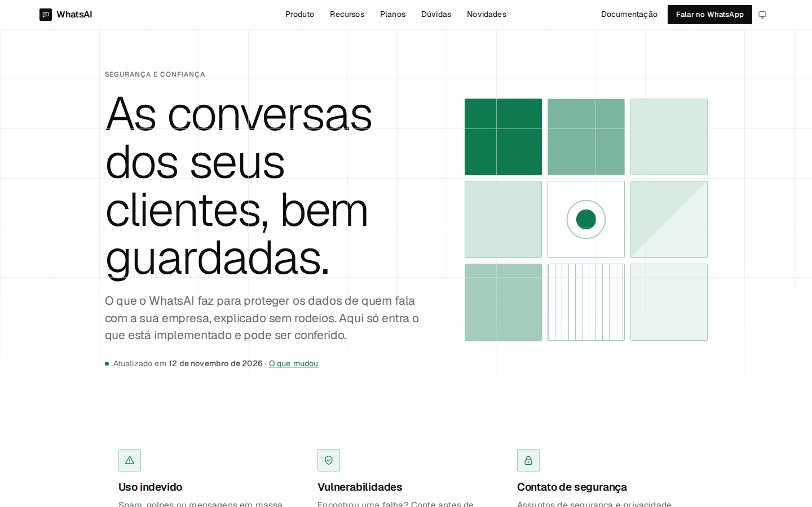 |
| 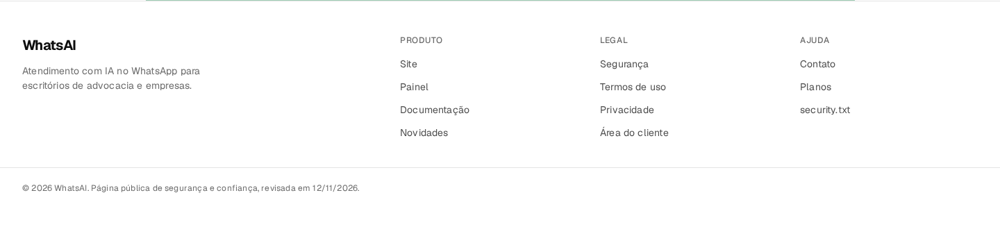 | 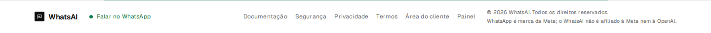 |

As demais capturas estão em `antes/` e `depois/`: landing, Segurança, Termos, Privacidade, Novidades, menu de tema
aberto em claro e escuro, e a referência do `/docs`.

## Arquivos alterados

- `manager/dist/assets/site-shell.css`: novo CSS compartilhado do cabeçalho, menu de tema e rodapé.
- `manager/dist/assets/theme.js`: aplicação e menu de tema da landing e de `/novidades`.
- `manager/dist/assets/landing-cursor.css`: remoção do topo e do rodapé que foram para o shell.
- `manager/patches/landing-css.mjs`: `site-shell.css` incluído no bundle.
- `manager/dist/landing/index.html`: menu de tema, ícones, `theme.js`, `data-theme-color` e novo grid do topo.
- `manager/dist/landing/seguranca.html`, `termos.html`, `privacidade.html`: cabeçalho e rodapé globais, `site-shell.css`,
  `landing.js`, `legal-page` e ícones que faltavam.
- `manager/dist/landing/novidades.html`: cabeçalho e rodapé globais, ícones e `theme.js`.
- `manager/dist/landing/legal.css`: `--d-topbar` de 52 px.
- `readmes/pr/header-footer-globais/`: este README e as capturas.

## Checagens

- `node manager/patches/landing-css.mjs --check` passa.
- `python3 -I manager/patches/perf-boot.py --check` passa.
- `python3 -I manager/patches/theme.py --check` passa.
- Mudança só estática (`manager/**` e `readmes/**`): o squash termina com `[skip render]`; a API no Render não reinicia.
- Sem `src/`, `prisma/`, `Dockerfile` ou `render.yaml`; sem migration.
- Sem script inline novo; a CSP de `manager/dist/vercel.json` não muda.
- O GitHub Actions roda lint, Prettier, build, tipos, unitários, integração e patches do painel.

## Recomendações

1. Manter o shell em `site-shell.css` e não voltar a duplicar topo ou rodapé nos CSS de página. O HTML ainda repete o
   markup em cada arquivo estático; um passo de build ou include reduziria essa repetição no futuro.
2. O `theme.js` e o trecho de tema do `docs.js` têm a mesma lógica. Em uma refatoração futura, extrair só o tema para
   um módulo comum e fazer o `docs.js` reutilizá-lo, sem mexer na busca e no índice da documentação.
3. Remover `assets/site-header.css` e `assets/site-header.js` em um PR de limpeza se nenhuma página ainda os usar.
   Nesta mudança eles deixaram de ser carregados por landing, legais e novidades.
4. O `/novidades` entrou no shell, mas o conteúdo ainda usa a tipografia antiga. Alinhar os títulos e o corpo ao `/docs`
   é um passo separado, como foi feito na landing.
5. O antigo topo das páginas legais tinha “Entrar no painel” e “Agendar demonstração”; o topo global mantém
   “Documentação” e “Falar no WhatsApp”, e o rodapé tem “Painel” e “Área do cliente”. Se o login precisar de mais
   destaque, avaliar um link no topo sem quebrar a paridade com a landing.
6. Conferir a persistência do tema entre `/`, `/seguranca`, `/termos`, `/privacidade`, `/novidades` e `/docs`, o foco
   por teclado e o Lighthouse depois do merge.
