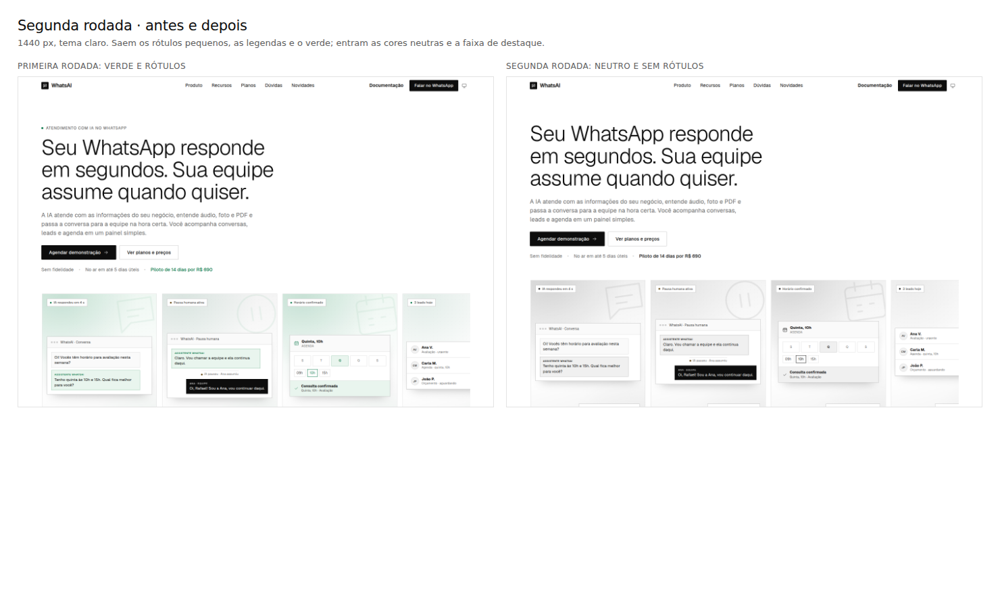
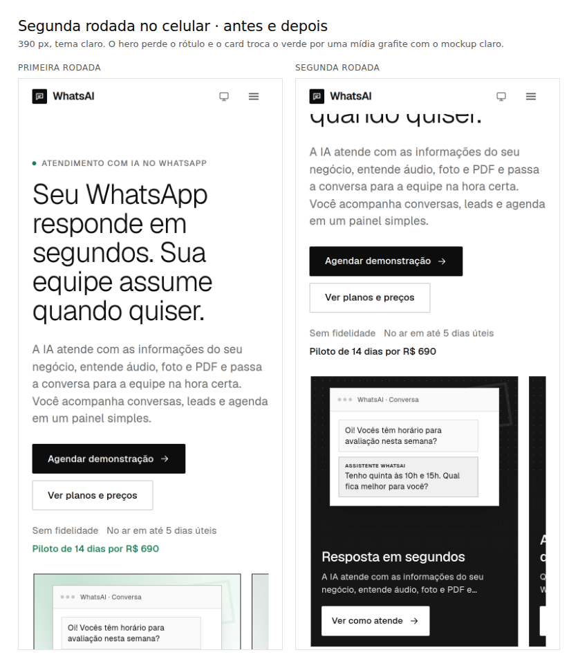
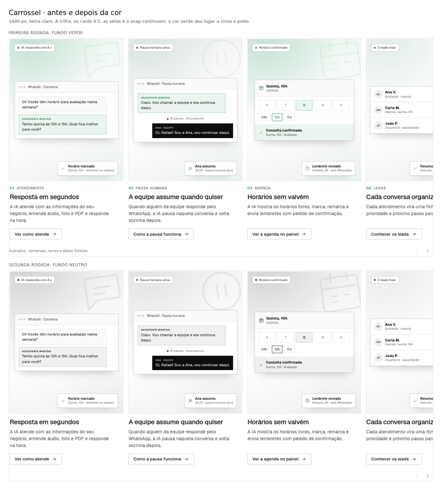
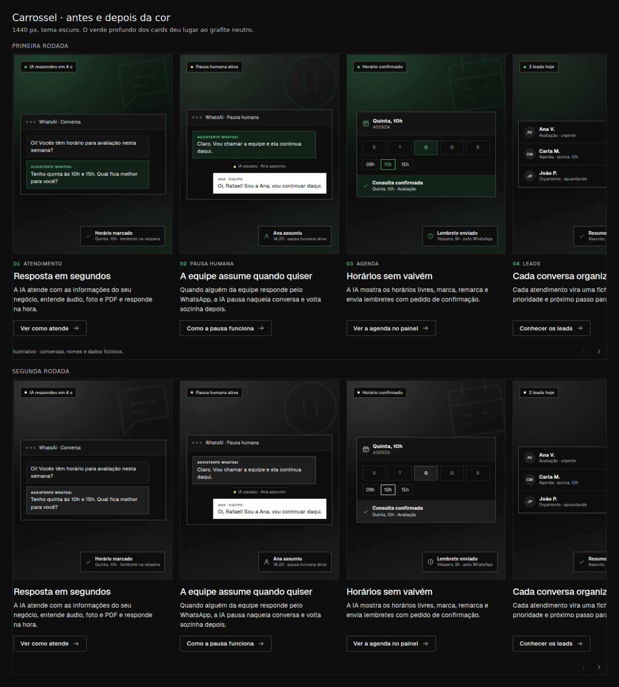
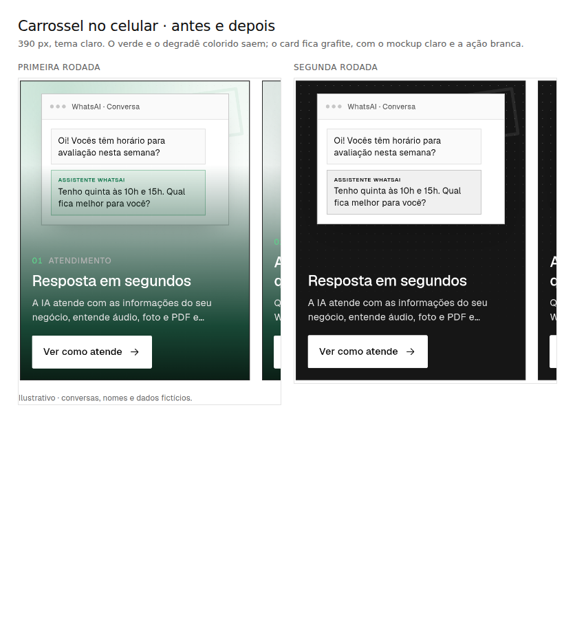
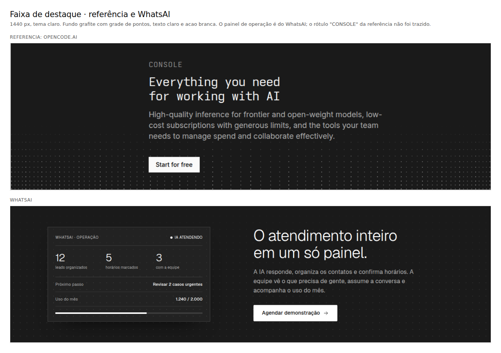
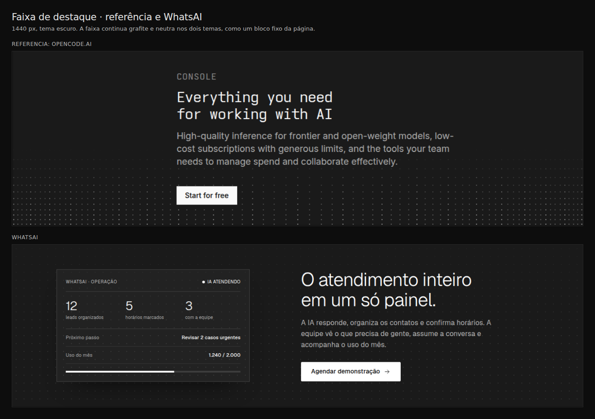
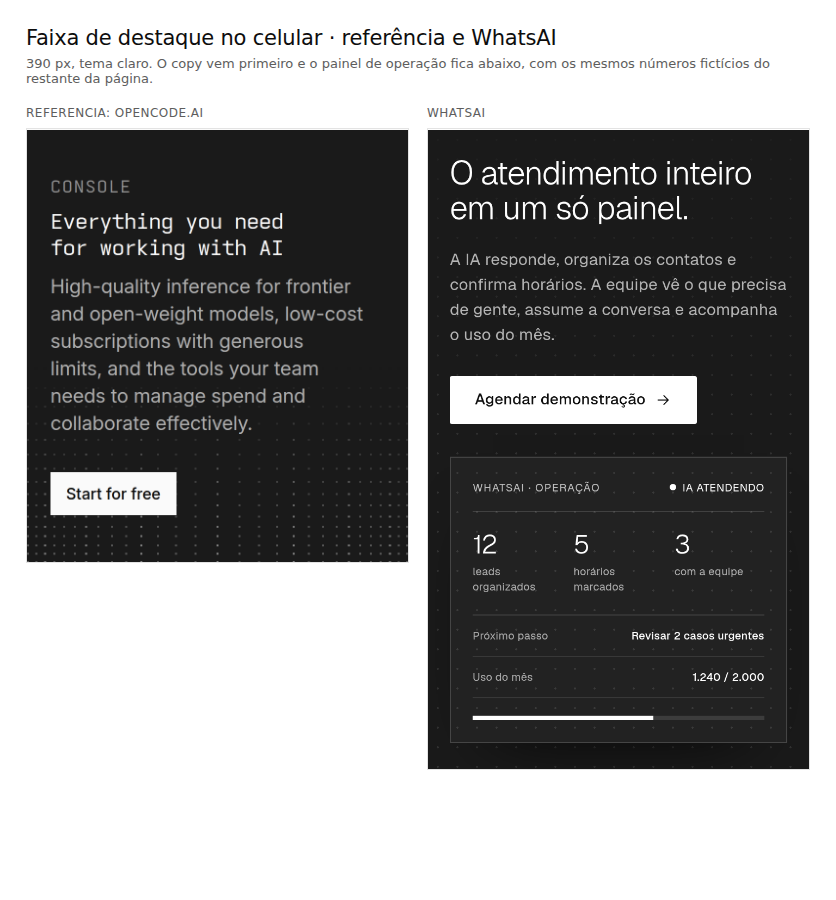
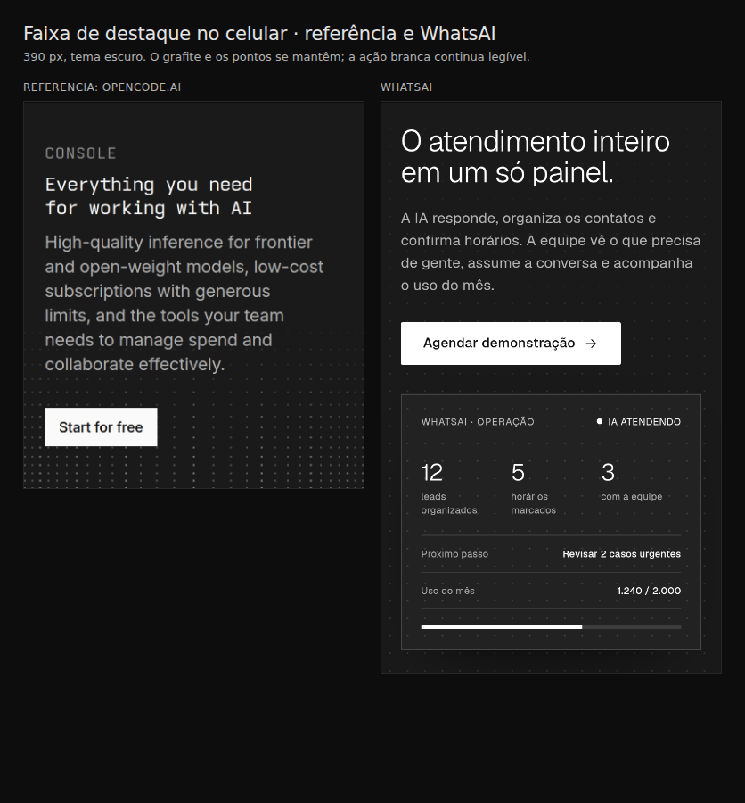

# Hero em carrossel e faixa de destaque na landing

Proposta para a home do WhatsAI com duas referências da home pública do [opencode.ai](https://opencode.ai/),
adaptadas para a nossa interface e o nosso conteúdo:

- o hero em carrossel horizontal, com cards de mídia, título, texto e ação, snap por card e setas discretas;
- uma faixa de destaque escura, com grade de pontos, texto claro e uma ação, no lugar do bloco de console da
  referência.

O conteúdo, os mockups, as cores e a tipografia são do WhatsAI. A referência foi observada em 15/11/2026, em 1440 e
390 px, nos temas claro e escuro. Nenhum logo, texto, fonte, imagem, vídeo, CSS ou arquivo do opencode foi copiado.

## O que mudou

### Hero em carrossel

- O hero deixou de ser uma janela única de produto e passou a ser um carrossel de quatro cards: Atendimento,
  Pausa humana, Agenda e Leads.
- Cada card tem uma mídia 4:5 com um mockup em HTML/CSS, um selo de estado, uma nota de resultado e o texto do card
  logo abaixo no desktop.
- No celular, a mídia é grafite e o texto fica sobreposto na base, como na referência. O próximo card aparece cortado
  à direita.
- As setas andam um card por vez, ficam desabilitadas nas pontas, somem em aparelhos de toque e não existem sem
  JavaScript (a trilha continua rolando nativamente).
- Quatro âncoras novas levam cada card ao bloco correspondente da página: `#atendimento`, `#pausa-humana`, `#agenda`
  e `#leads`.

### Accent neutro, sem verde de fundo

- O verde de interface deu lugar ao accent neutro invertido: preto no tema claro e branco no tema escuro. Isso vale
  para links, botões, setas, foco, badges e o destaque do plano Profissional.
- Os cards do carrossel perderam o fundo verde: no desktop ficam em cinza claro; no celular, em grafite `#161616`
  com o mockup claro e a ação branca.
- As paisagens dos mockups, os cartões de destaque e o plano Premium também ficaram neutros. O Premium mantém o fundo
  grafite, agora com pixels brancos.
- O âmbar continua só com significado: pausa humana e contato urgente.

### Rótulos e legendas removidos

- Saíram os rótulos pequenos acima das seções e dos cards ("Atendimento com IA no WhatsApp", "Atendimento",
  "Pausa humana", "Em cada ferramenta", "Um jeito mais simples de atender", "Planos e preços", "Antes de decidir",
  "Novidades", "Por dentro do WhatsAI", "01 Atendimento" etc.).
- Saíram também os rótulos internos das nove colunas de recursos e as legendas visíveis "Ilustrativo · conversas,
  nomes e dados fictícios".
- A indicação de mockup e de dados fictícios continua no `aria-label` das figuras, em uma nota `sr-only` do
  carrossel e no comentário do HTML. Ela não aparece visualmente.

### Faixa de destaque

- Entrou entre "Sempre um passo à frente" e os planos: fundo grafite `#1a1a1a`, grade de pontos de 18 px, painel de
  operação à esquerda e título, texto e ação à direita.
- O painel usa os mesmos números fictícios do restante da página: 12 leads organizados, 5 horários marcados, 3 com a
  equipe, próximo passo e uso do mês.
- A ação é "Agendar demonstração", no mesmo fluxo de WhatsApp da página. Sem rótulo pequeno, sem autoplay e sem
  imagens.
- No celular, o texto e a ação vêm primeiro; o painel fica abaixo.

### Arquivos alterados

- `manager/dist/landing/index.html`
- `manager/dist/assets/landing-cursor.css`
- `manager/dist/assets/landing.js`
- `manager/dist/assets/landing-pixels.js`
- `manager/dist/assets/landing.bundle.css` (gerado por `node manager/patches/landing-css.mjs`)
- `readmes/pr/hero-carousel-opencode/` (esta documentação e as capturas)

## Referência e adaptação

### Carrossel

| Item | opencode.ai | WhatsAI |
| --- | --- | --- |
| Mecânica | Trilha horizontal com snap, rolagem nativa e setas | Idêntica |
| Cards | 4 produtos, mídia 4:5, texto e ação | 4 recursos, mídia 4:5, texto e ação |
| Visíveis no desktop | Cerca de 3,6 cards, o quarto cortado | 3,6 cards a partir de 1200 px |
| Espaço entre cards | 16 px | 16 px |
| Mídia | Imagem/vídeo escuro de tela cheia | Mockup de interface em HTML/CSS sobre fundo neutro |
| Texto no celular | Sobreposto à mídia, em fundo escuro | Sobreposto à mídia grafite, texto branco |
| Ação no desktop | Botão sólido | Botão fantasma neutro, para não competir com o CTA do hero |
| Ação no celular | Botão claro | Botão branco de 44 px |
| Setas | Ícones sem borda, 24 px, só com ponteiro | Ícones sem borda, 32 px, só com ponteiro |
| Autoplay | Não | Não |

O botão fantasma no desktop é a única diferença de hierarquia. O hero já tem o botão principal "Agendar
demonstração"; quatro botões sólidos logo abaixo competiriam com ele. No celular, o card ocupa a tela e a ação sólida
ajuda no toque, como na referência.

### Faixa de destaque

| Item | opencode.ai (console) | WhatsAI |
| --- | --- | --- |
| Fundo | Grafite `#1a1a1a` com pontos | Grafite `#1a1a1a` com pontos de 18 px |
| Anatomia | Rótulo, título, texto e botão | Título, texto e botão, sem o rótulo |
| Botão | Claro | Branco com texto preto |
| Conteúdo | Console da opencode | Painel de operação do WhatsAI + convite para demonstração |
| Posição | Perto do rodapé | Entre "Sempre um passo à frente" e os planos |
| Largura | Bloco de conteúdo | Bloco de conteúdo, sem borda |

O rótulo "CONSOLE" da referência não foi trazido por causa do pedido de remover os textos pequenos. A faixa mantém a
função de respiro escuro e de conversão no meio da página.

## Medidas

| Item | Valor |
| --- | --- |
| Cards visíveis | 3,6 (>= 1200 px), 2,6 (<= 1199 px), 2,2 (<= 899 px), 1,12 (<= 719 px) |
| Largura do card | Cerca de 348 px em 1440 px; 307 px em 390 px |
| Mídia | `aspect-ratio: 4 / 5` no desktop; altura mínima de 400 px no celular |
| Fundo da mídia | Cinza claro no desktop; `#161616` no celular |
| Espaço entre cards | 16 px em todas as larguras |
| Trilha | `overflow-x: auto`, `scroll-snap-type: x mandatory`, barra escondida |
| Setas | 32 x 32 px, sem borda, `aria-disabled` nas pontas |
| Ação no celular | 44 px de altura |
| Tipografia | Geist; título de 20 px, texto de 14 px (13 px no celular) |
| Faixa de destaque | 1300 x 368 px em 1440 px; 350 x 587 px em 390 px |
| Topo do carrossel | 614 px em 1440 px; 689 px em 390 px |
| Cores | Tokens `--wa-*` e `--c-*`; accent preto no claro e branco no escuro |

## Comparações visuais

### Segunda rodada, 1440 px, claro

### Segunda rodada, 390 px, claro

### Carrossel: verde de um lado, neutro do outro, 1440 px

### Carrossel: verde de um lado, neutro do outro, 1440 px, escuro

### Carrossel no celular: verde de um lado, grafite do outro

### Faixa de destaque: referência e WhatsAI, 1440 px, claro

### Faixa de destaque: referência e WhatsAI, 1440 px, escuro

### Faixa de destaque no celular, claro e escuro

### Primeira rodada (histórico)

As comparações da primeira rodada, com o fundo verde e os rótulos, ficam em
`comparacao/comparacao-antes-depois-*.png`, `comparacao/comparacao-referencia-1440-light.png` e
`comparacao/comparacao-carrossel-*.png`. Elas servem para mostrar a evolução, não o estado atual.

### Página inteira depois da mudança

- `depois/depois-full-1440-light.png`
- `depois/depois-full-1440-dark.png`
- `depois/depois-full-390-light.png`
- `depois/depois-full-390-dark.png`

As capturas da referência ficam em `reference/` apenas para revisão. Elas não são publicadas no site nem entram em
`manager/dist`.

## Comportamento e acessibilidade

- A trilha rola com toque, trackpad, roda horizontal e teclado (o próprio contêiner recebe foco).
- As setas atualizam `aria-disabled` conforme a posição; nas pontas, o clique é ignorado.
- Em `pointer: coarse`, as setas somem e a rolagem fica por conta do gesto nativo.
- Sem JavaScript, as setas não aparecem (classe `js` no `<html>`) e a trilha continua rolando.
- `prefers-reduced-motion: reduce` desliga o `scroll-behavior: smooth` e as transições.
- A mídia de cada card é decorativa (`aria-hidden`); o título e a ação carregam o conteúdo para leitores de tela.
- O carrossel tem `h2` visualmente oculto, lista semântica, uma ação por card, foco visível e uma nota `sr-only`
  sobre os mockups fictícios.
- Nenhuma rolagem horizontal na página em 320, 360, 390, 768, 1024 e 1440 px.
- Nenhum erro de console nas capturas e nos testes de interação.
- O texto sobreposto no celular tem altura mínima reservada; em 320 px a mídia sobe para 420 px para não cobrir a
  simulação.

## Lighthouse local

Medido em 15/11/2026 contra o servidor estático local, com Lighthouse 12.8.2 e o Chromium do ambiente:

| Configuração | Performance | Acessibilidade | Boas práticas | SEO |
| --- | --- | --- | --- | --- |
| Computador | 100 | 100 | 100 | 100 |
| Celular | 96-97 | 100 | 100 | 100 |

O celular oscila entre 96 e 97 no servidor local, o mesmo intervalo da landing anterior no mesmo servidor (sem
compressão e com TTFB de desenvolvimento). O LCP fica em 2,3-2,4 s, o CLS em 0 e o TBT em 0 ms. A conferência em
produção continua sendo a do dono, com a Vercel.

## Limitações

- O hero do WhatsAI tem título de três linhas, lead, dois botões e uma linha de planos antes dos cards. No opencode,
  o hero tem só título e lead. Por isso, em uma janela de 1440 x 900 px, o texto e a ação de cada card ficam logo
  abaixo da dobra.
- No celular, o carrossel começa por volta de 689 px em uma tela de 844 px de altura; aparecem a borda e o topo do
  primeiro card. É a mesma ordem da referência, mas com mais texto antes.
- A mídia é um mockup de interface em HTML/CSS, não uma foto ou vídeo de tela cheia. O projeto não usa imagens
  externas na landing.
- A faixa de destaque acrescenta cerca de 370 px no desktop e 590 px no celular; ela é um respiro de conversão, não
  um bloco de conteúdo essencial.
- Os dados das conversas, leads, agenda e do painel de operação são fictícios.

## Recomendações

1. Manter a direção neutra: o verde de interface saiu e o preto/branco dá conta dos links, botões e destaques sem
   competir com o âmbar de atenção.
2. Manter o carrossel com quatro cards e sem autoplay. Um quinto card ("Processos") dilui a leitura; "Processos" já
   aparece na grade de recursos e nos planos.
3. Manter os rótulos pequenos e as legendas fora. Se quiser limpar mais, os próximos candidatos são as categorias
   pequenas dos cartões de Novidades e Destaques ("Produto", "Agenda", "Guia rápido").
4. Manter a faixa de destaque entre "Sempre um passo à frente" e os planos: ela dá contraste no meio da página e
   leva ao WhatsApp sem repetir o CTA final.
5. Se o dono quiser os textos dos cards acima da dobra em 1440 x 900 px, a saída é encurtar o lead do hero ou reduzir
   o espaço entre o título e os botões, não encolher os cards.
6. Repetir o Lighthouse em produção (`/` e `/seguranca`) antes do merge, nas quatro categorias e em 1440/390, claro e
   escuro. O bundle CSS cresceu cerca de 12 KB, o JS da landing cerca de 2 KB e o script de pixels mudou só a cor e o
   brilho.

## O que não foi copiado

- Logo, marca, nome, textos, produtos e o painel de console do opencode.
- Imagens, vídeos, fontes, CSS e JavaScript servidos pela referência.
- O rótulo "CONSOLE" e o restante dos textos pequenos da referência.
- Nenhuma requisição externa, CDN, cookie ou rastreador novo.
