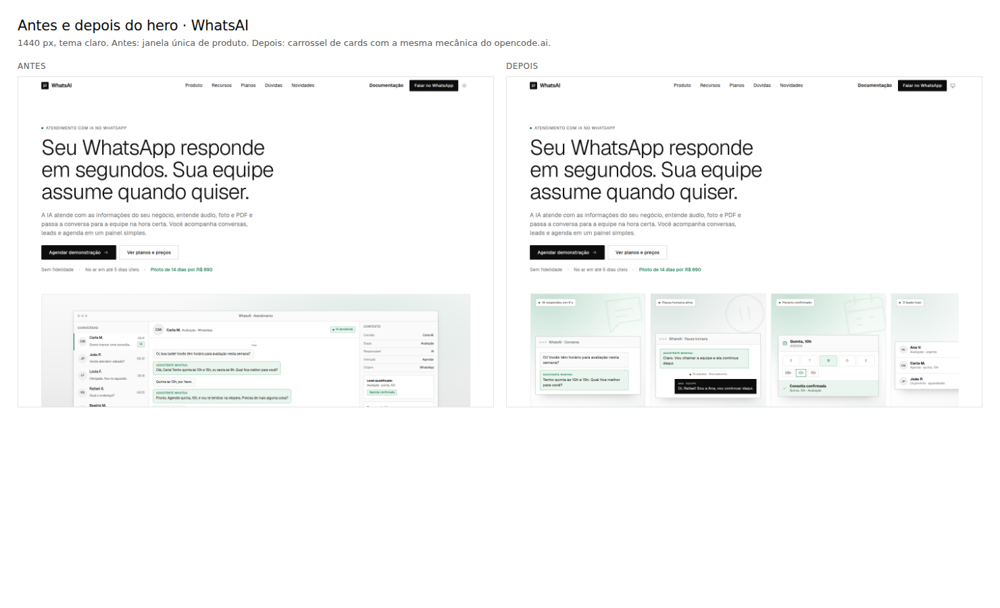
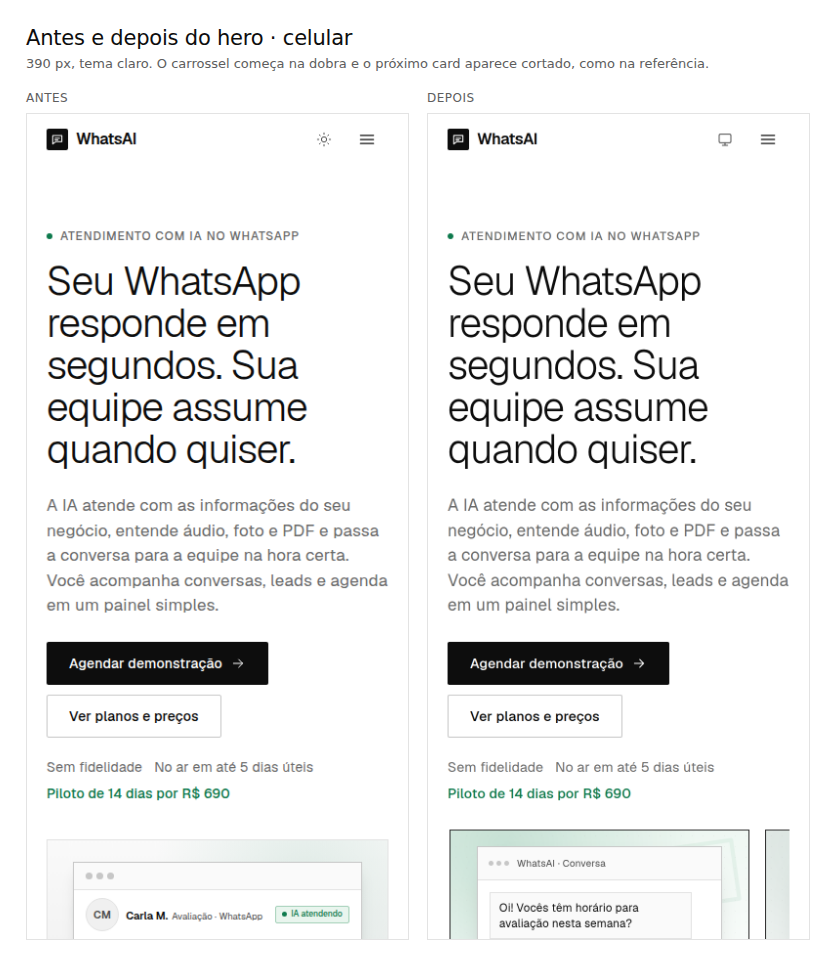
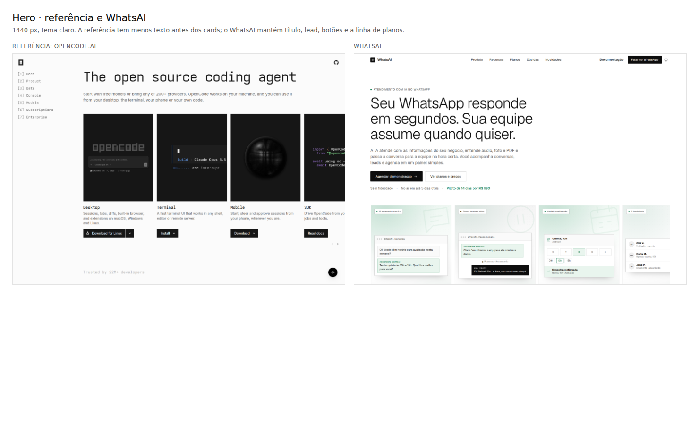
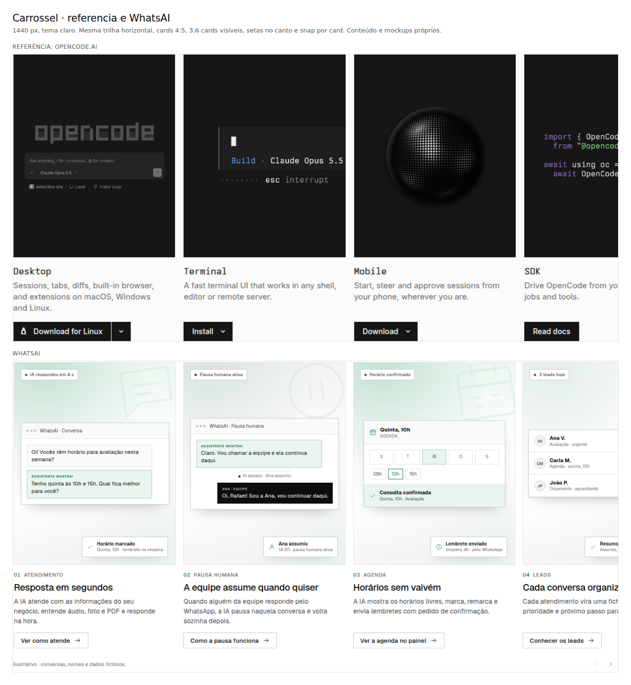
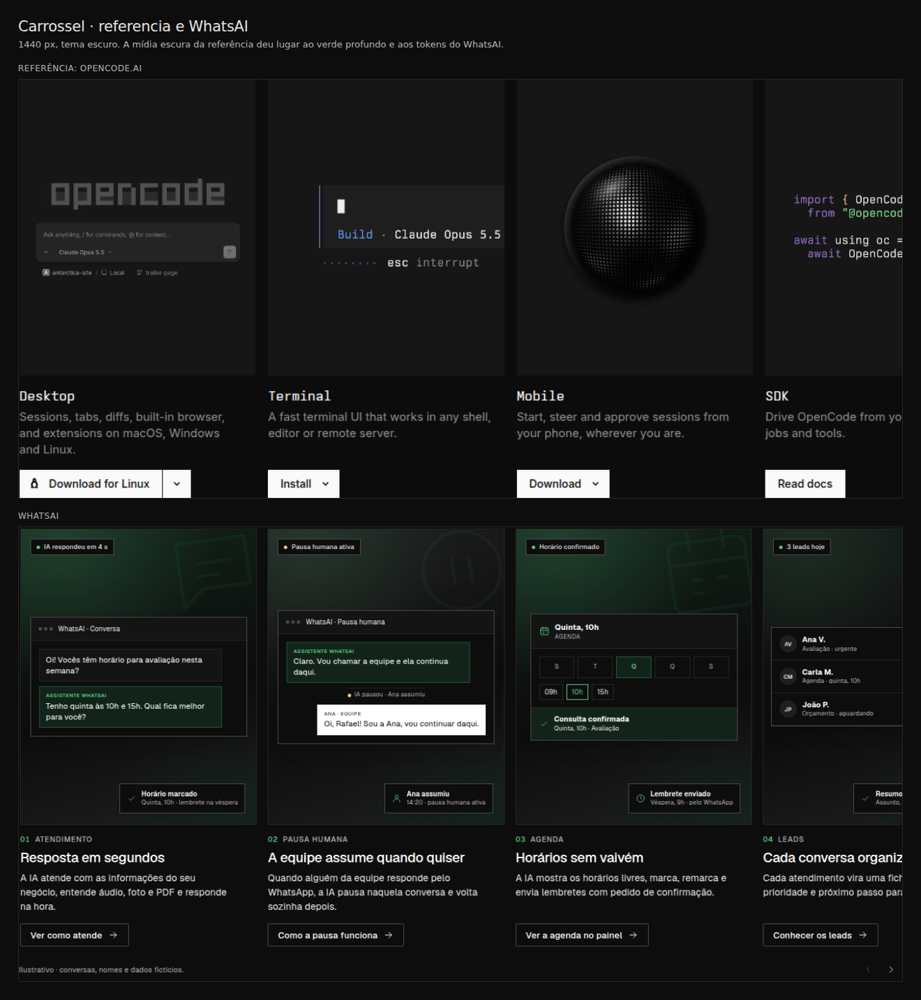
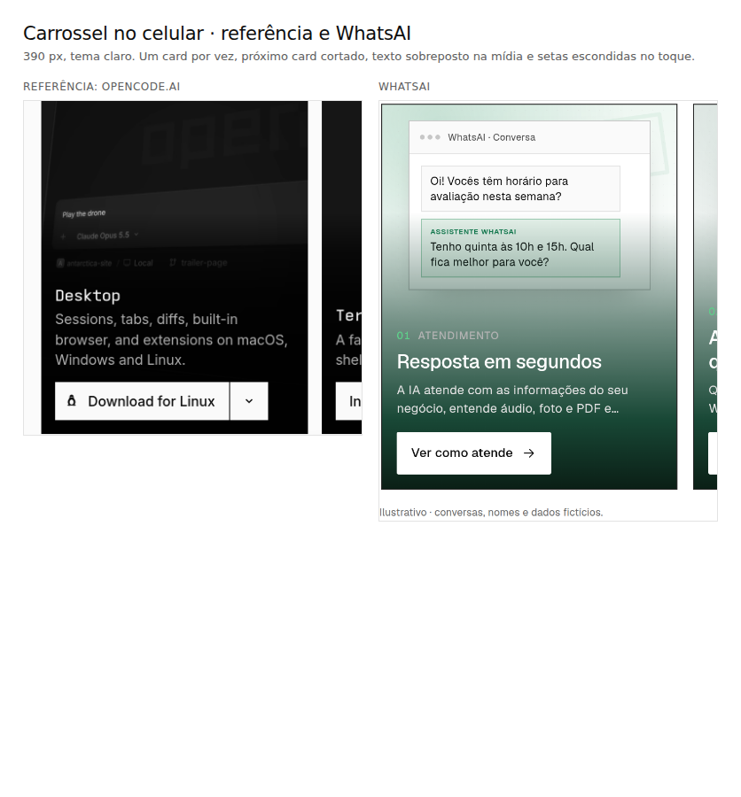
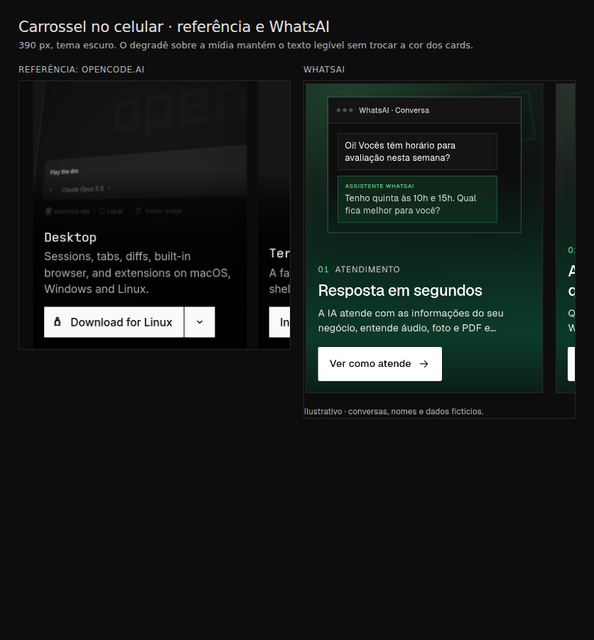

# Carrossel de cards no hero da landing

Proposta de hero para a home do WhatsAI com a mesma mecânica do carrossel de produtos da home pública do
[opencode.ai](https://opencode.ai/): uma trilha horizontal de cards com mídia, título, texto e ação, snap por card e
setas discretas no canto inferior direito. O conteúdo, os mockups, as cores e a tipografia são do WhatsAI.

A referência foi observada no dia 15/11/2026, em 1440 e 390 px, nos temas claro e escuro. Nenhum logo, texto, fonte,
imagem, vídeo, CSS ou arquivo do opencode foi copiado.

## O que mudou

- O hero deixou de ser uma janela única de produto e passou a ser um carrossel de quatro cards: Atendimento,
  Pausa humana, Agenda e Leads.
- Cada card tem uma mídia 4:5 com um mockup em HTML/CSS, um selo de estado, uma nota de resultado e o texto do card
  logo abaixo no desktop.
- No celular, o texto fica sobreposto à mídia, com um degradê verde profundo, como na referência. O próximo card
  aparece cortado à direita.
- As setas andam um card por vez, ficam desabilitadas nas pontas, somem em aparelhos de toque e não existem sem
  JavaScript (a trilha continua rolando nativamente).
- Quatro âncoras novas levam cada card ao bloco correspondente da página: `#atendimento`, `#pausa-humana`, `#agenda`
  e `#leads`.
- O restante da landing não mudou: topo, prova social, blocos de produto, recursos, planos, dúvidas, novidades, CTA e
  rodapé continuam iguais.

Arquivos alterados:

- `manager/dist/landing/index.html`
- `manager/dist/assets/landing-cursor.css`
- `manager/dist/assets/landing.js`
- `manager/dist/assets/landing.bundle.css` (gerado por `node manager/patches/landing-css.mjs`)
- `readmes/pr/hero-carousel-opencode/` (esta documentação e as capturas)

## Referência e adaptação

| Item | opencode.ai | WhatsAI |
| --- | --- | --- |
| Mecânica | Trilha horizontal com snap, rolagem nativa e setas | Idêntica |
| Cards | 4 produtos, mídia 4:5, texto e ação | 4 recursos, mídia 4:5, texto e ação |
| Visíveis no desktop | Cerca de 3,6 cards, o quarto cortado | 3,6 cards a partir de 1200 px |
| Espaço entre cards | 16 px | 16 px |
| Mídia | Imagem/vídeo escuro de tela cheia | Mockup de interface em HTML/CSS sobre gradiente |
| Texto no celular | Sobreposto à mídia, em fundo escuro | Sobreposto à mídia, em verde profundo |
| Ação no desktop | Botão sólido | Botão fantasma, para não competir com o CTA do hero |
| Ação no celular | Botão claro | Botão branco de 44 px |
| Setas | Ícones sem borda, 24 px, só com ponteiro | Ícones sem borda, 32 px, só com ponteiro |
| Autoplay | Não | Não |
| Conteúdo | Nomes e textos do opencode | Nomes, textos, tokens e mockups do WhatsAI |

O botão fantasma no desktop é a única diferença de hierarquia. O hero já tem o botão principal "Agendar
demonstração"; quatro botões sólidos logo abaixo competiriam com ele. No celular, o card ocupa a tela e a ação sólida
ajuda no toque, como na referência.

## Medidas

| Item | Valor |
| --- | --- |
| Cards visíveis | 3,6 (>= 1200 px), 2,6 (<= 1199 px), 2,2 (<= 899 px), 1,12 (<= 719 px) |
| Largura do card | Cerca de 348 px em 1440 px; 307 px em 390 px |
| Mídia | `aspect-ratio: 4 / 5` no desktop; altura mínima de 400 px no celular |
| Espaço entre cards | 16 px em todas as larguras |
| Trilha | `overflow-x: auto`, `scroll-snap-type: x mandatory`, barra escondida |
| Setas | 32 x 32 px, sem borda, `aria-disabled` nas pontas |
| Ação no celular | 44 px de altura |
| Tipografia | Geist; kicker de 11 px em monoespaçada, título de 20 px, texto de 14 px (13 px no celular) |
| Cores | Apenas tokens `--wa-*` e `--c-*`; verde só com significado |

## Comparações visuais

### Antes e depois, 1440 px, claro

### Antes e depois, 390 px, claro

### Referência e WhatsAI, hero em 1440 px, claro

### Carrossel em 1440 px, claro

### Carrossel em 1440 px, escuro

### Carrossel em 390 px, claro

### Carrossel em 390 px, escuro

### Página inteira depois da mudança

- `depois/depois-full-1440-light.png`
- `depois/depois-full-1440-dark.png`
- `depois/depois-full-390-light.png`
- `depois/depois-full-390-dark.png`

As capturas da referência ficam em `reference/` apenas para revisão. Elas não são publicadas no site nem entram em
`manager/dist`.

## Comportamento e acessibilidade

- A trilha rola com toque, trackpad, roda horizontal e teclado (o próprio contêiner recebe foco).
- As setas atualizam `aria-disabled` conforme a posição; nas pontas, o clique é ignorado.
- Em `pointer: coarse`, as setas somem e a rolagem fica por conta do gesto nativo.
- Sem JavaScript, as setas não aparecem (classe `js` no `<html>`) e a trilha continua rolando.
- `prefers-reduced-motion: reduce` desliga o `scroll-behavior: smooth` e as transições.
- A mídia de cada card é decorativa (`aria-hidden`); o título e a ação carregam o conteúdo para leitores de tela.
- O carrossel tem um `h2` visualmente oculto, lista semântica, uma ação por card e foco visível.
- Nenhuma rolagem horizontal na página em 320, 360, 390, 768, 1024 e 1440 px.
- Nenhum erro de console nas capturas e nos testes de interação.
- O texto sobreposto no celular tem altura mínima reservada; em 320 px a mídia sobe para 420 px para não cobrir a
  simulação.

## Lighthouse local

Medido em 15/11/2026 contra o servidor estático local, com Lighthouse 12.8.2 e o Chromium do ambiente:

| Configuração | Performance | Acessibilidade | Boas práticas | SEO |
| --- | --- | --- | --- | --- |
| Computador | 100 | 100 | 100 | 100 |
| Celular | 97 | 100 | 100 | 100 |

O 97 de performance no celular é o mesmo da landing anterior no mesmo servidor local (sem compressão e com TTFB de
desenvolvimento). O LCP ficou em 2,3 s nos dois casos, o CLS em 0 e o TBT em 0 ms. A conferência em produção continua
sendo a do dono, com a Vercel.

## Limitações

- O hero do WhatsAI tem kicker, título de três linhas, lead, dois botões e uma linha de planos antes dos cards. No
  opencode, o hero tem só título e lead. Por isso, em uma janela de 1440 x 1000 px, aparecem o topo dos cards e as
  setas, mas o texto e a ação de cada card ficam um pouco abaixo da dobra. O conteúdo principal do hero continua
  visível.
- No celular, o carrossel começa por volta de 730 px em uma tela de 844 px de altura; aparecem a borda e o topo do
  primeiro card. É a mesma ordem da referência, mas com mais texto antes.
- A mídia é um mockup de interface em HTML/CSS, não uma foto ou vídeo de tela cheia. O projeto não usa imagens
  externas na landing.
- Os dados das conversas, leads e agenda são fictícios.

## Recomendações

1. Aprovar a direção: o carrossel apresenta o produto em quatro blocos e mantém o CTA principal acima da dobra.
2. Manter quatro cards. Um quinto card ("Processos", para escritórios) é possível, mas dilui a leitura e aumenta a
   rolagem; hoje "Processos" já aparece na grade de recursos e nos planos.
3. Não adicionar autoplay. A referência não usa; o controle manual combina com uma página de conversão e evita
   movimento involuntário.
4. Se o dono quiser os textos dos cards acima da dobra em 1440 x 900 px, a saída é encurtar o lead do hero ou reduzir
   o espaço entre o título e os botões, não encolher os cards.
5. Manter o botão fantasma no desktop e o botão branco no celular, como nesta proposta.
6. Repetir o Lighthouse em produção (`/` e `/seguranca`) antes do merge, nas quatro categorias e em 1440/390, claro e
   escuro. A página continua sem imagens externas e sem requisições novas; o bundle CSS cresceu cerca de 10 KB e o JS,
   cerca de 2 KB.

## O que não foi copiado

- Logo, marca, nome, textos e produtos do opencode.
- Imagens, vídeos, fontes, CSS e JavaScript servidos pela referência.
- Cores da referência; o preto e o branco deram lugar aos tokens do WhatsAI.
- Nenhuma requisição externa, CDN, cookie ou rastreador novo.
