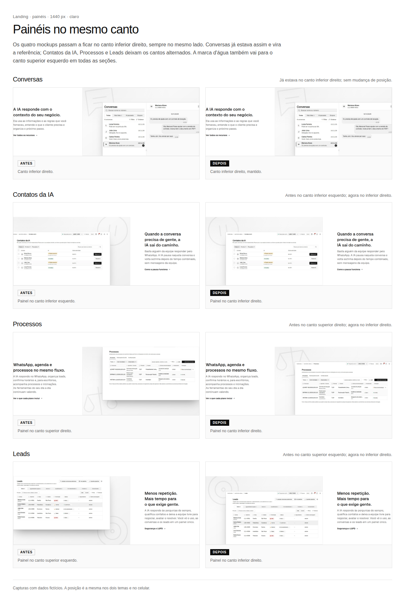
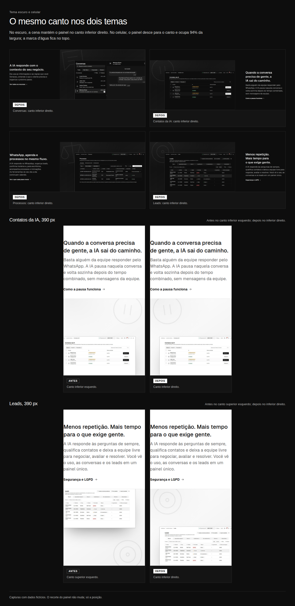
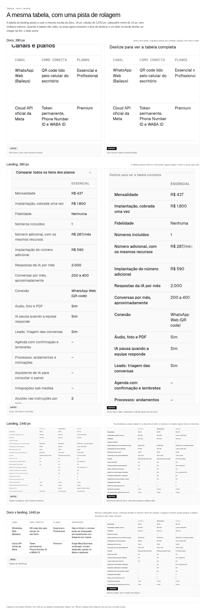
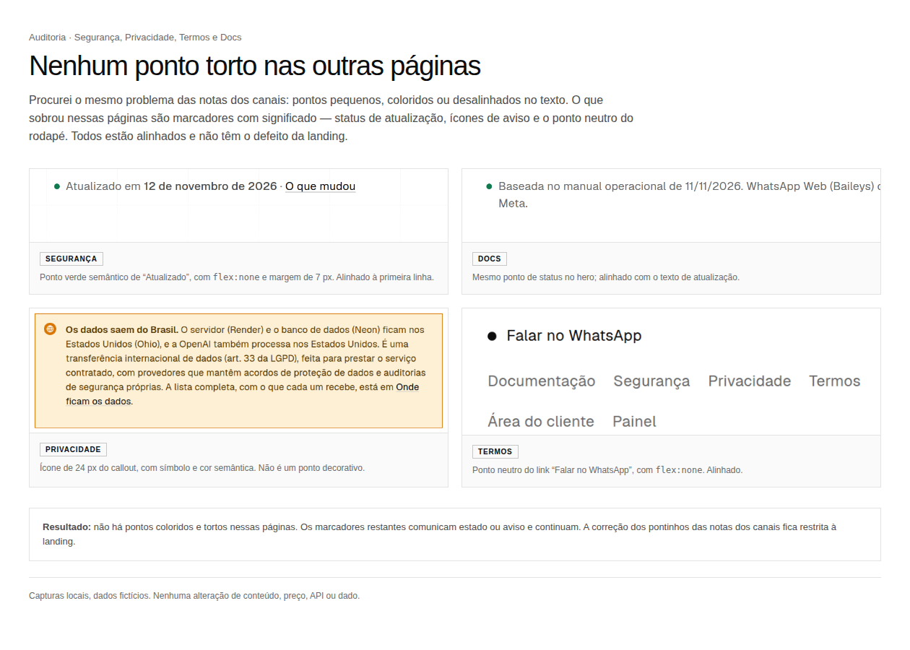
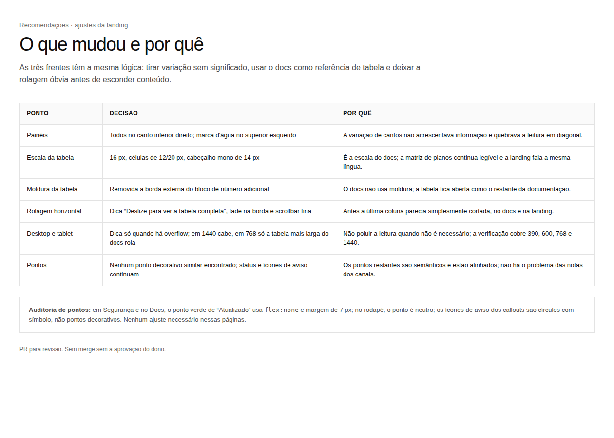

# Ajustes da landing: painéis, tabelas e auditoria

Três frentes na mesma rodada:

1. Os quatro mockups de produto ficam no mesmo canto, o inferior direito, e a marca d'água vai para o superior
   esquerdo em todas as seções.
2. A tabela da landing passa a usar a mesma escala e o mesmo respiro da tabela do docs. Quando a tabela não cabe,
   docs, páginas legais e landing mostram uma dica de rolagem e um fade na borda direita.
3. Auditoria dos pontos em Segurança, Privacidade, Termos e Docs: não há o mesmo problema das notas dos canais; os
   marcadores que restam são semânticos e estão alinhados.

## Painéis no mesmo canto

- Conversas já estava no canto inferior direito e vira a referência.
- Contatos da IA sai do inferior esquerdo; Processos sai do superior direito; Leads sai do superior esquerdo.
- Todos passam ao inferior direito, no desktop e no celular.
- A marca d'água fica no superior esquerdo nas quatro cenas.
- O recorte, a sombra, o raio de 2 px, o fundo e o conteúdo não mudam; só a posição.

## Tabelas

### Mesma linguagem do docs

- Corpo em 16 px e entrelinha 1.4, como no docs.
- Células com 12 px na vertical e 20 px na horizontal; cabeçalho com 10/20.
- Cabeçalho em mono, 14 px, caixa alta e sem quebra.
- Linhas com a mesma borda inferior; primeira coluna em peso 500.
- Removida a moldura externa do bloco de número adicional; o docs não usa moldura.

### Rolagem horizontal visível

- Novo `table-scroll.js`: detecta `.table-wrap` e `.wa-table-wrap` que passam da largura, adiciona a dica
  "Deslize para ver a tabela completa", marca o contêiner como região focável e aplica a classe de rolagem.
- Enquanto há conteúdo à direita, um fade de 28 px na borda direita mostra que a tabela continua. Ao chegar ao fim,
  o fade desaparece.
- Scrollbar fina nos navegadores que a exibem.
- Em 768 e 1440 px, quando a tabela cabe, a dica e o fade não aparecem. No docs, uma tabela mais larga ainda rola em
  768 px e recebe a dica; no celular, todas as tabelas que passam da largura recebem.
- O script não usa timer, não faz chamada de rede e não roda em tabelas que não existem.
- Legal pages carregam o mesmo script e o mesmo CSS do docs, então o comportamento é o mesmo em Segurança, Privacidade
  e Termos.

## Auditoria de pontos

- Segurança e Docs: o ponto verde de "Atualizado" usa `flex: none` e margem de 7 px; está alinhado à primeira linha.
- Privacidade e Termos: os círculos coloridos são ícones de callout com símbolo (24 px), não pontos decorativos.
- Rodapé: o ponto do link "Falar no WhatsApp" é neutro (`currentColor`) e usa `flex: none`.
- Nenhum ponto pequeno, colorido e desalinhado como os dois das notas dos canais foi encontrado. Nada foi alterado
  nessas páginas.

## Comparações

### Painéis, 1440 px, claro

### Painéis no escuro e no celular

### Tabelas, docs x landing

### Auditoria de pontos

### Recomendações

As capturas usam dados fictícios. Nenhuma requisição foi feita à produção.

## Arquivos

- `manager/dist/assets/landing-cursor.css`: posição única dos painéis, tabela no padrão do docs, dica e fade.
- `manager/dist/docs/docs.css`: dica, fade, scrollbar e ajuste do wrapper de tabela; link atualizado para `docs.css?v=10`.
- `manager/dist/assets/table-scroll.js`: detecção de overflow, dica, foco e estado de fim; incluído como `?v=1`.
- `manager/dist/landing/index.html`, `docs/index.html`, `seguranca.html`, `privacidade.html`, `termos.html`: inclusão do
  script e, na landing, o hash novo do bundle CSS.
- `manager/dist/landing/novidades.html`: só o hash do bundle CSS.

## Verificação

- 1440, 1024, 768, 600 e 390 px, claro e escuro; sem rolagem horizontal da página, imagens quebradas ou erros de
  console.
- Tabelas:
  - landing em 768 e 1440: cabem, sem dica;
  - landing em 600 e 390: rolam, com dica;
  - docs em 768: uma tabela mais larga rola, com dica; em 390, todas as que passam da largura rolam, com dica;
  - Segurança e Privacidade em 600 e 390: rolam, com dica.
- Ao rolar até o fim, o fade é removido; ao voltar, reaparece.
- `node --check manager/dist/assets/table-scroll.js` passa; `landing-css.mjs --check` passa; todos os
  `manager/patches/*.py --check` passam; os bundles CSS e JS passam no `esbuild`; `git diff --check` passa.
- Lighthouse local com gzip: desktop 100 nas quatro categorias; celular 99 em performance e 100 em acessibilidade,
  boas práticas e SEO.
- Mudança estática com `[skip render]`; a API não reinicia.

## Limitações

- A tabela de planos ainda precisa de rolagem horizontal no celular; é uma matriz de quatro colunas. A dica e o fade
  tornam a rolagem explícita, mas não eliminam a rolagem.
- Com JavaScript desativado, a tabela continua rolando pelo scroll nativo; a dica e o fade não aparecem. O conteúdo
  não fica inacessível.
- O fade usa `mask-image`; navegadores muito antigos podem ignorá-lo e ficar apenas com a dica/scrollbar.
- A escala de 16 px do docs foi aplicada à tabela da landing; o restante da landing continua na escala editorial.
- O CSS dos mockups antigos ainda está no bundle compartilhado; a limpeza segue separada.

## Revisão

O PR fica aberto para o dono ver as comparações antes do merge.
