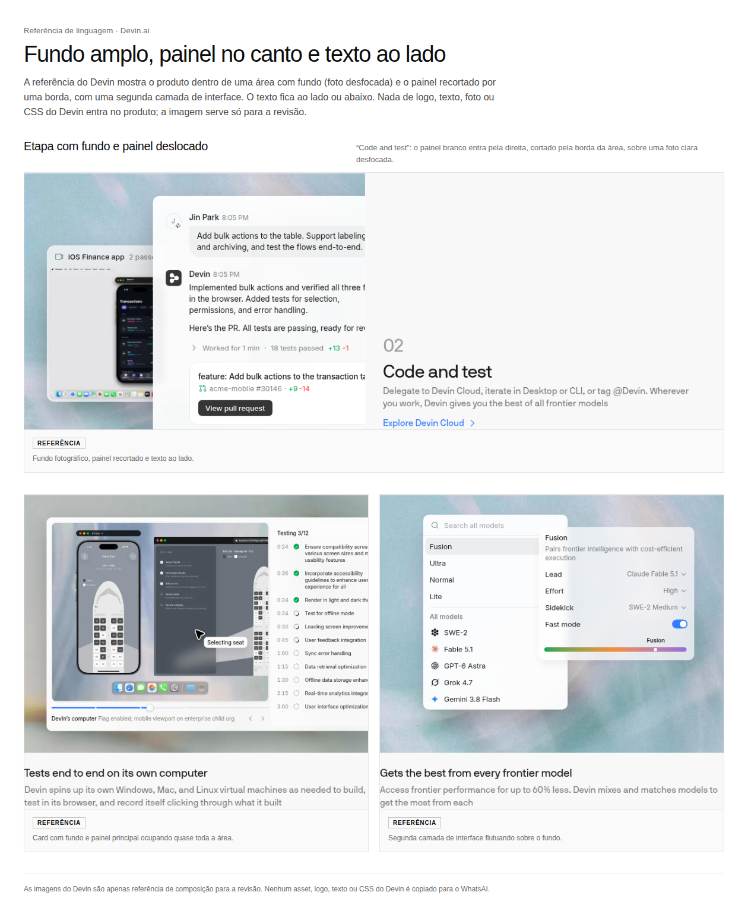
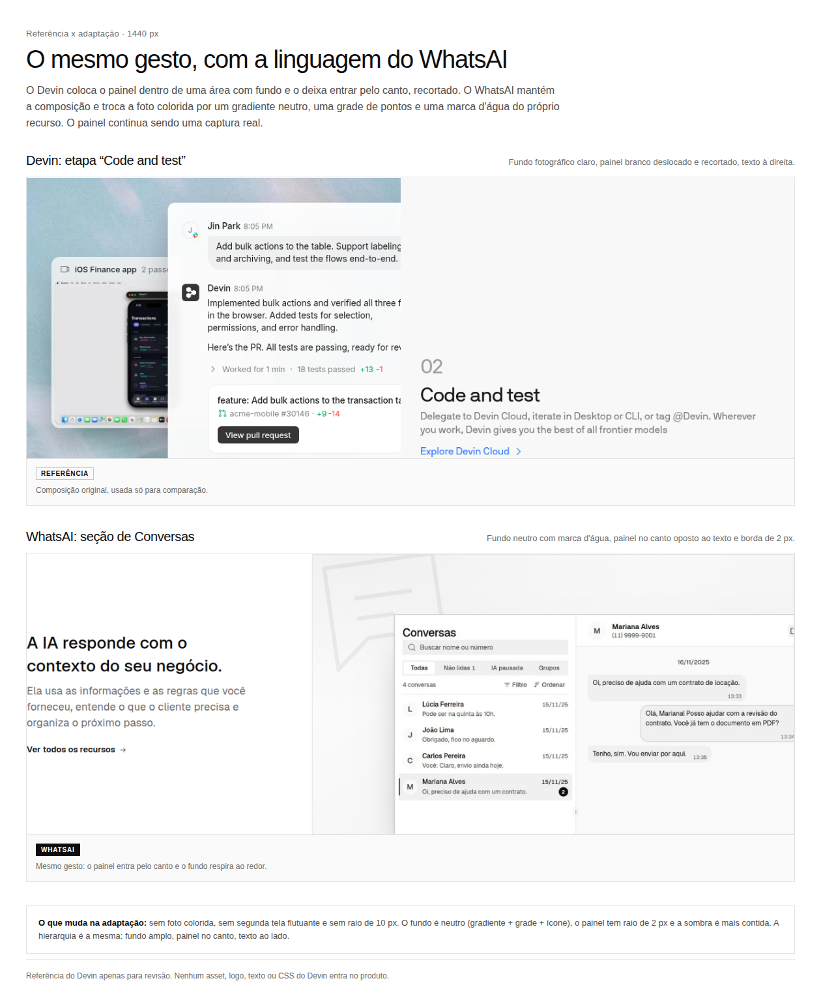
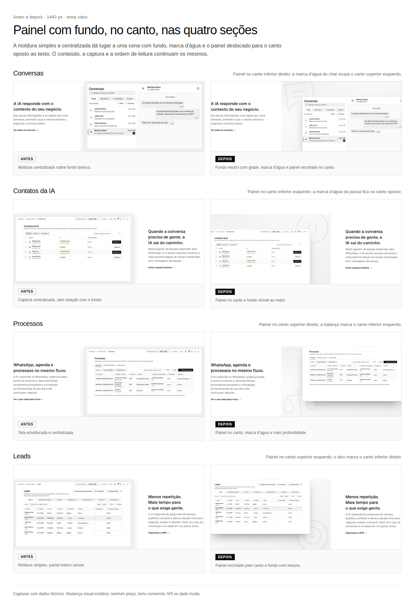
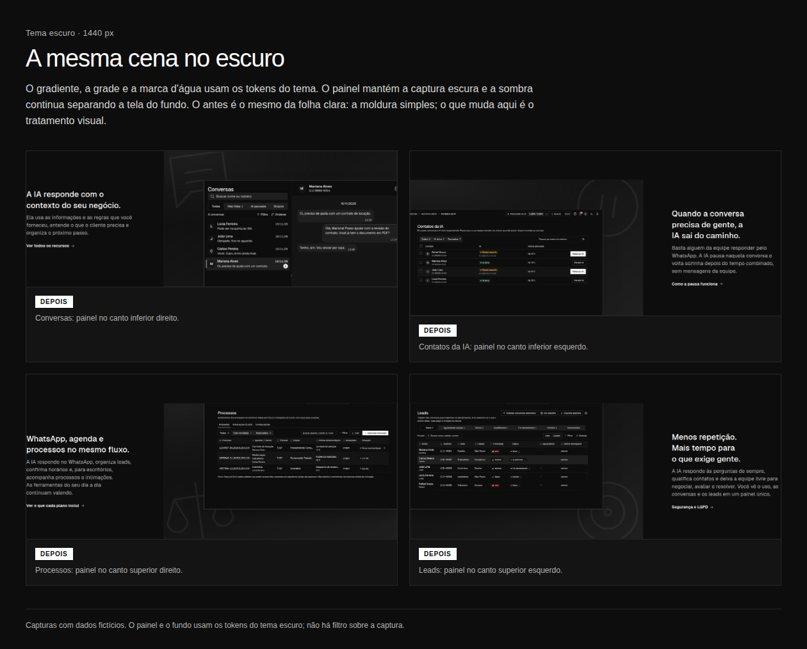
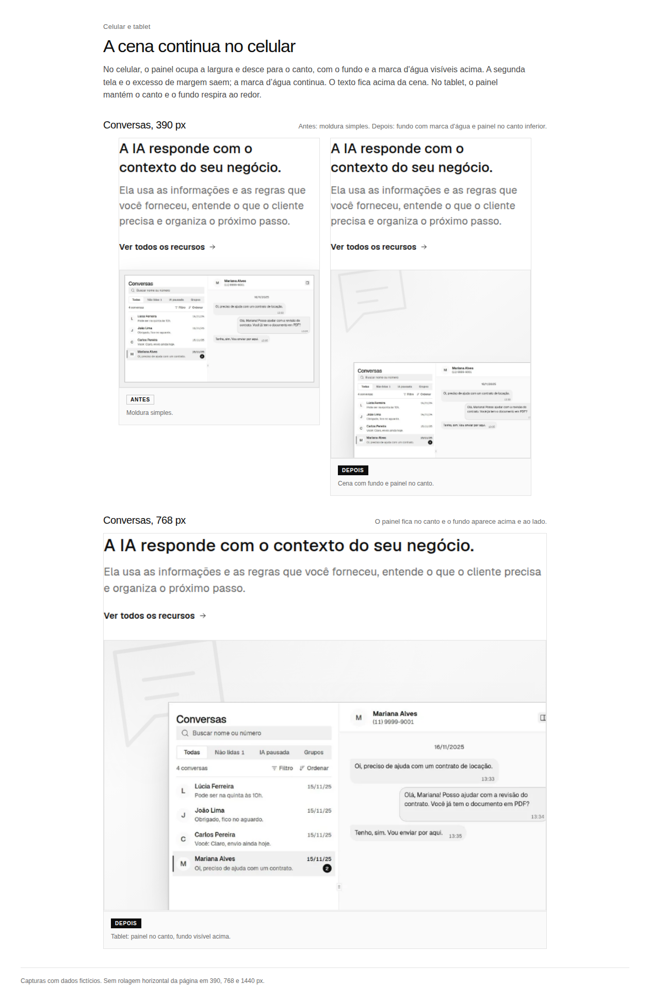
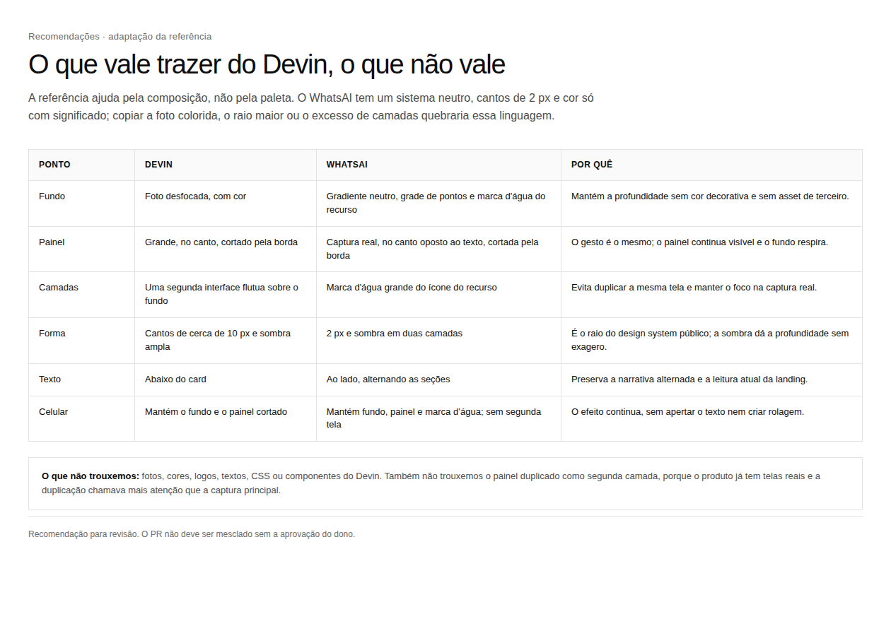

# Painéis em cenas com fundo e canto

As quatro seções de produto deixam de mostrar a captura em uma moldura centralizada e passam a usar uma cena: um fundo
neutro com grade de pontos e uma marca d'água grande do recurso, e o painel real deslocado para o canto oposto ao
texto. A composição se inspira nas seções de produto do Devin, onde o painel entra pela borda de uma área com fundo.

O Devin é referência de composição, não de paleta. Nada de foto, logo, texto, CSS ou componente dele entra no produto.

## O que mudou

- **Conversas:** o painel fica no canto inferior direito e a marca d'água do chat no canto superior esquerdo.
- **Contatos da IA:** o painel fica no canto inferior esquerdo e a marca da pausa no canto superior direito.
- **Processos:** o painel fica no canto superior direito e a balança no canto inferior esquerdo.
- **Leads:** o painel fica no canto superior esquerdo e o alvo no canto inferior direito.
- O fundo é um gradiente neutro com uma grade de pontos e a marca d'água do ícone do recurso. A cor continua reservada
  ao significado dentro do painel.
- O painel tem moldura de 1 px, raio de 2 px e sombra em duas camadas. Ele é recortado pela borda da cena, como na
  referência.
- O texto, a captura, o `srcset`, o `alt` e a ordem das seções não mudam.
- Nenhuma imagem nova é carregada: o fundo e a marca d'água são CSS e SVG do próprio sprite. As capturas continuam
  sendo as mesmas WebP de antes.
- No celular, o painel vai para o canto, o fundo e a marca continuam visíveis e não há segunda tela. No tablet, o
  painel mantém o canto e o fundo aparece acima e ao lado.

## Comparações

### Referência do Devin

### Referência x adaptação do WhatsAI

### Antes e depois, 1440 px, claro

### Tema escuro, 1440 px

### Celular e tablet

### Recomendações

As imagens do Devin são apenas referência de linguagem para a revisão. Nenhum asset, logo, texto ou CSS do Devin é
copiado para o produto. As capturas do WhatsAI usam dados fictícios.

## Recomendações

1. **Manter a composição, não a paleta.** O ganho do Devin é o fundo amplo com o painel entrando pelo canto; a cor
   fotográfica não combina com o sistema neutro do WhatsAI.
2. **Uma camada de produto, não duas.** A segunda interface do Devin funciona porque as telas são diferentes. No
   WhatsAI, duplicar a mesma captura chamava mais atenção que o painel principal; a marca d'água faz o papel de
   segunda camada sem inventar interface.
3. **Painel no canto oposto ao texto.** Isso mantém o fundo visível entre o texto e a tela e cria uma leitura em
   diagonal, como nas etapas do Devin.
4. **Canto recortado, não flutuando no meio.** O painel entra 24 px pela borda; a sombra e a moldura separam a tela do
   fundo sem parecer um card solto.
5. **Marca d'água grande e discreta.** O ícone do recurso dá escala e textura ao fundo sem competir com a captura.
6. **Celular sem segunda tela.** O espaço é curto; o fundo, a marca d’água e o painel no canto já contam a história.
7. **Não aumentar o raio.** O raio de 2 px é parte da linguagem pública; trocar por 10 px aproximaria do Devin e
   afastaria do restante do site.

## Verificação

- 1440, 1024, 768 e 390 px, claro e escuro; sem rolagem horizontal.
- Todas as imagens carregam; nenhuma referência quebrada e nenhum erro de console.
- Âncoras e ordem das seções continuam as mesmas.
- `node manager/patches/landing-css.mjs --check` passa; os `manager/patches/*.py --check` passam; o bundle CSS e o JS
  passam no `esbuild`.
- Lighthouse local com gzip: desktop 100 em performance, acessibilidade, boas práticas e SEO; celular 99 em
  performance e 100 nas outras três. O ponto que falta no celular é o TBT da simulação de CPU lenta; o deploy da
  Vercel usa Brotli e CDN.

## Limitações

- O painel é recortado pela borda; a leitura completa da tela continua sendo a captura original, não a cena.
- A marca d'água é decorativa e usa o ícone do recurso; não é uma segunda tela.
- O fundo é neutro, não fotográfico. Foi uma escolha de marca, não uma limitação técnica.
- O CSS antigo dos mockups removidos ainda está no bundle; a limpeza continua separada.
- O Devin foi usado só como referência de composição; nenhum asset ou texto dele entra no produto.

## Revisão

O PR fica aberto para o dono ver as comparações antes de decidir o merge.
