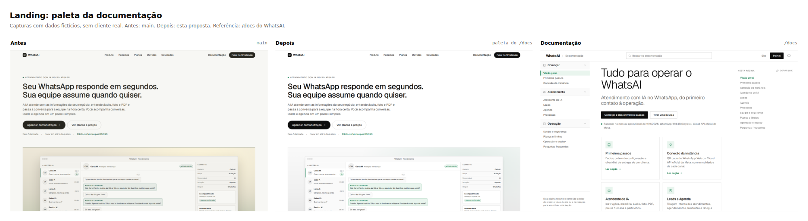
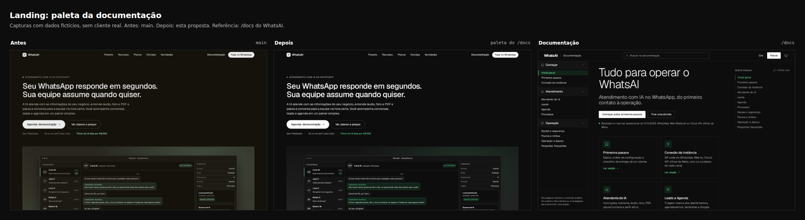
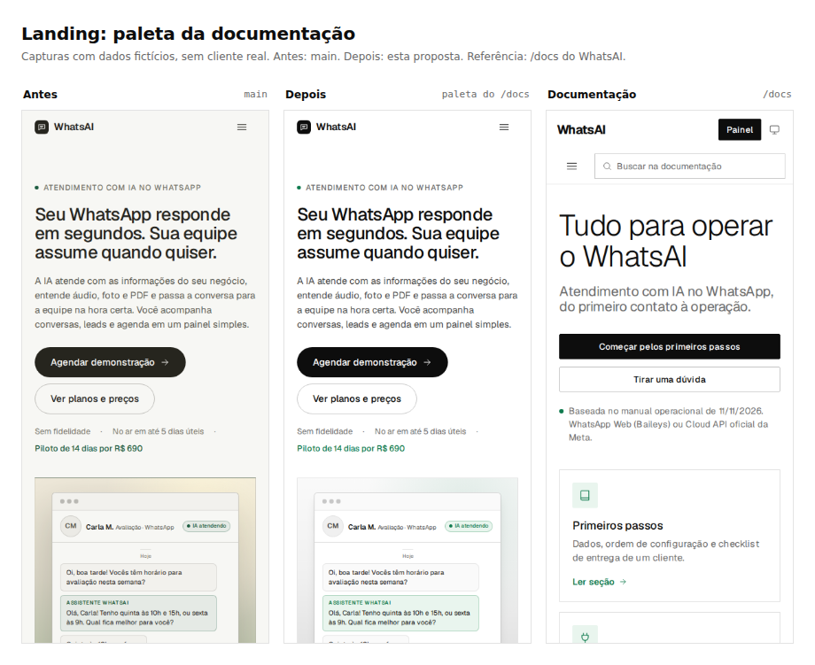
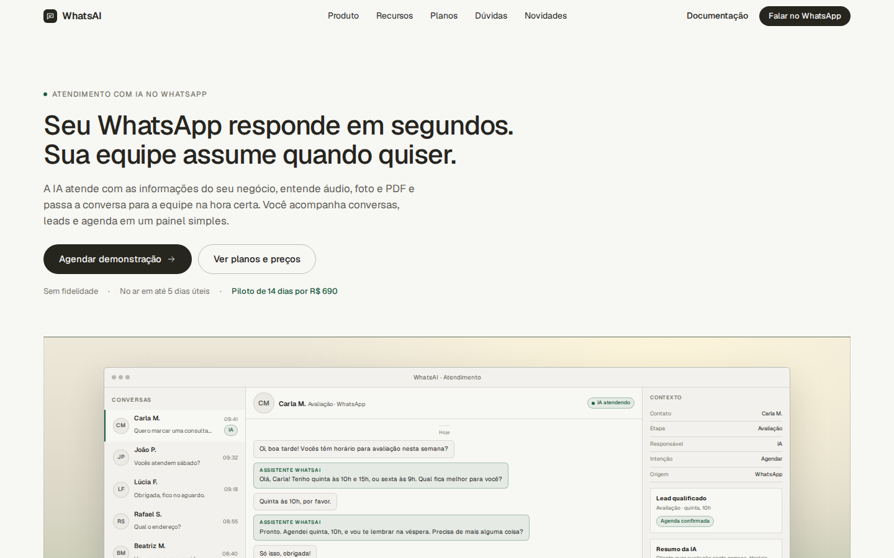
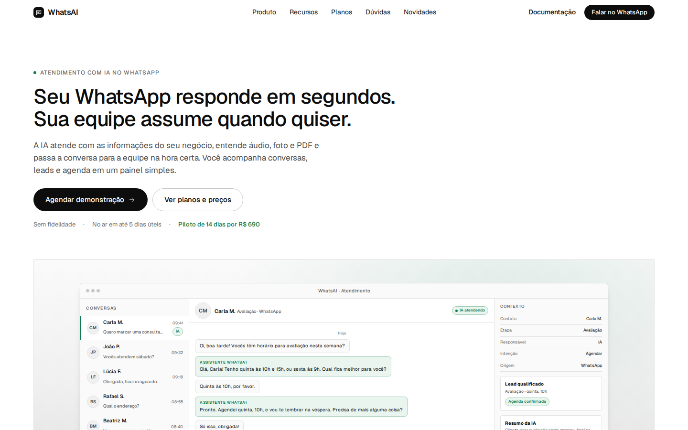
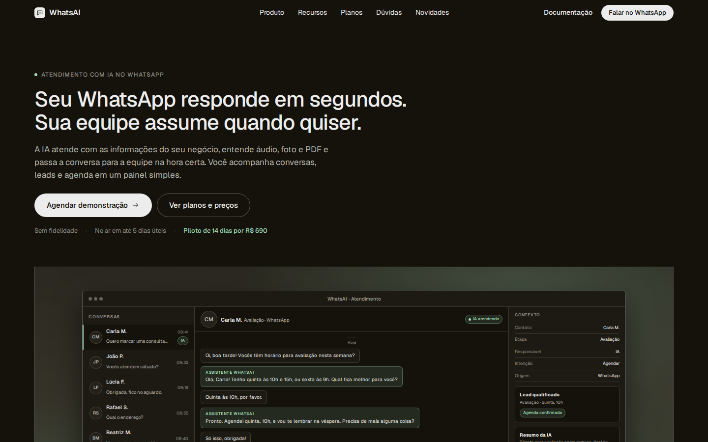
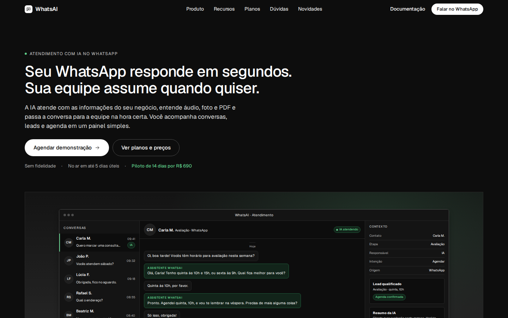

# Landing com as cores da documentação

Esta proposta leva para a página inicial (`/`) a mesma paleta da documentação pública (`/docs`): fundo, superfícies,
bordas, textos e o verde da marca. O desenho aprovado da landing no padrão do Cursor continua o mesmo; mudam as cores,
os estados e o cartão Premium.

O rodapé no padrão do Render Docs fica em um PR empilhado separado, para revisão independente.

## Método

- A referência interna é o `manager/dist/docs/docs.css`: os tokens `--d-*` do tema claro e do escuro.
- A landing é `manager/dist/landing/index.html` com o CSS `manager/dist/assets/landing-cursor.css`.
- Os valores foram trocados nos tokens `--wa-*` da própria landing. Nenhum seletor de layout, medida, tipografia ou
  espaçamento foi alterado.
- O bundle `manager/dist/assets/landing.bundle.css` foi reconstruído com `node manager/patches/landing-css.mjs`.
- Capturas com Playwright em 1440, 1024 e 390 px, temas claro e escuro, com dados fictícios e sem cliente real.
- Sem marca, fonte, texto, imagem ou CSS de terceiro. Sem requisição externa e sem script inline; a CSP não mudou.

## Tokens

| Uso | Antes na landing | Depois no claro | Depois no escuro | Origem no `/docs` |
| --- | --- | --- | --- | --- |
| Fundo da página | `#f7f7f4` / `#14120b` | `#ffffff` | `#0d0d0d` | `--d-bg` |
| Superfície de cartão | `#f2f1ed` / `#1c1a13` | `#fafafa` | `#141414` | `--d-bg-soft` |
| Superfície mais forte | `#ebeae5` / `#232119` | `#f0f0f0` | `#1f1f1f` | `--d-bg-muted` |
| Borda | `rgba(38, 37, 30, 0.13)` / `rgba(237, 236, 236, 0.16)` | `#e3e3e3` | `#272727` | `--d-border` |
| Borda forte | `rgba(38, 37, 30, 0.28)` / `rgba(237, 236, 236, 0.34)` | `#c7c7c7` | `#4d4d4d` | `--d-border-strong` |
| Texto principal | `#26251e` / `#edecec` | `#0d0d0d` | `#ffffff` | `--d-text` |
| Texto secundário | `#5f5e56` / `#b8b6ac` | `#4d4d4d` | `#e3e3e3` | `--d-text-2` |
| Texto terciário | `#77766c` / `#918f85` | `#6b6b6b` | `#b3b3b3` | `--d-text-3` |
| Verde da marca | `#1d5c40` / `#9fdcb6` | `#0e7a4d` | `#5fcf8a` | `--d-accent` |
| Verde suave | `rgba(29, 92, 64, 0.08)` / `rgba(159, 220, 182, 0.12)` | `#e9f5ee` | `#12241a` | `--d-accent-soft` |
| Borda do verde | `rgba(29, 92, 64, 0.32)` / `rgba(159, 220, 182, 0.38)` | `#9fceb5` | `#1f5c3a` | `--d-accent-border` |
| Botão primário | `#26251e` com texto `#f7f7f4` | `#0d0d0d` com texto `#ffffff` | `#ffffff` com texto `#0d0d0d` | `--d-btn-bg` / `--d-btn-text` |
| Hover do botão | `#3b3a32` / `#d6d5ce` | `#0e7a4d` | `#86efac` | `--d-accent` / `--d-accent-strong` |
| Atenção | `#8a5a1f` | texto `#5a3a00`, fundo `#fdf0d5`, borda `#d97706` | texto `#fcd38d`, fundo `#2a1f0c`, borda `#8a5a12` | tokens de atenção do `/docs` |
| Sombra | `0 26px 60px rgba(38, 37, 30, 0.2)` | `0 10px 15px -3px rgba(0, 0, 0, 0.1), 0 4px 6px -4px rgba(0, 0, 0, 0.1)` | `0 10px 15px -3px rgba(0, 0, 0, 0.5), 0 4px 6px -4px rgba(0, 0, 0, 0.4)` | sombra do `/docs` |

## O que mudou nos componentes

- **Topo:** fundo igual ao da página, borda `--wa-line` ao rolar e marca em tinta; o menu e o botão continuam iguais.
- **Botões:** o primário usa a tinta da documentação e inverte no escuro; o hover preenche com o verde. O secundário
  mantém contorno e fundo transparente.
- **Cartões, planos, canais e blocos de recurso:** superfície suave `#fafafa`/`#141414`, borda de 1 px e hover com a
  borda forte. Sem sombra, como no `/docs`.
- **Selos e estados:** o verde usa `--wa-accent-soft`; a atenção usa âmbar e o erro continua vermelho, com a mesma
  semântica da documentação.
- **Plano Premium:** o cartão grafite passa a `#0d0d0d` no claro e `#141414` no escuro, com texto branco, borda
  `#272727`/`#4d4d4d` e botão verde. Os pixels animados agora são verdes (`rgba(95, 207, 138, ...)`).
- **Paisagem do herói:** virou uma composição neutra em cinza com o verde da marca no horizonte; o brilho creme saiu.
- **Sombras dos mockups:** passaram de marrom quente para preto neutro, com os mesmos níveis.
- **`theme-color`:** atualizado para `#ffffff` no claro e `#0d0d0d` no escuro.

## O que não mudou

- Layout, grades, medidas, espaçamento, tamanhos de fonte e quebras de linha.
- Raios e pílulas do desenho aprovado no padrão do Cursor: botões em pílula, cartões com raio de 6 px e molduras dos
  mockups. A documentação usa cantos retos; igualar a geometria é um passo separado, se for desejado.
- Textos, preços, planos, ícones, mockups e dados fictícios.
- Tema pelo sistema, sem botão manual, como antes. A documentação tem seletor de tema; a landing não.

## Acessibilidade

Contraste calculado para os pares usados na página (WCAG 2.1):

| Par | Contraste |
| --- | --- |
| Texto `#0d0d0d` no fundo `#ffffff` | 19,44:1 |
| Texto secundário `#4d4d4d` no fundo `#ffffff` | 8,45:1 |
| Texto terciário `#6b6b6b` no fundo `#ffffff` | 5,33:1 |
| Verde `#0e7a4d` no fundo `#ffffff` | 5,37:1 |
| Texto `#ffffff` no fundo `#0d0d0d` | 19,44:1 |
| Texto secundário `#e3e3e3` no fundo `#0d0d0d` | 15,14:1 |
| Texto terciário `#b3b3b3` no fundo `#0d0d0d` | 9,27:1 |
| Verde `#5fcf8a` no fundo `#0d0d0d` | 9,98:1 |
| Texto `#ffffff` no botão `#0e7a4d` | 5,37:1 |
| Texto `#0d0d0d` no hover `#86efac` | 13,84:1 |
| Verde `#0e7a4d` no fundo `#e9f5ee` | 4,80:1 |
| Verde `#5fcf8a` no fundo `#12241a` | 8,34:1 |

Todo texto pequeno fica em 4,5:1 ou mais. O foco visível continua no verde da marca e o movimento segue
`prefers-reduced-motion: reduce`.

## Comparação

### 1440 px, tema claro

### 1440 px, tema escuro

### 390 px, tema claro

### 390 px, tema escuro

### Antes e depois em tamanho real

| Antes | Depois |
| --- | --- |
|  |  |
|  |  |

As páginas inteiras estão em `antes/antes-home-*-full.jpg` e `depois/depois-home-*-full.jpg` (1440 e 390 px, claro e
escuro). As capturas da documentação usadas só como referência de paleta estão em `referencia/` (1440, 1024 e 390 px,
claro e escuro); nenhuma imagem do Render ou de terceiro é publicada no site.

## Arquivos alterados

- `manager/dist/assets/landing-cursor.css`: tokens e cores de componentes.
- `manager/dist/assets/landing-pixels.js`: pixels do Premium no verde da marca.
- `manager/dist/assets/landing.bundle.css`: bundle minificado reconstruído.
- `manager/dist/landing/index.html`: `theme-color` e comentário de cabeçalho.
- `readmes/pr/landing-cores-docs/`: este README e as capturas.

## Checagens

- `node manager/patches/landing-css.mjs --check` passa.
- Mudança só estática (`manager/dist` e `readmes`): o título do squash termina com `[skip render]`; não reinicia a API.
- Sem `src/`, `prisma/`, `Dockerfile` ou `render.yaml`; sem migration.
- Sem script inline novo e sem `unsafe-inline`: o hash da CSP em `manager/dist/vercel.json` não muda.
- O GitHub Actions roda lint, Prettier, build, tipos, unitários, integração e patches do painel.

## Recomendações

1. Manter a paleta da documentação como fonte. Se o `/docs` mudar um token, atualizar a landing no mesmo PR para as
   duas páginas não divergirem de novo.
2. Em uma refatoração futura, extrair os tokens comuns para um arquivo só (`tokens.css`) carregado por `/docs` e pela
   landing. Hoje os valores são repetidos em `docs.css` e `landing-cursor.css`, porque o bundle da landing não pode
   incluir o CSS da documentação sem misturar escopos.
3. Revisar o rodapé no PR empilhado: ele troca as colunas atuais pelo rodapé compacto do Render Docs, adaptado.
4. Se a direção for aprovada, considerar um segundo passo de geometria (cantos retos e botões de 2 px) para chegar ao
   componente da documentação por inteiro. Este PR é só de cor para não misturar decisões.
5. A landing continua seguindo o tema do sistema. Um seletor manual de tema, como o do `/docs`, é uma mudança à parte
   e precisa de script próprio; não foi incluído aqui.
6. Depois do merge, conferir Lighthouse em `/` e `/seguranca` (meta de 100 nas quatro notas e 4/4 em navegação
   agêntica) e a instância `open` no Render, que fica com o Claude Code do dono.
