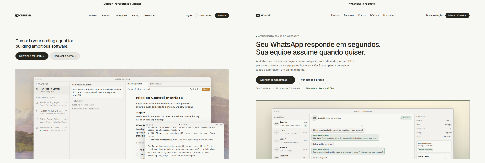
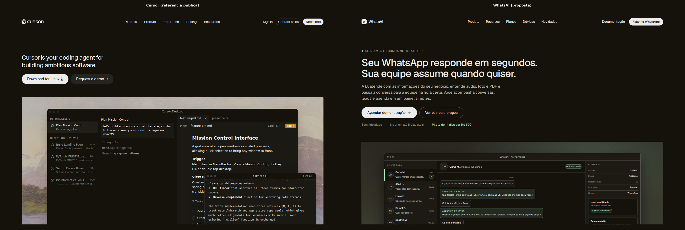
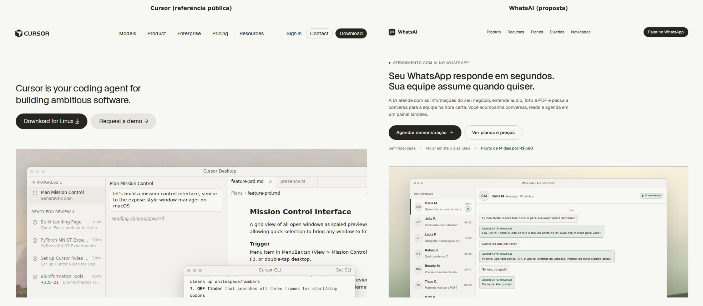
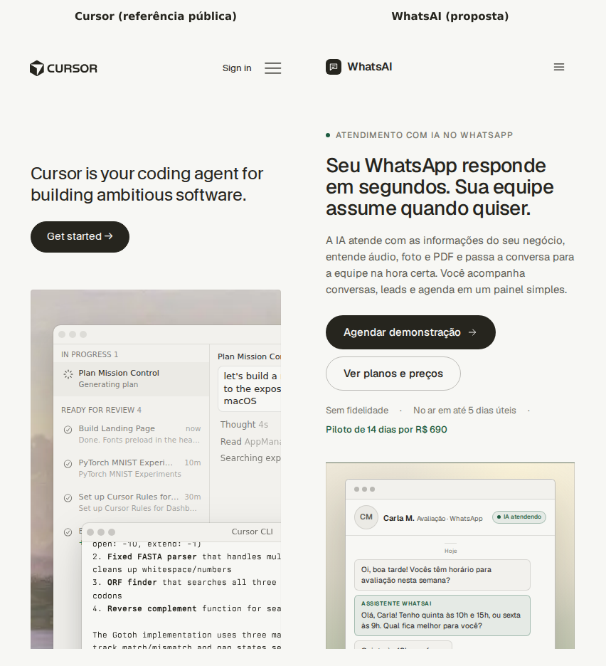
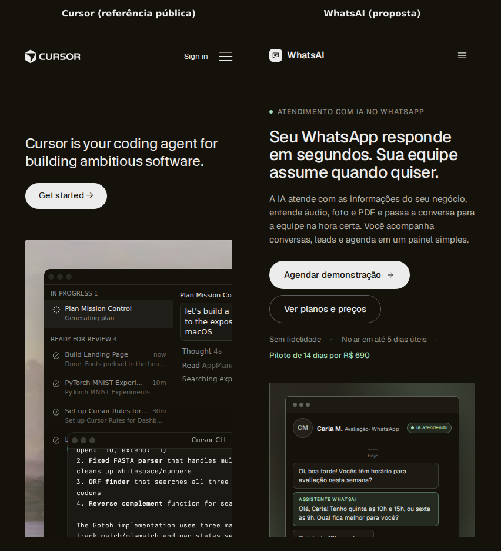

# Landing no padrão do Cursor

Proposta de landing page para o WhatsAI inspirada na composição editorial da home pública do Cursor. O objetivo é
comparar layout, hierarquia, componentes e comportamento responsivo, sem copiar marca, textos, imagens, fontes ou
arquivos da referência.

Esta branch é uma proposta visual. Não deve ser mesclada sem decisão do dono do projeto.

## Referência

- `https://cursor.com/` (home pública), capturada em 1440, 1024 e 390 px, nos temas claro e escuro.
- As imagens ficam em `reference/` só para revisão. Elas não são publicadas no site nem entram em `manager/dist`.
- Nenhum logo, ilustração, foto, fonte proprietária, texto ou CSS do Cursor foi copiado.

## O que foi feito

- HTML, CSS e JS próprios em `manager/dist/landing/index.html`, `manager/dist/assets/landing-cursor.css` e
  `manager/dist/assets/landing.js`.
- Tema claro com creme `#f7f7f4` e tinta `#26251e`; tema escuro com `#14120b` e `#edecec`.
- Um único accent verde: `#1d5c40` no claro e `#9fdcb6` no escuro. O laranja e o azul da referência não foram usados.
- Geist, a fonte que o site e o painel já carregam. As fontes proprietárias do Cursor não foram usadas.
- Mockups de produto feitos em HTML e CSS, com uma paisagem abstrata em gradiente. Nenhuma imagem externa.
- Conteúdo do WhatsAI, com dados fictícios nos exemplos. Sem telefone, nome ou conversa de cliente real.

## Comparação por seção

| Seção | Cursor | WhatsAI |
| --- | --- | --- |
| Topo | Fixo, logo à esquerda, navegação central, ações à direita | Mesmo desenho, com "Documentação" e "Falar no WhatsApp" |
| Herói | Título curto à esquerda, duas linhas, botões e janela de produto abaixo | Título de duas linhas no desktop e três no celular, lead curto, dois botões e janela de atendimento |
| Prova social | Faixa com logos de empresas | Faixa com segmentos e uma conversa ilustrativa; sem logos de terceiros |
| Produto | Três blocos alternando texto e janela | Três blocos: contexto da IA, pausa humana e ferramentas do dia a dia |
| Recursos | Grade de nove recursos | Grade de nove recursos, com exemplos de conversa, lead e agenda |
| "Frontier" | Três cartões com título, texto e link | Três cartões: IA com contexto, automação com supervisão e operação durável |
| Novidades | Changelog em colunas | Novidades do produto em cartões |
| Pesquisa/highlights | Blocos editoriais e cartões de conteúdo | "Por dentro do WhatsAI" e "Destaques" |
| CTA final | "Try Cursor now" | "Veja o WhatsAI atendendo os clientes do seu negócio" |
| Rodapé | Grade de colunas e links legais | Mesma grade, com produto, segmentos, recursos, empresa e legal |

## Tokens e medidas

| Item | Cursor | WhatsAI |
| --- | --- | --- |
| Fundo | Creme quente | `#f7f7f4` / `#14120b` |
| Texto | Quase preto | `#26251e` / `#edecec` |
| Accent | Laranja e azul da marca | Verde `#1d5c40` / `#9fdcb6` |
| Topo | Cerca de 52 px, fixo | 52 px, fixo, com borda ao rolar |
| Largura | Conteúdo centralizado com margem generosa | Máximo de 1440 px, padding lateral de 70 px a partir de 1200 px |
| Título do herói | Aproximadamente 32 px no desktop | `clamp(28px, 3vw, 44px)` |
| Botões | Pílula, 44 px de altura | Pílula, 44 px; 48 px na versão grande |
| Seções | Ritmo largo, muito espaço em branco | `clamp(72px, 9vw, 128px)` entre seções |
| Grade de recursos | Três colunas no desktop | Três, duas e uma coluna conforme a largura |
| Planos | Cartões lado a lado | Três cartões com o Profissional em destaque |
| Movimento | Discreto | Transições curtas de 0,15 s; desligadas em `prefers-reduced-motion` |

## Comparações visuais

### Desktop, 1440 px, claro

### Desktop, 1440 px, escuro

### Tablet, 1024 px, claro

### Celular, 390 px, claro

### Celular, 390 px, escuro

## Página inteira

- `depois/depois-home-1440-light-full.png`
- `depois/depois-home-1440-dark-full.png`
- `depois/depois-home-1024-light-full.png`
- `depois/depois-home-1024-dark-full.png`
- `depois/depois-home-390-light-full.png`
- `depois/depois-home-390-dark-full.png`
- `depois/depois-home-390-light-menu.png`
- `depois/depois-home-390-dark-menu.png`

## Comportamento e acessibilidade

- Sem rolagem horizontal em 1440, 1024 e 390 px, nos dois temas.
- Menu do celular abre e fecha com foco e `aria-expanded`; o botão de fechar fica visível.
- Links com foco visível, textos alternativos nas ilustrações e `aria-label` nas janelas decorativas.
- Contraste conferido nos botões, links, textos de apoio e cartões.
- Nenhum erro de console nas capturas.
- `prefers-reduced-motion` desliga as transições.

## O que não foi copiado

- Logo, marca, nomes de produto e textos do Cursor.
- Fontes proprietárias, ilustrações, fotos e capturas de tela da referência.
- CSS, JavaScript, componentes ou arquivos servidos pela página.
- Logos de clientes e a faixa de prova social com marcas de terceiros.
- Cores de marca do Cursor; o laranja e o azul deram lugar ao verde do WhatsAI.

## Limitações

- O título do herói ficou um pouco maior que o da referência para acomodar o português e a Geist.
- O WhatsAI tem lead, botões e uma linha de metadados no herói; o Cursor mostra só título e botões. Isso empurra a
  janela de produto um pouco para baixo.
- As janelas de produto são mockups, não capturas do painel real.
- A paisagem é um gradiente CSS, não a ilustração da referência.
- A página é mais longa que a do Cursor porque reúne planos, comparação e perguntas frequentes.

## Recomendações

1. Aprovar a direção editorial se a ideia é afastar a landing do visual de "página de vendas" e aproximá-la de uma home
   de produto, com muito espaço em branco e mockups grandes.
2. Manter o herói compacto: título de duas linhas no desktop e três no celular. Título grande demais empurra a prova
   visual para baixo da dobra.
3. Levar para o site atual apenas os blocos de maior retorno: herói compacto, janela de produto e grade de recursos.
   A página inteira é longa para uma primeira versão.
4. Não trazer a faixa de logos de terceiros. No WhatsAI ela pode virar uma faixa de segmentos, como nesta proposta.
5. Se a direção for aprovada, rodar Lighthouse em 1440 e 390, claro e escuro, antes de qualquer merge. A meta do site
   atual é 100 nas quatro categorias.
6. Revisar o texto jurídico e comercial com o dono antes de publicar: planos, prazos, limites e promessas precisam
   continuar iguais aos documentos oficiais.
