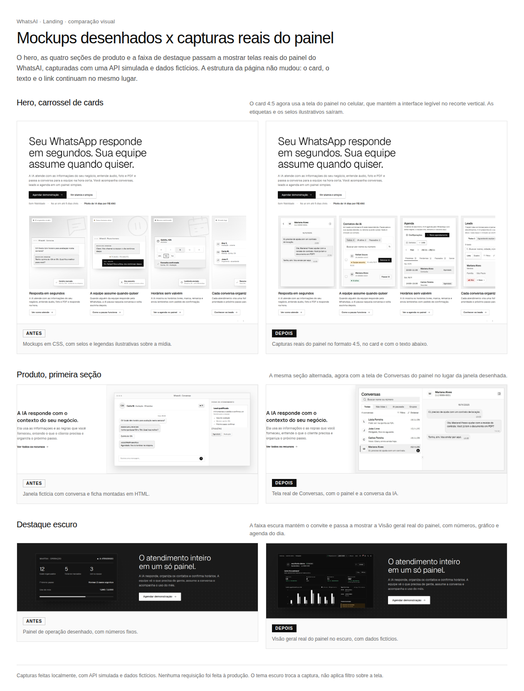
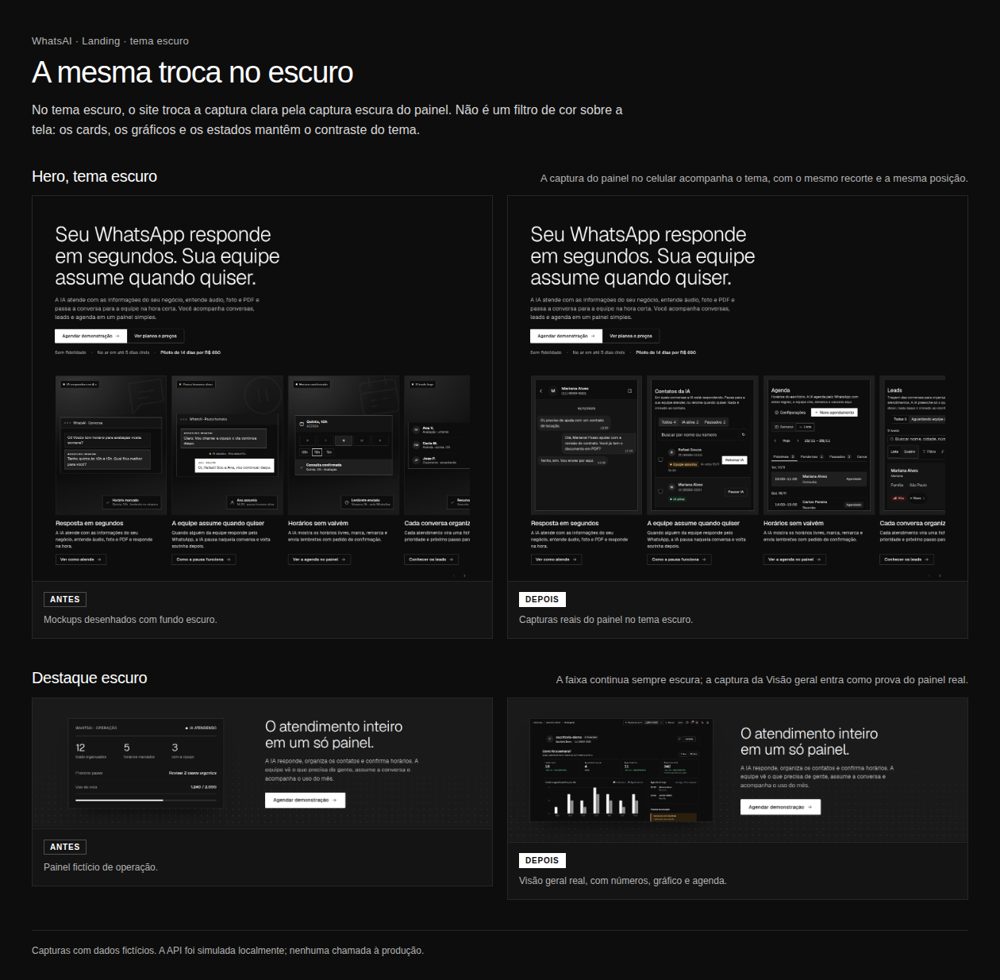
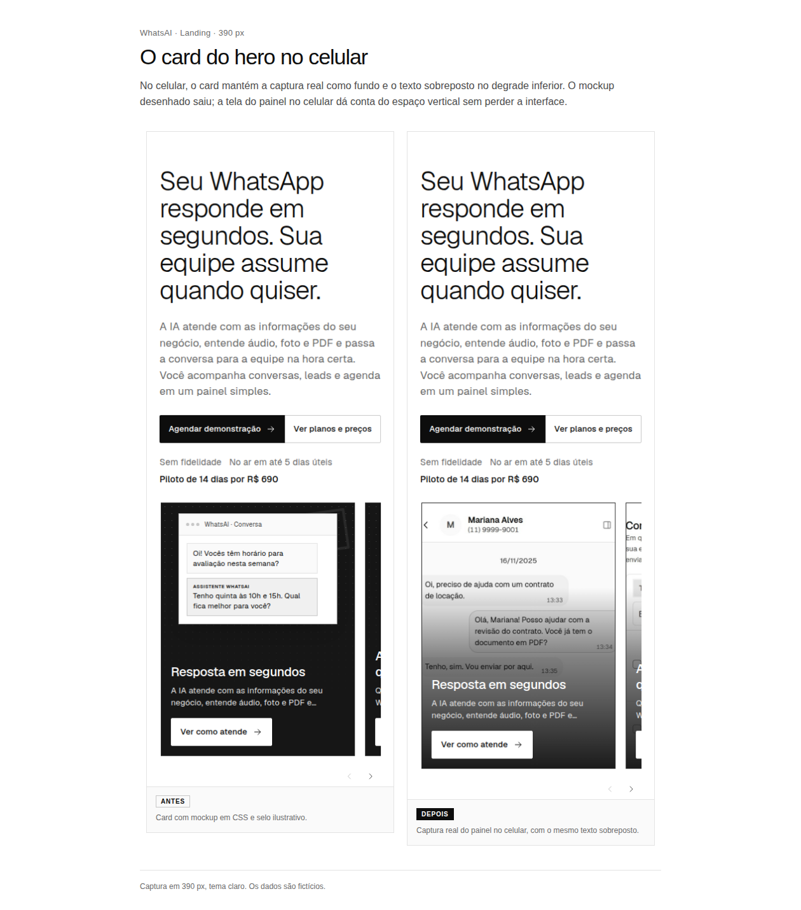
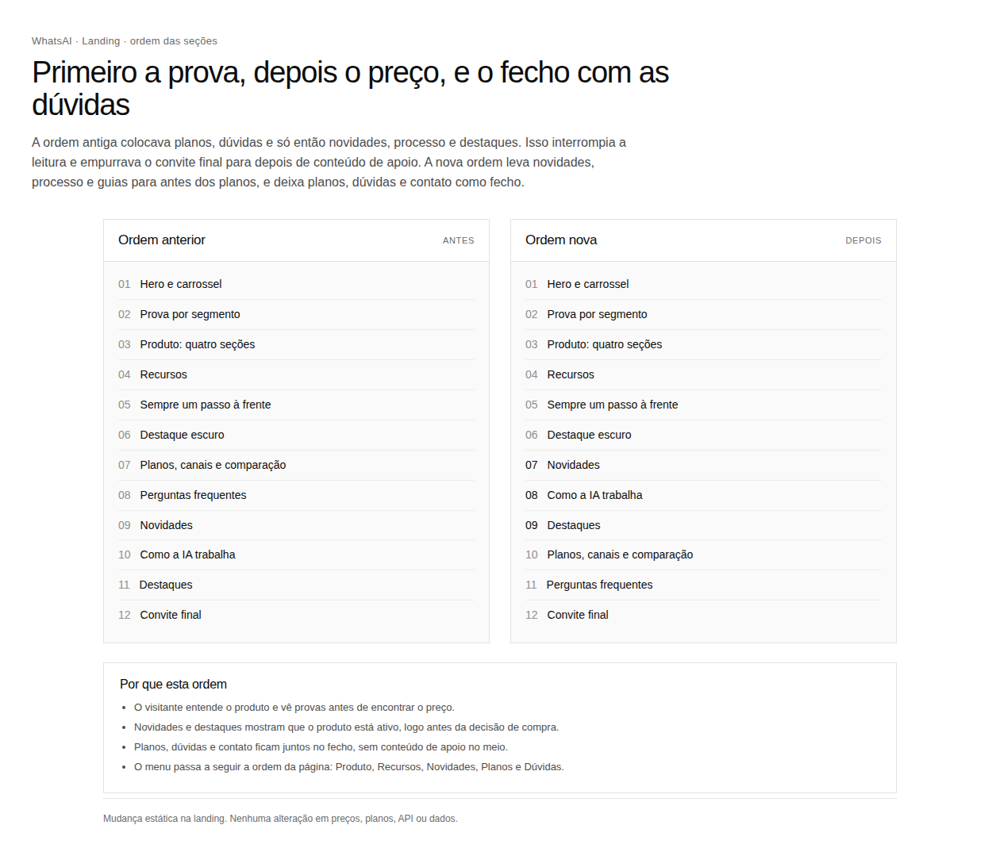

# Landing com capturas reais do painel

O hero, as quatro seções de produto e a faixa de destaque deixam de mostrar mockups desenhados em HTML/CSS e passam a
usar capturas reais do painel do WhatsAI. As imagens foram feitas com uma API simulada, dados fictícios e o próprio
painel em execução local; nenhuma requisição foi feita à produção.

A ordem das seções também foi ajustada: novidades, como a IA trabalha e destaques passam para antes dos planos, e o
fecho fica com planos, dúvidas e contato. O menu acompanha a nova ordem.

## O que mudou

### Hero

- Os quatro cards do carrossel usam capturas 4:5 do painel no celular: Conversas, Contatos da IA, Agenda e Leads.
- O formato vertical do card é o mesmo; a tela do celular cabe inteira e mantém a interface legível, sem recortar
  mensagens ou colunas no meio.
- Saíram os selos, as legendas ilustrativas, a marca d'água e os mockups em CSS. Ficou a captura real e o texto do
  card.
- A primeira captura é `eager` com prioridade alta; as demais são `lazy`. A variante escura da primeira só carrega
  quando o tema escuro está ativo.

### Produto

- As quatro seções alternadas usam telas 16:9 do desktop: Conversas, Contatos da IA, Processos e Leads.
- Cada imagem tem uma versão clara e uma escura; o tema troca a captura, não aplica filtro sobre a tela.
- A moldura de 1 px e o fundo `--wa-card-2` separam a captura branca do fundo branco da página.
- Saíram a janela fictícia com barra de navegador, a ficha desenhada, o telefone ilustrado e o cartão de agenda
  fictício.

### Destaque escuro

- A faixa escura passa a mostrar a Visão geral real do painel: leads novos, aguardando equipe, agendamentos,
  respostas da IA, gráfico da semana e agenda do dia.
- A captura é sempre a escura porque a faixa é sempre escura nos dois temas.
- O convite e o texto da seção não mudaram.

### Ordem das seções

Sequência anterior: hero, prova por segmento, produto, recursos, pilares, destaque, planos, dúvidas, novidades,
como a IA trabalha, destaques e convite final.

Sequência nova: hero, prova por segmento, produto, recursos, pilares, destaque, novidades, como a IA trabalha,
destaques, planos, dúvidas e convite final.

O visitante entende o produto e vê provas antes de encontrar o preço; novidades e guias mostram que o produto está
ativo logo antes da decisão; planos, dúvidas e contato ficam juntos no fecho. O menu passa a ser Produto, Recursos,
Novidades, Planos e Dúvidas.

### Imagens

- WebP com duas variantes por imagem e `srcset`/`sizes`: 390/780 para o hero, 900/1600 para o produto e 800/1400 para
  o destaque.
- `width` e `height` em todas as tags, para não deslocar o layout.
- `alt` descreve a tela e o estado mostrado; a nota em `sr-only` diz que são capturas reais do painel com dados
  fictícios.
- O conjunto completo de variantes ocupa cerca de 1,2 MB; cada visita carrega só o tema ativo, o tamanho adequado e o
  que chega perto da viewport.

## Comparações

### 1440 px, claro

### 1440 px, escuro

### 390 px, claro

### Ordem das seções

As capturas de comparação foram feitas com o painel local, API simulada e dados fictícios. Nomes, telefones e números
são inventados.

## Arquivos

- `manager/dist/landing/index.html`: markup do hero, das seções de produto, do destaque e a nova ordem; links do menu.
- `manager/dist/assets/landing-cursor.css`: estilos das capturas, molduras, troca de tema e ajuste do celular.
- `manager/dist/assets/landing.bundle.css`: bundle regerado por `node manager/patches/landing-css.mjs`.
- `manager/dist/assets/images/landing/`: 17 composições em WebP, cada uma com duas larguras (34 arquivos).
- `manager/dist/landing/novidades.html`: só o hash do bundle CSS mudou.

## Verificação

- 1440, 768 e 390 px nos temas claro e escuro; sem rolagem horizontal da página.
- Todas as imagens carregam; nenhuma referência quebrada. Só a variante do tema ativo aparece.
- Nenhum erro de console nas capturas.
- A navegação por âncoras continua funcionando: `#produto`, `#recursos`, `#novidades`, `#planos`, `#duvidas`,
  `#agenda`, `#leads` e `#contato`.
- `node manager/patches/landing-css.mjs --check` passa; os `manager/patches/*.py --check` passam; o bundle CSS e o
  bundle JS passam no `esbuild`.
- Lighthouse local, com gzip:
  - desktop: 100 em performance, acessibilidade, boas práticas e SEO;
  - celular: 99 em performance e 100 nas outras três. O ponto que falta é o TBT sob a simulação de CPU lenta; o
    deploy da Vercel usa Brotli e CDN. Recomendo conferir o Lighthouse de produção depois do deploy.
- Mudança estática: termina com `[skip render]` e não reinicia a API no Render.

## Limitações

- Capturas reais são mais densas que os mockups desenhados. Nas seções de produto, o texto da interface é pequeno na
  largura de leitura da página; o objetivo é mostrar a tela, não permitir ler cada linha.
- O hero usa a tela do celular por causa do card 4:5. A versão desktop aparece nas seções de produto.
- A captura do destaque é sempre escura porque a faixa é sempre escura; isso é intencional.
- A troca de tema usa duas imagens no DOM, com `display:none` na inativa. Só a ativa é carregada por causa do
  `loading="lazy"`, mas o HTML fica com as duas tags.
- O CSS antigo dos mockups removidos ainda está no bundle. A limpeza desse CSS morto é uma próxima rodada separada,
  porque mexe em um arquivo compartilhado com `/novidades`.
- As capturas usam dados fictícios. Nenhum dado de cliente real foi usado.

## Revisão

O PR fica aberto para a revisão do dono. Preços, planos, textos comerciais, API e dados não mudam.
