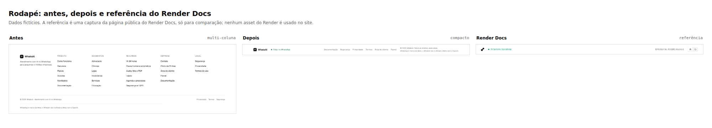
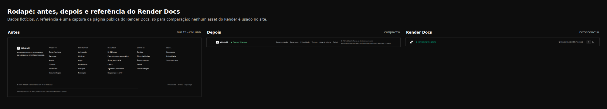
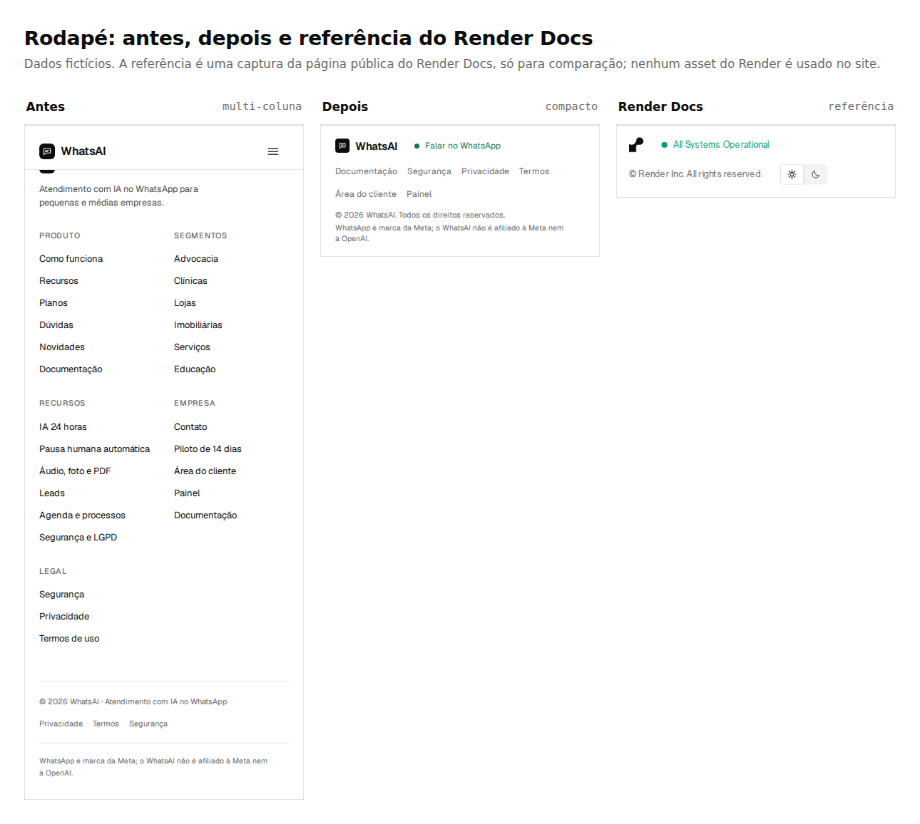
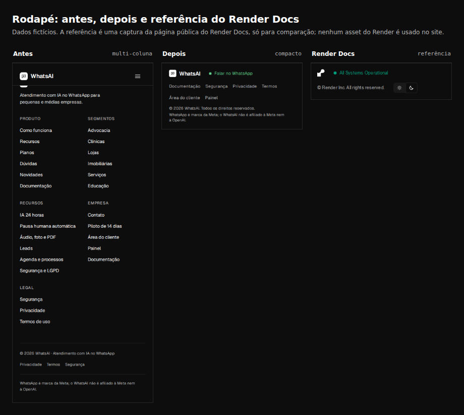
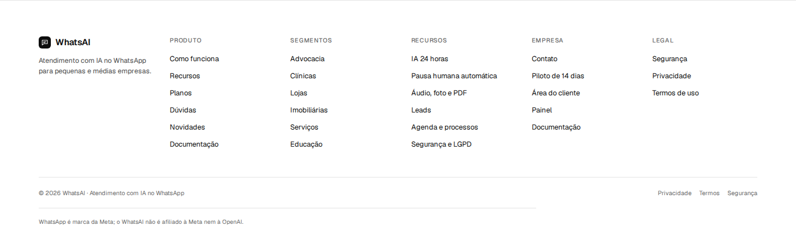
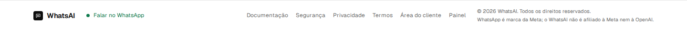
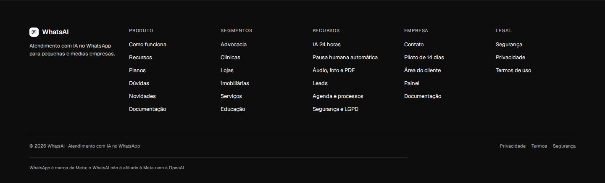
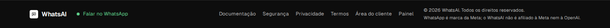

# Rodapé compacto no padrão do Render Docs

Este PR troca o rodapé em seis colunas da landing por uma barra compacta, na anatomia do rodapé da documentação
pública do Render: marca e status à esquerda, copyright à direita, uma linha fina em cima e empilhamento no celular.
A marca, os textos, os tokens, os ícones e o código são do WhatsAI.

Este PR é empilhado no PR #159 (cores da documentação na landing). A base é a branch `feat/landing-cores-docs`; por
isso as capturas de "antes" já estão com a paleta nova, e a diferença mostrada aqui é só o rodapé.

## Método

- Referência pública: `https://render.com/docs`, rodapé capturado em 1440 e 390 px, temas claro e escuro, com
  Playwright, sem login e só com GET.
- Foram observados o layout, as medidas, a hierarquia, a tipografia e o comportamento responsivo. Nenhum arquivo CSS,
  fonte, logo, texto ou asset do Render foi copiado.
- O rodapé novo é HTML e CSS próprios em `manager/dist/landing/index.html` e
  `manager/dist/assets/landing-cursor.css`.
- O bundle foi reconstruído com `node manager/patches/landing-css.mjs`.
- As imagens do Render ficam só em `referencia/`, para revisão no PR. Elas não são publicadas no site.
- Capturas com dados fictícios, sem cliente real.

## Comparação de anatomia

| Item | Render Docs | WhatsAI |
| --- | --- | --- |
| Barra | Borda superior de 1 px, uma linha, padding vertical de 16 px | Igual |
| Esquerda | Símbolo da marca e link de status com ponto verde | Marca do WhatsAI e link "Falar no WhatsApp" com ponto verde |
| Direita | Copyright e seletor de tema | Links compactos, copyright e aviso da Meta/OpenAI |
| Tipografia | Texto pequeno de 12 px | Links e status de 12 px; copyright de 11 px; aviso de 10,5 px |
| Celular | Coluna; status, copyright e tema empilhados | Coluna; marca e contato, links, copyright e aviso empilhados |
| Altura em 1440 px | 61 px | 67 px |
| Altura em 390 px | 98 px | 184 px |

## O que mudou

- **HTML:** saem as seis colunas (Produto, Segmentos, Recursos, Empresa e Legal) e a linha de copyright separada.
  Entra uma barra única com marca, contato, links, copyright e o aviso de marcas.
- **Links:** ficam só os atalhos que não estão no topo: Documentação, Segurança, Privacidade, Termos, Área do cliente
  e Painel. Os links de produto, segmentos e recursos já estão no topo da página e apontavam para as mesmas âncoras.
- **Contato:** o link "Falar no WhatsApp" usa o mesmo `data-wa-cta` dos outros botões; nenhum JavaScript novo.
- **CSS:** o bloco `.wa-foot-*` foi substituído por `.wa-docfoot-*`, com os tokens `--wa-*` da landing. Sem sombra, com
  a mesma borda superior da documentação.
- **Área de toque:** links e status têm altura mínima de 24 px; no celular, o rodapé empilha sem apertar os alvos.
- **Acessibilidade:** foco visível herdado da página, texto terciário em 5,33:1 no claro e 9,27:1 no escuro, verde em
  5,37:1 e 9,98:1. Nenhum texto pequeno abaixo de 4,5:1.

## O que não foi copiado

- O logo e a marca do Render.
- O texto "All Systems Operational" e o link para o status do Render.
- O seletor de tema do rodapé do Render.
- Qualquer CSS, fonte, ícone ou arquivo do Render.

## Adaptações e por quê

1. **Status honesto.** O Render exibe "All Systems Operational" porque tem uma página pública de status. O WhatsAI não
   tem. Exibir o mesmo selo seria uma afirmação que não podemos conferir e contrariaria a regra de `/seguranca` de só
   mostrar o que está implementado. No lugar, o ponto verde leva para "Falar no WhatsApp", que é uma ação real e útil.
   Quando existir uma página pública de status, o texto e o link podem ser trocados sem mexer no layout.
2. **Links essenciais.** O rodapé antigo era o único caminho para Privacidade, Termos, Segurança, Área do cliente e
   Painel em algumas páginas. Uma cópia literal do Render deixaria esses acessos sem link. Por isso a barra mantém uma
   linha compacta de atalhos; não voltam as colunas de marketing.
3. **Aviso de marcas.** O aviso "WhatsApp é marca da Meta; o WhatsAI não é afiliado à Meta nem à OpenAI" continua no
   rodapé, em texto pequeno. Ele não cita o fornecedor da base.
4. **Sem seletor de tema.** A landing segue o tema do sistema, como antes. Um seletor manual exige script próprio,
   preferência salva e seletores de CSS para `data-theme`; é uma mudança à parte e está nas recomendações.

## Comparação

### 1440 px, tema claro

### 1440 px, tema escuro

### 390 px, tema claro

### 390 px, tema escuro

### Antes e depois em tamanho real

| Antes (seis colunas) | Depois (barra compacta) |
| --- | --- |
|  |  |
|  |  |

As páginas inteiras estão em `antes/antes-home-*-full.jpg` e `depois/depois-home-*-full.jpg` (1440 e 390 px, claro e
escuro), para ver o rodapé no fim da página. As capturas do rodapé do Render usadas só como referência estão em
`referencia/` (1440 e 390 px, claro e escuro).

## Arquivos alterados

- `manager/dist/landing/index.html`: o bloco do rodapé.
- `manager/dist/assets/landing-cursor.css`: as regras `.wa-docfoot-*` no lugar de `.wa-foot-*`.
- `manager/dist/assets/landing.bundle.css`: bundle minificado reconstruído.
- `readmes/pr/landing-rodape-render-docs/`: este README e as capturas.

## Checagens

- `node manager/patches/landing-css.mjs --check` passa.
- Mudança só estática (`manager/dist` e `readmes`): o título do squash termina com `[skip render]`; não reinicia a API.
- Sem `src/`, `prisma/`, `Dockerfile` ou `render.yaml`; sem migration.
- Sem script inline novo; a CSP de `manager/dist/vercel.json` não muda.
- O GitHub Actions roda lint, Prettier, build, tipos, unitários, integração e patches do painel.

## Recomendações

1. Quando houver uma página pública de status, trocar o link "Falar no WhatsApp" por "Todos os sistemas operacionais"
   apontando para ela. Não usar `/observability`: hoje ela redireciona para o painel administrativo e não é um status
   público.
2. Aplicar o mesmo rodapé em `/docs`, `/seguranca`, `/termos` e `/privacidade`, que ainda usam o rodapé em colunas.
   Assim o site inteiro fica com um componente só. Fazer em PR separado, com as mesmas capturas.
3. Se o dono quiser um seletor de tema na landing, seguir o padrão do `/docs`: `Sistema`, `Claro` e `Escuro`, com
   `localStorage` (`wa-theme`), script externo e CSS para `data-theme`. Não adicionar script inline para não mexer na
   CSP.
4. Manter a barra só com o essencial. Se os links de marketing fizerem falta, a solução é uma linha acima do rodapé ou
   o topo, não voltar às seis colunas.
5. Depois do merge, conferir Lighthouse em `/` e `/seguranca` (meta de 100 nas quatro notas e 4/4 em navegação
   agêntica) e a instância `open` no Render, que fica com o Claude Code do dono.
