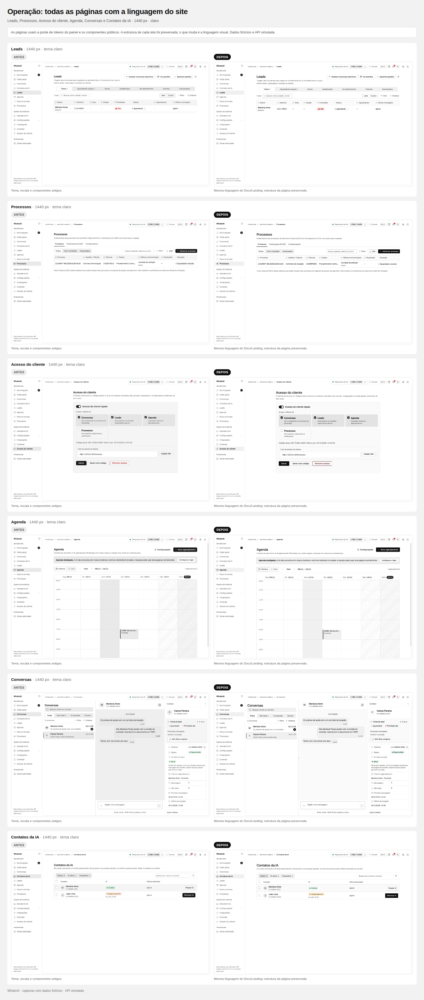
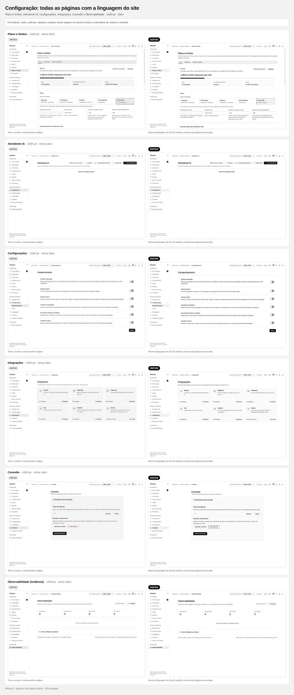
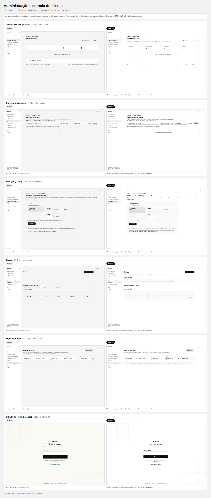
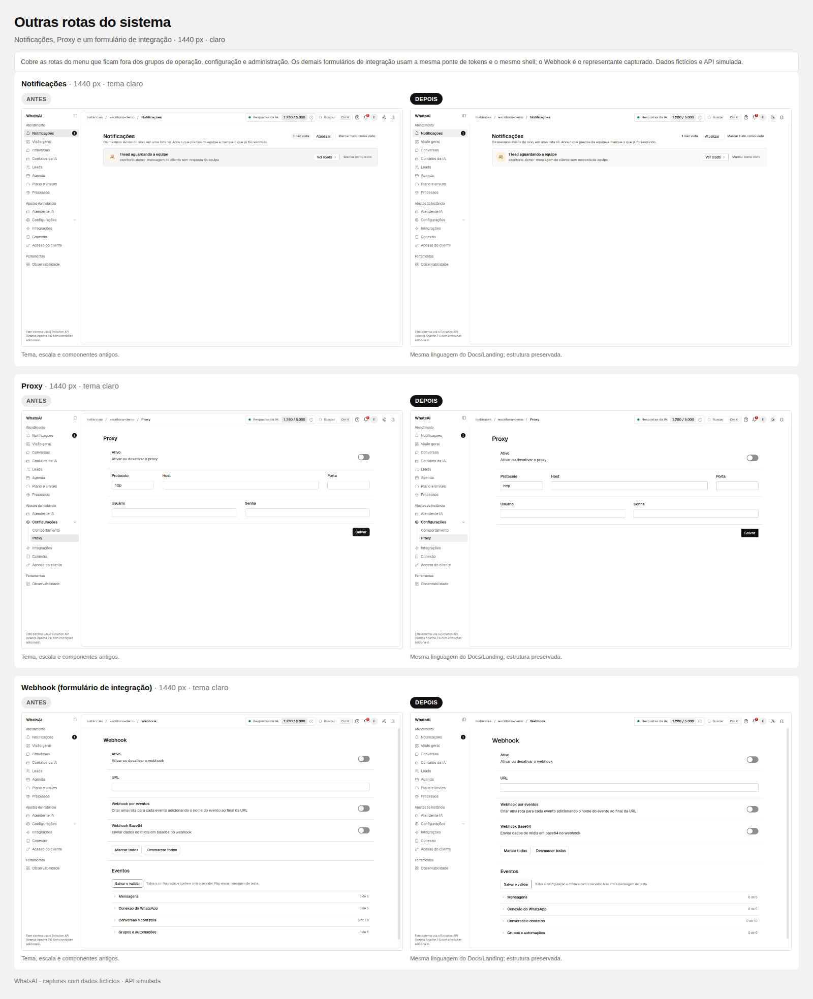
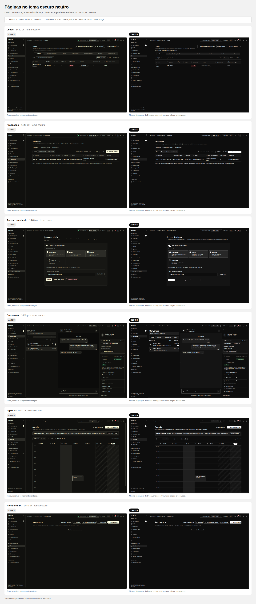
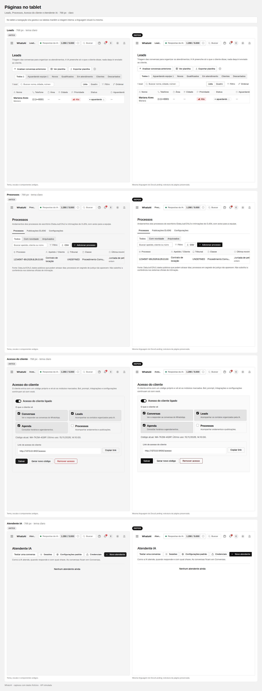
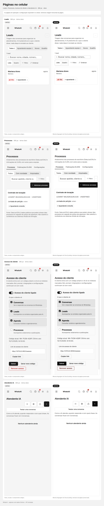
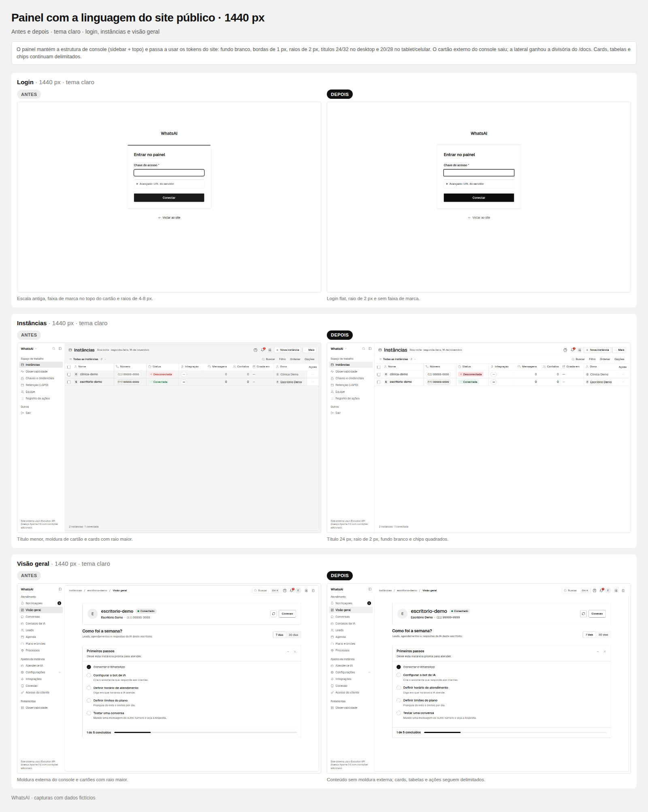
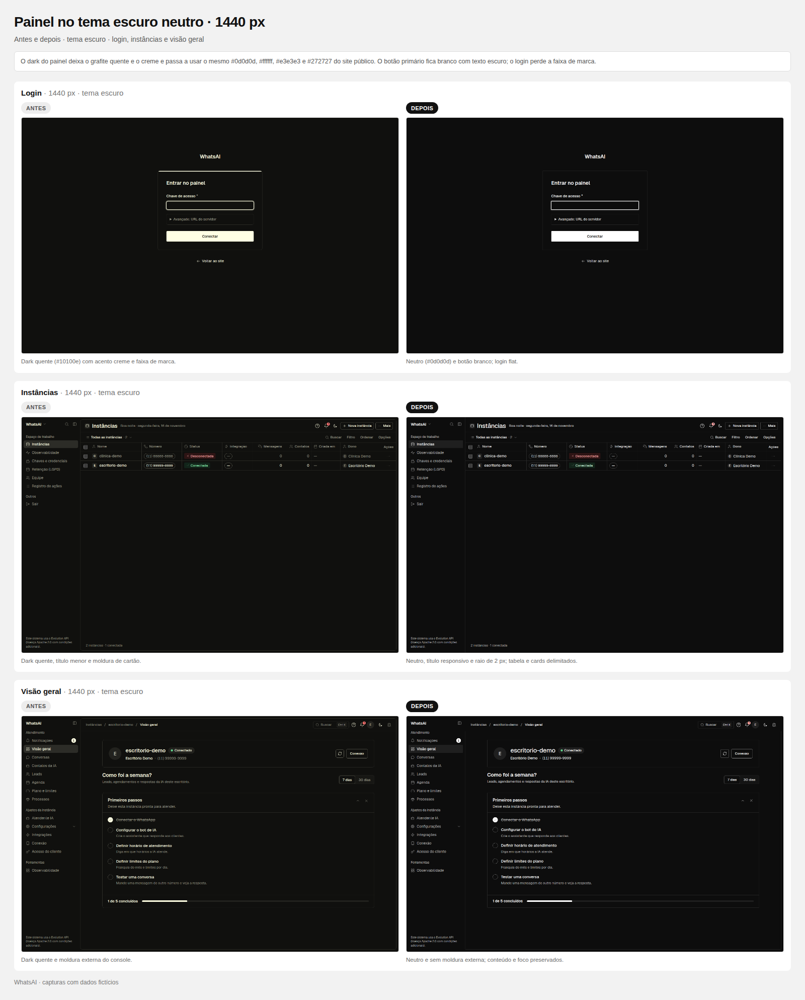
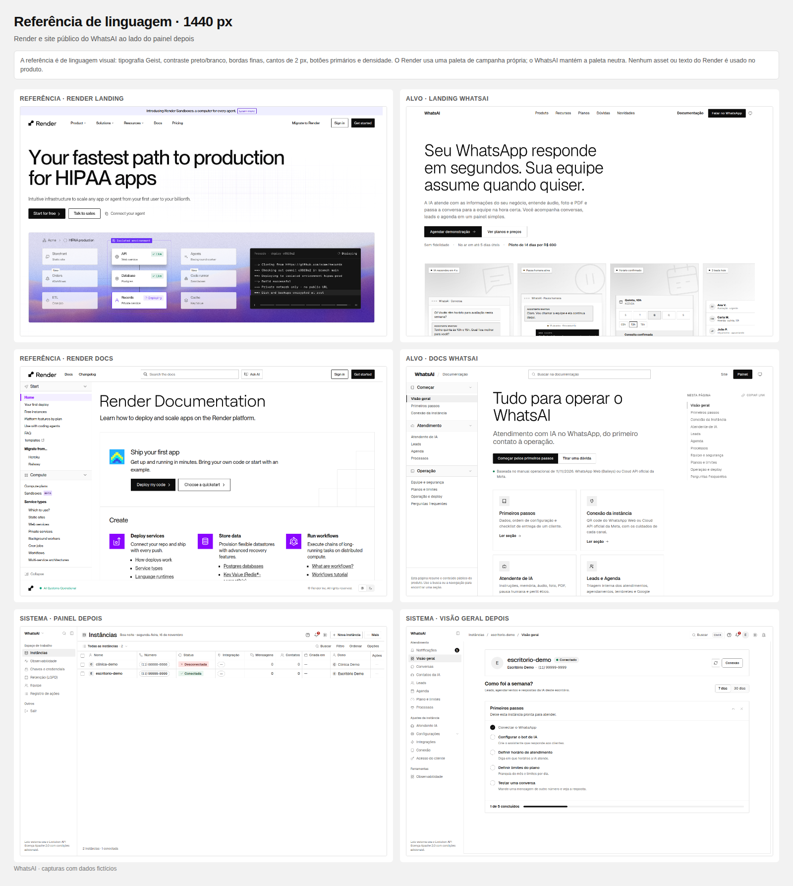

# Painel com a linguagem visual do site público

O painel administrativo inteiro passa a usar a mesma linguagem visual do Docs e da Landing, que seguem a referência do
[Render](https://render.com/): Geist, contraste preto/branco, bordas finas, cantos de 2 px, títulos com respiro e
hierarquia clara. A estrutura de console (sidebar + topo + conteúdo rolável) continua, porque é o que faz sentido para
um sistema operacional.

A mudança cobre as rotas do menu, a visão geral, as páginas globais, os formulários de integração e a entrada do
cliente em `/acesso`. As páginas públicas, a API e os dados não mudam.

## O que mudou

### Ponte de tokens

- O fim de `manager/dist/assets/design-system.css`, que já era o último CSS do painel, recebeu uma ponte com os valores
  de `assets/tokens.css`.
- A ponte cobre `--m-*`, os tokens derivados `--wo-*`, `--wa-*` e `--wc-*` e as triplas HSL do shadcn/Tailwind.
- O accent é neutro: preto no claro, branco no escuro. Verde, âmbar e vermelho seguem reservados a estados com
  significado.
- Claro: fundo e cards brancos, superfície `#fafafa`, texto `#0d0d0d`, bordas `#e3e3e3` e apoio `#c7c7c7`.
- Escuro: fundo `#0d0d0d`, superfície `#141414`, texto `#ffffff`, apoio `#e3e3e3` e bordas `#272727`. O antigo dark
  quente (`#10100e` com creme `#ffffe3`) saiu.

### Forma e tipografia

- Raios de 2 px em cards, controles, campos, chips, módulos do acesso do cliente e códigos.
- Títulos de página e de instância em 24/32 no desktop e 20/28 no tablet e no celular, peso 500.
- O login do painel perdeu a faixa de marca no topo do cartão, ganhou cartão de 2 px e passou a ter borda e respiro
  internos no celular.
- O console perdeu a moldura externa de cartão; a lateral ganhou a divisória vertical do `/docs` e o topo deixou de
  desenhar uma linha.
- Chips ficaram quadrados. A grade de recursos, as tabelas, os cards e as linhas de conteúdo continuam delimitados.

### Páginas específicas

- **Acesso do cliente:** card, módulos, código e mensagem pronta em 2 px; chips semânticos nos tokens do site; botão de
  remover acesso com contraste correto no escuro.
- **Contatos da IA:** chips de estado em 2 px e com as cores semânticas do site.
- **Conversas:** avatar, esqueletos, links, badge de não lidas e horário da mensagem passaram aos tokens neutros. As
  bolhas do chat mantêm o raio de 20 px e os alvos de toque mantêm 44 px.
- **Notificações, Proxy e Webhook:** entram na mesma ponte e foram capturados como rotas representativas de extras e
  formulários de integração.
- **Entrada do cliente `/acesso`:** é uma página estática separada e não carrega o bundle do painel. O CSS dela foi
  alinhado diretamente: fundo branco/`#0d0d0d`, primário preto/branco, raios de 2 px, sem o ponto verde da marca,
  `theme-color` neutro e `acesso.css?v=2`.
- **Integrações:** o catálogo foi capturado; os formulários individuais usam a mesma ponte, o mesmo shell e os mesmos
  componentes. O Webhook é o representante capturado; os demais seguem o mesmo CSS base.

## Cobertura das páginas

| Grupo | Páginas | Comparação |
| --- | --- | --- |
| Núcleo | Login, Instâncias, Visão geral | `comparacao-sistema-1440-light/dark`, `768-light`, `390-light` |
| Operação | Leads, Processos, Acesso do cliente, Agenda, Conversas, Contatos da IA | `comparacao-paginas-operacao-1440-light` |
| Configuração | Plano e limites, Atendente IA, Configurações, Integrações, Conexão, Observabilidade da instância | `comparacao-paginas-configuracao-1440-light` |
| Administração e cliente | Observabilidade global, Chaves, Retenção, Equipe, Registro, `/acesso` | `comparacao-paginas-administracao-1440-light` |
| Extras | Notificações, Proxy, Webhook | `comparacao-paginas-extras-1440-light` |
| Escuro | Leads, Processos, Acesso do cliente, Conversas, Agenda, Atendente IA | `comparacao-paginas-1440-dark` |
| Tablet/celular | Leads, Processos, Acesso do cliente, Atendente IA | `comparacao-paginas-768-light`, `comparacao-paginas-390-light` |

As capturas usam uma API simulada e dados fictícios. Nenhuma requisição foi feita à produção.

## Comparações

### Operação, 1440 px, claro

### Configuração, 1440 px, claro

### Administração e entrada do cliente, 1440 px, claro

### Extras, 1440 px, claro

### Páginas no escuro, 1440 px

### Páginas no tablet, 768 px, claro

### Páginas no celular, 390 px, claro

### Núcleo, 1440, 768 e 390 px

### Referência de linguagem

As imagens do Render são apenas referência de linguagem para a revisão; nenhum asset, logo, texto ou CSS do Render
entra no produto.

## Acessibilidade e comportamento

- Testado em 320, 390, 768, 1024 e 1440 px, nos temas claro e escuro.
- Sem rolagem horizontal da página nas rotas capturadas. No tablet e no desktop estreito, a tabela de instâncias e
  algumas tabelas densas rolam dentro do próprio wrapper.
- Sem erros de console nas capturas além do socket local da simulação.
- Contraste dos tokens principais:
  - claro: texto `#0d0d0d` sobre branco 19,44:1; apoio `#4d4d4d` 8,45:1; texto fraco `#6b6b6b` 5,33:1; botão branco
    sobre `#0d0d0d` 19,44:1; chips verde/âmbar/vermelho 10,97:1, 9,12:1 e 11,21:1;
  - escuro: texto branco sobre `#0d0d0d` 19,44:1; apoio `#e3e3e3` 15,14:1; texto fraco `#b3b3b3` 9,27:1; botão
    `#0d0d0d` sobre branco 19,44:1; chips verde/âmbar/vermelho 13,76:1, 11,42:1 e 9,06:1.
- Foco visível de 2 px; campos com borda `#8f8f8f`, acima de 3:1 para componentes.
- A ordem de títulos, a navegação, os filtros e os alvos de 32/28 px com mouse (44 px no toque) não mudaram.
- A entrada do cliente `/acesso` não faz chamadas de API ao abrir; o login só ocorre no envio do formulário.

## Versões e patch

- `design-system.css?v=2` no `index.html`; o bundle continua `index-b29a5d7a.js?v=82`.
- `manager/patches/design-system.py` atualizado para a versão 2 do CSS, cache 82 e troca do link anterior.
- `acesso.css?v=2` e `theme-color` neutro em `acesso/index.html`.
- Nenhum arquivo público de CSS/JS do site mudou. A mudança é estática e leva `[skip render]`; a API no Render não
  reinicia.
- Todos os `manager/patches/*.py --check` passam; `npx esbuild` no bundle e nos CSS alterados passa.
- O merge é feito pelo dono após a revisão.

## Recomendações

1. Tratar `assets/tokens.css` como fonte da verdade. A ponte do painel repete os valores públicos; o próximo passo ideal
   é gerar esse bloco a partir do `tokens.css`.
2. Manter a estrutura de console no sistema. Copiar o layout de página do Docs para um painel com tabelas, filtros e
   ações reduziria a densidade e a eficiência.
3. Preservar a ponte em todas as rotas novas. Formulários de integração, notificações e subpáginas devem usar os
   mesmos tokens; não voltar a hex ou raio 6/8 px em CSS de página.
4. Manter a paleta neutra e as cores semânticas. Verde, âmbar e vermelho só para estado; gráficos com várias séries
   devem usar uma paleta definida, não cores decorativas.
5. Manter o login flat, o cartão de 2 px e a entrada do cliente neutra. A faixa de marca e o ponto verde eram do tema
   anterior.
6. Revisar sempre 390, 768 e 1440 px nos dois temas; o dark neutro é o principal ganho e o mais fácil de regredir.
7. Se o dono quiser o chrome do navegador também neutro no painel, atualizar o `theme-color` do script inline e a CSP
   junto; o `/acesso` já está neutro.

## Limitações

- A ponte duplica os valores de `tokens.css`; ela não importa o arquivo porque o painel usa `data-theme` e o site usa
  `data-theme-mode`/`prefers-color-scheme`.
- O painel mantém a densidade de sistema: corpo de 13/14 px e controles de 32/28 px com mouse. O Docs usa corpo maior e
  títulos de 48-64 px.
- A entrada do cliente `/acesso` tem CSS próprio; está alinhada, mas não participa da ponte automática.
- O `theme-color` do navegador no painel ainda usa os valores antigos do script inline; o miolo da aplicação já está
  neutro.
- As bolhas do chat mantêm 20 px e os alvos de toque 44 px; são exceções deliberadas.
- Os formulários individuais de integração usam a mesma ponte, mas só o Webhook foi capturado como representante.
- O preview de planilha em Leads mantém o visual claro de Excel, porque representa o arquivo exportado; não é uma
  superfície do tema.
- O painel é um build minificado com patches determinísticos; a mudança foi feita no CSS e no `index.html`, sem
  reconstruir o bundle nem alterar o JavaScript.
- O PR não foi mesclado; a revisão do dono decide se a ponte entra como está ou se vira uma geração automática de
  tokens.
