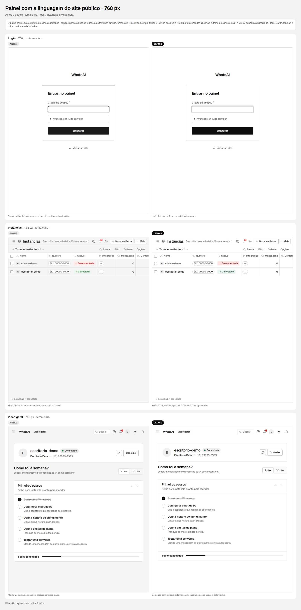
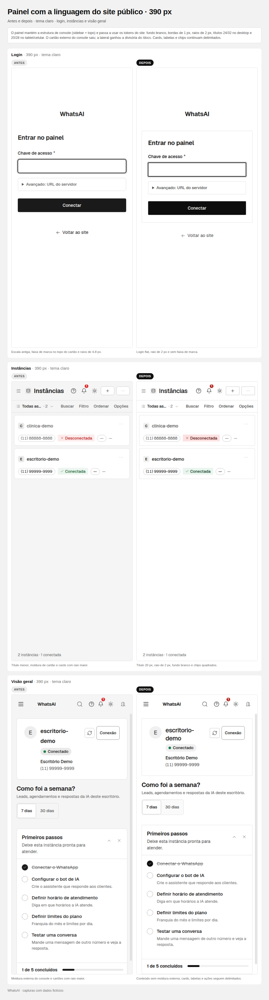
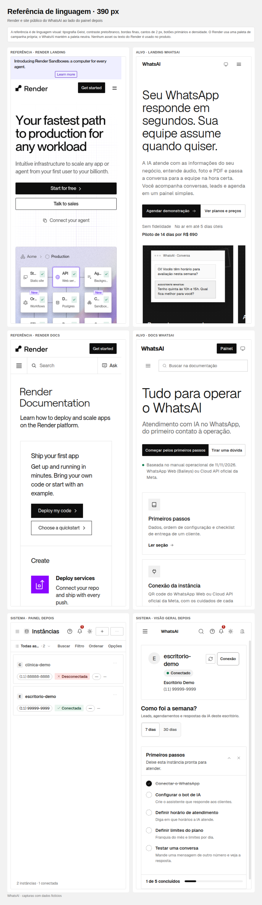

# Painel com a linguagem visual do site público

O sistema (painel administrativo) passa a usar a mesma linguagem visual do Docs e da Landing, que seguem a referência
do [Render](https://render.com/): Geist, contraste preto/branco, bordas finas, cantos de 2 px, títulos com respiro e
hierarquia clara. A estrutura de console (sidebar + topo + conteúdo rolável) continua, porque é o que faz sentido para
um sistema operacional; o que muda é a linguagem visual.

O escopo é só o painel. As páginas públicas, a API e os dados não mudam nesta rodada.

## O que mudou

### Ponte de tokens

- O fim de `manager/dist/assets/design-system.css`, que já era o último CSS do painel, recebeu uma ponte com os valores
  de `assets/tokens.css`.
- A ponte cobre `--m-*`, os tokens derivados `--wo-*`, `--wa-*` e `--wc-*` e as triplas HSL do shadcn/Tailwind.
- O painel usa `data-theme="light|dark"`; por isso a ponte repete os valores públicos nos dois temas, em vez de carregar
  `tokens.css` e depender de `data-theme-mode`/`prefers-color-scheme`.
- O accent continua neutro: preto no claro, branco no escuro. Verde, âmbar e vermelho seguem reservados a estados com
  significado.

### Cores e superfícies

- Claro: fundo e cards brancos, superfície `#fafafa`, texto `#0d0d0d`, bordas `#e3e3e3` e apoio `#c7c7c7`.
- Escuro: fundo `#0d0d0d`, superfície `#141414`, texto `#ffffff`, apoio `#e3e3e3` e bordas `#272727`.
- O antigo dark quente (`#10100e` com creme `#ffffe3`) saiu. O tema escuro agora é o mesmo grafite neutro do site.
- O botão primário no escuro ficou branco com texto escuro, como no site.

### Forma e tipografia

- Raios de 2 px em cards, controles, campos e chips, no lugar de 6/8 px.
- Títulos de página e de instância em 24/32 no desktop e 20/28 no tablet e no celular, peso 500.
- O login perdeu a faixa de marca no topo do cartão, ganhou cartão de 2 px e passou a ter borda e respiro internos no
  celular.
- O console perdeu a moldura externa de cartão; a lateral ganhou a divisória vertical do `/docs` e o topo deixou de
  desenhar uma linha.
- Chips ficaram quadrados. A grade de recursos, as tabelas, os cards e as linhas de conteúdo continuam delimitados.

### Exceções de componente

- As bolhas do chat mantêm o raio de 20 px; são um componente de conversa, não um card de página.
- Os alvos de toque do `responsive.css` continuam com 44 px no celular e no tablet.
- Os gráficos passaram a uma escala neutra. Se um gráfico precisar de mais séries, a recomendação é usar uma paleta
  com significado, não voltar às cores decorativas.

## Comparações

### Desktop, 1440 px, tema claro

### Desktop, 1440 px, tema escuro

### Tablet, 768 px, tema claro

### Celular, 390 px, tema claro

### Referência de linguagem, 1440 px

### Referência de linguagem, 390 px

As capturas usam uma API simulada e dados fictícios. Nenhuma requisição foi feita à produção. As imagens do Render são
apenas referência de linguagem para a revisão; nenhum asset, logo, texto ou CSS do Render entra no produto.

## Acessibilidade e comportamento

- Testado em 320, 390, 768, 1024 e 1440 px, nos temas claro e escuro.
- Sem rolagem horizontal da página em nenhuma combinação. No tablet e no desktop estreito, a tabela de instâncias rola
  dentro do próprio wrapper, como antes.
- Sem erros de console nas capturas (o socket local da simulação foi ignorado).
- Contraste dos tokens principais:
  - claro: texto `#0d0d0d` sobre branco 19,44:1; apoio `#4d4d4d` 8,45:1; texto fraco `#6b6b6b` 5,33:1; botão branco
    sobre `#0d0d0d` 19,44:1; chips verde/âmbar/vermelho 10,97:1, 9,12:1 e 11,21:1;
  - escuro: texto branco sobre `#0d0d0d` 19,44:1; apoio `#e3e3e3` 15,14:1; texto fraco `#b3b3b3` 9,27:1; botão
    `#0d0d0d` sobre branco 19,44:1; chips verde/âmbar/vermelho 13,76:1, 11,42:1 e 9,06:1.
- O foco visível continua com 2 px; os campos usam borda `#8f8f8f`, que passa no critério de 3:1 para componentes.
- A ordem de títulos, a navegação lateral e os alvos de 32/28 px com mouse (44 px no toque) não mudaram.
- As páginas públicas continuam em 100 de acessibilidade no Lighthouse; o painel não foi auditado com Lighthouse nesta
  rodada, mas os contrastes acima foram calculados sobre os tokens.

## Versões e patch

- `design-system.css?v=2` no `index.html`; o bundle continua `index-b29a5d7a.js?v=82`.
- `manager/patches/design-system.py` foi atualizado para a versão 2 do CSS, para o cache 82 e para trocar o link
  anterior.
- Nenhum arquivo público de CSS ou JS mudou; `tokens.css`, `docs.css`, `legal.css` e o bundle da landing continuam
  iguais.
- A mudança é estática e leva `[skip render]`; a API no Render não reinicia.
- Todos os `manager/patches/*.py --check` passam; `node --check`/`esbuild` no bundle passa.
- O PR fica aberto para revisão; não foi mesclado.

## Recomendações

1. Tratar `assets/tokens.css` como fonte da verdade. A ponte do painel repete os valores públicos; quando um token
   público mudar, atualizar a ponte junto. O próximo passo ideal é gerar esse bloco a partir do `tokens.css`.
2. Manter a estrutura de console no sistema. Copiar o layout de página do Docs para um painel com tabelas, filtros e
   ações reduziria a densidade e a eficiência.
3. Manter a paleta neutra e as cores semânticas. Verde, âmbar e vermelho só para estado; gráficos com várias séries
   devem usar uma paleta definida, não cores decorativas.
4. Preservar as bordas funcionais de cards, tabelas, chips e divisórias de navegação. A remoção de linhas é só para
   separadores decorativos de seção.
5. Manter o login flat e o cartão de 2 px. A faixa de marca no topo era um elemento do tema anterior e não existe no
   site público.
6. Revisar sempre 390, 768 e 1440 px nos dois temas; o dark neutro é o principal ganho e o mais fácil de regredir.
7. Se o dono quiser o chrome do navegador também neutro, atualizar o `theme-color` do script inline do painel e a CSP
   junto; nesta rodada ele ficou fora para não mexer no hash da CSP.

## Limitações

- A ponte duplica os valores de `tokens.css`; ela não importa o arquivo porque o painel usa `data-theme` e o site usa
  `data-theme-mode`/`prefers-color-scheme`.
- O painel mantém a densidade de sistema: corpo de 13/14 px e controles de 32/28 px com mouse. O Docs usa corpo maior e
  títulos de 48-64 px; copiar a escala de leitura do Docs deixaria as tabelas e filtros pesados.
- As bolhas do chat continuam com raio de 20 px e os alvos de toque com 44 px; são exceções deliberadas.
- O `theme-color` do navegador ainda usa os valores antigos no script inline; o miolo da aplicação já está neutro.
- O painel é um build minificado com patches determinísticos; a mudança foi feita no CSS e no `index.html`, sem
  reconstruir o bundle nem alterar o JavaScript.
- A referência do Render é de linguagem visual. A paleta de campanha do Render não foi copiada; o WhatsAI continua
  neutro.
- O PR não foi mesclado. A revisão do dono decide se a ponte entra como está ou se vira uma geração automática de
  tokens.
