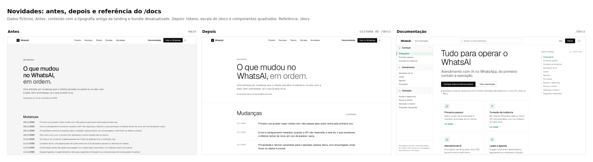
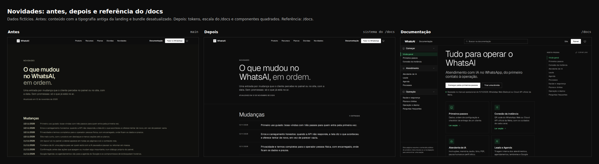
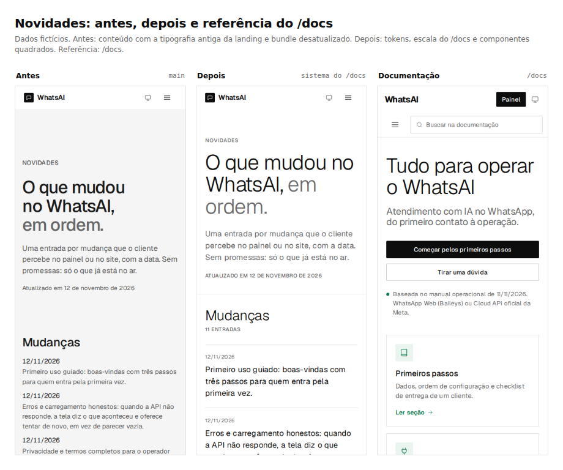
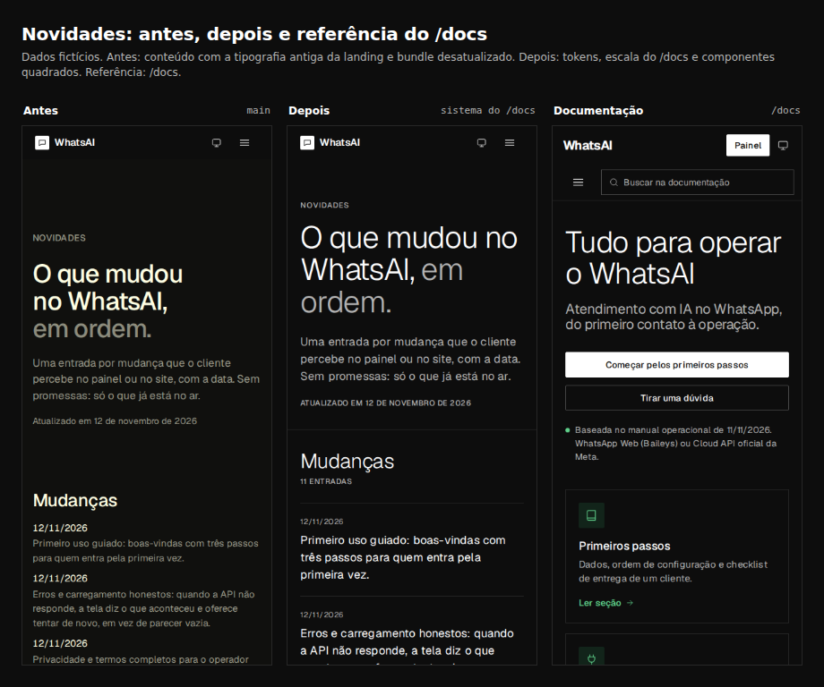
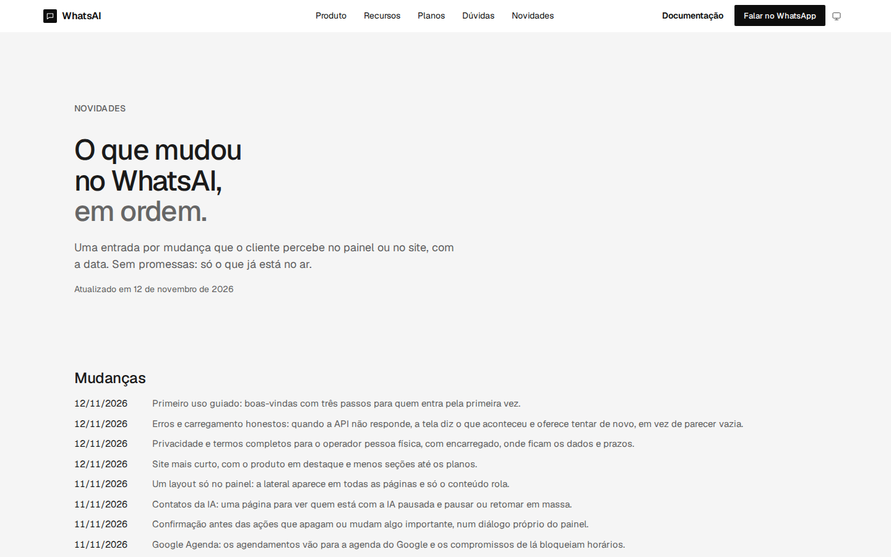
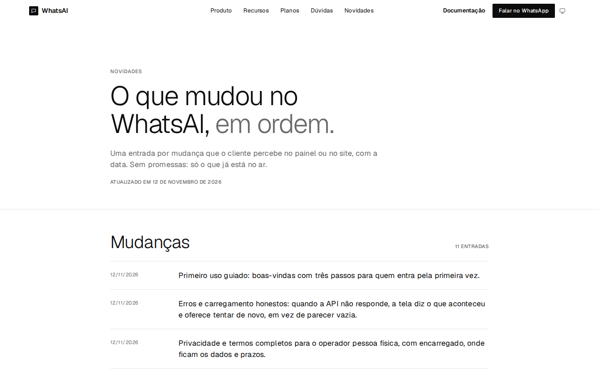

# Novidades no sistema visual e troca de tema sem flash

Esta proposta atualiza a página `/novidades` para o mesmo sistema visual da landing e do `/docs`: tokens globais,
escala tipográfica, componentes quadrados, contraste nos dois temas e o cabeçalho e rodapé globais. Também corrige a
troca de tema, que animava a cor de alguns componentes por 150 ms e parecia piscar enquanto o restante da página
mudava na hora.

## Novidades

- O conteúdo deixou de usar as classes antigas `.sec-*` da página de segurança. Agora usa `body.novidades-page` e as
  classes `.nv-*` de `landing/novidades.css`.
- O hero segue o `/docs`: sobrancelha em mono 12 px, título `clamp(48px, 5vw, 64px)` com peso 300, lead de corpo em
  18 px e a data em mono 12 px.
- A lista de mudanças virou uma tabela editorial: data mono na primeira coluna, texto na segunda, linhas de 1 px e
  raio 0. No celular, a data fica acima do texto. O cabeçalho da lista mostra “11 entradas”, que acompanha o conteúdo
  atual.
- O topo, o rodapé e o seletor de tema continuam os do shell global (`site-shell.css` e `theme.js`).
- A página carrega `landing/novidades.css?v=1` depois do bundle. Se o CSS da página mudar, subir essa versão.

### Causa da página desatualizada

O `landing-css.mjs` gerava o bundle e atualizava o `<link>` apenas da landing. `/novidades` ficou com um `?v=` antigo,
e o cache imutável de `/assets/*` podia continuar servindo o bundle velho em produção. Agora a lista de páginas do
script inclui `landing/novidades.html`, então o hash do bundle acompanha as duas páginas.

Também removi `security.css` do bundle: ele só servia as classes `.sec-*` antigas que a Novidades usava. Com o CSS
próprio da página, o bundle caiu de cerca de 129 KB para 117 KB.

## Troca de tema sem flash

Não é Tailwind: o projeto usa CSS escrito à mão. O que acontecia era o seguinte:

- a troca de tema altera `data-theme-mode` e, com ele, as variáveis `--c-*`;
- vários componentes têm `transition` de `background-color`, `color` e `border-color` para o hover, com 150 ms;
- ao trocar o tema, esses componentes animavam da cor antiga para a nova, enquanto os elementos sem transição
  mudavam na hora. O resultado era o flash de algumas partes.

A correção:

- `tokens.css` ganhou a regra `html.theme-switching` e `html.theme-switching *`, que desliga transições e animações
  com `!important` enquanto a classe estiver no `<html>`;
- o `theme.js` e o `docs.js` adicionam a classe antes de trocar `data-theme-mode` e removem depois de dois frames
  de animação, quando o navegador já aplicou as cores novas;
- a classe vale para landing, `/novidades`, `/docs` e as páginas legais, porque todos carregam `tokens.css` pelo
  bundle ou pelo link direto.

Teste feito com Playwright no clique em Escuro:

| Página | Durante a troca | Depois de 120 ms |
| --- | --- | --- |
| Landing | `theme-switching=true`, `transition: none` | classe removida, tema escuro |
| `/docs` | `theme-switching=true`, `transition: none` | classe removida, tema escuro |
| `/seguranca` | `theme-switching=true`, `transition: none` | classe removida, tema escuro |

As versões subiram: `tokens.css?v=2`, `theme.js?v=2` e `docs.js?v=6`.

## Comparação

### 1440 px, tema claro

### 1440 px, tema escuro

### 390 px, tema claro

### 390 px, tema escuro

### Antes e depois

| Antes | Depois |
| --- | --- |
|  |  |
|  |  |

As páginas inteiras estão em `antes/novidades-*-full.jpg` e `depois/novidades-*-full.jpg` (1440 e 390 px, claro e
escuro).

## Arquivos alterados

- `manager/dist/landing/novidades.html`: conteúdo com as classes `.nv-*`, `novidades-page`, link do CSS da página e
  bundle atualizado.
- `manager/dist/landing/novidades.css`: novo CSS da página, com tokens, escala do `/docs` e lista editorial.
- `manager/patches/landing-css.mjs`: Novidades incluída na lista de páginas; `security.css` removido das fontes.
- `manager/dist/assets/tokens.css`: regra `theme-switching`; versão `?v=2` nos links.
- `manager/dist/assets/theme.js` e `manager/dist/docs/docs.js`: classe de troca de tema; versões novas.
- `manager/dist/landing/index.html`, `seguranca.html`, `termos.html`, `privacidade.html`, `docs/index.html`: links de
  `tokens.css?v=2`, `theme.js?v=2` ou `docs.js?v=6`.
- `readmes/pr/novidades-design-system/`: este README e as capturas.

## Checagens

- `node manager/patches/landing-css.mjs --check` passa.
- `python3 -I manager/patches/perf-boot.py --check` passa.
- `python3 -I manager/patches/theme.py --check` passa.
- `textos-proprios.py --check` e `no-manual.py --check` passam.
- Mudança só estática (`manager/**` e `readmes/**`): o squash termina com `[skip render]`; a API no Render não reinicia.
- Sem script inline novo; a CSP de `manager/dist/vercel.json` não muda.

## Recomendações

1. Manter `landing-css.mjs` com todas as páginas que carregam o bundle. A falha da Novidades veio de uma página fora
   dessa lista; vale um teste que compare os `<link>` do bundle com as páginas em `PAGES`.
2. Se `landing/novidades.css` crescer ou ganhar componentes, considerar mover para um CSS de conteúdo compartilhado
   com o `/docs`, em vez de repetir estilos de lista e data.
3. Manter a regra `theme-switching` em `tokens.css` e usá-la em qualquer novo script de tema. Novos componentes podem
   ter transição de hover, mas a troca de tema não deve animar cor.
4. Remover `security.css` do repositório se nenhuma página continuar usando `.sec-*`; ele saiu do bundle nesta
   mudança, mas o arquivo ainda está em `manager/dist/assets`.
5. Revisar o texto das entradas de Novidades com o dono quando houver mudança de produto; a lista e o contador
   “11 entradas” são manuais.
6. Conferir o tema no celular, a persistência entre páginas e o Lighthouse em `/novidades` depois do merge.
