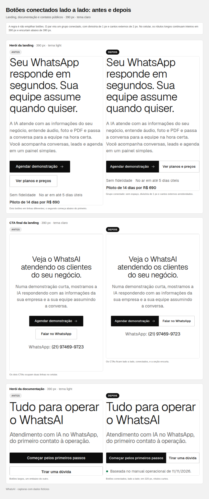
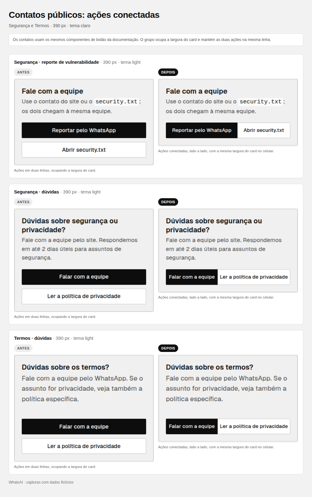
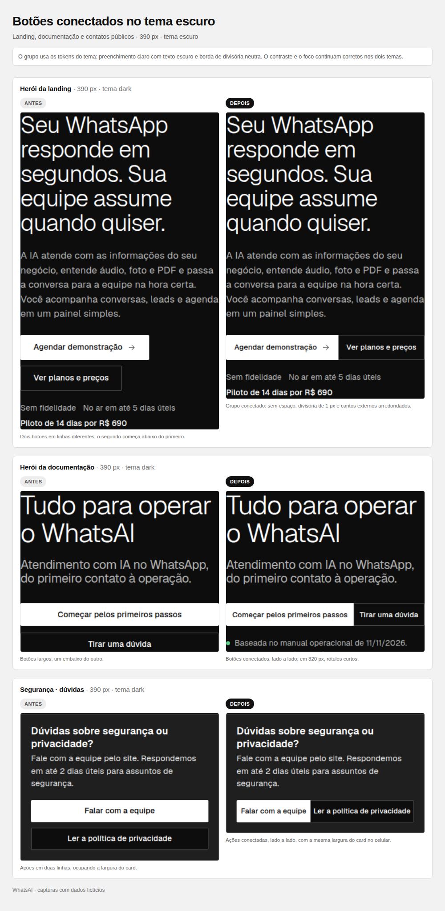
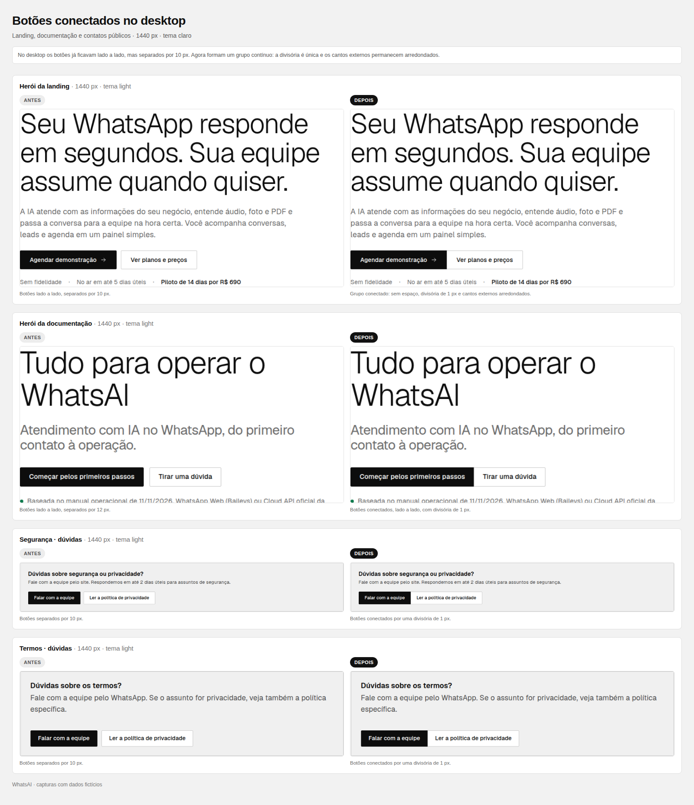
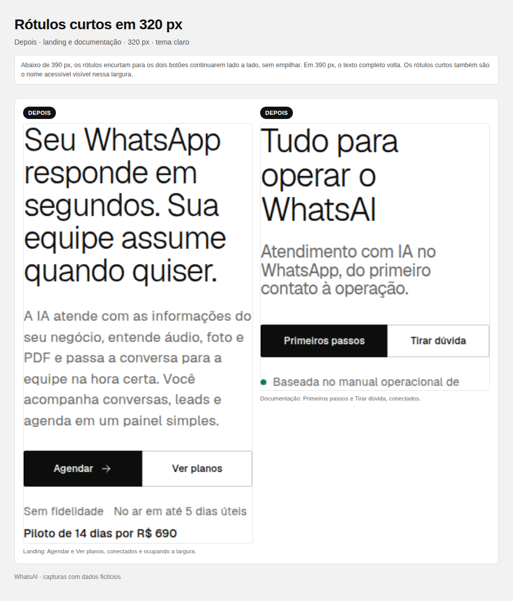
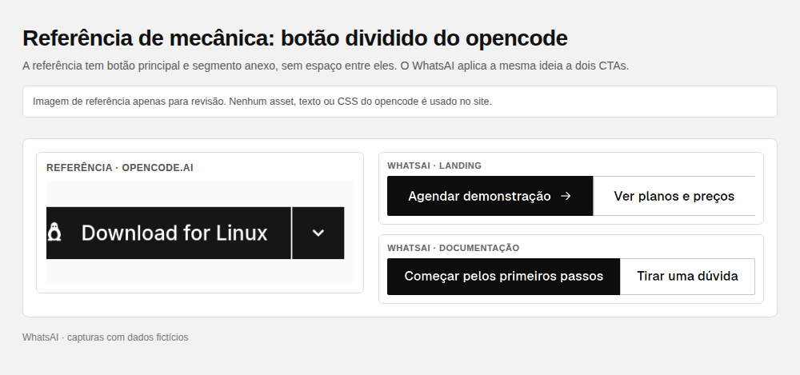

# Botões conectados lado a lado

Troca os pares de botões empilhados por um grupo conectado: sem espaço, com divisória de 1 px, altura igual e cantos
externos arredondados. A mecânica segue o botão dividido do opencode.ai, adaptada para dois CTAs com hierarquia.

A regra vale para as páginas públicas que tinham um par de botões: herói e CTA final da landing, herói da
documentação, contato de segurança (dois blocos) e contato de Termos. Privacidade tem um único botão e não muda.

## O que mudou

### Landing

- O herói (`wa-hero-actions`) e o CTA final (`wa-cta-actions`) recebem o grupo `wa-btn-group`.
- Os dois botões ficam na mesma linha em qualquer largura, inclusive em 320 px.
- O primeiro botão continua sendo a ação principal (preto no tema claro, branco no escuro); o segundo continua
  `ghost`, com borda e fundo da página. A conexão é estrutural, não uma mudança de cor.
- O grupo usa `gap: 0`, `align-items: stretch`, raio de 2 px só nos cantos externos e `margin-left: -1px` no segundo
  botão. A borda esquerda do segundo forma a divisória única.
- Em 390 px, os rótulos completos cabem. Abaixo de 390 px, os rótulos encurtam para manter a mesma linha:
  "Agendar" e "Ver planos" no herói; "Agendar" e "WhatsApp" no CTA.

### Documentação e páginas legais

- O herói da documentação (`hero-actions`) e os contatos de Segurança e Termos (`legal-contact-actions`) recebem o
  componente `btn-group`, definido em `docs.css` e usado também pelas páginas legais.
- O botão primário e o `btn-quiet` ficam conectados. No celular, o grupo ocupa a largura do card e as duas ações
  dividem o espaço; nenhuma delas cai para a linha de baixo.
- Rótulos completos em 390 px; abaixo de 390 px, versões curtas:
  - "Primeiros passos" e "Tirar dúvida" na documentação;
  - "Reportar" e "security.txt" no contato de segurança;
  - "Falar com a equipe" e "Ver política" nos contatos de dúvidas.
- O nome acessível é o rótulo visível na largura atual; não há `aria-label` concorrendo com o texto.

### Hover no tema escuro

Os botões primários da documentação e das páginas legais tinham um hover branco sobre branco no tema escuro: o
gradiente usava `--d-accent` (branco) e o texto era fixo em `#ffffff`. O hover agora usa `--d-btn-hover` e
`--d-btn-text`:

- tema claro: fundo `#272727`, texto branco;
- tema escuro: fundo `#e3e3e3`, texto `#0d0d0d`.

É uma correção de contraste relacionada, porque esses são justamente os botões que passaram a formar grupo.

### Foco e alvos

- O foco visível do site continua com contorno de 2 px. Os botões do grupo recebem `position: relative; z-index: 1`
  no foco para o contorno não ficar coberto pelo vizinho.
- A landing mantém alvos de 44 px (`wa-btn--lg`); documentação e páginas legais mantêm 40 px. Os dois tamanhos passam
  no critério de alvo do WCAG 2.2.

### Versões

- `landing.bundle.css` regerado por `node manager/patches/landing-css.mjs`; a landing e `/novidades` apontam para
  `?v=a4888d6a72`.
- `docs.css?v=8` na documentação, Segurança, Termos e Privacidade.
- `legal.css?v=6` em Segurança, Termos e Privacidade.
- `tokens.css`, `site-shell.css`, `landing.js` e `landing-pixels.js` não mudaram.
- Nenhum script inline novo; a CSP e o `manager/dist/vercel.json` não mudam.

## Comparações

### 390 px, tema claro

### Contatos públicos em 390 px, tema claro

### 390 px, tema escuro

### 1440 px, tema claro

### Rótulos curtos em 320 px

### Referência do botão dividido

A imagem acima é só de revisão. Nenhum asset, texto, fonte ou CSS do opencode é usado no site.

## Comportamento e acessibilidade

- Testado em 320, 360, 375, 390, 414, 768, 1024 e 1440 px, nos temas claro e escuro.
- Testados também os dois temas manuais: claro com sistema escuro e escuro com sistema claro.
- Em todas as combinações, os botões de cada grupo ficam na mesma linha; não há par empilhado.
- Sem rolagem horizontal em nenhuma página ou combinação de largura e tema.
- Sem erros de console.
- Sem texto cortado dentro dos botões: a largura de rolagem de cada botão é igual à largura visível.
- Os rótulos completos voltam em 390 px; em 320, 360 e 375 px, os rótulos curtos mantêm os dois botões na linha.
- O grupo não esconde nenhuma ação: o segundo botão continua visível e clicável; não é um menu nem um dropdown.
- Foco de 2 px visível nos dois botões; o `z-index` no foco evita que a divisória cubra o contorno.
- Hover com contraste alto nos dois temas, inclusive nos botões de documentação e legais.
- Lighthouse 13.6, tema claro: landing 100, Segurança 100 e documentação 100 em acessibilidade. A auditoria
  informativa `td-has-header` da documentação segue como pendência separada de tabela e não altera a nota.
- Nenhuma imagem, CDN, fonte ou requisição nova.

## Recomendações

1. Reutilizar `wa-btn-group` na landing e `btn-group` na documentação/legais em qualquer novo par de ações. Não
   voltar ao `flex-wrap` com dois botões: em 390 px, os rótulos longos empilham.
2. Manter no máximo dois botões por grupo conectado. Com três ou mais, a divisória e a hierarquia perdem sentido; o
   ideal é uma ação principal e uma secundária.
3. Manter a ordem ação principal + ação secundária. O grupo conectado não deve unir ações destrutivas ou de peso
   semelhante sem uma distinção clara.
4. Usar rótulos completos em 390 px e versões curtas abaixo de 390 px. Se um novo rótulo não couber em 320 px, a
   recomendação é encurtar o texto, não empilhar.
5. Usar os tokens de hover (`--wa-btn-hover` na landing, `--d-btn-hover` na documentação/legais) em vez de fixar
   `#ffffff` no texto. Isso evita o branco sobre branco quando o accent é claro.
6. Testar sempre 320, 390 e 1440 px nos dois temas, além dos temas manuais; o grupo depende de `white-space: nowrap`,
   então qualquer rótulo novo precisa ser medido.
7. O botão secundário deve continuar visualmente mais leve. A conexão resolve o pedido de lado a lado; não é
   necessário transformar os dois em botões primários.

## Limitações

- Abaixo de 390 px, os rótulos são abreviados. Isso é intencional para cumprir a regra de nunca empilhar; em 390 px
  o texto completo volta. O nome acessível acompanha o rótulo visível.
- No desktop, o grupo fica com a largura do conteúdo, não esticado pela página. É o mesmo comportamento do botão
  dividido de referência.
- O grupo não é um split button de menu: o segundo botão leva a outra ação, não abre opções. Se no futuro o segundo
  botão virar um seletor, a estrutura muda para um botão com chevron.
- A Privacidade tem um único botão de contato e ficou fora do grupo; não havia par para conectar.
- A referência do opencode fica apenas em `readmes/pr/site-botoes-conectados/`; o site público não recebe esse
  arquivo nem qualquer marca de terceiro.
