# Accent neutro e rodapé com wordmark

Leva a cor neutra da landing para as outras páginas públicas (`/docs`, `/seguranca`, `/termos`, `/privacidade` e
`/novidades`), remove o ícone de chat dos cabeçalhos e do rodapé e troca a marca pequena do rodapé por um wordmark
grande de "WhatsAI", na escala e na posição do rodapé do [opencode.ai](https://opencode.ai/).

O wordmark do opencode é feito de letras vazadas com alças de edição. O WhatsAI mantém a ideia de um título grande no
rodapé, mas usa Geist sólido, sem copiar o desenho, as alças, as animações ou os arquivos da referência.

## O que mudou

### Accent neutro nas páginas públicas

- `assets/tokens.css` passou a definir o accent como preto no tema claro (`#0d0d0d`) e branco no escuro (`#ffffff`).
- O foco, a seleção, os glows e o hover do botão primário também ficaram neutros: `#272727` no claro e `#e3e3e3` no
  escuro.
- `/docs`, `/seguranca`, `/termos`, `/privacidade` e `/novidades` herdam os tokens. Links, botões, itens ativos do
  menu, ícones de linha, "Ler seção", "Copiar link" e o índice ficam neutros.
- O verde, o âmbar e o vermelho continuam reservados a significado: ponto de status, checks de "ok", avisos e erros.
  As notas verdes da documentação continuam iguais.
- A página de segurança trocou as peças decorativas verdes por cinza; o ponto "Atualizado em" continua verde.

### Cabeçalhos sem ícone

- O ícone de chat (`wa-brand-mark`) saiu da landing, de `/novidades`, `/seguranca`, `/termos` e `/privacidade`.
- O topo da documentação já era só texto e continua assim.
- O texto "WhatsAI" continua no cabeçalho, alinhado à esquerda, com a navegação no centro e as ações à direita.

### Rodapé com wordmark grande

- A marca pequena com ícone (`wa-docfoot-brand` e `wa-docfoot-mark`) saiu do rodapé.
- Entrou um wordmark "WhatsAI" grande, estático e ligado à home, abaixo da linha de status, links e aviso legal.
- O wordmark usa Geist 600, `letter-spacing: -0.06em`, `line-height: 0.74` e
  `font-size: clamp(70px, 21vw, 300px)`.
- Em 1440 px, o título tem 300 px de fonte e cerca de 242 px de altura; em 390 px, fica com 82 px; em 320 px, 70 px.
- A landing, `/novidades`, `/seguranca`, `/termos` e `/privacidade` usam o mesmo rodapé. O rodapé da documentação
  continua compacto, com o texto "WhatsAI" e as colunas de links; a recomendação é manter assim, porque a sidebar da
  documentação já carrega a marca.

### Acessibilidade

- Os números dos cartões de controle da página de segurança passaram de `--d-text-4` para `--d-text-3`, corrigindo o
  contraste de 3,23:1 para 5,4:1 no tema claro.
- O "Não" das tabelas passou de `--d-warn-border` para `--d-warn-text`, mantendo o âmbar com significado e contraste
  suficiente.
- Os títulos do fluxo de dados saíram de `h4` para `h3`, corrigindo a ordem de títulos.
- O resultado: `/seguranca` passou de 95 para 100 em acessibilidade no Lighthouse, nos temas claro e escuro.

### Versões

- `tokens.css?v=3` em `/docs`, `/seguranca`, `/termos` e `/privacidade`.
- `legal.css?v=4` e `site-shell.css?v=2` nas páginas legais.
- `docs.css?v=6` em `/docs` e nas páginas legais.
- `landing.bundle.css` regerado por `node manager/patches/landing-css.mjs`, com hash novo na landing e em
  `/novidades`.

## Referência e adaptação

| Item | opencode.ai | WhatsAI |
| --- | --- | --- |
| Wordmark | Letras vazadas/hatched com alças de edição | Geist sólido, 600 |
| Altura | Cerca de 200 px em 1440 px | Cerca de 242 px em 1440 px |
| Largura | Bloco de conteúdo | Bloco de conteúdo, alinhado à esquerda |
| Posição | Base do rodapé, depois dos links | Base do rodapé, depois de status, links e aviso legal |
| Cor | Texto da página | Preto no claro e branco no escuro |
| Interação | Letras arrastáveis/selecionáveis | Link estático para a home |
| Rodapé da documentação | Não se aplica | Compacto, sem wordmark |

O preto e o branco neutros substituem o verde de interface. O wordmark é a única peça grande de marca no rodapé, como
na referência, mas sem os detalhes técnicos do desenho do opencode.

## Comparações visuais

### Docs, 1440 px, claro

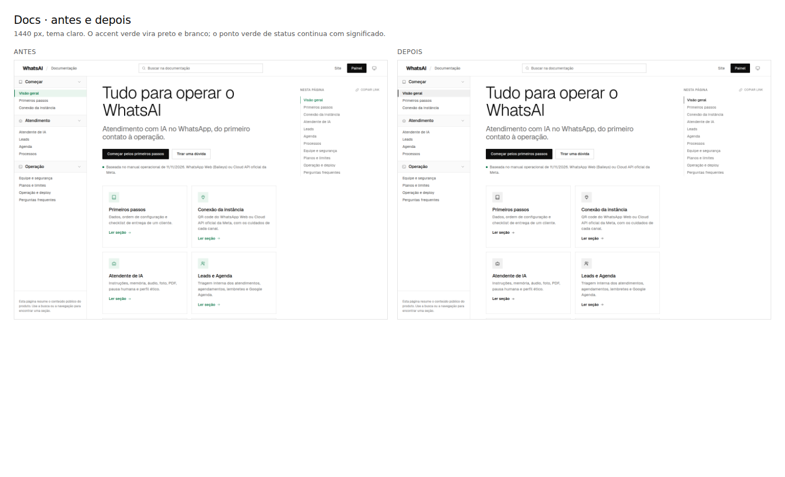

### Docs, 1440 px, escuro

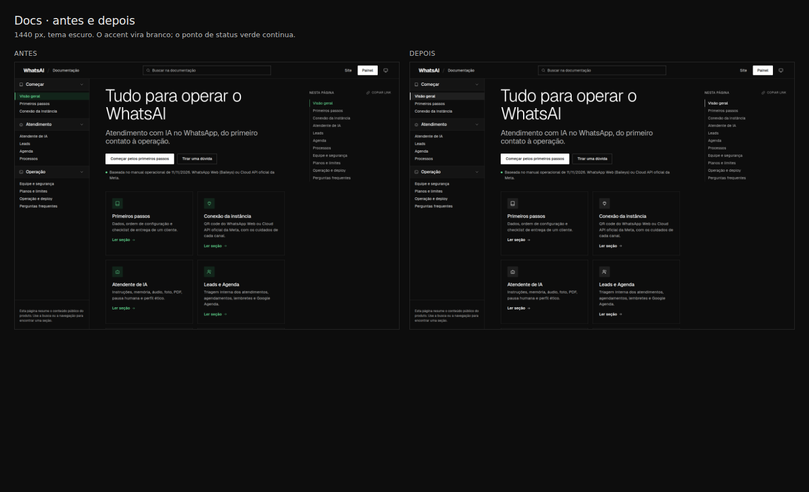

### Segurança, 1440 px, claro

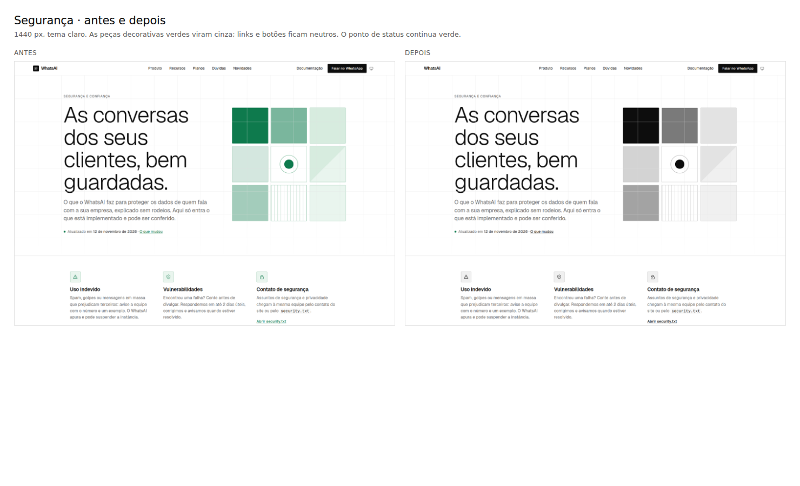

### Segurança, 1440 px, escuro

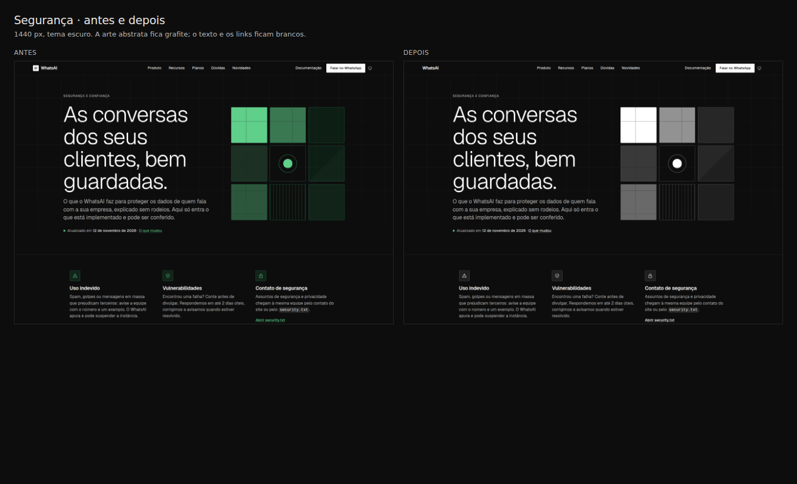

### Termos de uso, 1440 px, claro

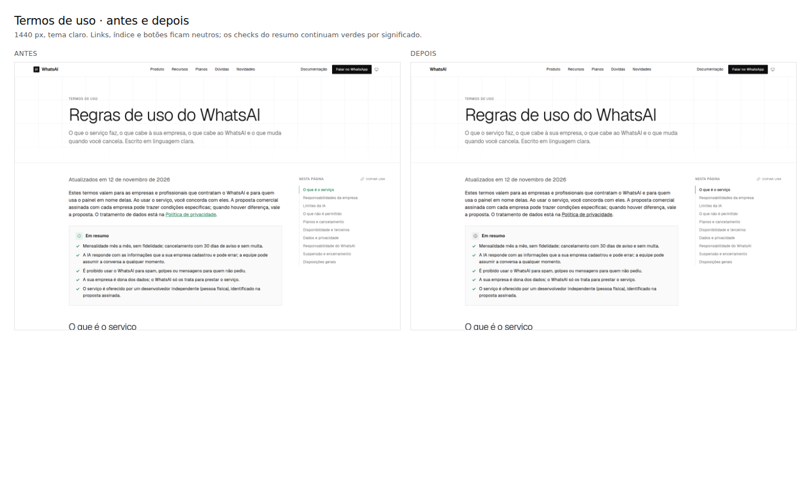

### Privacidade, 1440 px, claro

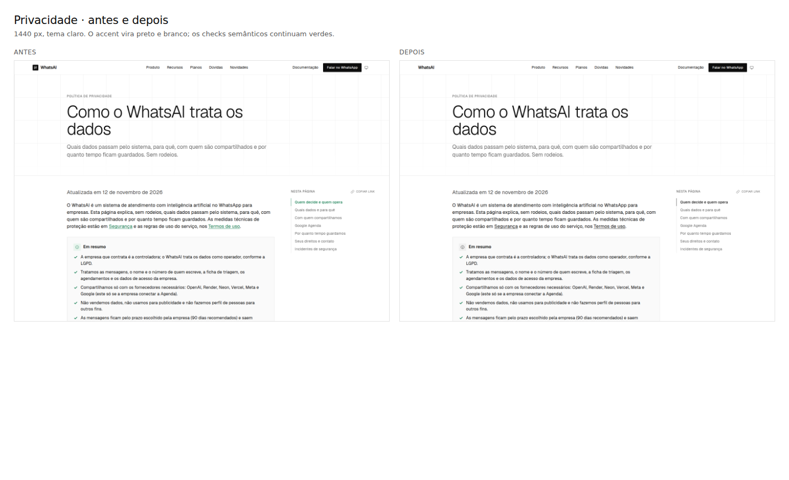

### Docs e Segurança no celular

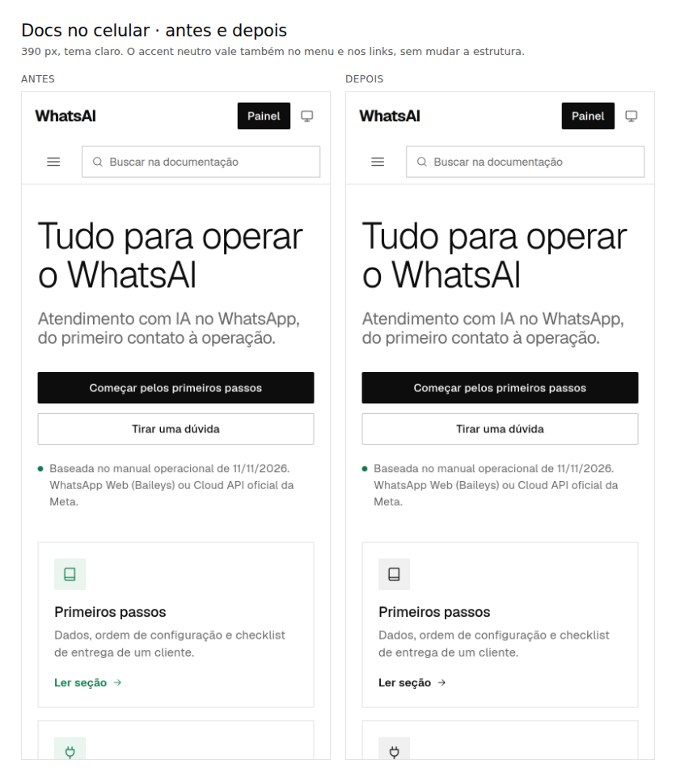

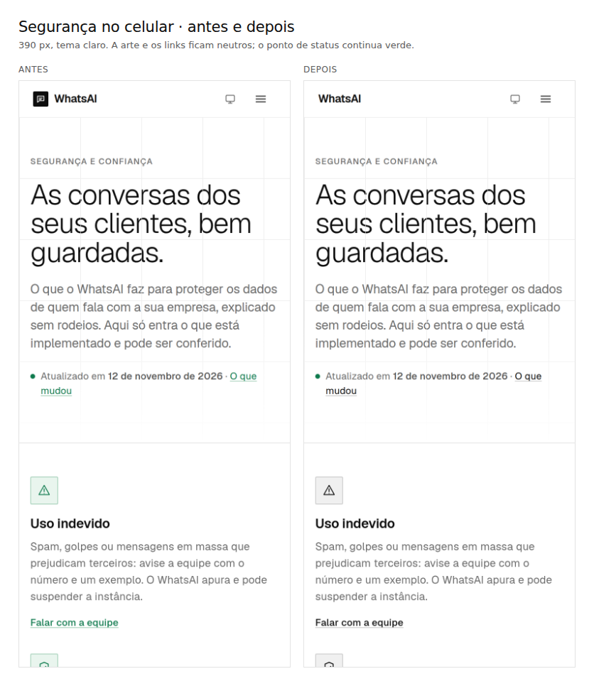

### Cabeçalho, 1440 px, claro

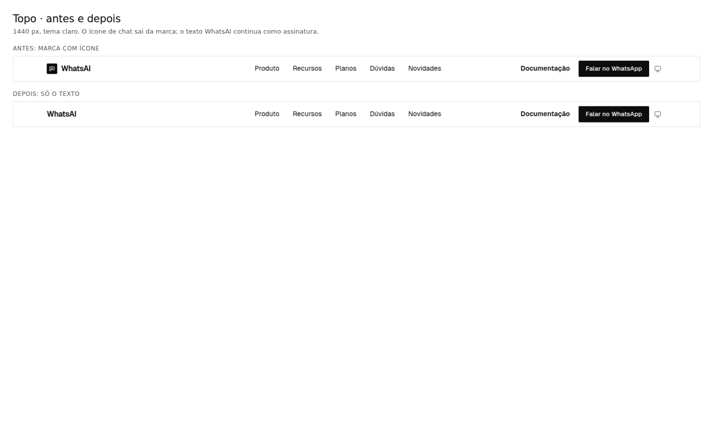

### Rodapé, 1440 px, claro

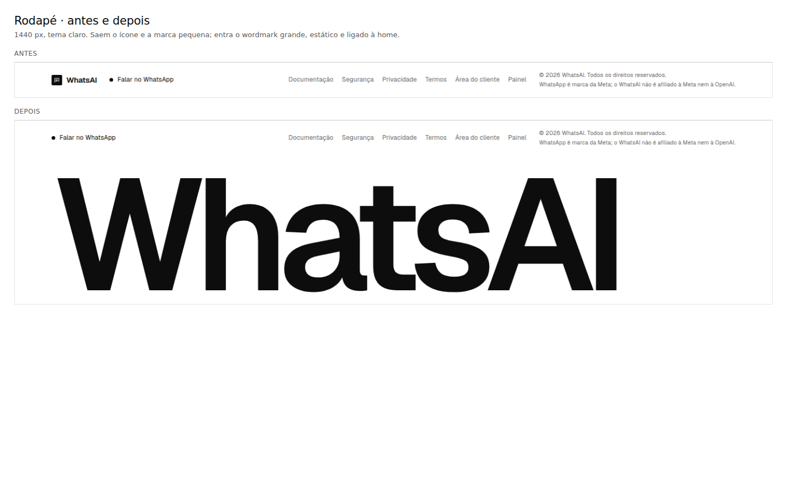

### Rodapé, 1440 px, escuro

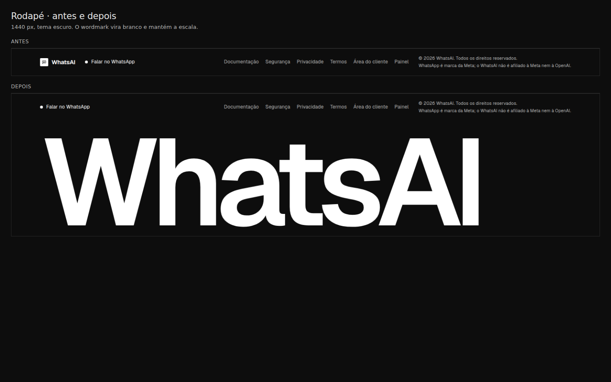

### Rodapé no celular, 390 px

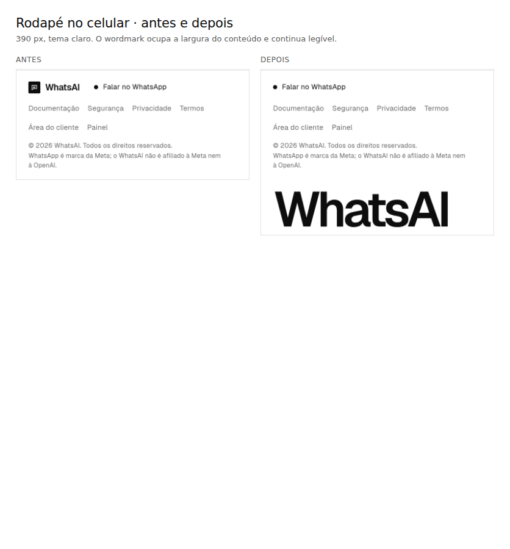

### Rodapé: referência e WhatsAI

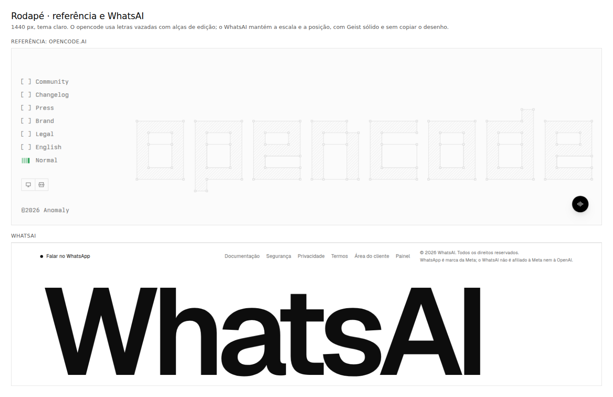

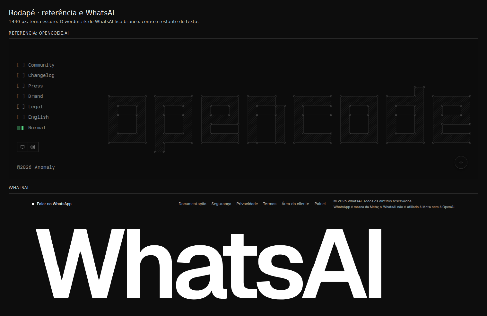

As capturas da referência ficam em `reference/` apenas para revisão. Elas não são publicadas no site nem entram em
`manager/dist`.

## Comportamento e acessibilidade

- O wordmark é um link para `/` com texto visível; não tem animação, canvas ou script.
- Ele cabe em 320, 390, 768, 1024 e 1440 px sem rolagem horizontal; o texto quebra em uma linha e o `overflow` fica
  escondido apenas como proteção.
- O cabeçalho continua com o texto "WhatsAI"; o foco e os links seguem a escala de tokens.
- O rodapé mantém status, links e aviso legal acima do wordmark em todas as páginas que usam o rodapé público.
- Nenhum erro de console nas capturas.
- Nenhuma imagem, fonte, CDN ou requisição nova.

## Lighthouse local

Medido em 15/11/2026 com Lighthouse 12.8.2 e o Chromium do ambiente:

| Página | Configuração | Performance | Acessibilidade | Boas práticas | SEO |
| --- | --- | --- | --- | --- | --- |
| `/` | Computador | 100 | 100 | 100 | 100 |
| `/` | Celular | 96 | 100 | 100 | 100 |
| `/seguranca` | Computador | 100 | 100 | 100 | 100 |
| `/seguranca` | Celular | 97 | 100 | 100 | 100 |

O `/seguranca` estava em 95 de acessibilidade antes destas correções (contraste dos números, contraste do "Não" e
ordem dos títulos do fluxo). O `/docs` também passa em acessibilidade 100. A performance no celular é a mesma faixa do
servidor local anterior, sem compressão; a conferência em produção continua com o dono, na Vercel.

## Recomendações

1. Manter o accent neutro como padrão das páginas públicas. O verde fica só onde significa "ok" (checks, status e
   notas), e o âmbar/vermelho ficam com atenção e erro.
2. Manter o wordmark estático. As letras hatched com alças do opencode são um desenho proprietário e interativo; a
   versão sólida em Geist é mais leve, acessível e não copia a referência.
3. Manter o rodapé da documentação compacto. A sidebar do `/docs` já carrega a marca; um wordmark de 300 px ali
   competiria com a leitura. Se o dono quiser, usar uma variante menor (por exemplo, 96-140 px) e testar em 390 px.
4. Manter o texto "WhatsAI" no cabeçalho e o wordmark no rodapé. O topo fica limpo e a marca ganha peso no fim da
   página, como na referência.
5. Manter as correções de acessibilidade da página de segurança. Elas não mudaram a identidade visual e levaram a
   página de 95 para 100 em acessibilidade.
6. Repetir o Lighthouse em produção (`/` e `/seguranca`) depois do merge. A mudança é estática, leva `[skip render]` e
   não reinicia a API no Render.

## O que não foi copiado

- As letras vazadas, as alças de edição, a animação e o desenho do wordmark do opencode.
- Links, textos, fontes, cores de marca, CSS, imagens ou qualquer arquivo servido pela referência.
- Nenhuma requisição externa, CDN, cookie ou rastreador novo.
