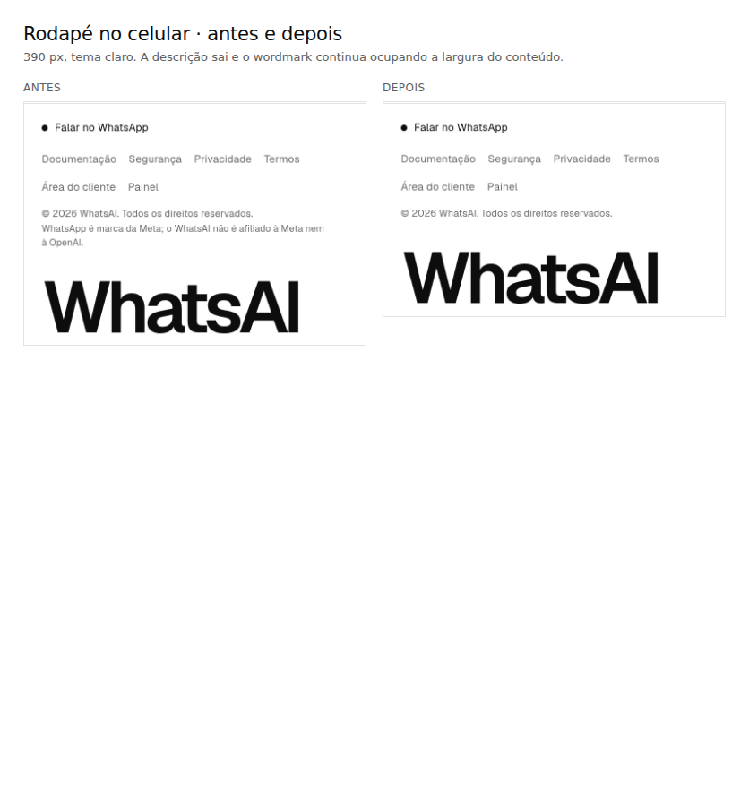
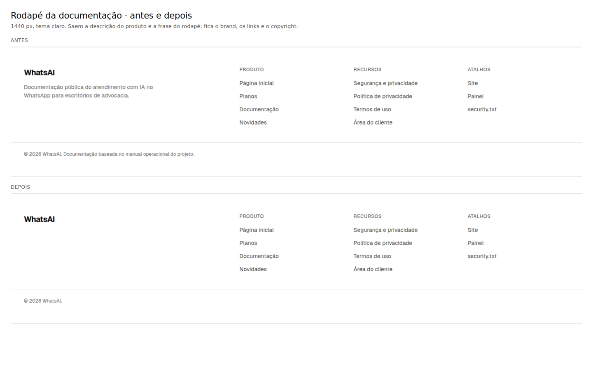
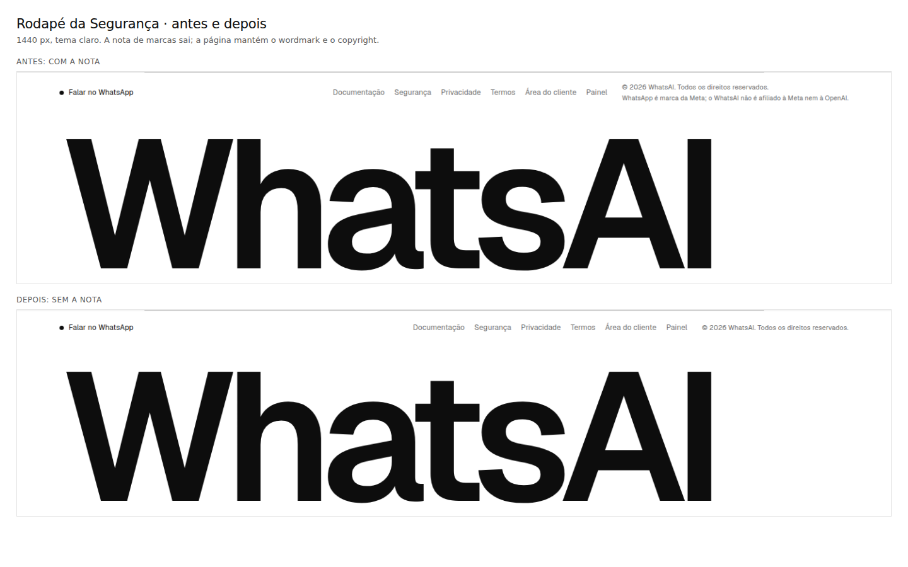
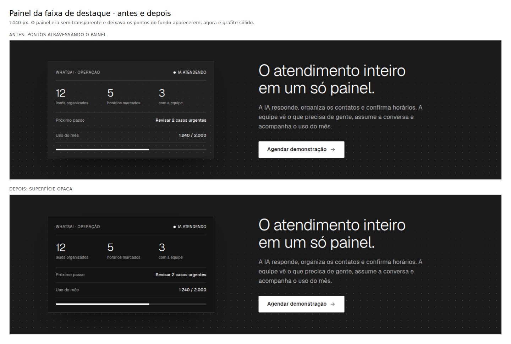
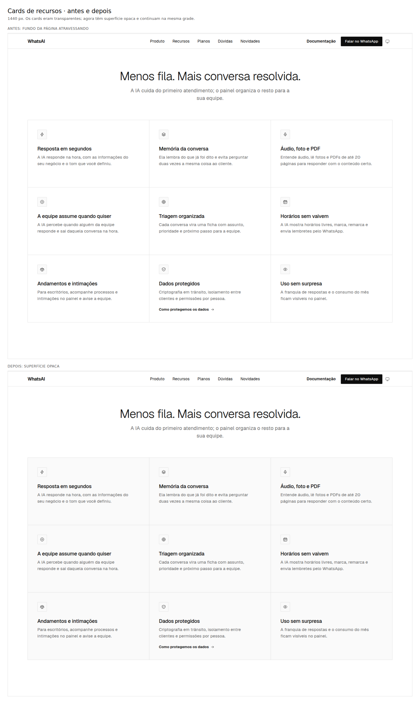
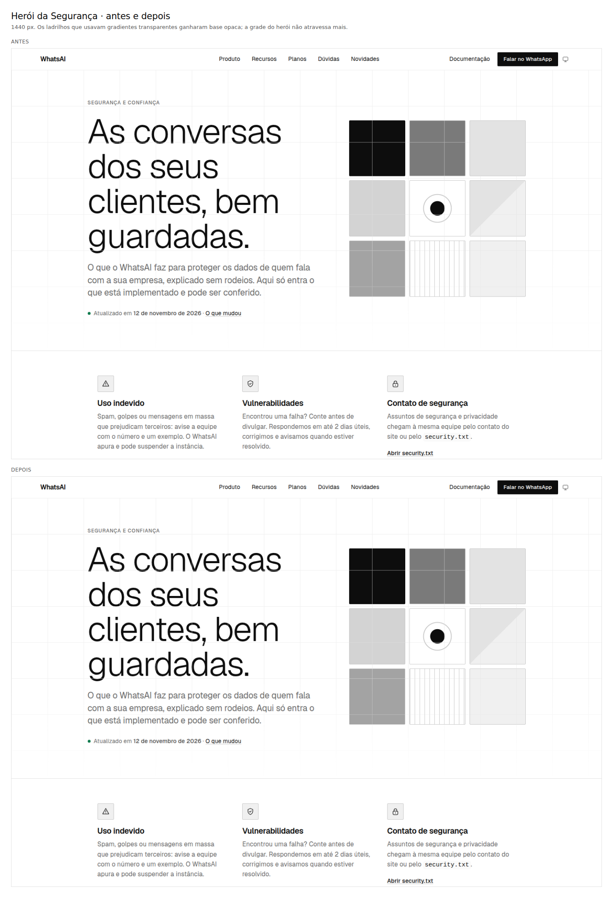

# Rodapés sem descrição e cards opacos

Remove as descrições que apareciam nos rodapés e garante que os cards e as superfícies de conteúdo não revelem o fundo
da página. A mudança cobre a landing, `/seguranca`, `/termos`, `/privacidade`, `/novidades` e o rodapé da
documentação.

## O que saiu dos rodapés

- A nota "WhatsApp é marca da Meta; o WhatsAI não é afiliado à Meta nem à OpenAI." saiu do rodapé público da landing,
  de `/novidades`, `/seguranca`, `/termos` e `/privacidade`.
- A documentação perdeu a descrição "Documentação pública do atendimento com IA no WhatsApp para escritórios de
  advocacia." e a frase "Documentação baseada no manual operacional do projeto." do copyright.
- Ficaram no rodapé público: o status "Falar no WhatsApp", os links essenciais, o copyright e o wordmark "WhatsAI".
- Ficaram no rodapé da documentação: a marca em texto, as colunas de links e "© 2026 WhatsAI.".
- O aviso de uso exigido pela licença do Evolution API continua no README e no rodapé do Manual, onde ele precisa
  estar. Se for necessário manter o aviso de marcas, a recomendação é colocá-lo no Manual ou em uma página legal, não
  no rodapé.

## Cards e superfícies opacas

- **Landing:** os cards de recursos ganharam superfície `--wa-card`; o carrossel ganhou base `--wa-bg` na mídia e na
  cópia no desktop; no celular, a cópia fica transparente sobre a mídia grafite opaca; as paisagens abstratas ganharam base `--wa-art-sky`; o painel da faixa de destaque virou grafite sólido
  `#141414`, sem os pontos do fundo atravessando.
- **Segurança:** os ladrilhos do herói que usavam gradientes transparentes (o do círculo e o de linhas verticais)
  ganharam base `--d-bg`; os canais de contato e os wrappers de tabela também têm fundo opaco. Os cards de controles
  e o resumo já eram opacos.
- **Termos e Privacidade:** o resumo e os cards já eram opacos; os wrappers de tabela ganharam base `--d-bg`. O fundo
  da página não aparece mais por trás das superfícies de conteúdo.
- **Documentação:** os cards já usavam superfícies opacas. A mudança no rodapé não toca o conteúdo.
- Nenhuma textura, grade ou ponto de seção é desenhado dentro de card; a decoração continua atrás da seção, e não
  atravessa a superfície.

## Comparações

### Rodapé público, 1440 px

### Rodapé no celular, 390 px

### Rodapé da documentação

### Rodapé da Segurança

### Painel da faixa de destaque

### Cards de recursos

### Herói da Segurança

## Comportamento e acessibilidade

- Sem rolagem horizontal em 320, 390 e 1440 px nas páginas alteradas.
- Sem erros de console.
- O rodapé continua com o wordmark em uma linha; em 320 px, o wordmark de 70 px cabe nos 280 px de conteúdo.
- A remoção das descrições não altera a navegação, o status ou o copyright.
- `/seguranca` continua em 100 de acessibilidade no Lighthouse depois das superfícies opacas.
- `/docs` continua em 100 de acessibilidade.
- A landing também ficou em 100 de acessibilidade; o texto sobreposto do carrossel no celular fica sobre a mídia
  grafite opaca, não sobre uma superfície branca.
- Nenhuma imagem, CDN ou requisição nova.

## Versões

- `legal.css?v=5` nas páginas legais, por causa das bases opacas dos ladrilhos, dos contatos e das tabelas.
- `site-shell.css?v=3`, por causa da remoção da nota do rodapé.
- `docs.css?v=7`, por causa da remoção da descrição do rodapé da documentação.
- `landing.bundle.css` regerado por `node manager/patches/landing-css.mjs`, com hash novo na landing e em
  `/novidades`.
- `tokens.css?v=3` sem mudança nesta rodada.

## Recomendações

1. Usar superfícies opacas (`--wa-card`, `--wa-bg`, `--d-bg`, `--d-bg-soft`) em qualquer card ou caixa de conteúdo.
   Transparência fica para overlays de mídia e para bordas, nunca para o preenchimento de um card.
2. Manter a decoração de fundo (grade, pontos e paisagens) atrás da seção. Quando um card precisa de textura, a
   textura é desenhada dentro dele sobre uma base opaca, como nos ladrilhos da Segurança.
3. Manter o rodapé enxuto: status, links, copyright e wordmark. Descrições longas ou avisos de marca devem ir para o
   Manual ou para a página legal correspondente.
4. Se o dono quiser recuperar o aviso de marcas no rodapé, usar uma linha curta e testar em 320 px; hoje ele não está
   no rodapé.
5. O painel da faixa de destaque ganhou um fundo `#141414`; se a intenção for um card mais claro, usar `#1f1f1f` e
   manter a borda `rgba(255,255,255,.16)`.
6. O card de recursos agora tem uma superfície `#fafafa` no claro e `#141414` no escuro. Se o dono preferir a grade
   aberta, a alternativa é manter a superfície da página sem deixar o fundo decorativo atravessar.

## Limitações

- A mudança dos ladrilhos do herói da Segurança é sutil: o desenho continua igual, mas a base deixou de ser
  transparente. A comparação mostra a diferença nos cantos e nas linhas.
- Termos e Privacidade já tinham os cards principais opacos; a correção neles foi explicitamente aplicar fundo aos
  wrappers de tabela e aos blocos de contato.
- A remoção do aviso de marcas do rodapé é uma decisão editorial do dono; o aviso de uso da licença do Evolution API
  continua no README e no Manual.
