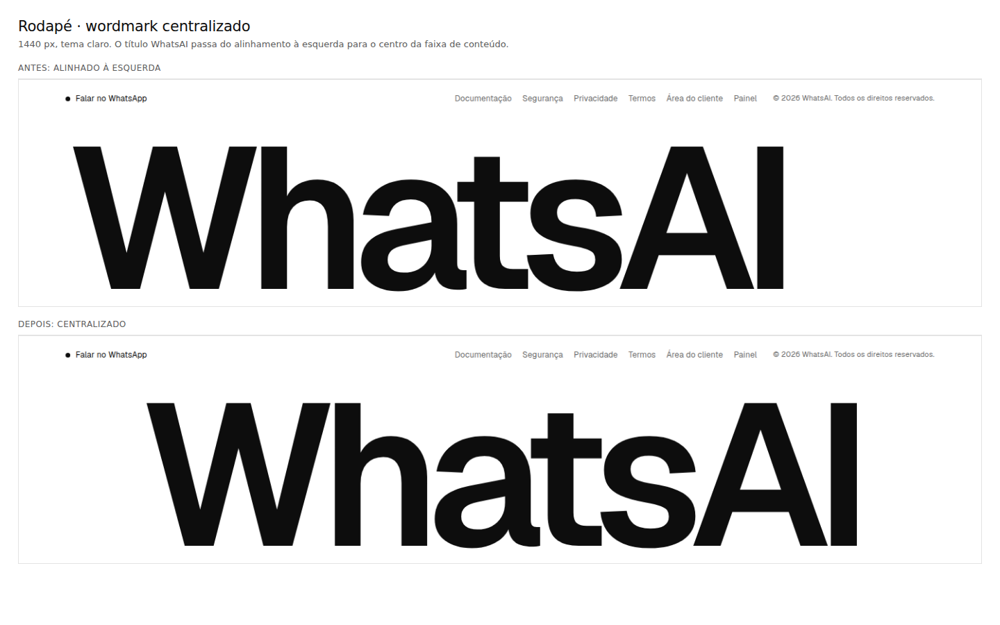
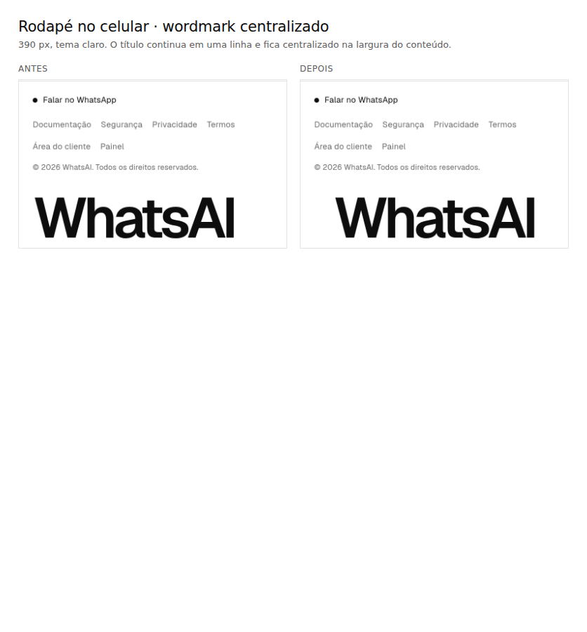
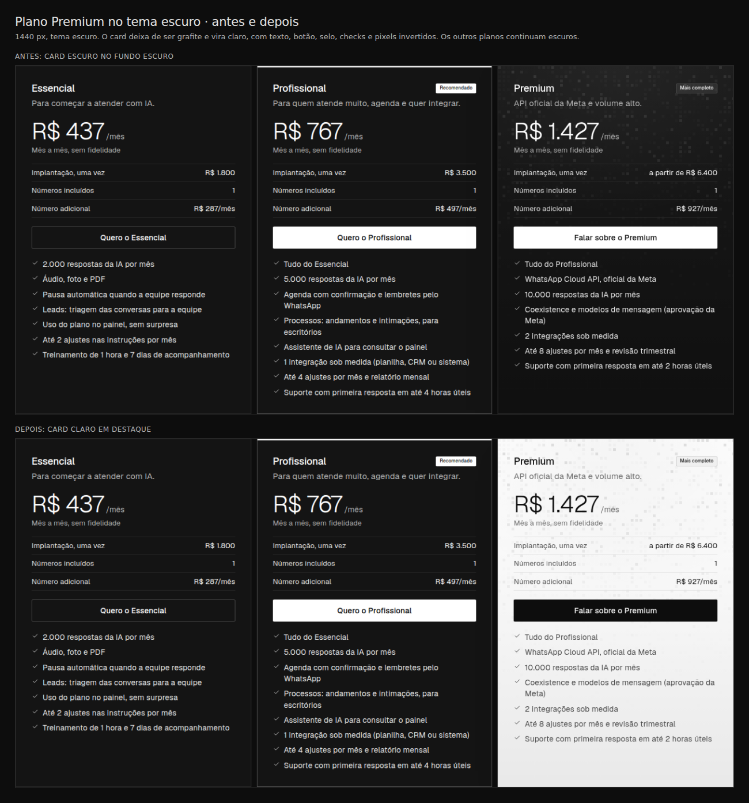
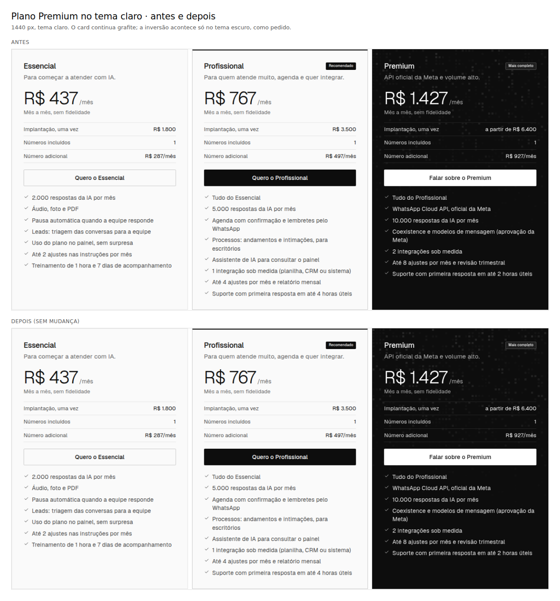

# Wordmark centralizado e Premium invertido no escuro

Centraliza o título "WhatsAI" do rodapé e inverte o fundo do plano Premium no tema escuro: o card passa de grafite para
claro quando a página está escura, mantendo o contraste com os outros planos e com o fundo.

## O que mudou

### Wordmark centralizado

- O wordmark grande do rodapé passou de alinhado à esquerda para `text-align: center`.
- A escala, o peso, o tamanho e o link para a home continuam iguais.
- A linha superior do rodapé continua dividida: status à esquerda, links e copyright à direita.
- A centralização vale para a landing, `/novidades`, `/seguranca`, `/termos` e `/privacidade`. O rodapé da
  documentação não tem o wordmark; a marca em texto dele continua compacta.

### Premium invertido no tema escuro

- No tema claro, o card do Premium continua grafite (`#0d0d0d`), com texto branco, botão branco, selo claro e pixels
  brancos.
- No tema escuro, o card vira claro (`#f5f5f5`), com texto escuro, botão escuro com texto claro, selo claro com texto
  escuro e checks escuros.
- O fundo claro tem uma base opaca `--wa-premium-bg` e um gradiente leve por cima; o card não revela a página.
- O canvas de pixels continua com a animação branca no código; no tema escuro, `filter: invert(1)` transforma os
  pixels em pontos escuros sobre o card claro.
- Os outros planos continuam com a superfície escura no tema escuro. O Premium é o card de contraste, como o plano em
  destaque.
- Os tokens locais do card cobrem texto, linhas, accent, botão, selo e checks. O botão usa o fundo do card como cor do
  texto; o hover usa `#272727` no card claro e `#e3e3e3` no card escuro.
- O tema manual também foi coberto: `html[data-theme-mode="dark"]` deixa o card claro, e
  `prefers-color-scheme: dark` só aplica quando o tema não foi fixado em claro.

### Versões

- `site-shell.css?v=4` nas páginas legais, por causa da centralização do wordmark.
- `landing.bundle.css` regerado por `node manager/patches/landing-css.mjs`, com hash novo na landing e em
  `/novidades`.
- `tokens.css`, `legal.css` e `docs.css` sem mudança nesta rodada.
- `landing-pixels.js` não mudou; a inversão é feita no CSS.

## Comparações

### Rodapé, 1440 px, claro

### Rodapé no celular, 390 px, claro

### Premium no tema escuro, 1440 px

### Premium no tema claro, 1440 px

## Comportamento e acessibilidade

- Testado nos quatro estados: claro, escuro, escuro com tema manual claro e claro com tema manual escuro.
- No estado escuro, o card claro tem texto `#0d0d0d` sobre `#f5f5f5`; o botão tem texto `#f5f5f5` sobre `#0d0d0d`; o
  selo tem texto escuro sobre `#f0f0f0`; os checks são escuros. O contraste é alto.
- No estado claro, o card grafite mantém o texto branco e o botão branco com texto escuro.
- Sem rolagem horizontal em 320, 390 e 1440 px.
- Sem erros de console.
- `/` e `/seguranca` continuam em 100 de acessibilidade no Lighthouse no tema claro; o card escuro do tema claro é o
  mesmo de antes.
- A inversão do canvas não muda o movimento, o `prefers-reduced-motion` ou o carregamento.
- Nenhuma imagem, CDN ou requisição nova.

## Recomendações

1. Manter o Premium como card de contraste: grafite no tema claro e claro no tema escuro. Ele é o plano em destaque;
   a inversão faz o card se destacar nos dois temas sem precisar de borda ou sombra forte.
2. Manter os tokens locais do card. O botão deve continuar usando o fundo do card como cor do texto, e o selo/checks
   devem usar o accent local; assim, uma futura troca de superfície não quebra o contraste.
3. Manter o `filter: invert(1)` no canvas enquanto o script desenhar pixels brancos. Se o script mudar para pixels
   escuros, o filtro deve sair e a cor deve ser conferida no card claro.
4. Manter o wordmark centralizado como assinatura do rodapé; a linha superior continua dividida entre status,
   navegação e copyright.
5. Se o dono preferir o Premium escuro nos dois temas, a alternativa é manter o grafite e usar uma borda clara ou um
   glow; a inversão foi o pedido atual.
6. Testar sempre os temas manuais além do `prefers-color-scheme`; o seletor de tema do site permite fixar claro ou
   escuro independentemente do sistema.

## Limitações

- O Lighthouse padrão roda no tema claro, então ele não audita o card claro do tema escuro. O contraste do card no
  escuro foi conferido pelos valores computados e pela captura; os textos principais ficam acima de 15:1.
- O card claro no tema escuro é uma mudança de contraste proposital; se o dono quiser uma transição mais suave, a
  alternativa é um cinza claro `#ececec` em vez de `#f5f5f5`.
- O wordmark centralizado ocupa a mesma largura; não muda o layout do rodapé, só o alinhamento do texto.
