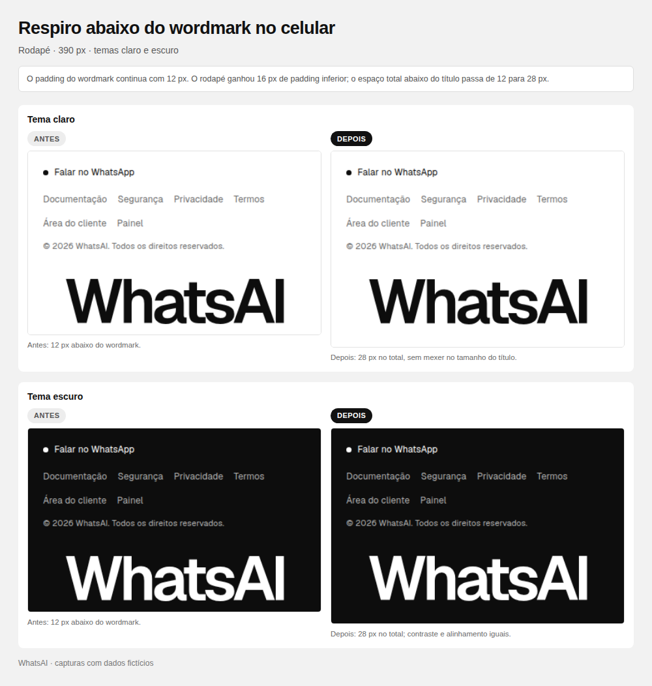
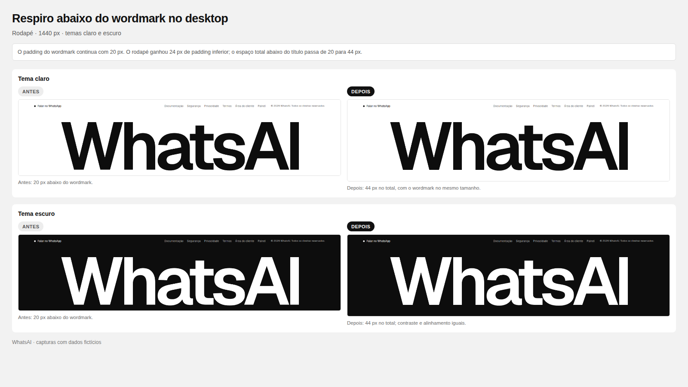

# Respiro abaixo do wordmark no rodapé

Aumenta o espaço entre o wordmark "WhatsAI" e o fim da página. O título continua com o mesmo tamanho, peso, altura de
linha, letra e centralização; só o rodapé ganhou mais respiro embaixo.

## O que mudou

- O `.wa-docfoot` recebeu `padding-bottom: clamp(16px, 2vw, 24px)`.
- O wordmark mantém o `padding-bottom` atual: 12 px no celular e 20 px no desktop.
- O espaço total abaixo do título fica em 28 px no celular e 44 px no desktop, contra 12 px e 20 px antes.
- O padding extra fica fora do wordmark, que usa `overflow: hidden`. Assim, o respiro aparece de fato e não é
  recortado junto com o título.
- O footer das páginas legais e de Novidades usa a mesma regra; o rodapé da documentação não tem o wordmark e não
  muda.

## Comparações

### Celular, 390 px, temas claro e escuro

### Desktop, 1440 px, temas claro e escuro

## Versões

- `landing.bundle.css` regerado por `node manager/patches/landing-css.mjs`; a landing e `/novidades` apontam para
  `?v=23f933beb3`.
- `site-shell.css?v=6` em Segurança, Termos e Privacidade.
- `docs.css`, `legal.css`, `tokens.css`, scripts e imagens do site não mudaram.
- Nenhum script inline novo; a CSP e o `manager/dist/vercel.json` não mudam.

## Comportamento e acessibilidade

- Testado em 320, 390, 768, 1024 e 1440 px, nos temas claro e escuro.
- Sem rolagem horizontal em nenhuma página ou combinação.
- Sem erros de console.
- O espaço extra é de 16 px até 767 px, cresce gradualmente e chega a 24 px em 1440 px.
- O wordmark continua centralizado, em uma linha, com o mesmo link para a home.
- O foco e o alvo do link não mudaram; o link continua com a mesma área de texto e padding.
- Lighthouse 13.6, acessibilidade: landing 100 e Segurança 100.
- Nenhuma imagem, CDN, fonte ou requisição nova.

## Recomendações

1. Se o dono quiser mais respiro, aumentar só o `padding-bottom` do `.wa-docfoot`; não mexer no tamanho do wordmark,
   no `line-height` ou no `letter-spacing`.
2. Manter o padding no rodapé, não no wordmark. O wordmark tem `overflow: hidden`; o padding externo garante que o
   espaço não seja recortado pelo próprio título.
3. Testar 390 e 1440 px nos dois temas ao ajustar o valor. O clamp mantém o celular confortável e o desktop
   proporcional.
4. Em navegadores móveis com barra inferior ou home indicator, conferir a área visível; se necessário, uma próxima
   rodada pode somar `env(safe-area-inset-bottom)`.
5. Manter o rodapé sem a linha divisória; o respiro e o wordmark já fazem a separação.

## Limitações

- O espaço total de 28/44 px é a soma do padding do wordmark (12/20 px) com o novo padding do rodapé (16/24 px). A
  medição direta do padding externo é 16/24 px; a leitura visual abaixo do título é 28/44 px.
- O rodapé da documentação não usa o wordmark; a alteração não chega a ele.
- A mudança é estática e leva `[skip render]`; a API no Render não reinicia.
