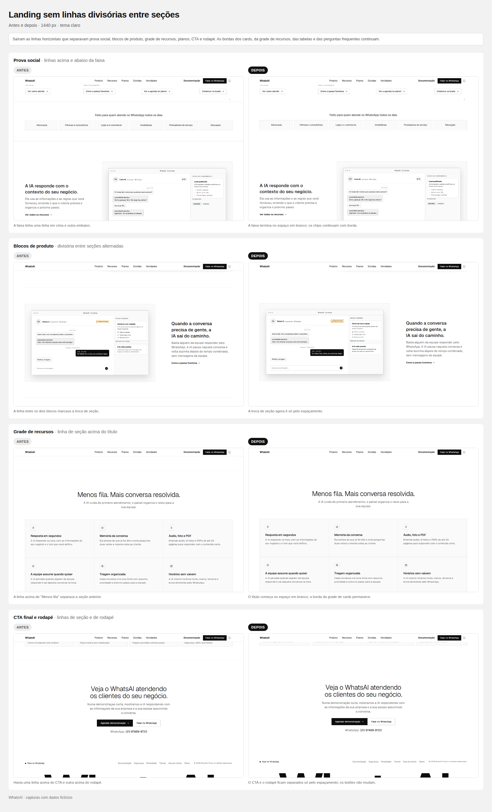
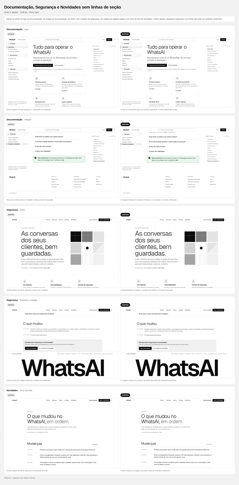

# Sem linhas divisórias entre seções

Remove as linhas horizontais que separavam blocos na landing, na documentação, em Segurança, Termos, Privacidade e
Novidades. A separação entre as seções passa a ser feita só pelo espaçamento.

As bordas de cards, tabelas, perguntas frequentes, listas de conteúdo, navegação lateral e a grade de recursos
continuam. A divisória interna dos botões conectados também não mudou: o pedido era sobre as linhas entre seções.

## O que saiu

### Landing

- a linha acima e a linha abaixo da faixa de prova social (`wa-proof`);
- a linha entre os blocos alternados de produto (`wa-alt + wa-alt`);
- a linha acima da grade de recursos (`wa-why`);
- a linha acima das notas dos planos (`wa-plan-notes`);
- a linha acima dos adicionais (`wa-addon`);
- a linha acima do CTA final (`wa-cta`);
- a linha acima do rodapé (`wa-docfoot`);
- a linha que aparecia abaixo do cabeçalho fixo ao rolar (`wa-head.is-scrolled`).

### Documentação

- a linha abaixo do topo fixo (`.topbar`);
- a linha acima do rodapé (`.doc-footer`);
- a linha acima do copyright (`.foot-license`).

### Segurança, Termos e Privacidade

- a linha abaixo do herói (`.legal-hero`);
- a linha abaixo dos três contatos de segurança (`.trust-contacts`);
- a linha acima do rodapé compartilhado (`wa-docfoot`).

### Novidades

- a linha no início da lista de mudanças (`.nv-list-section`);
- a linha acima do rodapé compartilhado (`wa-docfoot`).

Novidades usava o mesmo padrão de seção da landing; foi incluída para o site não ficar com uma linha isolada.

## O que ficou

- Bordas dos cards de planos, canais, recursos, novidades e contatos.
- A grade de recursos: a linha de cima e as linhas entre as células são a estrutura dos cards, não uma divisória de
  seção. A linha de seção que ficava acima do título (`wa-why`) saiu.
- Tabelas comparativas, linhas de FAQ e linhas entre as entradas das listas de conteúdo.
- Navegação lateral da documentação, inclusive os rótulos de grupo e a nota do rodapé da barra.
- A grade decorativa do herói da Segurança: é textura de fundo, não uma linha entre seções.
- As bordas dos botões, inputs e callouts.

## Versões

- `landing.bundle.css` regerado por `node manager/patches/landing-css.mjs`; a landing e `/novidades` apontam para
  `?v=b806c7a262`.
- `docs.css?v=9` na documentação, Segurança, Termos e Privacidade.
- `legal.css?v=7` em Segurança, Termos e Privacidade.
- `site-shell.css?v=5` em Segurança, Termos e Privacidade.
- `novidades.css?v=2` em `/novidades`.
- `tokens.css`, scripts e imagens do site não mudaram.
- Nenhum script inline novo; a CSP e o `manager/dist/vercel.json` não mudam.

## Comparações

### Landing, 1440 px

### Documentação, Segurança e Novidades, 1440 px

## Comportamento e acessibilidade

- Testado em 320, 390, 768, 1024 e 1440 px, nos temas claro e escuro.
- Sem rolagem horizontal em nenhuma página ou combinação.
- Sem erros de console.
- As linhas de seção estão com largura zero nos dois temas; as bordas de cards, tabelas, FAQ e listas continuam.
- O cabeçalho fixo continua opaco; ao rolar, ele não ganha mais a linha inferior.
- O rodapé continua com o wordmark e o espaçamento; não perdeu links nem copyright.
- A remoção das linhas não muda a ordem dos títulos, a navegação, o foco ou os botões conectados.
- Lighthouse 13.6, tema claro: landing 100, Segurança 100 e documentação 100 em acessibilidade.
- Nenhuma imagem, CDN, fonte ou requisição nova.

## Recomendações

1. Separar seções por espaço, não por linha. O espaçamento já cria a pausa visual; a linha extra volta a poluir a
   página.
2. Manter as bordas funcionais: cards, tabelas, FAQ, listas e navegação. Elas ajudam a ler grupos e itens; a remoção
   foi só das divisórias decorativas.
3. Não remover a borda superior da grade de recursos sem redesenhar a grade. Ela é a moldura dos cards, não uma linha
   de seção.
4. Se uma seção precisar de mais destaque no futuro, usar fundo, contraste ou espaçamento maior antes de voltar com
   uma linha horizontal.
5. Manter o cabeçalho fixo com fundo opaco. Sem a linha inferior, o fundo é o que impede o conteúdo de aparecer por
   baixo ao rolar.
6. Testar 320, 390 e 1440 px nos dois temas ao mexer em bordas ou espaçamento; os temas manuais também precisam ser
   conferidos.

## Limitações

- A grade de recursos continua com as linhas das células. Se o dono quiser uma grade sem nenhuma linha, é uma mudança
  estrutural nos cards, com outro desenho de separação.
- As tabelas, o FAQ, as listas e a navegação lateral continuam com linhas. A opção escolhida foi remover as linhas
  entre seções, mantendo essas bordas de conteúdo.
- A grade decorativa do herói da Segurança continua. Ela é uma textura, não uma divisória entre blocos.
- Novidades recebeu a mesma remoção por consistência; se o dono quiser uma linha só ali, é uma exceção pontual.
- A mudança é estática e leva `[skip render]`; a API no Render não reinicia.
