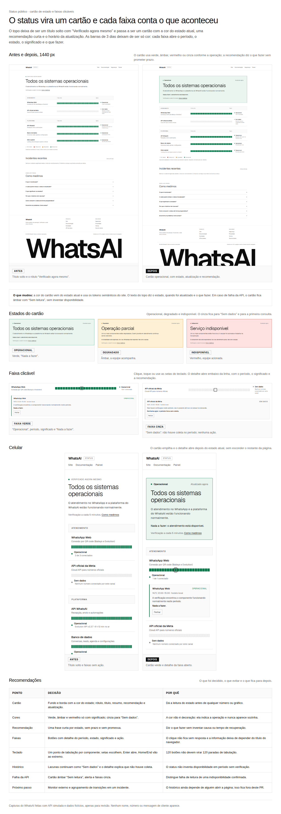

# Status em cartão e faixas clicáveis

## O que este PR faz

Duas mudanças na página pública `/status`, no mesmo PR para revisão:

1. **O topo vira um cartão de estado.** Sai o rótulo “Verificado agora mesmo” e o título solto. Entra um cartão com fundo e borda na cor da operação atual, com estado, título, resumo, uma recomendação curta, o horário da atualização e a cadência de verificação.
2. **As faixas de 3 dias passam a responder ao clique.** Cada uma das 24 faixas por componente agora abre um detalhe com o período, o estado, o que ele significa e o que fazer. O detalhe vale para faixa verde, âmbar, vermelha e cinza.

O detalhe abre embaixo da linha do componente, sem popup e sem sair da página. Também funciona por toque e por teclado.

## Por que

O topo antigo era um título solto com um rótulo pequeno. A informação existia, mas não tinha o peso de “estado atual”. O cartão resolve isso com a cor semântica e uma recomendação, sem prometer causa, prazo ou recuperação.

As faixas tinham `title` (o balão do navegador), que não aparece no celular e não é lido por teclado. Clicar não fazia nada. Agora o clique, o toque e o teclado mostram a informação específica daquele período.

## O cartão

| Estado | Fundo | Borda | Rótulo | Recomendação |
|---|---|---|---|---|
| Operacional | Verde suave (`--c-ok-bg`) | Verde (`--c-ok`) | Operacional | Nada a fazer: o atendimento está disponível. |
| Degradado | Âmbar (`--c-warn-bg`) | Âmbar (`--c-warn-border`) | Degradado | A instabilidade está registrada. Se o seu WhatsApp não responder, fale com a equipe. |
| Indisponível | Vermelho suave (`--c-bad-bg`) | Vermelho (`--c-bad-border`) | Indisponível | O componente não está respondendo. Se o seu atendimento parou, fale com a equipe. |
| Sem dados | Cinza (`--c-bg-soft`) | Cinza (`--c-border-strong`) | Sem dados | Ainda não há leitura dos componentes. Tente de novo em alguns minutos. |
| Falha da consulta | Âmbar | Âmbar | Sem leitura | Não foi possível ler o status agora. Tente de novo ou fale com a equipe se o seu atendimento parou. |

A cor nunca aparece sozinha: o rótulo textual e a recomendação dizem o mesmo que a cor. O cartão usa os tokens do site e funciona no claro e no escuro.

## O detalhe da faixa

Cada faixa é um botão com o período e o estado no `aria-label`. Ao clicar, tocar ou pressionar Enter/Espaço, abre:

- **Componente:** WhatsApp Web, API oficial da Meta, API, banco ou site/painel.
- **Estado:** rótulo textual e cor.
- **Período:** dia e intervalo de 3 horas no horário local do navegador.
- **Significado:** o que aquele estado quer dizer naquele período.
- **Ação:** o que fazer; “Nada a fazer” quando estava operacional e “Nenhuma ação: o período ficou sem coleta” quando não houve verificação.
- **Fechar:** devolve a linha ao estado normal.

O detalhe de uma faixa cinza é explícito: não houve coleta, então a página não afirma que o componente estava funcionando.

## Teclado e acessibilidade

- Um ponto de tabulação por componente, não 24. O grupo de faixas recebe o foco e abre a faixa atual.
- Setas esquerda/direita escolhem a faixa; Home e End vão aos extremos; Enter e Espaço abrem o detalhe.
- `aria-pressed` marca a faixa escolhida; `aria-controls` liga a faixa ao detalhe; o detalhe é uma região `aria-live="polite"`.
- O texto do estado não depende só da cor. O contraste usa os tokens existentes.
- O detalhe é um bloco abaixo da linha, sem foco preso e sem sobreposição; no celular ele aparece depois do estado atual.

## Arquivos

| Arquivo | Mudança |
|---|---|
| `manager/dist/status/index.html` | Cartão, rótulo de estado, recomendação, dica de clique e versões dos assets |
| `manager/dist/status/status.css` | Cores por estado, cartão, detalhe, botões e foco |
| `manager/dist/status/status.js` | Estado do cartão, recomendação, faixas como botões, detalhe e teclado |
| `README-WHATSAI.md`, `readmes/GUIA-DO-PROJETO.md` | Registro do cartão e das faixas clicáveis |

## Como testar

- Playwright com API simulada: cartão operacional, degradado e indisponível; faixa verde e faixa cinza abertas; teclado com setas e Enter; celular em 390 px; falha da API; sem rolagem horizontal e sem erro de console.
- `node --check manager/dist/status/status.js`, `esbuild` no JS e no CSS, todos os `manager/patches/*.py --check`, `landing-css.mjs --check` e `git diff --check`.
- O CSP não muda: a página não tem script inline.

## Limitações e recomendações

- O histórico continua começando na primeira consulta; faixas sem coleta aparecem como **Sem dados** e o detalhe explica que não houve verificação.
- O monitoramento continua request-driven. Um monitor externo e o agrupamento de transições em um único incidente ficam para depois.
- O período do detalhe usa o horário local do navegador, como o restante da página; os incidentes continuam em UTC.
- O detalhe é inline de propósito: no celular, um popover cobriria as faixas e o texto longo ficaria apertado.

## Capturas

- [Cartão operacional](comparacao/cartao-operacional.png)
- [Cartão degradado](comparacao/cartao-degradado.png)
- [Cartão indisponível](comparacao/cartao-indisponivel.png)
- [Cartão no tema escuro](comparacao/cartao-escuro.png)
- [Faixa verde aberta](comparacao/faixa-verde.png)
- [Faixa cinza aberta](comparacao/faixa-cinza.png)
- [Faixa aberta no celular](comparacao/faixa-celular.png)
- [Falha da API](comparacao/cartao-falha.png)

As capturas usam dados fictícios e uma API simulada. Nenhum nome, número ou mensagem de cliente aparece.

## Observação

Este PR fica aberto para a revisão do dono antes do merge. Não fazer merge sem a autorização dele.

Mudança só estática: o título do squash deve terminar com `[skip render]`. A Vercel publica o `/status`; a API no Render não reinicia.
