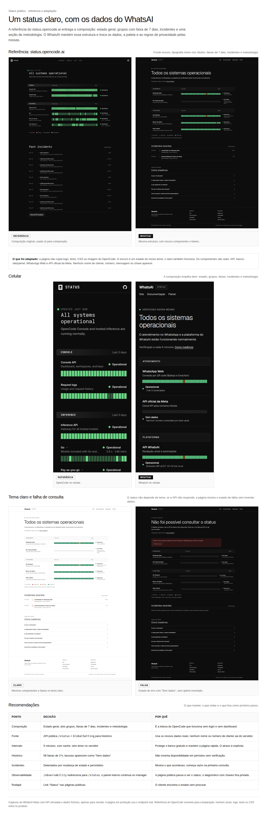

# Status público do WhatsAI

## O que este PR faz

Cria uma página pública de status em `/status`, inspirada na composição do `status.opencode.ai`, e a liga aos dados reais
da operação do WhatsAI:

- estado geral no topo, com a frase que resume a situação;
- grupos **Atendimento** e **Plataforma**, com uma barra de 7 dias por componente;
- incidentes recentes (90 dias) e uma seção **Como medimos**, com as limitações escritas de forma explícita;
- atualização automática a cada cinco minutos, com o horário da última verificação;
- estado de falha próprio: se a API de status não responder, a página continua no ar e mostra **Sem dados**, sem inventar
  disponibilidade.

No backend, um endpoint público `GET /status` (sem chave) monta o retrato agregado. O histórico fica em uma linha de
`GlobalSetting` (`public-status:v1`), sem migration, e só é gravado quando algum estado muda. Não existe timer no servidor:
a verificação acontece quando a página ou o JSON é consultado, com cache em memória de cinco minutos.

A antiga página pública `/observability` foi substituída: a rota agora responde `308` para `/status`. A aba
**Observabilidade do manager** continua existindo e privada, com a chave global, porque ela é a ferramenta de diagnóstico
(Neon, Render, Vercel, OpenAI e consumo) e não deve virar página pública.

O link **Status** entrou no rodapé da landing, Novidades, Segurança, Privacidade, Termos, Docs e Área do cliente, além do
`sitemap.xml` e do `llms.txt`.

## A referência e o que foi adaptado

A referência foi usada só para a composição: estado geral, grupos, faixas de sete dias, incidentes e metodologia. Não há
logo, texto, CSS ou imagem do OpenCode na página. A tipografia, os tokens, a paleta semântica e o conteúdo são do WhatsAI.

| Referência (OpenCode) | WhatsAI |
|---|---|
| Estado geral e grupos de componentes | Mesma ideia, com **Atendimento** e **Plataforma** |
| Faixas de 7 dias por componente | 56 faixas de 3 horas; a faixa mostra o pior estado do período |
| Incidentes recentes | Incidentes de 90 dias, detectados pela mudança de estado |
| Página escura por padrão | Tema claro e escuro pelo sistema, como o resto do site |
| Métricas de console e gateway | API, banco, site/painel e conexões de WhatsApp, sem dados de clientes |

## O que a página mostra

| Componente | Como o estado é calculado | Exemplo de detalhe |
|---|---|---|
| WhatsApp Web | Conexões por QR code (Baileys e Evolution); todas conectadas = operacional, nenhuma = indisponível, parte = degradado | `3 de 3 conectados` |
| API oficial da Meta | Números com Cloud API (Meta); mesma regra de contagem | `1 de 2 conectados` |
| API WhatsAI | O endpoint público respondeu e leu o sistema | `Evolution API v2.3.7 · 6 h 12 min no ar` |
| Banco de dados | Status da conexão e tamanho do banco; aviso vira degradado, crítico vira indisponível | `Consulta em 4 ms` |
| Site e painel | A página em si carregou pela Vercel | `Servido pela Vercel` |

Quando um canal não tem nenhum número, ele aparece como **Sem dados**, e não como operacional. Isso é proposital: o
WhatsAI não deve afirmar que um canal está bem quando não há nada para verificar.

## De onde vêm os dados

- `observabilityService.collectSystem()` monta as visões locais **Sistema** e **WhatsApp**. São as mesmas leituras da
  Observabilidade do manager, sem as APIs externas de Neon, Render, Vercel, GitHub e OpenAI.
- O serviço público extrai somente contagens, status e detalhes técnicos genéricos. Nomes de instância, números,
  mensagens, credenciais e chaves ficam no backend e não entram no JSON.
- O teste unitário verifica explicitamente que nomes de clientes, ids de instância e telefones não aparecem no payload.
- O site e a API não usam cookie, sessão ou chave. O CORS é liberado só para leitura pública (`Access-Control-Allow-Origin:
  *`) e o cache HTTP é curto (`max-age=30`).

## Histórico e incidentes

- 56 faixas de 3 horas cobrem 7 dias. A faixa guarda o pior estado visto no período: indisponível > degradado >
  operacional. `Sem dados` não sobrescreve um estado conhecido.
- O histórico começa na primeira consulta. Períodos sem consulta aparecem como **Sem dados**; a página não completa as
  lacunas com disponibilidade inventada.
- Um incidente abre quando um componente muda para degradado ou indisponível, e fecha quando ele volta a operacional.
  Uma mudança de degradado para indisponível fecha um incidente e abre outro, porque são estados diferentes.
- Até 50 incidentes ficam guardados; a página mostra os 20 mais recentes. A janela é de 90 dias.
- A persistência é uma linha `GlobalSetting` (`public-status:v1`), no banco de controle. Não há migration, tabela nova ou
  job agendado. A gravação acontece no máximo uma vez a cada cinco minutos, quando o cache expira e há mudança.

## Cache, Neon e Render

O plano gratuito do Neon dorme por falta de tráfego. Para não criar um monitor que acorde o banco o tempo todo:

- não há `setInterval`, cron ou worker;
- o resultado fica em memória por cinco minutos;
- chamadas simultâneas compartilham a mesma verificação em andamento;
- o navegador só atualiza enquanto a aba está visível;
- o histórico só é gravado quando o estado muda.

O custo é uma leitura do banco quando o cache expira e alguém consulta a página. É o mesmo tipo de leitura que a
Observabilidade já faz, agora limitada a uma vez a cada cinco minutos. A página não consulta Neon, Render, Vercel, GitHub
nem OpenAI.

## Rota antiga e rodapé

- `/observability` passou a responder `308` para `/status` no `vercel.json`, antes do `filesystem`.
- A página `manager/dist/observability/` foi removida.
- O CSP perdeu o hash do script inline que existia só nessa página; restaram os dois hashes do painel e da Área do
  cliente.
- O link **Status** entrou no rodapé das páginas públicas. O painel não ganhou um link público novo.

## Arquivos principais

| Arquivo | Mudança |
|---|---|
| `manager/dist/status/index.html`, `status.css`, `status.js` | Página pública, tema claro/escuro e comportamento de atualização |
| `src/api/services/public-status.core.ts` | Estados, grupos, histórico, incidentes e cache |
| `src/api/services/public-status.service.ts` | Liga o serviço ao `GlobalSetting` e à Observabilidade |
| `src/api/routes/public-status.router.ts` | `GET /status` sem chave, CORS de leitura e cache curto |
| `src/api/services/observability.service.ts` | Novo `collectSystem()` com as visões locais |
| `src/api/routes/index.router.ts` | Registro da rota `/status` |
| `test/unit/public-status.test.ts` | Mapeamento, privacidade, degradação, incidentes e normalização |
| `manager/dist/vercel.json` | Rewrite de `/status`, redirect de `/observability` e CSP |
| `manager/dist/*/index.html` | Link **Status** no rodapé |
| `manager/dist/sitemap.xml`, `llms.txt` | Descoberta da página |

## Como testar

- `npx tsx --test test/unit/public-status.test.ts` (6 testes passando).
- `node --check manager/dist/status/status.js`.
- Todos os `manager/patches/*.py --check`, `node manager/patches/landing-css.mjs --check`, `npx esbuild` nos bundles,
  parse de `vercel.json`, `sitemap.xml` e `llms.txt`.
- Playwright com a API simulada, em 1440 e 390 px, claro e escuro: sem rolagem horizontal, 280 barras, dois incidentes,
  estados de erro e de carregamento.
- A página também foi conferida com a API real desligada e com a API simulada retornando falha.

O endpoint real ainda não foi exercitado contra o banco de produção neste PR. A primeira consulta depois do deploy cria a
linha de histórico; isso é esperado e não precisa de migration.

## Limitações e recomendações

1. **Não é um monitor externo.** O status é request-driven. Se ninguém abrir a página, não há coleta. Para uptime de
   verdade, o próximo passo é um monitor externo (por exemplo, uma chamada de outro provedor a cada cinco minutos) que
   consulte `GET /status` e registre o resultado. Isso aumenta a confiança, mas também o consumo do Render/Neon; por isso
   não entrou neste PR.
2. **Histórico começa vazio.** A primeira semana aparece como **Sem dados** até a página ser consultada. É melhor do que
   preencher com verde inventado. Uma rotina de coleta só deve entrar se o custo do banco for aceito.
3. **API e site são verificados de forma indireta.** A API aparece operacional quando o próprio endpoint respondeu; o site,
   quando a página carregou. Se a Vercel estiver fora do ar, ninguém consegue abrir esta página para ver o estado. Um
   monitor externo resolve essa cegueira.
4. **Um incidente por transição.** Uma queda que passa por degradado e indisponível gera dois registros. É transparente,
   mas uma página de status madura costuma agrupar tudo em um incidente com atualizações. Fica como evolução, junto com
   uma nota manual do operador.
5. **Sem Cloud API, o canal oficial fica Sem dados.** É a leitura correta hoje: o WhatsAI não tem número oficial
   configurado para verificar. Quando houver, a mesma contagem passa a valer.
6. **O banco gratuito continua sendo o limite.** O cache de cinco minutos foi escolhido para manter a página útil sem
   transformar o status em um gerador de acordadas. Se o tráfego crescer, o próximo passo é migrar o Render/Neon para
   planos pagos, não diminuir o cache.

## Capturas

- [Desktop, tema claro](comparacao/status-1440-claro.png)
- [Desktop, tema escuro](comparacao/status-1440-escuro.png)
- [Celular, tema claro](comparacao/status-390-claro.png)
- [Falha da API, tema escuro](comparacao/status-falha-1440-escuro.png)

As capturas usam dados fictícios e uma API simulada. Nenhum nome, número ou mensagem de cliente aparece.

## Observação

Este PR fica aberto para a revisão do dono. Não fazer merge sem a autorização dele.

Mudanças em `src/` reiniciam a API no Render depois do merge; a conferência do deploy `live` e da instância `open` fica
para o Claude Code do dono, que tem os MCPs. A parte estática (`manager/dist`) é publicada pela Vercel.
