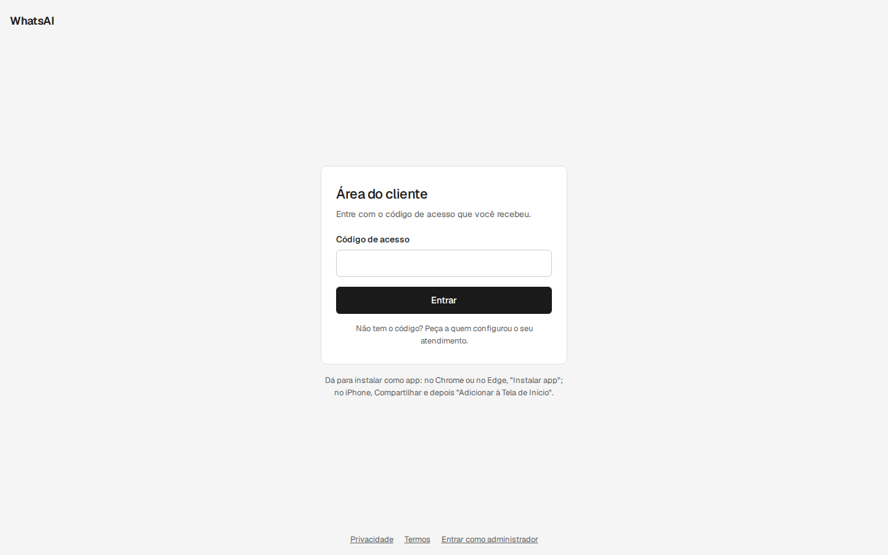
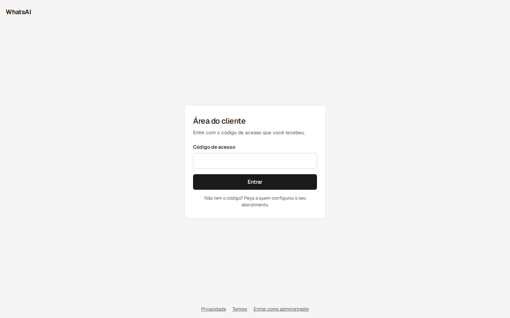
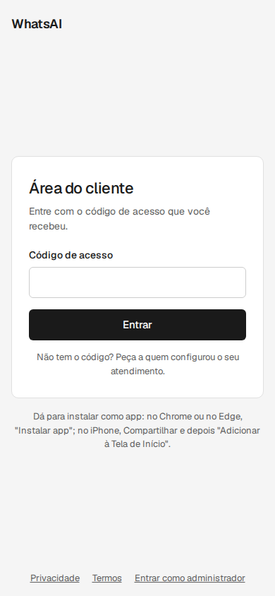
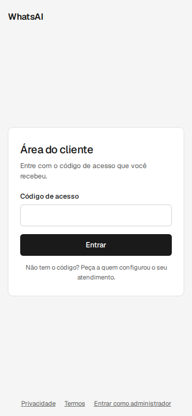
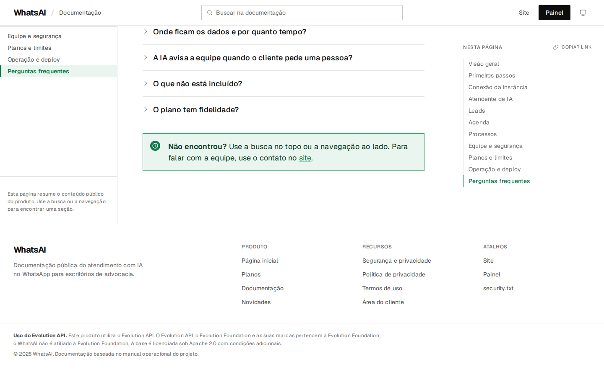
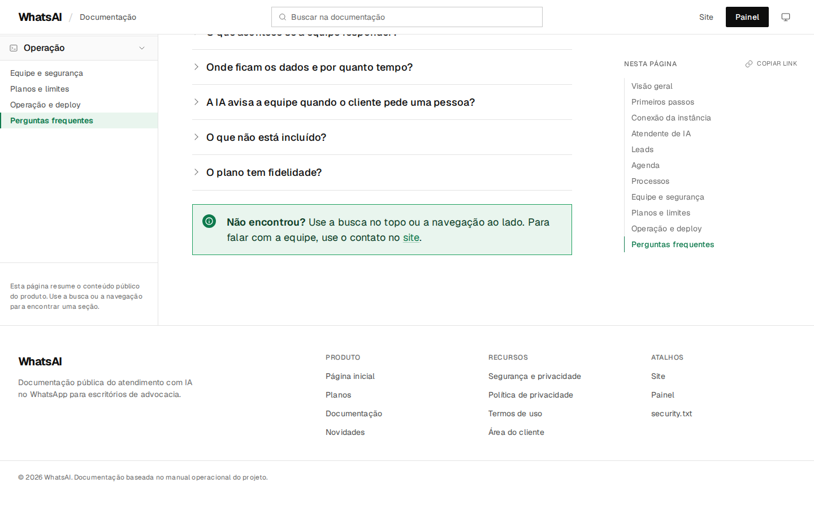
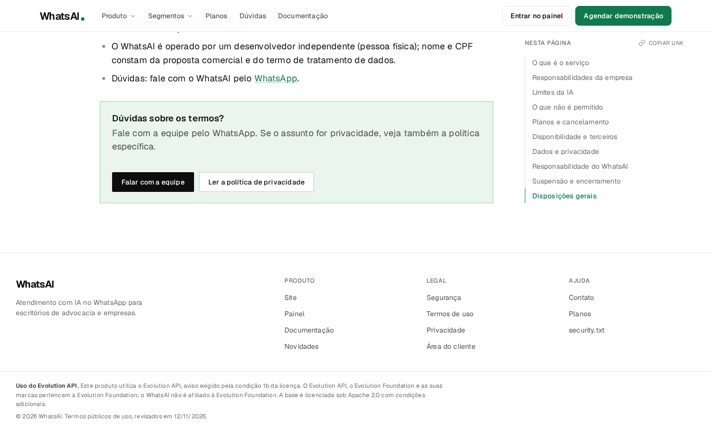
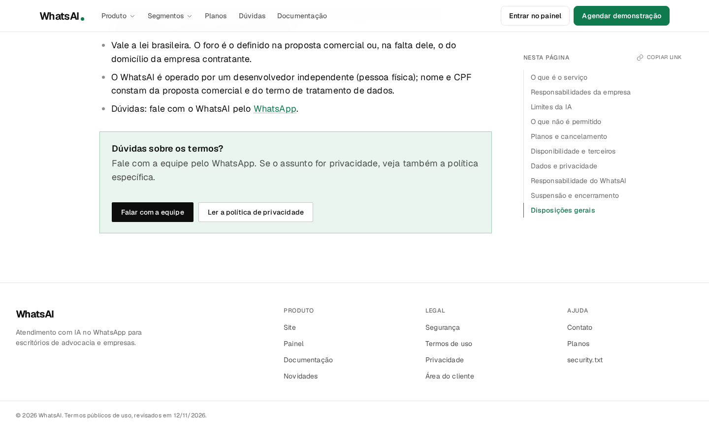

# Textos próprios no site, no acesso e no painel

Esta mudança tira das páginas públicas as descrições que citavam o fornecedor da base e as instruções para instalar o
site como aplicativo. O produto passa a se apresentar só como WhatsAI.

## O que mudou

- **Site, Termos, Privacidade, Segurança e Documentação:** saem as menções ao fornecedor da base e o aviso de licença
  do rodapé. O rodapé fica só com o copyright.
- **Termos de uso:** a frase sobre software livre deixa de nomear o fornecedor.
- **`/acesso`:** saem o botão "Instalar o app", a nota que ensinava a instalar e o código de `beforeinstallprompt`.
- **Acesso do cliente no painel:** a mensagem pronta para o cliente não tem mais o passo de instalar como app; a
  dica da Conexão chama o aparelho de "aparelho do WhatsAI", não pelo nome do fornecedor.
- **Catálogo de integrações:** a descrição do bot deixa de dizer "Bots do Evolution API" e passa a "Bots de
  atendimento do WhatsAI".
- **CSP:** o hash do script inline de `/acesso` foi atualizado em `manager/dist/vercel.json`.

## Comparação

| Antes | Depois |
| --- | --- |
| `antes/acesso-1440.png` e `antes/acesso-390.png` | `depois/acesso-1440.png` e `depois/acesso-390.png` |
| `antes/docs-rodape-1440.png` | `depois/docs-rodape-1440.png` |
| `antes/termos-rodape-1440.png` | `depois/termos-rodape-1440.png` |

As capturas de "antes" são das páginas públicas em produção, feitas só com GET, sem login. As de "depois" são do
build local desta branch. Não há dado real de cliente nas imagens.

### Acesso em 1440 px

### Acesso em 390 px

### Rodapé da documentação

### Rodapé dos termos

## Aviso que continua

A condição 1b da licença da base exige um aviso claro, visível aos administradores e acessível pela documentação ou
configurações, de que o sistema usa a base licenciada. Por isso o aviso mínimo continua:

- no rodapé da lateral do painel, visível a administradores;
- no `README.md` e no `README-WHATSAI.md`.

Ele não aparece mais nas páginas públicas de marketing. Remover também o aviso do painel e do README só é possível com
uma licença comercial do fornecedor da base; sem ela, a remoção tira o projeto dos termos da licença atual.

## Recomendações

1. Manter o aviso mínimo no painel e no README enquanto a licença atual estiver em vigor. Se houver licença comercial,
   a remoção pode ser feita em uma mudança separada, com registro da licença.
2. O manifesto PWA de `/acesso` continua no HTML, mas sem botão nem instrução de instalação. Se a instalação não for
   mais desejada, remover também `manifest`, `apple-mobile-web-app-capable` e `apple-mobile-web-app-title` em uma
   próxima mudança.
3. O aparelho conectado pode continuar aparecendo no WhatsApp com o nome antigo porque `CONFIG_SESSION_PHONE_CLIENT`
   tem esse valor por padrão. Trocar para "WhatsAI" mexe na conexão do Baileys e só deve entrar depois de teste com um
   número de teste; não fazer isso na instância de produção atual.
4. O endereço da API ainda contém o nome do fornecedor no host do Render. Um domínio próprio para a API resolve isso
   sem mexer em código.
