# Tokens globais, tipografia e componentes

Esta proposta cria `manager/dist/assets/tokens.css` como fonte única de cor e tipografia das páginas públicas e faz a
landing usar os mesmos papéis de texto e a mesma geometria de componentes do `/docs`. A fonte é a Geist local em woff2,
já usada pela documentação; o que muda é a escala, o peso, o ritmo de cada tipo de texto e o formato dos controles e
cartões. As páginas de documentação, segurança, termos e privacidade continuam visualmente idênticas.

## Método

- Os valores de cor e tipografia foram extraídos do `manager/dist/docs/docs.css`, que já segue o padrão de documentação
  do Render com marca e textos próprios.
- O novo arquivo `assets/tokens.css` define os tokens `--c-*` (cor), `--font-*` (famílias) e `--type-*` (papéis de
  texto), no claro e no escuro, incluindo `html[data-theme-mode="dark"]` usado pelo `/docs`.
- `docs.css` e `landing-cursor.css` passam a apontar os tokens que já existiam (`--d-*` e `--wa-*`) para os tokens
  globais. Nenhum seletor de layout foi alterado na documentação.
- A landing usa os mesmos papéis do `/docs` para título, subtítulo, corpo, apoio, rótulo, cartão e botão.
- A geometria segue os mesmos valores do `/docs`: botões, selos e ícones com raio de 2 px; cartões e painéis com raio 0;
  altura padrão de botão de 40 px. As molduras de celular e os balões de conversa dos mockups continuam arredondados,
  porque representam o aparelho e o WhatsApp, não os componentes da página.
- O bundle da landing inclui `tokens.css`; `/docs`, `/seguranca`, `/termos` e `/privacidade` carregam
  `/assets/tokens.css?v=1` antes do `docs.css`.
- A fonte Geist continua local: `assets/fonts/geist-latin-wght-normal.woff2` e as variantes latin-ext e itálico, com
  `font-display: swap` e pesos de 100 a 900. O `geist.css` já aplica Geist a todos os elementos com `!important`.
- O preload da fonte foi padronizado em todas as páginas: `?v=1`, a mesma URL do `@font-face`; o link do
  `geist.css` ficou em `?v=3` em todas as páginas. O `perf-boot.py` passou a cobrir landing, novidades, legais e
  `/docs`, para o preload e a versão não divergirem de novo.
- Capturas com Playwright em 1440, 1024 e 390 px, temas claro e escuro, com dados fictícios.
- Sem marca, fonte, texto, imagem ou CSS de terceiro; sem requisição externa e sem script inline novo.

## Papéis de texto

| Papel | `/docs` | Landing antes | Landing depois |
| --- | --- | --- | --- |
| Título de página | `clamp(48px, 5vw, 64px)`, peso 300, entrelinha 1,05, tracking -0,025em | `clamp(28px, 3vw, 44px)`, peso 500, entrelinha 1,08, tracking -0,035em | Igual ao `/docs` |
| Título de seção | `clamp(32px, 3.3vw, 42px)`, peso 300, entrelinha 1,05, tracking -0,02em | `clamp(30px, 3.4vw, 48px)`, peso 500, entrelinha 1,08, tracking -0,035em | Igual ao `/docs` |
| Subtítulo interno | 28 px, peso 500, entrelinha 1,375, tracking 0,006em | `clamp(26px, 2.3vw, 33px)`, peso 500, entrelinha 1,2 | Igual ao `/docs` |
| Corpo de leitura | 18 px, entrelinha 1,5, tracking 0,01em | 15 a 17 px, entrelinha 1,55 | 18 px, entrelinha 1,5 |
| Apoio de cartão | 15 px, entrelinha 1,5 | 13 a 14 px | 15 px, entrelinha 1,5 |
| Título de cartão | 18 px, peso 500, entrelinha 1,3, tracking -0,01em | 14 a 21 px, peso 500 | 18 px, igual ao `/docs` |
| Rótulo, sobrancelha e cabeçalho de tabela | Mono do sistema, 12 px, peso 500, tracking 0,08em, caixa alta | Geist, 11 a 13 px, peso 500 ou 600 | Mono, 12 px, igual ao `/docs` |
| Metadados | 14 px, entrelinha 1,5 | 11 a 13 px | 14 px |
| Botão | 14 px, peso 500 | 14 px, peso 500 | Igual ao `/docs` |
| Link de ação | 14 px, peso 600 | 14 px, peso 500 | 14 px, peso 600 |
| Preço | Sem equivalente; usa o título de seção | 32 a 40 px, peso 550 | 32 a 42 px, peso 300 |
| Tabela comparativa | 16 px | 12 px | 14 px |
| Mockups do painel | Sem equivalente | 8 a 11 px | Mantidos: representam a interface, não o texto da página |

### Adaptações conscientes

- **Lead do herói:** no `/docs`, o lead é um subtítulo curto de 22 a 28 px. Na landing, o texto é um parágrafo longo;
  por isso ele usa o papel de corpo (18 px), não o de lead. O título segue exatamente o papel de título de página.
- **Título no celular:** o `/docs` usa `clamp(44px, 12vw, 56px)`. A landing usa `clamp(38px, 10.5vw, 48px)` porque o
  título dela é mais longo; o peso 300, a entrelinha 1,05 e o tracking continuam iguais. Os demais títulos de seção
  usam a mesma escala móvel do `/docs` (`clamp(30px, 8vw, 36px)`).
- **Componentes densos:** tabela, linhas de implantação e selos mantêm tamanhos menores para caber nos cartões. Os
  mockups continuam com a tipografia miúda de interface; eles simulam o painel, não o texto editorial.
- **Molduras de celular e balões:** continuam arredondados porque representam o aparelho e a conversa do WhatsApp. Os
  cartões, janelas, resumos, agendas e a linha do tempo dentro dos mockups passam a ter raio 0, como os cartões da
  documentação.

## Geometria dos componentes

| Componente | Antes na landing | Depois | `/docs` |
| --- | --- | --- | --- |
| Botão padrão | Pílula de 999 px, 44 px de altura | Raio 2 px, 40 px de altura, padding de 18 px | `.btn` com raio 2 px e 40 px |
| Botão pequeno (topo) | Pílula de 999 px, 32 px | Raio 2 px, 34 px | Topo com 34 px |
| Botão grande (herói e CTA) | Pílula de 999 px, 48 px | Raio 2 px, 44 px, padding de 22 px | Sem variante grande; mesmo formato |
| Links do topo e hover | Pílula de 999 px | Raio 2 px | Sem pílula |
| Botão do menu no celular | Círculo de 999 px | Quadrado de 44 px com raio 2 px | `.icon-btn` de 36 px com raio 2 px |
| Cartões, planos, canais e painéis | Raio 0 a 6 px | Raio 0 | `.entry-card` e `.fact` com raio 0 |
| Selos e chips | Pílula de 999 px | Raio 2 px | `.chip` com raio 2 px |
| Ícones e tiles | Raio 0 a 50% | Raio 2 px | `.entry-ico` e `.fact-ico` com raio 2 px |
| Molduras de celular | 26 px e 18 px | Mantidas | Sem equivalente |
| Balões de conversa | 6 px | Mantidos | Sem equivalente |

O foco visível continua com 2 px e o anel de foco no verde da marca; a sombra e as cores não mudaram nesta etapa.

## Fonte global

- Os arquivos ficam em `manager/dist/assets/fonts/`: `geist-latin-wght-normal.woff2` (29,4 KB),
  `geist-latin-ext-wght-normal.woff2` (16,5 KB), as duas variantes itálicas e `LICENSE-Geist.txt`.
- `geist.css` declara a família, o `font-display: swap`, a faixa de peso 100 a 900 e a regra global que aplica Geist a
  todos os elementos. Ele é carregado diretamente em `/docs`, nos legais, em `/acesso`, na Observabilidade e no painel,
  e entra no bundle da landing e de `/novidades`.
- O `<link rel="preload">` agora aponta para a URL exata do `@font-face` (`?v=1`), evitando baixar o mesmo arquivo duas
  vezes por URLs diferentes. O `geist.css` está em `?v=3` em todas as páginas; o `perf-boot.py` mantém a consistência.
- A fonte já era local e não havia CDN; a mudança corrige a versão do cache e o preload, que estavam divergentes entre
  painel, documentação e landing.

## Comparação

### 1440 px, tema claro

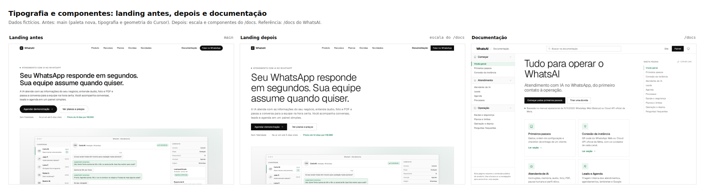

### 1440 px, tema escuro

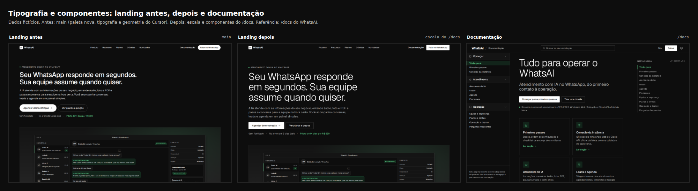

### 390 px, tema claro

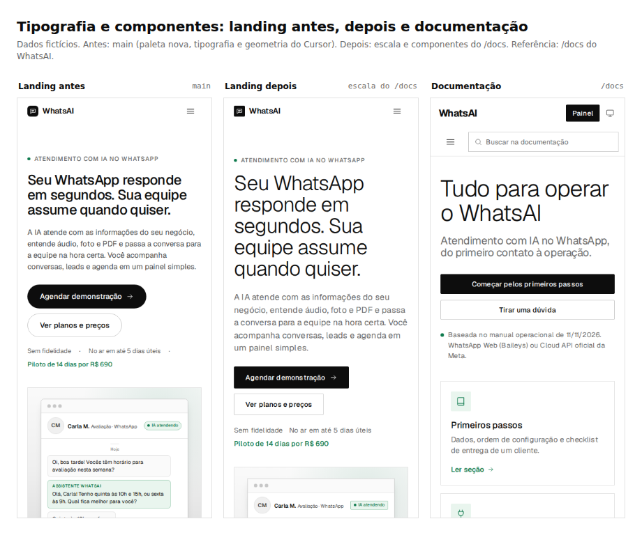

### 390 px, tema escuro

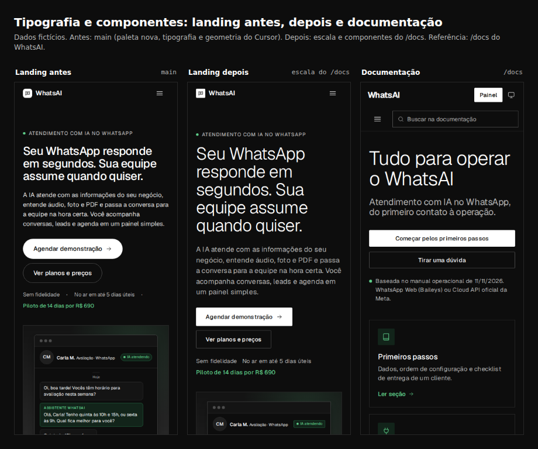

### Antes e depois no herói

| Antes | Depois |
| --- | --- |
| 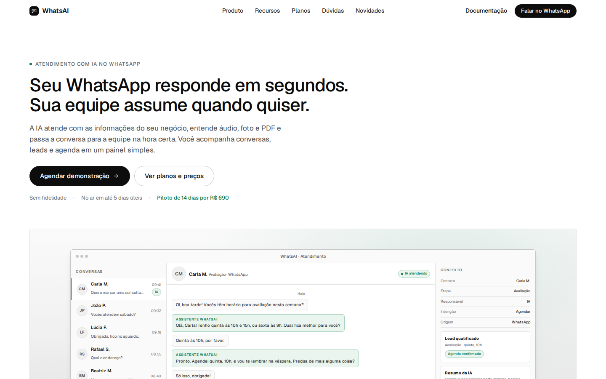 | 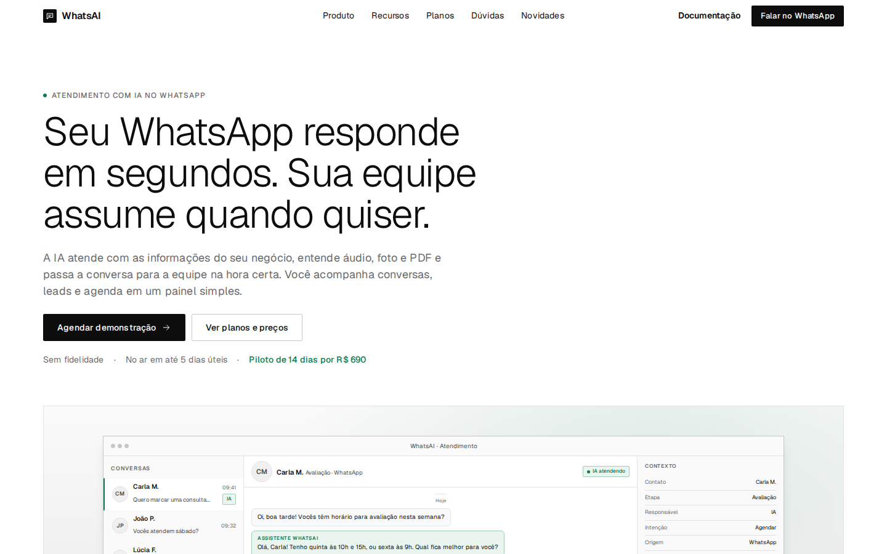 |
|  | 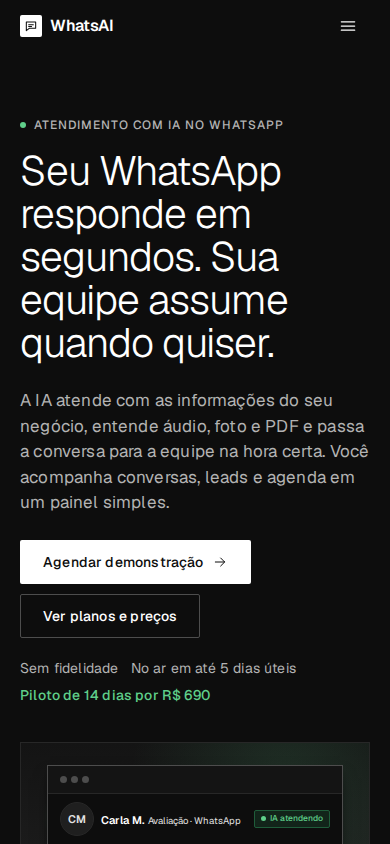 |

As páginas inteiras da landing estão em `antes/home-*-full.jpg` e `depois/home-*-full.jpg` (1440 e 390 px, claro e
escuro), para conferir o ritmo de todas as seções.

### Documentação e páginas legais

As capturas do `/docs` e de `/seguranca` foram comparadas byte a byte antes e depois do refactor: SHA-256 idêntico em
1440 e 390 px, claro e escuro. Isso confirma que a extração dos tokens não mudou a documentação nem as páginas legais.

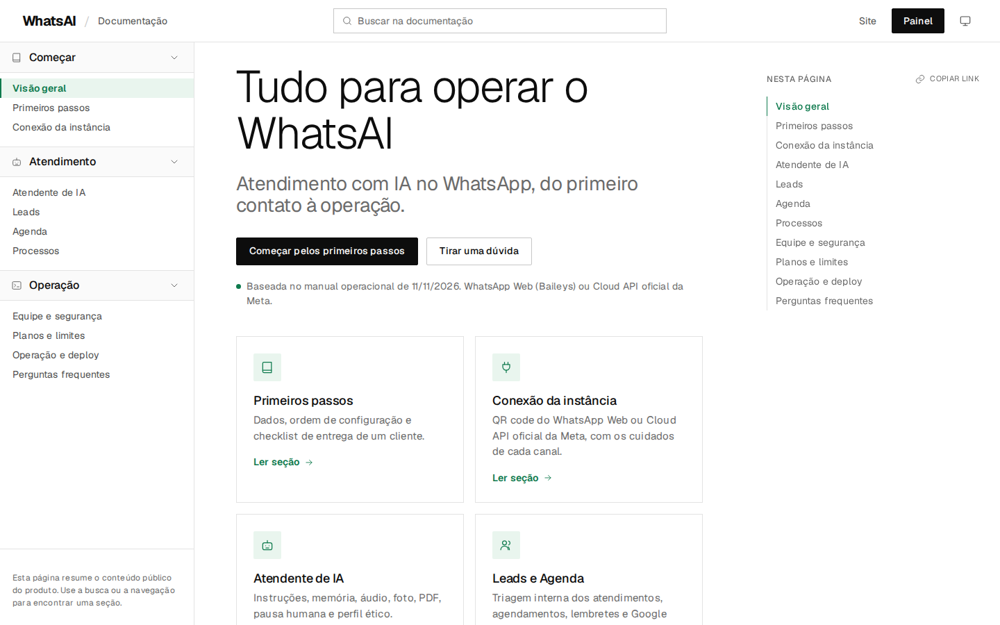
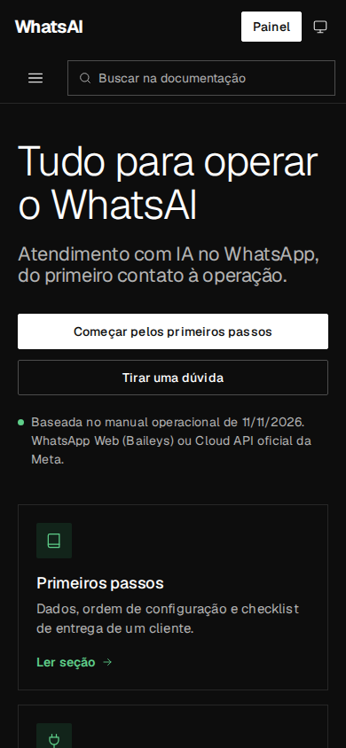

A página de segurança também ficou idêntica:

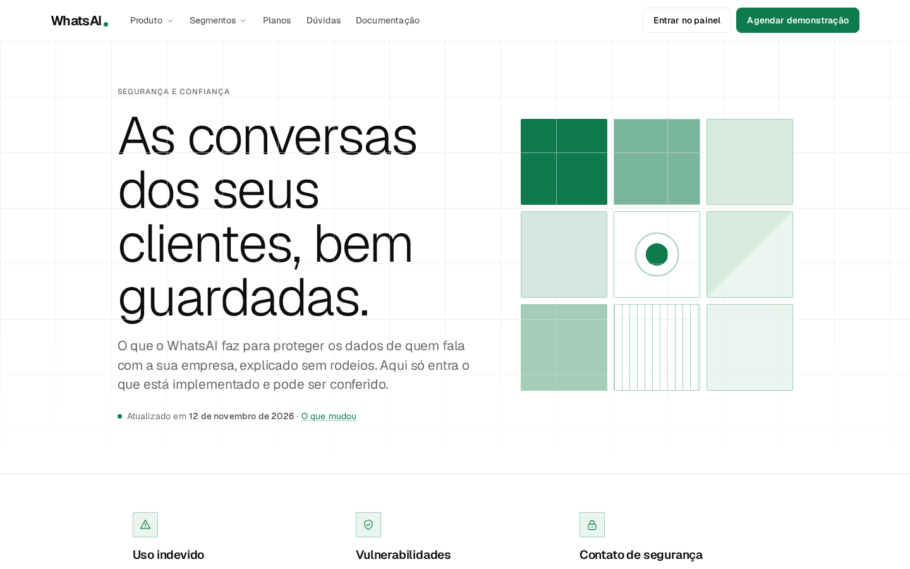
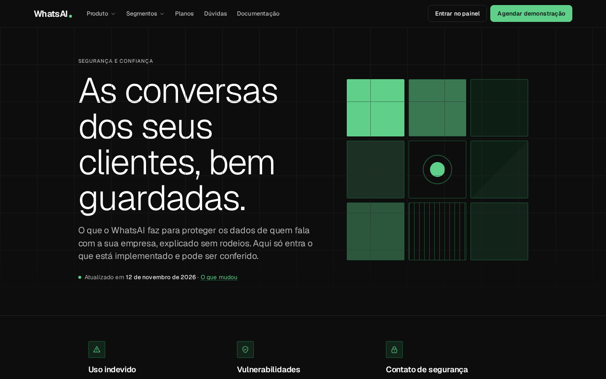

## Arquivos alterados

- `manager/dist/assets/tokens.css`: novo arquivo global de cor, fonte e escala tipográfica.
- `manager/dist/assets/landing-cursor.css`: tokens `--wa-*` apontando para os globais, papéis de texto e geometria de
  botões, cartões, selos e controles do `/docs`.
- `manager/dist/assets/landing.bundle.css`: bundle minificado reconstruído com `tokens.css`.
- `manager/patches/landing-css.mjs`: `tokens.css` incluído nas fontes do bundle.
- `manager/dist/docs/docs.css`: tokens `--d-*` apontando para os globais; blocos de cor escura removidos.
- `manager/dist/docs/index.html`: link do `tokens.css` e `docs.css?v=5`.
- `manager/dist/landing/index.html`, `novidades.html`, `seguranca.html`, `termos.html`, `privacidade.html`: link do
  `tokens.css`, `docs.css?v=5` e preload da fonte.
- `manager/dist/404.html`, `manager/dist/acesso/index.html`, `manager/dist/observability/index.html`: preload da fonte.
- `manager/patches/perf-boot.py`: preload e versão do `geist.css` em todas as páginas que usam a fonte.
- `readmes/pr/tokens-globais/`: este README e as capturas.

## Checagens

- `node manager/patches/landing-css.mjs --check` passa.
- `python3 -I manager/patches/perf-boot.py --check` passa.
- Mudança só estática (`manager/**` e `readmes/**`): o título do squash termina com `[skip render]`; não reinicia a API.
- Sem `src/`, `prisma/`, `Dockerfile` ou `render.yaml`; sem migration.
- Sem script inline novo; a CSP de `manager/dist/vercel.json` não muda.
- O GitHub Actions roda lint, Prettier, build, tipos, unitários, integração e patches do painel.

## Recomendações

1. Manter `assets/tokens.css` como a única fonte de cor e tipografia das páginas públicas. Um token novo entra ali,
   não em `docs.css` ou `landing-cursor.css`.
2. Migrar o `site-header.css` (`--sh-*`) e o `/acesso` para os tokens globais em um PR separado. O painel continua com
   os tokens `--m-*` próprios; misturar agora aumentaria o risco sem necessidade.
3. Se a documentação e a landing precisarem de escalas móveis diferentes, manter as media queries nos arquivos de
   página, como está; os tokens guardam os valores-base.
4. Não aplicar os papéis de texto da página aos mockups. Eles simulam a interface do painel e precisam continuar
   compactos para caber e para não parecer que o painel usa a tipografia editorial.
5. Incluir um teste de regressão visual com Playwright e comparação de pixels para `/docs` e as páginas legais. Hoje a
   prova foi feita nas capturas deste PR; um teste automático impede que um próximo refactor mude a documentação sem
   querer.
6. Depois do merge, conferir Lighthouse em `/` e `/seguranca` (meta de 100 nas quatro notas e 4/4 em navegação
   agêntica) e a instância `open` no Render, que fica com o Claude Code do dono.
